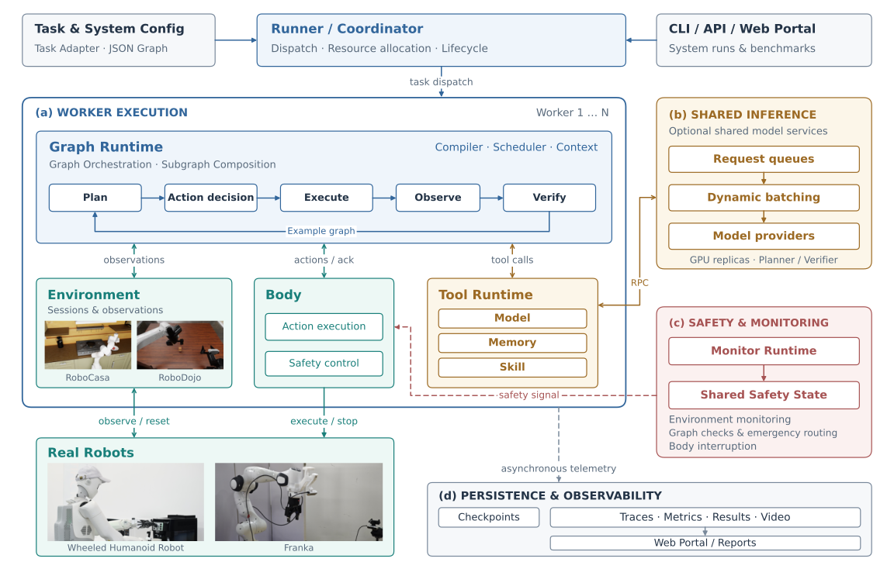

<h1 align="center"> RoboTenon</h1>

<p align="center"><strong>A modular runtime for executing and evaluating robot policies.</strong></p>

<p align="center"><a href="README.md"><strong>English</strong></a> · <a href="README.zh-CN.md" lang="zh-CN">简体中文</a></p>

RoboTenon takes its name from the tenon in a mortise-and-tenon joint. Its interfaces let you replace one part of a robot system and measure what changes. For example, you can run a vision-language-action (VLA) policy on its own, add a planner and verifier, and compare both systems on the same tasks with the same success criteria.

## Architecture

The coordinator reads the task configuration and workflow graph, then dispatches episodes to workers. Panel **(a)** follows one worker through its control loop. Panels **(b)–(d)** show where model requests, safety signals, and run data go.

[](docs/assets/diagrams/runtime-overview.svg)

- **(a) Worker execution.** The example graph plans, selects an action, sends it to the Body adapter, then reads a fresh observation from the Environment adapter to verify the outcome. Changing the graph changes the sequence. Physical robots connect through a device driver and an observation source.
- **(b) Shared inference.** Workers can send model requests to a shared service. It batches compatible requests and returns each prediction to the worker that requested it.
- **(c) Safety and monitoring.** Monitors publish findings to a shared safety state. The graph can route the episode to an emergency handler, and the Body adapter can interrupt an action already in progress.
- **(d) Experiment records.** Episode results capture the outcome. Traces and metrics show how it was reached. Runs can also save graph checkpoints and, with a supported environment, video.

The [RoboCasa example graph](extensions/benchmarks/systems/robocasa_hierarchical/configs/graphs.json) shows how the planner and verifier fit into one episode. The [architecture guide](docs/architecture.md) describes the interfaces between components.

## Run your first experiment

From the repository root on Linux or macOS, use Python 3.10 or later. The bundled CPU example runs three episodes in a test environment without model weights, a GPU, or robot hardware.

```bash
python3 -m venv .venv
source .venv/bin/activate
python -m pip install -e .

Tenon run --batch --config docs/tutorials/examples/cpu-demo.json \
  --run-id first-run --output-dir runs --save-traces
```

Open `runs/first-run/summary.json`. A successful run reports `num_completed` and `successes` as `3`, and `num_errors` as `0`. The [quickstart](docs/quickstart.md) shows how to inspect the traces and open the Web Portal.

## Documentation

| Goal | Start here |
| --- | --- |
| Build a policy workflow | [Graph execution](docs/workflow.md) · [Write a plugin](docs/plugin_development.md) |
| Connect a simulator or a robot | [First simulation](docs/tutorials/02-first-simulation.md) · [Physical robot integration](docs/tutorials/real-robot.md) |
| Evaluate a policy | [Benchmark guide](docs/benchmarks.md) · [RoboCasa365 and VLABench reference runs](docs/reference-runs.md) |
| Run and inspect experiments | [Python API](docs/tutorials/python-api.md) · [Shared model batching](docs/graph-batching.md) · [Results and traces](docs/tutorials/view-results.md) |

[Full documentation index](docs/README.md)
