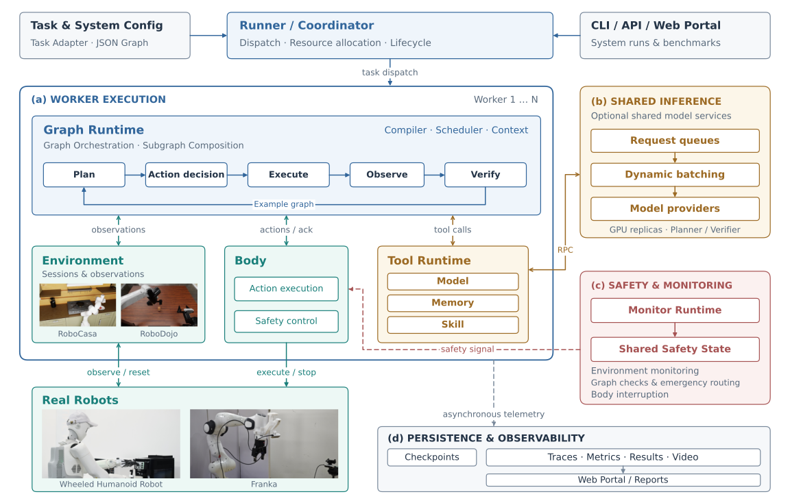

<h1 align="center"> RoboTenon</h1>

<p align="center"><strong>用于执行和评测机器人策略的模块化运行时。</strong></p>

<p align="center"><a href="README.md">English</a> · <a href="README.zh-CN.md" lang="zh-CN"><strong>简体中文</strong></a></p>

RoboTenon 的名字取自榫卯结构中的「榫头」。在机器人系统中，各组件同样通过明确的接口连接，可以单独替换，再用实验衡量变化。例如，先运行一个视觉–语言–动作（VLA）策略，再为它加入规划器和验证器，就可以在相同的任务和成功判据下比较两套系统。

## 系统架构

协调器读取任务配置和工作流图，将每次试验（episode）分派给 Worker。图 **(a)** 展开了一个 Worker 的执行闭环，图 **(b)–(d)** 分别展示模型请求如何处理、安全信号如何生效，以及运行数据如何记录。

[](docs/assets/diagrams/runtime-overview.svg)

- **(a) Worker 执行。** 示例工作流先规划、选择动作，再通过 Body 适配器执行，随后从 Environment 适配器读取新的观测，验证动作结果。调整工作流图就能改变这个顺序。接入真机时需要提供设备驱动和观测源。
- **(b) 共享推理。** 多个 Worker 可以向同一模型服务提交请求。服务将兼容的请求合批推理，再把每条预测发回对应的 Worker。
- **(c) 安全与监控。** 监控器把检测结果写入共享安全状态。工作流可以据此转入应急流程，Body 适配器也可以中断正在执行的动作。
- **(d) 实验记录。** 每次试验都有结果，执行轨迹和指标可用来还原运行过程。按需还可保存工作流检查点，并在环境支持时录制视频。

[RoboCasa 示例工作流](extensions/benchmarks/systems/robocasa_hierarchical/configs/graphs.json) 展示了规划器和验证器如何配合完成一次试验。组件之间的接口见[架构指南](docs/architecture.zh-CN.md)。

## 运行第一个实验

在 Linux 或 macOS 上，从仓库根目录使用 Python 3.10 或更高版本运行以下命令。内置 CPU 示例会在测试环境中完成三次试验，无需模型权重、GPU 或机器人硬件。

```bash
python3 -m venv .venv
source .venv/bin/activate
python -m pip install -e .

Tenon run --batch --config docs/tutorials/examples/cpu-demo.json \
  --run-id first-run --output-dir runs --save-traces
```

打开 `runs/first-run/summary.json`。运行成功时，`num_completed` 和 `successes` 均为 `3`，`num_errors` 为 `0`。查看执行轨迹和打开 Web Portal 的方法见[快速上手](docs/quickstart.zh-CN.md)。

## 文档导航

| 想做什么 | 从这里开始 |
| --- | --- |
| 编写策略工作流 | [工作流执行](docs/workflow.zh-CN.md) · [编写插件](docs/plugin_development.zh-CN.md) |
| 接入仿真器或真机 | [首次仿真](docs/tutorials/02-first-simulation.zh-CN.md) · [真机接入](docs/tutorials/real-robot.zh-CN.md) |
| 评测策略 | [评测指南](docs/benchmarks.zh-CN.md) · [RoboCasa365 与 VLABench 参考实验](docs/reference-runs.zh-CN.md) |
| 运行和分析实验 | [Python API](docs/tutorials/python-api.zh-CN.md) · [模型推理合批](docs/graph-batching.zh-CN.md) · [结果与执行轨迹](docs/tutorials/view-results.zh-CN.md) |

[完整文档索引](docs/README.zh-CN.md)
