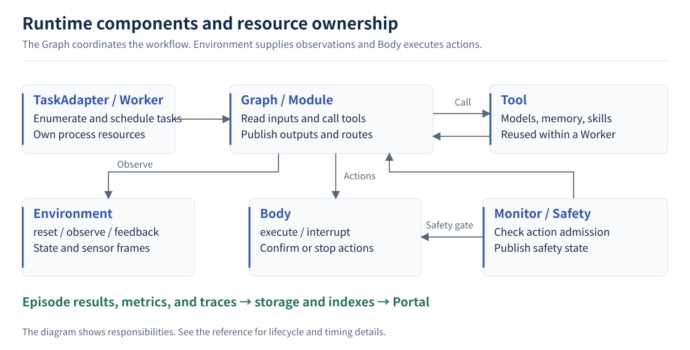
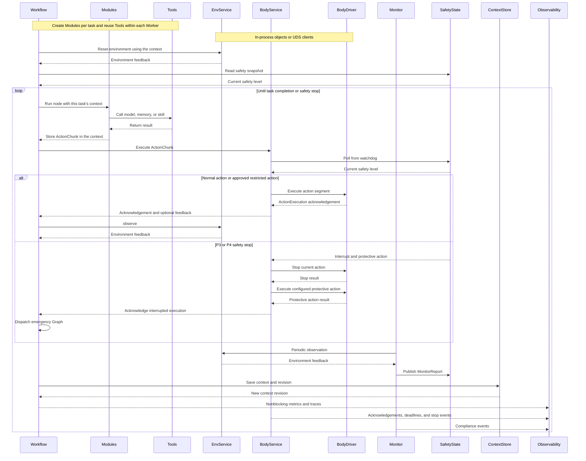

# RoboTenon architecture

[**English**](architecture.md) · [简体中文](architecture.zh-CN.md)

This guide describes component boundaries, execution, resource ownership, and persistence. See the [migration notes](changes/migration-2026-09.md) for compatibility details.

## 1. Component responsibilities and plugin registries



### 1.1 Communication during an Action/Feedback cycle

The diagram follows environment initialization, action execution, monitoring, and safety interruption. Env, Body, and Monitor can be in-process objects or UDS clients. Moving a service to another process preserves the message order.



Communication contracts:

- `GraphRuntime` orchestrates actions and produces `ActionChunk`. Only `BodyService` executes actions. It returns `ActionExecution` acknowledgements and keeps the driver outside Module code.
- `EnvironmentService` manages environment sessions and feedback. `MonitorService` reads `observe()` and publishes its findings without writing directly to `ctx` or TaskQueue.
- Workflow, Body, and Monitor share one `SafetyStateStore`. Both the Body watchdog and Graph safety checks consume P3/P4 signals; either may observe them first. Depending on configuration, the Graph dispatches an emergency graph or returns safety_stop.
- Workflow/GraphRuntime owns application state in `ctx`. `ContextStore` persists revisions using compare-and-swap (CAS). Env, Body, and Monitor receive only the request snapshot they need.
- Bounded nonblocking Metrics/Trace clients send telemetry to the configured writer, either a shared run service or an external daemon. Action execution need not wait for these writes.
- Monitor runs independently of the main Workflow loop. The diagram interleaves their messages for one cycle. The default uses cooperative asynchronous tasks in one process. A synchronous plugin can block the Body watchdog, so it cannot guarantee hard real-time interruption.

`MonitorRuntime` owns Monitor registration and lifecycle. An instance's `modes` may select
`resident`, `request`, or both. In dual mode, one instance uses a call lock to serialize periodic checks and
Workflow requests. A resident task polls `EnvironmentService.observe()` independently. Request-mode callers use
`MonitorRuntime.request(name, payload, feedback, context)` or the UDS `request` method to obtain a
`MonitorReport`. Reports and runtime errors both update the shared SafetyStateStore. The Body watchdog and
the Workflow's emergency Graph can therefore respond without knowing the Monitor implementation.

- GraphRuntime produces decisions and orchestrates nodes. JSON Graphs send actions through Body. EnvironmentService supplies feedback and observations.
- The resident Body executes ActionChunk, checks admission and deadlines, returns acknowledgements, and uses stop_executor to stop at the driver.
- Environment owns the Session and reports observed facts. Calling observe does not execute an action.
- Monitor periodically observes and publishes safety signals. A physical driver still requires an independent hardware watchdog.
- ToolRuntime manages resident capabilities such as models, Memory, and Skill. Workflow and Module code call them through
  `ctx.call_tool()` without constructing a new provider for every node.

The service protocol supports in-process implementations and same-host UDS. BodyServiceClient uses separate execution and control connections so interrupt and health calls do not wait behind a long execute call. Cancelling execute requests interruption through the control connection. RPC deadlines include time spent waiting for the request lock.

## 2. Source layout

| Location | Responsibility |
| --- | --- |
| schemas.py | Domain models for Action, Feedback, and Decision, plus the Pydantic compatibility layer |
| contracts/context.py | Serializable GraphContext and versioned checkpoint fields |
| contracts/execution.py | Task-local ExecutionFrame and conflict detection for explicit patches |
| contracts/module.py | GraphModule、NodeResult、ModuleContext/ModuleResult |
| contracts/service_context.py | Compact request snapshots for service reset/check |
| contracts/serialization.py | Strict JSON encoding |
| workflow/compiler.py | Graph references, plugin capability validation, edge normalization, successor indexes, and configuration fingerprints |
| workflow/conditions.py | Restricted expression validation, parse cache, and evaluation |
| workflow/scheduler.py | Activations, waves, joins, loop invalidation, and recovery cursors |
| workflow/runtime.py | Run assembly, node invocation, emergency Graphs, and recovery policies |
| workflow/operations.py | Environment, Body, and Monitor operations and action admission |
| workflow/recovery.py | Incident deduplication and automatic/manual recovery polling |
| runtime/safety.py | Signal merging, latching, recovery, and SafetyGate rules |
| storage/ | SQLite safety state, context/CAS, and action acknowledgements |
| modules/, runtime/factory.py | Module registration, plugin lifecycle, configuration, and dependency assembly |
| bodies/, runtime/factory.py | Body registration, selection of one Body service, lifecycle, and dependency injection |
| tools/, runtime/factory.py | Tool registration, instantiation, lifecycle, and model/memory/skill calls |
| services/ | Environment/Body/Monitor service、Supervisor、UDS |
| envs/ | EnvironmentAdapter registration, handles, and Session protocols |
| monitors/ | Monitor registry, resident/request runtime, and report normalization |
| infra/ | Out-of-band metrics, traces, Recorder, and events |
| web/ | Server, query, Grafana, page, and static assets |
| extensions/ | Optional Dataset, Release, Deployment, Memory, and Skill facilities |

tests/test_architecture_boundaries.py checks dependency rules. Contracts are independent of workflow, module containers, and concrete services. Services and storage do not depend on workflow. The scheduler needs no knowledge of SQLite or UDS.

## 3. One scheduler inside a Graph

JSON predecessors/next and legacy edges use WaveScheduler. The backend names langgraph/fallback remain for compatibility. Installing LangGraph does not select another execution algorithm.

The compiler validates Graph references, module run support, the predecessor DAG, and conditions before converting edges to next. Use one edge format per Graph. Conditions support ctx lookups, literals, logic, and comparisons. Function calls, private attributes, and arbitrary code are disallowed.

Nodes released together by ordinary next/goto edges share a batch read snapshot and select successors after the batch succeeds. Self-loops use independent batches and may advance while a slow sibling runs. When a next join becomes ready, it invalidates the target's old self-loop. Invalidation and ctx publication use the same commit lock; the new invocation starts after the old one exits. A goto skips original predecessors. A loop targets its own node. For next joins, the outer predecessor list means AND and a nested group means OR. A flat list requires every predecessor. A back-edge clears stale arrival tokens. Routing generations prevent obsolete in-flight calls from spawning successors. Duplicate triggers during execution coalesce into one follow-up call. END closes the current route. graph.stop atomically commits the Graph's termination marker and cancels all branches. See [Workflow](workflow.md) for syntax and concurrency rules.


## 4. Shared state and parallel execution

A Run uses one GraphContext and one set of service references. Subgraphs share application state. ExecutionFrame isolates the Graph path, node position, call stack, and event step of each asyncio branch. Concurrent invocations may reuse the same subgraph without triggering false recursion errors. Actual recursion is rejected.

Recommended form for new modules:

```python
from robotenon.modules import NodeResult

class Prepare:
    async def run(self, ctx):
        return NodeResult(output={"plan": "pick"}, state_patch={"ready": True})
```

NodeResult.state_patch carries explicit updates. Conflicting patches to one key in a wave fail. Legacy modules may still write ctx.values or return a dictionary. They must use nonoverlapping keys where applicable. Parallel execution does not provide a general shared-mutable-state transaction.

outputs[node_id] preserves the legacy last-value view. scoped_outputs distinguishes Graph path, node, and activation number. Node history events record their path and independent step. `history` and `scoped_outputs` are bounded diagnostic windows with a default limit of 2,048 entries each. Evictions increment dropped counts. Long runs should send complete application histories to Recorder/Trace.

## 5. Graph persistence and recovery

This integration requires an explicitly enabled ContextStore. Batch Coordinator crash recovery is separate. The caller supplies graphs, modules, env, body, safety, and session_id in this example.

SQLiteContextStore saves the Run's JSON checkpoint and uses context_revision for CAS. The current checkpoint_version is 1. graph_fingerprint covers the Graph definition and a digest of module manifest metadata and parameters. The file schema supports Pydantic 1 and 2. Unknown versions, corrupt models, and nonserializable objects fail explicitly.

Each Graph invocation persists pending work and triggers, batches and read snapshots, invalidation markers, wave, done/completed records, arrivals, generations, and execution counts. It persists input before starting a batch and commits each node result atomically with done. Subgraph cursors are released after the parent node commits.

```python
from robotenon.core.context import SQLiteContextStore
from robotenon.workflow import GraphContext, GraphRuntime

store = SQLiteContextStore("runs/context.sqlite3")
runtime = GraphRuntime(graphs, modules, context_store=store, safety_state=safety)
from robotenon.envs import bind_environment
bind_environment(env)
result = await runtime.run("main", GraphContext(session_id=session_id), body=body)
# After restart, an empty ctx with the same session_id loads the cursor and state.
```

Committed nodes are skipped. An interrupted node may retry, so external side effects must be idempotent or reconcilable. Durable successful Body acknowledgements are deduplicated by session/idempotency_key. A crash after physical execution but before acknowledgement persistence still leaves an ambiguity.

Legacy in-flight checkpoints contain a graph_stack but no cursor. Explicitly start a new Run or perform application-level recovery. A changed Graph or module configuration cannot resume its old cursor directly. Integrators own version metadata for changes to their Python modules.

## 6. Safety and recovery

| Level | Behavior |
| --- | --- |
| P0 | Normal operation |
| P1 | Monitor |
| P2 | SafetyGate restricts permitted action types and can require an approval flag |
| P3 | Stop ordinary actions and execute protective handling |
| P4 | Low-level stop and hardware fail-safe |

In-memory and SQLite implementations use the same merge_signal rules. An unacknowledged latched signal can escalate. An ordinary update with the same name cannot lower or clear it. Recovery at higher levels requires approved=True. clear(include_latched=True) is an explicit administrative operation for a controlled reset or test cleanup.

GraphRuntime merges safety decisions returned by modules in EvaluationDecision. A SafetyGate can be injected into both GraphRuntime and Body so P2 restrictions apply at orchestration and final execution.

Emergency Graph dispatch is serialized within a Run. Parallel nodes do not cancel another node's active emergency handling. emergency_graphs/recovery configuration remains compatible with RecoveryController. The default emergency Graph leaves the resident Environment open so recovery can continue using the same Session.

## 7. Assembly and resource ownership

Extend execution backends, storage, and RPC streams through execution_registry, storage.registry, and services.transports. These sit below the six application plugin families. Registration metadata determines assembly behavior. See [infrastructure plugins](infrastructure-plugins.md).

Normal package imports use lazy exports without starting threads or opening databases. Module, Tool, Body, Environment, Monitor, and TaskAdapter each have their own registry. Configuration loading imports plugins explicitly. Spawned children must also be able to import those modules.

WorkerRuntime owns ToolRuntime. For each task, the Runner creates an EnvironmentAdapter/Session and assembles observation resources, Body, Module, Monitor, and GraphContext. At task end, it releases task resources and calls each Tool's end_session. It closes ToolRuntime when the Worker ends. For optional external resident Environment or Body services, the deployment must define ownership of connections and service resources. Body execution authority is independent of model capabilities exposed as Tools.

ROBOTENON_SAFETY_DB is resolved on the default safety facade's first use. ROBOTENON_CONTEXT_DB is resolved at GraphRuntime assembly. In production, inject stores explicitly so Workflow, Body, Monitor, and Supervisor use the same path. Short-lived SQLite connections close after each transaction.

ModuleRuntime cleans up in reverse order on partial startup failure or cancellation. Supervisor releases services after startup failure and continues shutting down other services if one close fails. Body manages the action ledger within its own lifecycle.

ToolRuntime cleans up in reverse order after partial startup. Resolve tools by configuration ID or registered string. If several configured instances share a registration string, the ambiguous alias is disabled. The application bootstrap closes ToolRuntime; an individual Workflow run leaves it open so weights, connection pools, and Memory databases are reusable across runs. Bootstrap also binds the environment service to the `robotenon.envs.environment` singleton. Graph modules receive only `ctx` and read parameters from `ctx.params`.

Remote ServiceContext carries only session/task/feedback/safety/values/revision, omitting Graph cursor and history. Metrics and Trace use bounded clients. Web static files ship as package data, and page.render_page assembles the server response for single-page compatibility.

## 8. Experiment execution and observability sources

The parent enumerates TaskCase records, dispatches work, and writes global status and summaries. Both `in_process` and `process` use the same task lifecycle. The process backend spawns resident Workers that each run one task at a time. Configuration declares GPU/EGL bindings and exclusive resources. State and artifacts are isolated by attempt. Workers receive equal shares of the physical GPU pool, and each Tool deployment selects a subset by local ID. The Worker owns each model subprocess and binds its dedicated endpoint.

A resident Tool does not make Environment, Module, or GraphContext shared across tasks. Explicit snapshot/sequential/disabled policies control cross-task memory. See [execution and observability](execution-and-observability.md).

Web reads an explicit ObservabilitySource: Trace uses SQLite or JSONL and Metrics uses JSONL. Parallel Workers can share one writer, while an independent task can have its own store. Web uses the same data contract for either entry point. Identity includes experiment/run/episode/attempt/task/adapter/worker/gpu. A task_id alone cannot identify a retry.

The runtime supports bounded retries after Worker loss, cancellation, and Worker recycling. It does not automatically take over after a Coordinator crash. Bounded telemetry buffers do not guarantee zero loss after a crash or exactly-once delivery. Process-failure tests need separate validation on the target GPU or robot.

| Location | Execution responsibility |
| --- | --- |
| runtime/execution.py | Execution options, serial backend, same-user/same-host resource locks |
| runtime/parallel.py | Resident children, dispatch, timeouts, retries, and recycling |
| runtime/worker.py | Tool reuse and per-task resource lifecycle |
| task_adapters/evaluator.py | Enumeration, scheduling, and deterministic aggregation |
| runtime/observability.py | Execution identity, data sources, shared writers, and read-only Web |
| infra/trace_query.py | Read-only SQLite connections and query restrictions |

See the [documentation index](README.md), [plugin development guide](plugin_development.md), and [validation record](changes/verification-2026-09.md).

The safety backend operates independently of the Monitor switch. The Runner uses the registered MonitorRuntime. Under the default shared scope, the safety store keeps its explicit path. Only task scope relocates it under the resource root. A remotely bound full Portal requires a token and validates Host and request origin. See [execution and observability](execution-and-observability.md).

See the [module guide](module-guide.md) for inputs, outputs, configuration, and examples. The [evaluation and monitoring guide](evaluation-monitoring-and-task-queue.md) defines Evaluator and Monitor responsibilities and the scope of a global interrupt. TaskQueue is not the default execution scheduler.

## 9. Infrastructure extension points

The Runner and batch entry point use the same backend factory. They assemble resources according to local_worker/managed_workers/shared_observability capabilities. Application startup uses a shared resource container. Resources created from configuration are released on failure and normal exit. Injected safety state and Tools remain caller-owned. Custom observation modalities travel through the public protocol and ObservationRef. Roles, capture policy, and safety-level semantics stay common across implementations.

Environment RPC forwards reset/observe/health and other environment calls across processes. The stream transport is replaceable. Body still executes actions. Built-in UDS, SQLite, and process Workers remain available. Additional network protocols, schedulers, or databases require plugins; their extension points alone do not imply multi-host execution.
