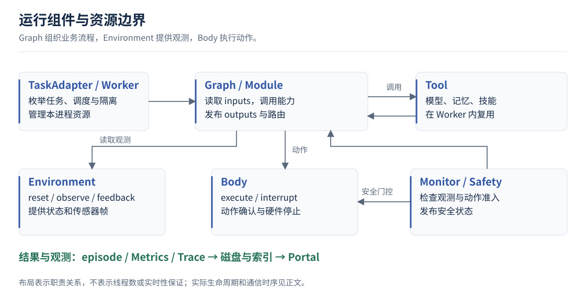
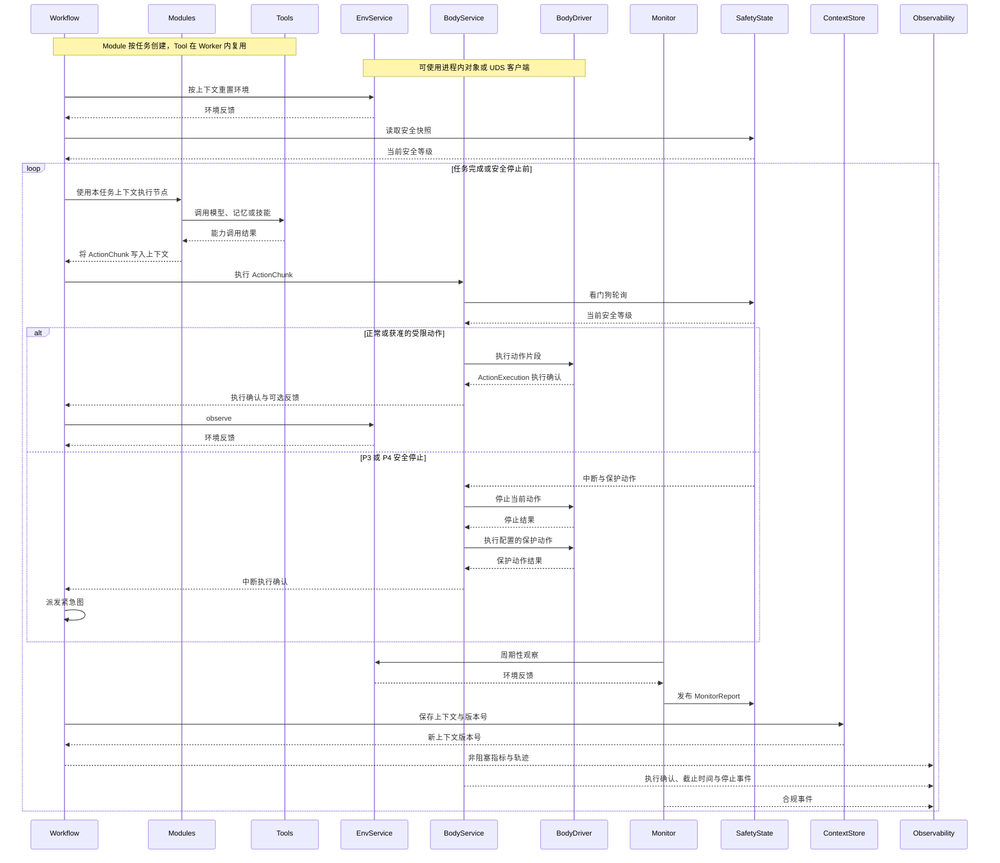

# RoboTenon 架构

[English](architecture.md) · [**简体中文**](architecture.zh-CN.md)

本文说明组件边界、执行流程、资源所有权与持久化。版本兼容事项见[迁移说明](changes/migration-2026-09.zh-CN.md)。

## 1. 职责边界与插件注册表



### 1.1 详细通信时序图：一次 Action/Feedback 周期

下面的时序图描述从环境初始化到动作执行、监控和安全中断的路径。Env、Body、Monitor 可以是进程内对象，也可以是 UDS Client；换成跨进程 Client 不改变消息顺序。



通信约束：

- `GraphRuntime` 是动作编排方，只生成 `ActionChunk`；`BodyService` 是唯一动作执行边界，返回 `ActionExecution` ack，不把驱动对象暴露给 Module。
- `EnvironmentService` 只负责环境会话和反馈；`MonitorService` 只读 `observe()` 并发布合规结论，不直接修改 `ctx` 或 TaskQueue。
- Workflow、Body、Monitor 共享同一个 `SafetyStateStore`；P3/P4 分别被 Body watchdog 与 Graph 安全检查消费；二者的观察顺序不保证，Graph 根据配置派发 emergency graph 或返回 safety_stop。
- `ctx` 的业务状态由 Workflow/GraphRuntime 持有并通过 `ContextStore` 做 revision/CAS 持久化；Env、Body、Monitor 只接收必要的请求快照。
- Metrics/Trace 通过有界、非阻塞客户端送入配置的写入端（运行内共享服务或外部 daemon），不进入 Action 的同步关键路径。
- 图中的 Monitor 消息与 Workflow 主循环在实现上是独立任务，时序图按一次周期交错展示；默认是同进程的协作式异步任务，同步阻塞插件仍可能阻塞 Body watchdog，不能据此承诺硬实时中断。

`MonitorRuntime` 是 Monitor 的注册/生命周期边界。每个配置实例的 `modes` 可以是
`resident`、`request` 或两者；双模式不会复制实例，而是由一个调用锁串行化周期调用和
Workflow 请求。resident 任务独立轮询 `EnvironmentService.observe()`，request 调用通过
`MonitorRuntime.request(name, payload, feedback, context)` 或 UDS 的 `request` 方法返回
`MonitorReport`。报告及运行错误都写入共享 SafetyStateStore，因此 Body watchdog 与
Workflow 的 emergency graph 无需知道 Monitor 的具体实现。

- GraphRuntime 生成决策、编排节点。所有 JSON 图都通过 Body 发动作，EnvironmentService 只负责反馈/观测。
- Body 常驻执行 ActionChunk、检查动作准入和 deadline、返回 ack，并通过 stop_executor 执行低层停止。
- Environment 持有 Session、提供事实反馈；observe 不隐式执行动作。
- Monitor 周期观察并发布安全信号；真实驱动仍需独立硬件 watchdog。
- ToolRuntime 独立管理模型、Memory、Skill 等常驻能力；Workflow/Module 只通过
  `ctx.call_tool()` 调用，不在每个节点重复构造 provider。

服务协议支持进程内实现和同主机 UDS。BodyServiceClient 内部区分执行连接和控制连接，interrupt/health 不排在长 execute 之后；取消 execute 会通过控制连接请求中断。RPC 总超时包含请求锁等待。

## 2. 代码职责

| 位置 | 职责 |
| --- | --- |
| schemas.py | Action/Feedback/Decision 等领域模型与 Pydantic 兼容层 |
| contracts/context.py | 可序列化 GraphContext、版本化 checkpoint 字段 |
| contracts/execution.py | task-local ExecutionFrame、显式 patch 写入冲突检测 |
| contracts/module.py | GraphModule、NodeResult、ModuleContext/ModuleResult |
| contracts/service_context.py | 服务 reset/check 的小型请求快照 |
| contracts/serialization.py | 严格 JSON 编码 |
| workflow/compiler.py | 图引用与插件能力校验、edges 归一化、后继索引和配置指纹 |
| workflow/conditions.py | 受限表达式验证、解析缓存和求值 |
| workflow/scheduler.py | 激活、wave、join、循环失效规则、恢复游标 |
| workflow/runtime.py | Run 装配、节点调用、紧急图与恢复策略编排 |
| workflow/operations.py | env/body/monitor 系统操作及动作准入 |
| workflow/recovery.py | incident 去重、自动/人工恢复轮询控制器 |
| runtime/safety.py | 安全合并、锁存、恢复和 SafetyGate 规则 |
| storage/ | SQLite safety、context/CAS、action ack 实现 |
| modules/、runtime/factory.py | Module 注册、插件生命周期、配置与依赖装配 |
| bodies/、runtime/factory.py | Body 注册、单一本体服务选择、生命周期与运行时依赖注入 |
| tools/、runtime/factory.py | Tool 注册、实例化、生命周期与 model/memory/skill 调用 |
| services/ | Environment/Body/Monitor service、Supervisor、UDS |
| envs/ | EnvironmentAdapter 注册、环境句柄与 Session 协议 |
| monitors/ | Monitor 注册表、resident/request 双模式运行时与安全报告归一化 |
| infra/ | 指标、Trace、Recorder、事件等旁路 |
| web/ | server、query、grafana、page 和 static 资源 |
| extensions/ | Dataset/Release/Deployment/Memory/Skill 等可选能力 |

依赖规则由 tests/test_architecture_boundaries.py 检查：contracts 不依赖工作流、模块容器或具体服务；services 和 storage 不依赖 workflow；scheduler 不感知 SQLite/UDS。

## 3. Graph 内的统一调度内核

JSON predecessors/next 和旧 edges 都使用 WaveScheduler。旧 backend 名称 langgraph/fallback 保留兼容；安装 LangGraph 不再切换执行算法。

编译器先验证图引用、模块 run 能力、前驱 DAG 和条件，再将 edges 转成 next。不能混用两种格式。条件允许 ctx 查找、字面量、逻辑与比较；不允许调用、私有属性或任意代码。

普通 next/goto 同时释放的节点以 batch 共享读取快照，全部成功后选择后继；self-loop 使用独立 batch，可在慢分支运行时持续推进。next 汇合满足后作废目标的旧 self-loop，失效与 ctx 发布共用提交锁，旧调用退出后才启动新调用。goto 不等待原前驱，loop 只能指向自己。next 汇合使用外层 AND、内层 OR 的两层 predecessor 组；一维列表仍是严格 AND。回跳清除旧凭据，路由代次阻止旧在途调用派生失效后继。执行中的重复请求保留一次后续调用。END 仅结束当前路由，graph.stop 原子提交当前图终止标记后取消所有分支。详细语法与并发边界见 [Workflow](workflow.zh-CN.md)。


## 4. 共享状态与并行契约

一次 Run 使用同一个 GraphContext 和同一组服务引用。业务状态不会在子图间复制；每个 asyncio 分支的图路径、节点位置、调用栈和事件 step 由 ExecutionFrame 隔离。子图重复调用不会被其他分支误判为递归，真实递归仍被拒绝。

新模块推荐：

```python
from robotenon.modules import NodeResult

class Prepare:
    async def run(self, ctx):
        return NodeResult(output={"plan": "pick"}, state_patch={"ready": True})
```

NodeResult.state_patch 是显式状态更新；同一 wave 多个 patch 写同一 key 会失败。旧模块直接写 ctx.values 或返回 dict 仍兼容，必须使用互不重叠的 key，不能把并行执行当成任意共享可变状态的事务。

outputs[node_id] 保留旧的最后值视图；scoped_outputs 按图路径、节点和激活编号区分输出。history 的节点事件也包含路径与独立 step。`history`/`scoped_outputs` 是有界诊断窗口（默认各 2048 条/项，超限淘汰并累计 dropped 计数），长期 Run 应将完整业务日志写到 Recorder/Trace。

## 5. Graph 持久化与恢复

本节是显式启用 ContextStore 的集成能力，不代表批量 Coordinator 支持崩溃恢复。示例中的 graphs、modules、env、body、safety 与 session_id 由调用方提供。

SQLiteContextStore 保存整个 Run 的 JSON checkpoint，用 context_revision 做 CAS。checkpoint_version=1；graph_fingerprint 包含图定义和模块清单元数据/参数摘要。当前文件 schema 支持 Pydantic 1/2；未知版本、损坏模型或不可序列化对象会明确失败。

每个图调用保存 pending/触发来源、batches/读取快照/失效标记、wave、done、completed、arrivals、generation 与执行计数。发起 batch 前持久化输入；节点结果与 done 原子提交。子图游标在父节点提交后回收。

```python
from robotenon.core.context import SQLiteContextStore
from robotenon.workflow import GraphContext, GraphRuntime

store = SQLiteContextStore("runs/context.sqlite3")
runtime = GraphRuntime(graphs, modules, context_store=store, safety_state=safety)
from robotenon.envs import bind_environment
bind_environment(env)
result = await runtime.run("main", GraphContext(session_id=session_id), body=body)
# 进程重启后，同 session_id 的空 ctx 会加载游标和状态。
```

已提交节点不重放；中断中的节点可能重试。因此副作用操作必须幂等或可对账。Body 的持久化成功 ack 按 session/idempotency_key 去重，不能消除“物理动作完成、ack 尚未持久化”的故障窗口。

旧在途 checkpoint 只有 graph_stack 没有游标，必须由调用方明确选择新 Run 或做业务恢复，运行时不会猜测。更换图或模块配置后不能直接续跑旧游标。手写模块的代码升级仍由集成方维护版本元数据。

## 6. 安全与恢复

| 等级 | 行为 |
| --- | --- |
| P0 | 正常 |
| P1 | 监控 |
| P2 | SafetyGate 可配置允许动作类型与批准标记 |
| P3 | 停止普通动作，执行保护性处理 |
| P4 | 低层停止与硬件 fail-safe |

内存和 SQLite 共享 merge_signal 规则。未确认的锁存信号允许升高等级，普通同名更新不能降级或解除锁存。高等级恢复要求 approved=True；clear(include_latched=True) 是显式管理接口，应仅用于受控复位/测试清理。

GraphRuntime 会合并模块返回 EvaluationDecision 的安全结论。GraphRuntime 与 Body 均可注入 SafetyGate，使 P2 限制覆盖控制入口和最终动作边界。

同一 Run 的紧急图派发串行化；并行节点不会取消另一个节点正在执行的紧急处理。emergency_graphs/recovery 的配置与 RecoveryController API 保持兼容。默认紧急图不关闭 resident Environment，确保恢复继续使用同一 Session。

## 7. 装配与资源生命周期

执行后端、存储和 RPC 流传输分别通过 execution_registry、storage.registry、services.transports 扩展；它们与六类业务插件分层，注册元数据决定装配行为。完整契约见[基础设施插件](infrastructure-plugins.zh-CN.md)。

普通包导入使用懒导出，不启动线程或创建数据库。Module、Tool、Body、Environment、Monitor、TaskAdapter 分属六类注册表。配置加载后显式导入插件；spawn 子进程需能再次导入这些模块。

统一 Runner 使用 WorkerRuntime 持有 ToolRuntime。每个任务创建 EnvironmentAdapter/Session，装配观测资源、Body、Module、Monitor 和 GraphContext，结束后释放任务资源并调用 Tool 的 end_session；Worker 结束才关闭 ToolRuntime。外部常驻环境/本体服务是可选集成方式，其连接与服务资源的所有权需由部署方明确。Body 执行权限与 Tool 的模型能力相互独立。

ROBOTENON_SAFETY_DB 在默认安全 facade 首次使用时解析；ROBOTENON_CONTEXT_DB 在 GraphRuntime 装配时解析。生产装配优先显式注入 store，确保 Workflow、Body、Monitor、Supervisor 指向同一路径。SQLite 短连接在事务后确定性关闭。

ModuleRuntime 对部分启动失败与取消做逆序清理。Supervisor 启动失败清理服务，关闭某服务失败时继续关闭其他服务。Body 的 action ledger 在自身生命周期内管理。

ToolRuntime 对部分启动失败做逆序清理；工具实例由配置 ID 或注册字符串解析，同一注册字符串配置多个实例时自动关闭模糊别名。ToolRuntime 由应用 bootstrap 负责关闭，Workflow 单次 Run 不会关闭它，保证跨 Run 复用模型权重、连接池和 Memory 数据库。环境服务同样在 bootstrap 中绑定到 `robotenon.envs.environment` 单例；图 Module 只接收 `ctx`，参数从 `ctx.params` 读取。

远程 ServiceContext 仅传 session/task/feedback/safety/values/revision，不传图游标和历史。Metrics/Trace 有界客户端设计保持不变；Web 静态资源作为 package-data 打包，服务端由 page.render_page 组装以保持单页面兼容。

## 8. 实验执行与观测数据源

父进程枚举 TaskCase、分派任务并统一写入全局状态和汇总。`in_process` 与 `process` 都使用统一任务生命周期；进程后端通过 spawn 启动常驻 Worker，每个 Worker 一次只执行一个任务。GPU/EGL 绑定和独占资源由配置声明，任务状态与产物按 attempt 隔离。物理 GPU 池按 Worker 均分，Tool deployment 用局部编号选择子集；模型子进程由 Worker 持有并回填独立端点。

Worker 内 Tool 常驻不代表 Environment、Module 或 GraphContext 跨任务共享。跨任务记忆通过明确的 snapshot/sequential/disabled 策略控制，详细语义见[执行与统一观测](execution-and-observability.zh-CN.md)。

Web 只读取显式 ObservabilitySource：Trace 是 SQLite/JSONL，Metrics 是 JSONL。并行入口可以为所有 Worker 配置共享写入端，独立任务可以配置任务库；Web 不分辨启动来源。身份包含 experiment/run/episode/attempt/task/adapter/worker/gpu，不能仅依赖 task_id 区分重试。

当前支持 Worker 丢失后的受限重试、取消与进程回收；不支持 Coordinator 崩溃后的自动接管。遥测有界缓冲不保证崩溃零丢失或 exactly-once。进程故障测试不替代真实 GPU 和硬件验证。

| 位置 | 执行层职责 |
| --- | --- |
| runtime/execution.py | 执行选项、串行后端、同用户同主机资源锁 |
| runtime/parallel.py | 常驻子进程、任务分派、超时、重试与回收 |
| runtime/worker.py | Tool 复用和每任务资源生命周期 |
| task_adapters/evaluator.py | 枚举任务、调度和确定性汇总 |
| runtime/observability.py | 执行身份、数据源、共享写入端和只读 Web |
| infra/trace_query.py | SQLite 只读连接和查询约束 |

参阅[文档索引](README.zh-CN.md)、[插件开发](plugin_development.zh-CN.md)、[验证记录](changes/verification-2026-09.zh-CN.md)。

安全后端独立于 Monitor 开关；Runner 使用注册的 MonitorRuntime。安全库默认 shared 保留显式路径，task 作用域才允许按资源根目录重定位。完整 Portal 对远程绑定要求令牌，并校验 Host 与请求来源，细节见[执行说明](execution-and-observability.zh-CN.md)。

各模块的输入输出、配置和例子见[模块使用手册](module-guide.zh-CN.md)。Evaluator、Monitor 的职责与“全局中断”的准确范围见[专题说明](evaluation-monitoring-and-task-queue.zh-CN.md)；TaskQueue 当前不是默认执行调度器。

## 9. 基础设施扩展边界

Runner 与批量入口共用后端工厂，按 local_worker/managed_workers/shared_observability 能力执行资源装配。应用启动采用同一资源容器，配置创建的资源在失败和正常结束时释放，外部注入的安全状态与 Tools 保留调用方所有权。自定义观测模态通过公共协议和 ObservationRef 传递；角色、捕获策略、安全等级等运行语义保持统一。

Environment RPC 是对 reset/observe/health 等环境服务接口的跨进程调用；流传输可替换，动作仍由 Body 执行。内置 UDS、SQLite、process Worker 的具体实现保留，新的网络协议、调度或数据库由插件提供，不等同于已经实现多机运行。
