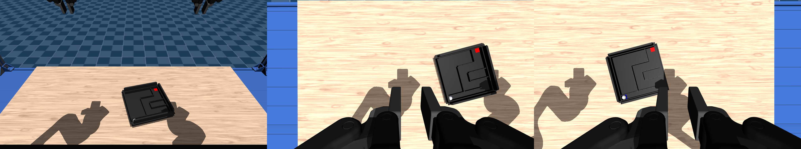
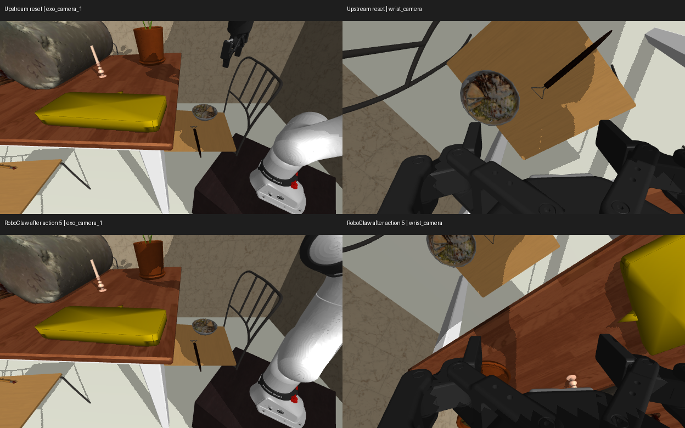
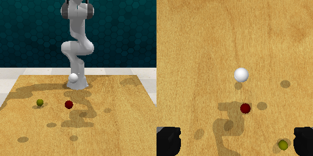
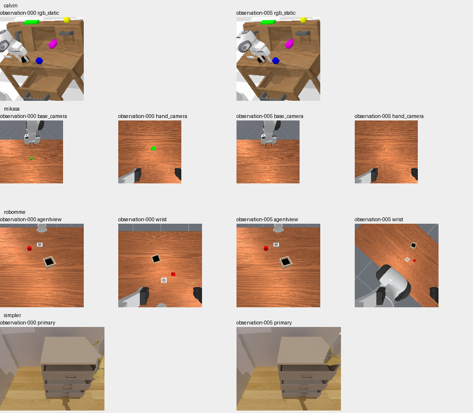
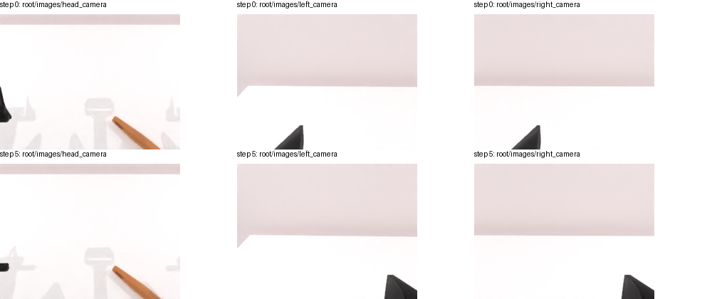
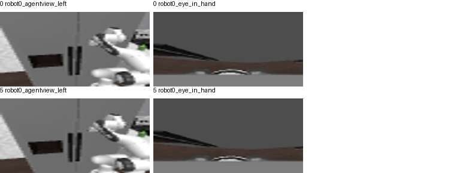

# Native action differential validation — 2026-09-28

[**English**](native-action-parity-2026-09-28.md) · [简体中文](native-action-parity-2026-09-28.zh-CN.md)

## Conclusion

**All 20 benchmarks are source-aligned, but complete simulation/evaluation parity is not established.** All 18 non-Isaac benchmarks were exercised against both upstream and the real RoboTenon Graph. Fourteen unmodified/default pairs matched exactly on the selected two-seed, five-action cases; VLABench also matched with its opt-in seed adapter. DuoBench and MolmoSpaces match state and signals with only upstream-repeat-level RGB quantization variability. RoboCasa365 retains an unresolved reset difference. This is not an all-task, full-horizon or score reproduction result.

Reference: `allenai/vla-evaluation-harness@6cc3e1bd9fc4bed26fb0a3aabd342c5fed11ca09`; remote `main` still resolved to this commit during verification. RoboTenon baseline: `680e3676364cab519e41627ad7833a15946aad2e`, plus the separately described VLABench opt-in seed adapter in the working tree, on `codex/independent-benchmark-extensions`.

## Method and acceptance criteria

- Each side runs in a separate process, using the **same installed simulator, assets, parameters and renderer**. This isolates integration differences; it does not certify that every installed dependency matches the upstream container recipe.
- Upstream runs its actual `SyncEpisodeRunner`; RoboTenon runs `run_experiment`, its five-node Graph, `native_sync`, real extension Environment/Body/TaskAdapter and lossless observation transport. Only the policy is fake.
- One selected task, one episode per process, seeds **0 and 11**, and **five explicit actions** per case. Initial observation plus five post-action observations are captured. The first action component is multiplied by `1, 1, -1, 0, 1`; other components remain unchanged. Complete parameters/action vectors are in [cases](native-action-parity-2026-09-28/cases/).
- Compare task metadata, actual action calls, observation keys/shapes/dtypes/values, policy inputs, accessible physical state, step reward/done/info, and final native metrics. Physical-state capture is best effort; simulator-specific hidden state is not comprehensively serialized.
- For RGB, compare both each frame and the signed difference `frame[t+1] - frame[t]`. Exact means byte-for-byte equality, with no tolerance. Every tested pair also had at least one changing camera after every action; this does not require every camera to change or imply every possible action must produce visible motion.
- These short runs do not establish positive-success detection, natural termination for every task, complete multi-episode replay, or official aggregate scores. In particular, RoboCasa365's five-step truncation precedes its configured 16-step success check and eight-step environment horizon.

## All 20 benchmarks

| Benchmark | Source audit | Real differential result |
| --- | --- | --- |
| BEHAVIOR-1K | Pass | Isaac simulation deferred by user |
| CALVIN | Pass | Both seeds: exact frames, frame changes and captured values; first selected sequence |
| DuoBench | Pass | Both seeds: actions, exposed state, metadata and metrics equal; RGB differs by at most 1/255 |
| Kinetix | Pass | Both seeds: exact frames, frame changes and captured values; sync/pixel mode only |
| LIBERO | Pass | Both seeds: exact frames, frame changes and captured values |
| LIBERO-Mem | Pass | Both seeds: exact with upstream step recording enabled; see recorder issue below |
| LIBERO-Plus | Pass | Both seeds: exact frames, frame changes and captured values |
| LIBERO-Pro | Pass | Both seeds: exact frames, frame changes and captured values |
| ManiSkill2 | Pass | Both seeds: exact frames, frame changes and captured values; PickCube-v0 |
| MIKASA | Pass | Both seeds: exact frames, frame changes and captured values; RememberColor3 |
| MolmoSpaces | Pass | Both seeds: task/action/state/reward/info/metrics equal; RGB differs by at most 1/255, also seen in upstream self-repeat |
| RLBench | Pass | Both seeds: exact frames, frame changes and captured values; reach_target |
| RoboCasa (original) | Pass | Both seeds: exact frames, frame changes and captured values; v0.2 OpenDrawer |
| RoboCasa365 | Pass | Reset/base-position and intermittent macOS rendering differences remain unresolved |
| RoboCerebra | Pass | Both seeds: exact frames, frame changes and captured values; Ideal/case1 |
| RoboDojo | Pass | Isaac simulation deferred by user |
| RoboMME | Pass | Both seeds: exact frames, frame changes and captured values; BinFill |
| RoboTwin | Pass | Both seeds: exact frames, frame changes and captured values; grab_roller/demo_clean |
| Simpler | Pass | Both seeds: exact frames, frame changes and captured values; google_robot_open_top_drawer |
| VLABench | Pass | Both seeds exact with optional extension seed against explicitly seeded upstream; default remains unseeded |

## Differences and diagnostics

### DuoBench: one-unit RGB variability also occurs upstream against itself

Both seeds completed all five actions with valid head and wrist images, readable native success/progress, and matching captured state, timestamps and step metadata. Cross-side RGB maximum absolute error is **1**, and the maximum fraction of differing image channels per compared frame is **0.000120443** (about **0.0121%**). Signed frame differences are therefore not strictly identical.

A same-seed repeat of upstream also differs by at most one RGB unit. This supports rendering variability as an explanation, without proving every differing pixel has that cause. Do not report this as byte-exact parity. See [self-repeat evidence](native-action-parity-2026-09-28/self-repeat.json).



### MolmoSpaces: state exact, one-unit GPU RGB variability

Both seeds completed the real `DummyPickPlaceEvalConfig` task through upstream and
the RoboTenon Graph: reset, five explicit 8-D joint actions, six observations, and
both exocentric and wrist cameras. Task metadata, actions, 8-D state, step count,
reward, done/info fields and native success match. Every action changed both camera
images. Cross-side RGB differs by at most **1/255**; the largest differing-channel
fraction in one frame is **0.000931794** (about **0.0932%**).

Repeating upstream alone with the same seed also differs by at most 1/255, with a
largest differing-channel fraction of **0.000934829** (about **0.0935%**). This
supports renderer quantization variability as the cause, so the result is not
reported as byte-exact. The run used MolmoSpaces v0.2.0, resource package 0.0.1b4,
MuJoCo 3.5 and the official v2 Franka pick-and-place benchmark. The installed
Objaverse version is `20260131`, newer than the benchmark-recorded
`20251016_from_20250610`; upstream emits the same warning on both sides. This asset
version limitation must be resolved before claiming official score reproduction.

The extension now accepts an optional `resource_manifest` native parameter. It
applies the same resource-version map in the isolated task enumerator and rollout
process; without this handoff Graph enumeration can fall back to MolmoSpaces's
packaged defaults even when the parent process was pinned.



### VLABench: default reset is not reproducible

Default pairs differ at the initial image, before any policy action. Repeating upstream alone also produces a different initial image. The installed `LM4ManipDMEnv` reaches dm_control Composer without an explicit `random_state`; its own NumPy RandomState is not fixed by seeding global NumPy/Python RNGs.

A diagnostic wrapper passes `random_state=seed` to the real Composer environment on **both** sides, without replacing physics, observations or actions. Both seeds then match exactly, including all five frame deltas. This proves equivalence for those controlled initializations, **not default-run parity**. The VLABench extension now offers an optional `seed` parameter that seeds the real Composer constructor and scopes Python/NumPy RNG changes to environment creation. The default remains unseeded. Both seeds passed against an explicitly seeded upstream reference using this production extension; this does not establish default-run parity.

### RoboCasa365: seed 0 discrepancy remains unresolved

Seed 0 has different base positions already at reset (about **2.013 m** maximum difference) and visibly different RGB. Seed 11 matched in the initial default test, but later experiments also exposed intermittent corrupted RGB on macOS/GLFW. Repeating each side separately reproduces its own result; this differs from the VLABench case and cannot be dismissed as ordinary run-to-run randomness.

An additional experiment supplies the seed at wrapper construction on both sides. It does not solve seed 0; seed 11 also has later differences under that experimental setup. Thus constructor seeding alone is **not a demonstrated fix**. Investigation must cover environment construction/import order, reset state and RNG consumption before claiming parity.

### LIBERO-Mem: upstream NullEpisodeRecorder incompatibility

Upstream LIBERO-Mem accesses `self._recorder._next_step`, but upstream `NullEpisodeRecorder` does not supply that field. The initial upstream no-recording run failed after the first action. The accepted differential runs enable the **real upstream EpisodeRecorder with step recording**, video disabled. RoboTenon's compatibility recorder already provides the field. This is a documented difference in recorder behavior; it is not proof of no-recording or SQLite/video artifact parity.

## Hosts and simulator scope

- Local macOS: LIBERO family, RoboCerebra, Kinetix, RoboCasa365, VLABench. Existing per-simulator environments are reused. LIBERO-family runs retain `NUMBA_DISABLE_JIT=1`. RoboCasa365 uses installed RoboCasa 1.0.1, robosuite 1.5.2 and MuJoCo 3.3.1; camera size is 64. VLABench uses MuJoCo 3.2.2 / dm_control 1.0.22. These choices are test scope, not edits to formal profiles.
- Linux server: isolated environments for ManiSkill2, DuoBench, RLBench, CALVIN, MIKASA, RoboMME, Simpler, RoboTwin and MolmoSpaces. MolmoSpaces uses Python 3.12, MolmoSpaces v0.2.0, resources 0.0.1b4, MuJoCo 3.5 and JAX. One NVIDIA A100 is selected. The existing `model-runtime` package set was not modified.
- RLBench, PyRep and CoppeliaSim assets came from local image digest `ghcr.io/allenai/vla-evaluation-harness/rlbench@sha256:87e57e8061cd7b11aec4d2de51e09709742fbc406d535f8a0a948abecb5cf1b6`. Source git directories were absent in the extracted image; this does not independently attest their source commit. CoppeliaSim OpenGL3 plugin was enabled; Xvfb/xcb and missing X11 libraries were supplied. This resolved the prior local black-frame issue. Academic/educational noncommercial licensing was accepted earlier by the user.



## Evidence and checks

- Static check: **20 extensions, 28 native AST comparisons and 4 shared contracts passed**, after documented import rewrites. This is adapter source equivalence, not simulator binary equivalence.
- Support/extension regression command below: **242 tests passed**.
- [Local comparisons](native-action-parity-2026-09-28/local-comparison.json), [server comparisons](native-action-parity-2026-09-28/server-comparison.json), [controlled-reset diagnostics](native-action-parity-2026-09-28/controlled-comparison.json).
- [Local frame-delta checks](native-action-parity-2026-09-28/local-image-changes.json), [server frame-delta checks](native-action-parity-2026-09-28/server-image-changes.json), [controlled frame-delta checks](native-action-parity-2026-09-28/controlled-image-changes.json).
- Full local NPZ/JSON traces remain in the task workspace under `outputs/action-parity-final`, `outputs/action-parity-remote` and `outputs/action-parity-controlled`. Server traces, including MolmoSpaces upstream-repeat evidence, remain under `/path/to/deployment/results`. Large simulation assets/traces are not added to Git.

```sh
python extensions/benchmarks/benchmark-support/scripts/verify_sources.py . /path/to/pinned/upstream
python -m pytest -q extensions/benchmarks/benchmark-support/tests tests/test_benchmark_extensions.py tests/test_robocasa_extension_boundary.py
```

## Reproducing a pair

Use the selected simulator's environment, install RoboTenon plus support and that extension, and install upstream's runner dependencies. Make both upstream `src` and `extensions/benchmarks/benchmark-support/scripts` importable. Set renderer/asset environment variables as required by that simulator. Copy one recorded case, updating machine-specific asset paths. Run both sides in separate processes with identical environment variables and `PYTHONHASHSEED=0`:

```sh
python extensions/benchmarks/benchmark-support/scripts/parity_probe.py --case results/libero/seed-0/case.json --side upstream --output results/libero/seed-0/upstream
python extensions/benchmarks/benchmark-support/scripts/parity_probe.py --case results/libero/seed-0/case.json --side robotenon --output results/libero/seed-0/robotenon
python extensions/benchmarks/benchmark-support/scripts/compare.py results
python extensions/benchmarks/benchmark-support/scripts/image_changes.py results
```

The comparison scripts write machine-readable results; inspect their statuses (they do not enforce a CI exit-code gate). `controlled_reset=true` explicitly enables the diagnostic initialization wrappers for VLABench/RoboCasa365 and must not be confused with unmodified defaults. VLABench has an opt-in reproducibility adapter. RoboCasa365 cleanup/GC experiments did not pass repeated real runs reliably and were removed from the production extension. Diagnostic traces remain in the task workspace.

## Additional server validation

CALVIN, MIKASA, RoboMME and Simpler now pass both seeds, including all five signed image deltas. Camera previews were inspected and contain real task scenes rather than blank frames.



MIKASA required a correction to the **test harness**: import Torch before seeding it, because its cue/hide durations use `torch.randint`. No MIKASA production adapter changed. The upstream probe now calls `get_metadata()` before enumerating tasks, matching the upstream orchestrator.

These server installations use isolated environments: MIKASA uses Torch 2.2.1 / ManiSkill 3.0.0b15 / SAPIEN 3.0.0b1; Simpler uses the extracted official ManiSkill2_real2sim stack; CALVIN uses PyBullet 3.2.7 and EGL; RoboMME uses its pinned ManiSkill fork and Torch 2.6.0. They are paired integration tests, not a claim that every package matches an upstream image. CALVIN's source checkout needed local Git metadata for its runtime version inspection. MolmoSpaces uses real offline NLTK corpora and a local official download index; no simulation data is fabricated.

### Follow-up diagnostics (not acceptance passes)

RoboCasa365 experiments covered constructor seeding, disabling cyclic GC, and restoring the owning GLFW context before freeing old MuJoCo render resources. Some runs matched both seeds, but repeat runs still showed RGB corruption. The experimental production wrapper was therefore withdrawn. Neither initial placement nor rendering is certified fixed. Diagnostic result roots include `action-parity-casa-production`, `action-parity-casa-production-repeat`, `action-parity-casa-combined` and `action-parity-casa-gl-state` in the task workspace. The probe's `safe_gl_finalizer` and `reference_render_guard` flags modify the reference and are diagnostic-only.

VLABench's accepted opt-in adapter evidence is separate from the earlier experiment: [seeded comparisons](native-action-parity-2026-09-28/vlabench-seeded-comparison.json), [seeded image deltas](native-action-parity-2026-09-28/vlabench-seeded-image-changes.json).

### RoboTwin follow-up

`grab_roller` / `demo_clean` passed both seeds with exact camera arrays and all five image deltas. The selected clean scene uses the official embodiment/object packs; the large background-texture download is incomplete and was paused after this case passed. Settings are `skip_expert_check=true`, `fast_init=true`, `fast_render=false`. These flags retain the native ray-traced renderer while skipping expert feasibility and planner warmup for the action-interface test. The server uses pinned RoboTwin source, CuRobo v0.7.8 compiled for A100, SAPIEN 3.0.0b1, Torch 2.2.1, and Warp 1.6.0; Torch differs from the upstream container recipe. Pytorch3D is not installed; this selected qpos path completed without it. Images contain very bright clean-scene surfaces on both sides; this is a pixel-equality result, not a photometric-quality certification.



### RoboCasa v0.2 follow-up

The required v0.2 source (`756598a5be52e052339bb2d957426e39015c2afb`) and robosuite 1.5.0 (`dc7fcf9fa6cdf0796f79b4c873166a8fb9fe8c9e`) now pass `OpenDrawer` with both seeds and all five frame deltas. The isolated local runtime uses MuJoCo 3.2.6, NumPy 1.23.5, Numba 0.57.1 (JIT disabled), SciPy 1.10.1 and the official fixture, texture and Objaverse archives. Default object sampling uses Objaverse; the upstream installer also skips the optional AI-generated object pack. Camera size is 64, horizon is 8, and the five fixed actions retain the official evaluation-scene distribution.

[Comparisons](native-action-parity-2026-09-28/robocasa-v02-comparison.json), [image deltas](native-action-parity-2026-09-28/robocasa-v02-image-changes.json).



RoboCasa365's initially installed commit was `a07e365c958c4216cd6bbd5f30b47f09a65c6f00`, despite reporting version 1.0.1. It was retested at the exact upstream `b4684e6ee37d377cc392e98302a6b916d588b415`; robosuite already matched upstream `5ce6643f3092639d08f7b0f90ed1c6a84f50552c`. The commit correction alone did not remove the intermittent macOS rendering differences.
