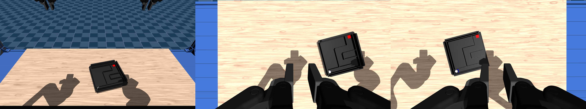
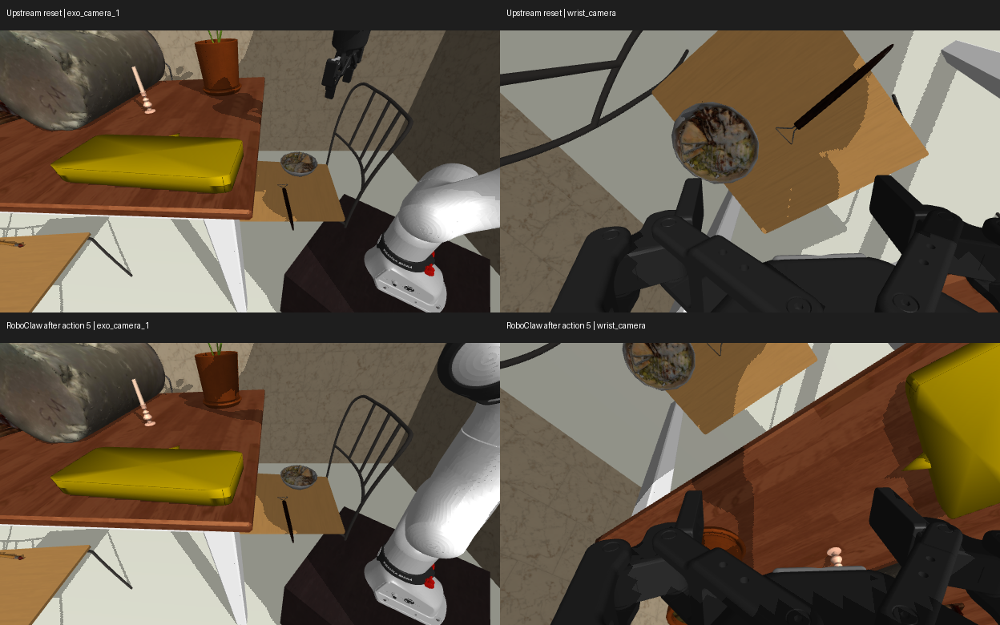
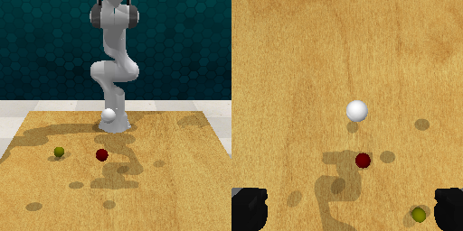
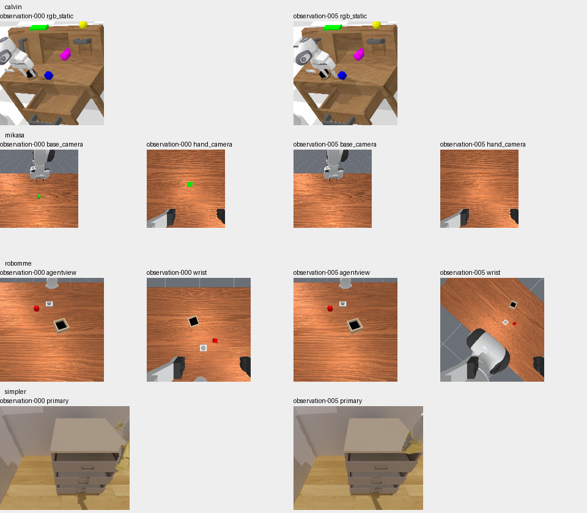
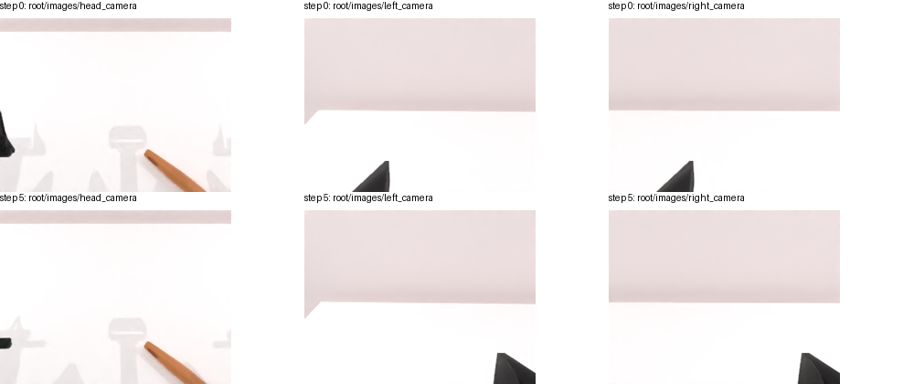
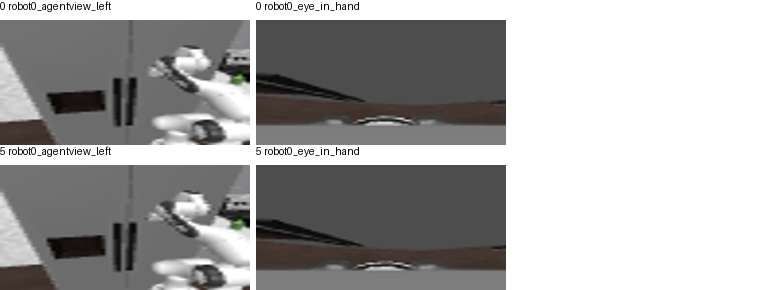

# 原生动作差分验证（2026-09-28）

[English](native-action-parity-2026-09-28.md) · [**简体中文**](native-action-parity-2026-09-28.zh-CN.md)

## 结论

**20 个基准均通过源码对照，完整仿真与评测一致性仍待验证。** 全部 18 个非 Isaac 基准均通过上游实现与真实 RoboTenon Graph 实际运行。选定两组种子、各五次动作，14 个基准以未经修改的默认配置获得精确匹配。VLABench 启用可选种子适配后也精确匹配。DuoBench 与 MolmoSpaces 的状态和信号一致，RGB 的量化差异与上游自身重复运行的量级相同。RoboCasa365 的 reset 差异仍未解决。以上结果只覆盖选定任务和动作，未复现完整 horizon 或官方评分。

上游参考为 `allenai/vla-evaluation-harness@6cc3e1bd9fc4bed26fb0a3aabd342c5fed11ca09`，验证时远端 `main` 仍指向该提交。RoboTenon 基线为 `codex/independent-benchmark-extensions` 分支上的 `680e3676364cab519e41627ad7833a15946aad2e`，加上工作区中单独说明的 VLABench 可选种子适配。

## 方法与验收标准

- 两侧使用独立进程和**同一套已安装的模拟器、资产、参数与渲染器**，以分离集成差异。该方法没有逐项证明所装依赖都与上游容器配方一致。
- 上游运行实际的 `SyncEpisodeRunner`，RoboTenon 则运行 `run_experiment`、五节点 Graph、`native_sync`、真实扩展 Environment/Body/TaskAdapter 和无损观测传输。仅策略使用替身。
- 各选一个任务，每个进程运行一个 episode，使用种子 **0 和 11**，每个案例执行**五次明确指定的动作**。记录初始观测和五次动作后的观测。首个动作分量依次乘以 `1, 1, -1, 0, 1`，其他分量不变。完整参数和动作向量见[案例](native-action-parity-2026-09-28/cases/)。
- 比对任务元数据、实际动作调用、观测键/形状/dtype/数值、策略输入、可访问的物理状态、每步 reward/done/info 及最终原生指标。物理状态尽可能采集，各模拟器的内部隐藏状态没有完整序列化。
- RGB 同时比较每一帧及带符号帧差 `frame[t+1] - frame[t]`。精确匹配要求逐字节相等，容差为零。所有测试中，每次动作后至少有一路相机画面变化。验收不要求所有相机都变化，也不能推断任意动作都必然产生可见运动。
- 短测未验证成功为真的检测、每项任务的自然终止、多 episode 完整回放或官方汇总评分。RoboCasa365 的五步截断尤其早于其配置的第 16 步成功检查和第 8 步环境 horizon。

## 全部 20 个基准

| 基准 | 源码审计 | 实际差分结果 |
| --- | --- | --- |
| BEHAVIOR-1K | 通过 | 依用户要求暂缓 Isaac 仿真 |
| CALVIN | 通过 | 两个种子的帧、帧差和采集值均精确匹配，使用首个选定序列 |
| DuoBench | 通过 | 两个种子的动作、可见状态、元数据和指标一致，RGB 差异最大为 1/255 |
| Kinetix | 通过 | 两个种子的帧、帧差和采集值均精确匹配，仅覆盖同步/像素模式 |
| LIBERO | 通过 | 两个种子的帧、帧差和采集值均精确匹配 |
| LIBERO-Mem | 通过 | 上游启用逐步记录时，两个种子均精确匹配，见下文记录器问题 |
| LIBERO-Plus | 通过 | 两个种子的帧、帧差和采集值均精确匹配 |
| LIBERO-Pro | 通过 | 两个种子的帧、帧差和采集值均精确匹配 |
| ManiSkill2 | 通过 | 两个种子的帧、帧差和采集值均精确匹配，任务为 PickCube-v0 |
| MIKASA | 通过 | 两个种子的帧、帧差和采集值均精确匹配，任务为 RememberColor3 |
| MolmoSpaces | 通过 | 两个种子的任务、动作、状态、reward、info 和指标一致，RGB 最大差异 1/255，上游自身重复也出现相同量级差异 |
| RLBench | 通过 | 两个种子的帧、帧差和采集值均精确匹配，任务为 reach_target |
| RoboCasa（原版） | 通过 | 两个种子的帧、帧差和采集值均精确匹配，任务为 v0.2 OpenDrawer |
| RoboCasa365 | 通过 | reset 时的基座位置差异及 macOS 间歇性渲染差异仍未解决 |
| RoboCerebra | 通过 | 两个种子的帧、帧差和采集值均精确匹配，使用 Ideal/case1 |
| RoboDojo | 通过 | 依用户要求暂缓 Isaac 仿真 |
| RoboMME | 通过 | 两个种子的帧、帧差和采集值均精确匹配，任务为 BinFill |
| RoboTwin | 通过 | 两个种子的帧、帧差和采集值均精确匹配，使用 grab_roller/demo_clean |
| Simpler | 通过 | 两个种子的帧、帧差和采集值均精确匹配，任务为 google_robot_open_top_drawer |
| VLABench | 通过 | 扩展启用可选种子并对照显式设种子的上游时，两组种子均精确匹配。默认仍不指定种子。 |

## 差异与诊断

### DuoBench 上游重复执行也有一个单位的 RGB 差异

两个种子均完成五次动作，头部和腕部图像有效，原生 success/progress 可读取，采集的状态、时间戳和逐步元数据相同。两侧 RGB 最大绝对误差为 **1**，单帧中不同通道值的占比最高为 **0.000120443**（约 **0.0121%**），因此带符号帧差也并非完全一致。

上游在相同种子下重复运行时，RGB 差异也不超过一个单位。这支持渲染波动这一解释，但未证明所有差异像素的具体原因。该结果达不到逐字节一致。见[上游重复运行证据](native-action-parity-2026-09-28/self-repeat.json)。



### MolmoSpaces 状态精确一致，GPU 渲染存在一个单位的 RGB 波动

上游与 RoboTenon Graph 均以两个种子执行了真实的 `DummyPickPlaceEvalConfig` 任务，
包括 reset、五次显式 8 维关节动作和六次观测，
记录外部与腕部相机。任务元数据、动作、8 维状态、步数、
reward、done/info 和原生成功值均匹配。每次动作后两路相机画面均变化。
两侧 RGB 最大差异为 **1/255**，单帧中不同通道值的
占比最高为 **0.000931794**（约 **0.0932%**）。

仅重复运行上游、保持同一种子时，RGB 最大差异同样为 1/255，
单帧不同通道值占比最高为 **0.000934829**（约 **0.0935%**）。
这支持渲染量化波动的解释，因此没有报告逐字节匹配。
运行使用 MolmoSpaces v0.2.0、资源包 0.0.1b4、
MuJoCo 3.5 和官方 v2 Franka 抓放基准。已安装的
Objaverse 版本为 `20260131`，新于基准记录的
`20251016_from_20250610`。上游在两侧均发出相同警告。要声称复现官方评分，
需先解决这一资产版本差异。

扩展现支持可选的 `resource_manifest` 原生参数，
将同一资源版本映射传给独立的任务枚举进程和实际执行进程。
若不传递，即使父进程固定了版本，Graph 枚举仍可能
回退到 MolmoSpaces 包内的默认值。



### VLABench 的默认 reset 无法确定性复现

两侧默认配置在策略执行前的初始图像就已不同。单独重复上游也会得到不同初始图像。已安装的 `LM4ManipDMEnv` 创建 dm_control Composer 时未显式传入 `random_state`，其内部 NumPy RandomState 不受全局 NumPy/Python RNG 种子控制。

诊断包装器在**两侧**都将 `random_state=seed` 传给真实 Composer 环境，保留原物理、观测和动作。此时两个种子的全部结果（包括五次帧差）均精确匹配，证明受控初始化下两者一致，**默认运行仍未证明一致**。VLABench 生产扩展新增可选 `seed`，将种子传递给真实 Composer 构造函数，并把 Python/NumPy RNG 的变更限定在环境创建期间。默认仍不设种子。两个种子都通过了与显式设种子上游的对照。

### RoboCasa365 的种子 0 差异仍未解决

种子 0 在 reset 后基座位置就不同，最大差异约 **2.013 m**，RGB 也有明显差别。种子 11 在首次默认测试中匹配，但后续实验发现 macOS/GLFW 偶发 RGB 损坏。单独重复每一侧均可重现各自结果，与 VLABench 的情况不同，不能直接归因于正常随机波动。

额外实验在两侧构造包装器时都传入种子，仍未解决种子 0 的问题；该设置下种子 11 后续也出现差异。**单靠构造函数设种子尚未证明能够修复问题。** 验证一致性还需要检查构造/导入顺序、reset 状态和 RNG 消耗。

### LIBERO-Mem 上游 NullEpisodeRecorder 不兼容

上游 LIBERO-Mem 读取 `self._recorder._next_step`，但上游 `NullEpisodeRecorder` 不提供这一字段，初次关闭记录的运行在首个动作后失败。用于验收的差分测试启用**真实上游 EpisodeRecorder 的逐步记录**，关闭视频。RoboTenon 的兼容记录器已提供该字段。这是记录器行为差异，测试未验证关闭记录时的行为或 SQLite/视频产物的一致性。

## 主机与模拟器范围

- 本地 macOS 运行 LIBERO 系列、RoboCerebra、Kinetix、RoboCasa365 和 VLABench，复用已有的各模拟器独立环境。LIBERO 系列保留 `NUMBA_DISABLE_JIT=1`。RoboCasa365 使用已安装的 RoboCasa 1.0.1、robosuite 1.5.2 和 MuJoCo 3.3.1，相机尺寸为 64。VLABench 使用 MuJoCo 3.2.2 与 dm_control 1.0.22。这些设置仅定义测试范围，未修改正式配置。
- Linux 服务器以独立环境运行 ManiSkill2、DuoBench、RLBench、CALVIN、MIKASA、RoboMME、Simpler、RoboTwin 和 MolmoSpaces。MolmoSpaces 使用 Python 3.12、MolmoSpaces v0.2.0、资源包 0.0.1b4、MuJoCo 3.5 和 JAX。选择一张 NVIDIA A100，现有 `model-runtime` 软件包集合未改动。
- RLBench、PyRep 和 CoppeliaSim 资产来自本地镜像摘要 `ghcr.io/allenai/vla-evaluation-harness/rlbench@sha256:87e57e8061cd7b11aec4d2de51e09709742fbc406d535f8a0a948abecb5cf1b6`。解包后的镜像不含源码 Git 目录，无法独立证明源码提交。启用 CoppeliaSim OpenGL3 插件，补齐 Xvfb/xcb 和缺少的 X11 库后，解决了此前本地黑帧问题。用户此前已接受学术/教育非商业许可。



## 证据与检查

- 按记录的导入路径调整后，静态检查通过 **20 个扩展、28 项原生 AST 对照和 4 项共享契约**。这验证适配器源码等价性，不验证模拟器二进制等价性。
- 下列 support/extension 回归命令共 **242 项通过**。
- [本地对照](native-action-parity-2026-09-28/local-comparison.json)、[服务器对照](native-action-parity-2026-09-28/server-comparison.json)、[受控 reset 诊断](native-action-parity-2026-09-28/controlled-comparison.json)。
- [本地帧差](native-action-parity-2026-09-28/local-image-changes.json)、[服务器帧差](native-action-parity-2026-09-28/server-image-changes.json)、[受控帧差](native-action-parity-2026-09-28/controlled-image-changes.json)。
- 完整本地 NPZ/JSON 轨迹位于工作区 `outputs/action-parity-final`、`outputs/action-parity-remote` 和 `outputs/action-parity-controlled`。包含 MolmoSpaces 上游重复运行的服务器轨迹位于 `/path/to/deployment/results`。大型仿真资产和轨迹未纳入 Git。

```sh
python extensions/benchmarks/benchmark-support/scripts/verify_sources.py . /path/to/pinned/upstream
python -m pytest -q extensions/benchmarks/benchmark-support/tests tests/test_benchmark_extensions.py tests/test_robocasa_extension_boundary.py
```

## 复现一组对照

使用所选模拟器的环境，安装 RoboTenon、support、对应扩展和上游 runner 依赖，确保可导入上游 `src` 与 `extensions/benchmarks/benchmark-support/scripts`。按模拟器要求设置渲染与资产环境变量。复制一份已记录案例并更新主机相关路径。使用相同环境变量及 `PYTHONHASHSEED=0`，在两个独立进程中分别运行两侧。

```sh
python extensions/benchmarks/benchmark-support/scripts/parity_probe.py --case results/libero/seed-0/case.json --side upstream --output results/libero/seed-0/upstream
python extensions/benchmarks/benchmark-support/scripts/parity_probe.py --case results/libero/seed-0/case.json --side robotenon --output results/libero/seed-0/robotenon
python extensions/benchmarks/benchmark-support/scripts/compare.py results
python extensions/benchmarks/benchmark-support/scripts/image_changes.py results
```

比较脚本输出机器可读结果，请检查状态字段；脚本没有用退出码强制 CI 判定。`controlled_reset=true` 显式开启 VLABench/RoboCasa365 的诊断初始化包装器，与默认配置不同。VLABench 提供可选的可复现性适配。RoboCasa365 的清理/GC 实验在重复实测中不稳定，已从生产扩展移除。诊断轨迹保存在任务工作区。

## 追加服务器验证

CALVIN、MIKASA、RoboMME 和 Simpler 在两组种子下均通过，包括所有五次带符号帧差。已查看相机预览，画面包含真实任务场景。



MIKASA 修正了**测试框架**，先导入 Torch 再设种子，因为提示与隐藏阶段的时长使用 `torch.randint`。没有更改 MIKASA 生产适配器。上游探针现按上游编排器的顺序，在枚举任务前调用 `get_metadata()`。

服务器使用独立环境。MIKASA 使用 Torch 2.2.1、ManiSkill 3.0.0b15、SAPIEN 3.0.0b1。Simpler 使用解包的官方 ManiSkill2_real2sim 栈。CALVIN 使用 PyBullet 3.2.7 和 EGL。RoboMME 使用其固定 ManiSkill fork 和 Torch 2.6.0。这些是配对集成测试，未逐包验证与上游镜像一致。CALVIN 在运行时检查版本，检出目录需有本地 Git 元数据。MolmoSpaces 使用真实离线 NLTK 语料和本地官方资源索引，没有伪造仿真数据。

### 后续诊断（不计入验收通过）

RoboCasa365 的实验包括构造时设种子、关闭循环 GC，以及在释放旧 MuJoCo 渲染资源前恢复所属 GLFW 上下文。部分运行两个种子均匹配，但重复运行仍出现 RGB 损坏，因此撤回实验性生产包装器。初始布局和渲染修复均未获得验证。诊断结果目录包括工作区中的 `action-parity-casa-production`、`action-parity-casa-production-repeat`、`action-parity-casa-combined` 和 `action-parity-casa-gl-state`。探针参数 `safe_gl_finalizer` 与 `reference_render_guard` 会改变参考实现，只用于诊断。

VLABench 可选适配器的验收证据与早期实验单列，见[设种子对照](native-action-parity-2026-09-28/vlabench-seeded-comparison.json)和[设种子帧差](native-action-parity-2026-09-28/vlabench-seeded-image-changes.json)。

### RoboTwin 追加验证

`grab_roller` / `demo_clean` 在两种种子下的相机数组和五次帧差均精确匹配。所选干净场景使用官方本体和物件包。该案例通过后暂停了尚未完成的大型背景纹理下载。设置为 `skip_expert_check=true`、`fast_init=true`、`fast_render=false`，保留原生光追渲染器，同时跳过专家可行性检查和规划器预热，以测试动作接口。服务器使用固定 RoboTwin 源码、为 A100 编译的 CuRobo v0.7.8、SAPIEN 3.0.0b1、Torch 2.2.1 和 Warp 1.6.0。Torch 与上游容器配方不同。未安装 Pytorch3D，该 qpos 路径仍顺利完成。两侧干净场景的表面都很亮，结果验证像素相等，不评价光度质量。



### RoboCasa v0.2 追加验证

所需的 v0.2 源码（`756598a5be52e052339bb2d957426e39015c2afb`）及 robosuite 1.5.0（`dc7fcf9fa6cdf0796f79b4c873166a8fb9fe8c9e`）在 `OpenDrawer` 的两组种子和全部五次帧差上均通过。独立本地环境使用 MuJoCo 3.2.6、NumPy 1.23.5、Numba 0.57.1（关闭 JIT）、SciPy 1.10.1 及官方场景设施、纹理和 Objaverse 压缩包。默认物件采样使用 Objaverse，上游安装器也跳过可选的 AI 生成物件包。相机尺寸 64，horizon 为 8，五次固定动作保留官方评测场景分布。

[对照结果](native-action-parity-2026-09-28/robocasa-v02-comparison.json)、[帧差](native-action-parity-2026-09-28/robocasa-v02-image-changes.json)。



最初安装的 RoboCasa365 虽然报告版本 1.0.1，其提交实际为 `a07e365c958c4216cd6bbd5f30b47f09a65c6f00`。已切换到上游精确版本 `b4684e6ee37d377cc392e98302a6b916d588b415` 复测；robosuite 已与上游 `5ce6643f3092639d08f7b0f90ed1c6a84f50552c` 一致。仅修正提交未消除 macOS 上的间歇性渲染差异。
