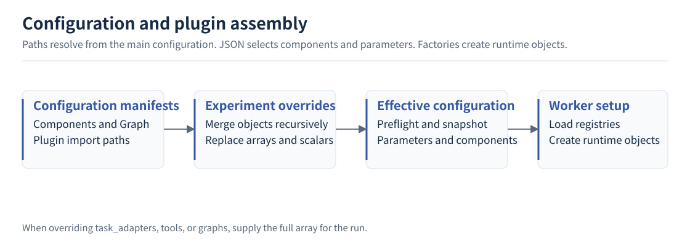
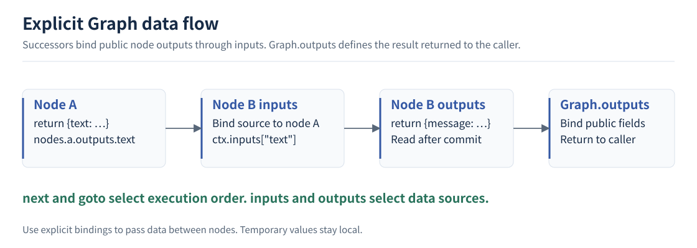
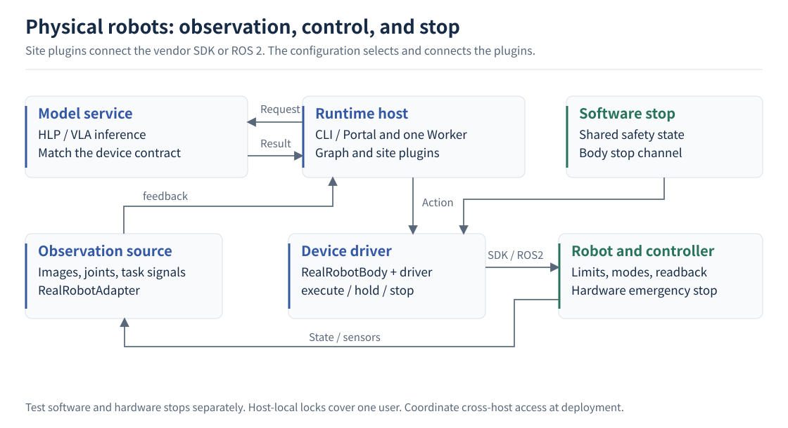

# RoboTenon developer guide

[**English**](development-guide.md) · [简体中文](development-guide.zh-CN.md)

This guide covers configuration assembly and component development. Begin with the [tutorials](tutorials/README.md) for installation and a first run. See [execution and observability](execution-and-observability.md) for runtime parameters and the [module reference](module-guide.md) for subsystem responsibilities.

Plugin examples illustrate interfaces. Supply the required dependencies and implementation when connecting a driver, model, or environment.

## Contents

| Topic | Sections |
| --- | --- |
| Configuration and startup | [Conventions](#0-conventions), [main configuration](#3-assemble-components-in-the-main-configuration), [running experiments](#4-running-single-tasks-and-batches) |
| Workflows and models | [Graph](#5-define-the-workflow-in-a-graph), [Module](#6-developing-a-module), [Tool](#7-developing-a-tool) |
| Environments and devices | [Body](#8-developing-a-body), [Environment](#9-developing-an-environmentadapter-and-session), [TaskAdapter](#10-task-adapters-and-task-sets) |
| Operations | [Safety and stopping](#11-monitor-safety-and-stopping), [observability and Portal](#12-observations-video-trace-and-web-portal), [deployment](#13-benchmarks-and-real-robot-deployment) |
| Diagnosis and maintenance | [Troubleshooting](#14-troubleshooting), [plugin checklist](#15-new-plugin-development-checklist), [code index](#16-code-navigation) |

## 0. Conventions

### 0.1 Common experiment entry point

Start experiments with this script:

~~~bash
Tenon run --config runs/robocasa365/config.json
~~~

Keep RoboCasa, VLA, HLP, ROS2, and specific robot model decisions outside the script. It reads the main configuration and assembles components using registries.

### 0.2 Read parameters through Params

The Parameter module loads application settings and injects the same ctx.params view. Modules should not open a second JSON file:

~~~python
timeout_ms = ctx.params.get("policy.action_timeout_ms", [int, None])
~~~

The pair [type, default] defines typed access. For a required field, use [type, None], then explicitly reject None. Avoid module-local defaults that disagree with configuration.

### 0.3 Execute actions through Body

Environment owns connectivity, reset, observe, and command. Body executes ActionChunk and handles deadlines, interruption, and stopping. Do not add apply_action() to EnvironmentSession or call a simulator, ROS2, or a robot SDK directly from a Module.

## 1. What the framework provides

An embodied experiment usually needs:

- One task or a set of tasks
- A simulator or physical robot environment
- Models such as a high-level planner (HLP), a low-level VLA, or a verifier
- A Graph with loops, conditional routing, and recovery logic
- Action execution, safety monitoring, observation caching, traces, and results

RoboTenon gives each responsibility an explicit boundary and assembles the components through one main configuration.

~~~mermaid
flowchart LR
    A[Main configuration] --> P[Params]
    A --> TA[Task Adapter]
    A --> G[Entry Graph]
    A --> E[Environment Adapter]
    A --> B[Body]
    A --> M[Modules]
    A --> T[Tools]
    A --> MO[Monitors]
    TA -->|TaskCase| R[Experiment Runner]
    R -->|SessionSpec| E
    E -->|Feedback| W[GraphRuntime]
    W --> M
    M --> T
    W -->|ActionChunk| B
    B --> D[Action driver / SDK / simulator env.step]
    E --> O[Observation Cache]
    W --> X[Trace / Metrics]
~~~

Core boundaries:

| Component | Owns | Outside its scope | Typical implementation |
| --- | --- | --- | --- |
| Task Adapter | Tasks, order, seeds, horizons | Camera connections and action execution | robocasa365, single-task |
| EnvironmentAdapter | Environment connection and Session creation per Run | Executing Actions | RoboCasa365Adapter, RealRobotAdapter |
| EnvironmentSession | reset, observe, command, health, feedback sequencing | apply_action | RoboCasa365Session, RealRobotSession |
| Body | ActionChunk execution, timeouts, stops, and idempotent acknowledgement | Selecting goals or observing the environment | RoboCasa365Body, RealRobotBody |
| Module | Graph node logic and GraphContext updates | Loading a duplicate model or opening environment connections | PlanModule, VerifyModule |
| Tool | Resident HLP, VLA, Memory, Skill, or another reusable capability | Selecting Graph routes | Qwen3.5-VL, Xiaomi-Robotics-1 |
| Monitor | Periodic or on-demand safety/compliance checks | Driving the robot | SafetyMonitorService |
| GraphRuntime | Node scheduling, conditional routing, recovery, checkpoints | Vendor SDK details | workflow/runtime.py |

Typical call order in a RoboCasa episode:

~~~text
Task Adapter.enumerate_cases()
  -> EnvironmentAdapter.open(SessionSpec)
  -> env.reset
  -> plan Module -> HLP Tool
  -> action Module -> VLA Tool -> ActionChunk
  -> body.execute(ActionChunk)
  -> env.observe
  -> verify Module -> HLP/Verifier Tool
  -> evaluate Module
  -> Follow goto to continue action, replan, or END
~~~

## 2. Installation and first run

The [first-run tutorial](tutorials/01-first-run.md) provides installation commands, the Fake smoke test, configuration checks, and expected output. See [your first simulation](tutorials/02-first-simulation.md) for a single simulated task.

Use `python -m pytest -q` for regressions during development. Check assembly, calls, failure cleanup, and process mode for a new plugin. See [change history](changes/README.md) for historical test results.

## 3. Assemble components in the main configuration

### 3.1 Main configuration

The main configuration references the component manifests and supplies run parameters. A minimal structure follows.

~~~json
{
  "config_version": 1,
  "modules_config": "modules.json",
  "graphs_config": "graphs.json",
  "tools_config": "tools.json",
  "monitor_config": "monitors.json",
  "bodies_config": "bodies.json",
  "environments_config": "envs.json",
  "task_adapters_config": "task_adapters.json",
  "parameters": {
    "runtime": {
      "environment_id": "fake",
      "graph_id": "demo",
      "horizon": 16
    },
    "task": {
      "task_id": "demo-task",
      "env_id": "fake",
      "seed": 0
    },
    "policy": {
      "action_timeout_ms": 1000,
      "action_chunk_size": 16
    }
  }
}
~~~

Referenced files resolve relative to the main configuration directory. For example, when the main file is runs/robocasa365/config.json, generated config_graphs.json resolves through the configuration location, independently of the shell's working directory.

Manifests may also be inline. Separate files make production configurations easier to select in Web, review, and reuse.

### 3.2 Common component manifest fields

Entries for modules, tools, bodies, environments, and task_adapters typically contain:

~~~json
{
  "id": "policy_main",
  "name": "my-policy",
  "version": "1.0.0",
  "kind": "policy",
  "enabled": true,
  "params": {
    "checkpoint": "weights/policy.pt"
  }
}
~~~

- name: the registered provider name.
- id: stable instance ID used by Graphs and Modules in this configuration.
- version: registered implementation version checked during startup.
- kind: semantic category checked during startup, such as model, planner, or local.
- enabled: whether to assemble the instance.
- params: serializable constructor arguments. Python callbacks, SDK objects, and open file handles cannot be stored in JSON.

Multiple instances may have the same name but must have distinct IDs. Call them by instance ID rather than an ambiguous provider alias.

### 3.3 Reading parameters

Parameter JSON can use nested objects:

~~~json
{
  "parameters": {
    "policy": {
      "action_timeout_ms": 1000
    }
  }
}
~~~

Read the values as follows:

~~~python
timeout_ms = ctx.params.get("policy.action_timeout_ms", [int, None])
if timeout_ms is None:
    raise ValueError("missing required parameter: policy.action_timeout_ms")

camera_size = ctx.params.get("render.camera_width", [int, 640])
~~~

Access rules:

- For policy.action_timeout_ms, check the full key first and then resolve a dotted path.
- params.get(name) returns the value without type checking.
- params.get(name, [type, default]) performs strict type checking.
- params.resolve(name) supports optional values in a Task Adapter.
- Declare missing-value defaults at the call site. Put settings important for reproducibility explicitly in the configuration.
- ctx.params is the frozen view for an experiment. Modules, Tools, and the Runner see the same parameters.

### 3.4 Experiment overrides

Apply overrides without changing the base configuration:

~~~bash
Tenon run \
  --config runs/robocasa365/config.json \
  --experiment-config configs/experiments/demo.json
~~~

Base manifests merge strictly: duplicate leaf keys conflict. Experiment overrides recursively merge objects and replace arrays and scalars in full.

## 4. Running single tasks and batches

### 4.1 Single task

~~~bash
Tenon run \
  --config runs/robocasa365/config.json \
  --task-id CloseBlenderLid \
  --seed 7 \
  --graph-id benchmark_rollout
~~~

The single-task entry point resolves runtime.environment_id, runtime.graph_id, task.*, model.*, render.*, and policy.* from the main configuration. CLI arguments override only this request and do not modify the JSON.

### 4.2 Batch experiment

~~~bash
Tenon run \
  --batch \
  --config runs/robocasa365/config.json \
  --output-dir data/xr365/eval \
  --save-videos \
  --save-traces
~~~

Task Adapters enumerate tasks in their main manifest order. Parallel processes can finish out of order. The RoboCasa365 Adapter expands cases according to the environment registry and task filters. A physical robot typically uses single-task to generate one TaskCase at a time.

Common overrides:

| Option | Effect |
| --- | --- |
| --task-set target50 | Select the RoboCasa task set |
| --task-name OpenFridgeDrawer | Select a named task; repeat for multiple tasks |
| --max-tasks 10 | Limit the number of tasks in a batch |
| --num-trials 2 | Episodes per task |
| --seed 7 | Override the base seed |
| --horizon 16 | Override the maximum step count per case |
| --save-videos | Save an MP4 for each episode when supported |
| --save-traces | Create a Trace directory per episode |
| --camera-width 640 --camera-height 480 | Override observation image size |
| --video-fps 20 --video-stride 1 | Video frame rate and sampling stride |
| --run-id name | Set the batch run directory name |

For example, run just two tasks:

~~~bash
Tenon run --batch \
  --config runs/robocasa365/config.json \
  --task-name OpenFridgeDrawer \
  --task-name CloseBlenderLid \
  --num-trials 1 \
  --save-videos --save-traces
~~~

### 4.3 Output directories

The default batch layout resembles:

~~~text
data/xr365/eval/<run-id>/
├── status.json
├── summary.json
├── long_term_memory.json
├── <task-name>/
│   ├── episode_000_seed_7.json
│   ├── episode_000_seed_7.mp4
│   ├── episode_000_seed_7.trace/
│   │   ├── trace.jsonl
│   │   └── trace.sqlite3
│   └── stats.json
~~~

With multiple Task Adapters, an adapter directory prefixes each task directory:

~~~text
<run-id>/<adapter-id>/<task-name>/episode_000_seed_0.json
~~~

Check progress while running:

~~~bash
python -m json.tool data/xr365/eval/<run-id>/status.json
python -m json.tool data/xr365/eval/<run-id>/summary.json
~~~

Use total_episodes, completed_episodes, and active in status.json for parallel progress. current is a one-item summary. Read num_episodes, successes, and episode_success_rate from summary.json for the aggregate. Counting directory entries cannot reliably infer progress.

### 4.4 Terminal logs

The common CLI writes human-readable progress to `stderr` and final JSON to `stdout`. This keeps result output usable by scripts:

~~~bash
Tenon run --batch --config runs/robocasa365/config.json 2>run.log
Tenon run-fake >result.json
~~~

Batch logs report configuration, entry Graph, environment, Task Adapter order, current task, `completed/total`, outcomes, environment steps, durations, and final success rate. Single-task logs include actual task/env/Graph, steps, duration, and video/Trace/result paths. This sample uses illustrative counts and timings:

~~~text
────────────────────────────────────────────
 RoboTenon  batch experiment
────────────────────────────────────────────
[12:30:01] INFO    graph=benchmark_rollout  environment=robocasa365
[12:30:01] INFO    task adapters: robocasa365
[12:30:01] RUN     [1/317] robocasa365/OpenFridgeDrawer  episode=0, seed=7
[12:30:18] OK      [1/317]  robocasa365/OpenFridgeDrawer  episode=0  success  steps=16  elapsed=16.7s
...
[12:44:10] OK      success=241/317 (76.0%)  attempted=317  errors=0
~~~

A single task also emits `NODE` lines when entering or finishing a node or encountering an error. They show where execution is waiting without opening Web Portal.

Use `--verbose` for per-task video, Trace, and episode JSON paths, `--quiet` to suppress progress in CI or scripts, and `--no-color` for terminals without ANSI support. Failed tasks appear as `FAIL`/`ERROR`. The batch continues with later cases and its exit code depends on `num_errors`.

### 4.5 Parallel processes and memory

Regular Graphs support dynamic model batching without the benchmark entry point. `--batch` enumerates tasks and `runtime.execution.batch_services` configures model batching. See [Graph batching](graph-batching.md) for a complete CPU example, Provider and Tool interfaces, eight-GPU placement, and separate Python environments.

Set `backend: "process"` and `max_workers` under `parameters.runtime.execution`, or use the `configs/experiments/parallel.json` override. Each Worker executes tasks serially and reuses Tools. Each task gets its own environment, Body, Modules, and context. Do not run multiple RoboCasa Sessions concurrently with `asyncio.gather` in one process.

The default batch memory policy is `snapshot`: tasks read an initial snapshot, then the parent merges in case order. Use `sequential` and one Worker when each task must see the preceding task's changes. Process artifacts are isolated by attempt. Shared Trace/Metrics live in the run's `observability/`. See [execution and observability](execution-and-observability.md) for commands, fields, and directory layouts.

## 5. Define the workflow in a Graph

### 5.1 Graph file structure

A graphs.json file may contain multiple named Graphs:

~~~json
{
  "config_version": 1,
  "graphs": [
    {
      "id": "pick_and_place",
      "entry": "reset",
      "backend": "fallback",
      "max_steps": 100,
      "nodes": [{"id": "reset", "type": "system", "operation": "env.reset"}]
    }
  ]
}
~~~

runtime.graph_id selects one of the IDs. A nested Graph shares its parent's GraphContext, Environment, Body, Tools, and safety state.

### 5.2 Three node types

Module node:

~~~json
{"id": "plan", "type": "module", "module": "plan"}
~~~

System node:

~~~json
{"id": "observe", "type": "system", "operation": "env.observe"}
~~~

Nested Graph node:

~~~json
{"id": "recovery", "type": "graph", "graph": "recover_pause"}
~~~

Common system operations:

~~~text
env.reset
env.observe
env.close
body.execute
body.interrupt
monitor.check
monitor.latest
monitor.request
monitor.request.<monitor_id>
safety.snapshot
graph.stop
~~~

### 5.3 Predecessors, concurrency, and joins

For a new Graph, declare predecessors explicitly:

~~~json
{
  "id": "join",
  "module": "merge_result",
  "predecessors": ["vision", "plan"]
}
~~~

When next selects multiple successors they may run in parallel. A join waits for every required predecessor group to finish and select it. Each node has its own ctx.values and NodeResult.state_patch workspace, so keys may repeat across nodes. Read predecessor results from ctx.results.

For mutually exclusive branches, use an inner OR group. Outer groups are joined with AND:

~~~json
{
  "id": "evaluate",
  "module": "evaluator",
  "predecessors": [
    ["capture_after_policy", "capture_after_recovery"]
  ]
}
~~~

This node runs when either capture node finishes and selects it via next. `["a", ["b", "c"]]` means `a AND (b OR c)`. `[["a", "b"], ["c", "d"]]` requires an arrival from each OR group. Only two levels are allowed; groups must be nonempty and predecessors unique across groups. A flat `["a", "b"]` means strict AND. `goto` skips these waits.

### 5.4 Conditional routes and termination

~~~json
{
  "id": "evaluate",
  "type": "module",
  "module": "evaluator",
  "predecessors": ["observe"],
  "goto": [
    {"node": "plan", "when": "ctx.results['evaluate']['continue'] == true and ctx.results['evaluate']['needs_plan'] == true"},
    {"node": "action", "when": "ctx.results['evaluate']['continue'] == true and ctx.results['evaluate']['needs_plan'] == false"}
  ],
  "default": "END"
}
~~~

For ordinary successors use next and matching target predecessors. Use goto for a back-edge and loop with optional every and when for a self-loop. All matching branches take effect. Use default as fallback. END closes a branch; the graph.stop system operation ends the current Graph.

Conditions support ctx lookups, literals, comparisons, and/or/not, and in/not in. They cannot invoke arbitrary Python functions. Set an appropriate max_steps for loops.

### 5.5 Emergency and recovery

~~~json
{
  "emergency_graphs": {
    "P3": "emergency_pause",
    "P4": "emergency_stop"
  },
  "recovery": {
    "P3": {
      "mode": "manual",
      "recovery_graph": "recover_pause",
      "resume_graph": "pick_and_place",
      "clear_latched": true
    }
  }
}
~~~

At P3/P4 the Body watchdog handles interruption of the active action, while the Graph dispatches its emergency Graph. A robot safety controller or the RealRobotBody driver must implement physical emergency stopping. EnvironmentSession.command("stop") alone cannot stop physical hardware.

## 6. Developing a Module

### 6.1 Base class and invocation contract

Official Modules should inherit BaseModule:

~~~python
from typing import Any

from robotenon.modules import BaseModule
from robotenon.runtime.registry import register_module

@register_module(
    "my-planner",
    version="1.0.0",
    kind="planner",
    description="A small example planner",
)
class MyPlanner(BaseModule):
    async def run(self, ctx: Any) -> dict[str, Any]:
        task_id = ctx.params.get("task.task_id", [str, None])
        if not task_id:
            raise ValueError("task.task_id is required")
        ctx.values["instruction"] = f"complete {task_id}"
        return {"instruction": ctx.values["instruction"]}
~~~

BaseModule provides optional start()/close() and requires run(ctx). External plugins can still use a structural Module Protocol and implement only invoke(arguments, context) for non-Graph calls. A JSON Graph node requires run(ctx).

### 6.2 Data available to a Module

~~~text
ctx.params           Current experiment Params
ctx.values           Application state in the current node's private workspace
ctx.outputs          Most recent output for each node
ctx.feedback         Latest EnvironmentFeedback
ctx.action_chunk     Latest generated ActionChunk
ctx.body_result      Body execution result
ctx.monitor_report   Monitor report
ctx.safety           Current safety snapshot
ctx.task_item        Current task information
ctx.step             Graph step count
ctx.current_graph    Current Graph
ctx.current_node     Current node
~~~

Use the resident Tool instance when making a call:

~~~python
result = await ctx.call_tool(
    "vla_main",
    {"instruction": ctx.values["instruction"], "max_actions": 10},
)
if not result.ok:
    raise RuntimeError(result.error or "VLA failed")
~~~

Do not call from_pretrained(), open a new database connection, create an Environment Session, or operate Body directly in run(). Put large models, Memory, and Skill in Tools.

### 6.3 Registration and configuration

my_package/planner.py：

~~~python
@register_module("my-planner", kind="planner")
class MyPlanner(BaseModule):
    ...
~~~

configs/modules.json：

~~~json
{
  "plugin_modules": ["my_package.planner"],
  "modules": [
    {
      "id": "planner_main",
      "name": "my-planner",
      "kind": "planner",
      "params": {}
    }
  ]
}
~~~

The Graph refers to the configured instance ID:

~~~json
{"id": "plan", "type": "module", "module": "planner_main"}
~~~

plugin_modules imports the module so it can register its type. runtime.factory.build_module_runtime() constructs the configured instances.

## 7. Developing a Tool

### 7.1 Responsibility

A Tool provides a resident reusable capability. Register HLP, VLA, Memory, Skill, and external inference services as Tools. A Tool returns a result. The Module and Graph decide whether to continue, replan, or stop.

WorkerRuntime owns Tools and reuses weights or clients across tasks. Without a deployment declaration, deploy an external model service separately. For managed services, see [per-Worker deployment](worker-model-deployment.md). At task end, optional `async def end_session(self, session_id)` releases session caches, observation resolver, and context references. Worker shutdown releases shared models and connections.

### 7.2 Implement BaseTool

~~~python
from collections.abc import Mapping
from typing import Any

from robotenon.tools import BaseTool, ToolContext, ToolResult, register_tool

@register_tool(
    "my-policy-model",
    version="1.0.0",
    kind="model",
    description="A resident policy service",
)
class MyPolicyModel(BaseTool):
    def __init__(self, endpoint: str, timeout_s: float = 30.0):
        self.endpoint = endpoint
        self.timeout_s = timeout_s
        self.client = None

    async def start(self) -> None:
        self.client = await create_client(self.endpoint, timeout=self.timeout_s)

    async def call(
        self,
        arguments: Mapping[str, Any],
        context: ToolContext,
    ) -> ToolResult:
        result = await self.client.generate(
            prompt=str(arguments.get("prompt", "")),
            observation=context.observation,
        )
        return ToolResult(output=result, metadata={"endpoint": self.endpoint})

    async def close(self) -> None:
        if self.client is not None:
            await self.client.close()
            self.client = None
~~~

Common ToolContext fields:

~~~text
context.ctx          Current GraphContext or ModuleContext
context.params       Current experiment parameters
context.values       Application state visible to the Tool
context.feedback     Current feedback
context.observation  Resolved observation view provided by ObservationResolver
context.session_id   Current session
await context.call("other_tool", {...})
~~~

A Tool may return a raw JSON-compatible value. The runtime wraps it as ToolResult(ok=True, output=...).

Example configuration:

~~~json
{
  "plugin_tools": ["my_package.models"],
  "tools": [
    {
      "id": "policy_model",
      "name": "my-policy-model",
      "kind": "model",
      "params": {
        "endpoint": "http://127.0.0.1:9000/v1",
        "timeout_s": 60
      }
    }
  ]
}
~~~

Constructor arguments come from params. Inject nonserializable clients, drivers, and shared state at bootstrap. Tools start before Modules and close in reverse order at application exit.

## 8. Developing a Body

### 8.1 Action data flow

~~~text
Module -> ActionChunk(actions=[Action, ...]) -> Body.execute -> BodyExecutionResult
~~~

An ActionChunk can contain multiple Actions. Body checks session, deadline, idempotency key, safety level, and interrupt state, then executes actions in order. BodyExecutionResult reports status, executed_actions, action_results, and errors.

### 8.2 Body base class

~~~python
from robotenon.bodies import BaseBodyService, register_body
from robotenon.schemas import ActionChunk, BodyExecutionResult, EnvironmentHealth

@register_body("my-body", kind="robot", version="1.0.0")
class MyBody(BaseBodyService):
    async def start(self) -> None:
        ...

    async def execute(self, action_chunk: ActionChunk) -> BodyExecutionResult:
        ...

    async def interrupt(self, reason: str, *, safe_action=None) -> BodyExecutionResult:
        ...

    async def health(self) -> EnvironmentHealth:
        ...

    async def close(self) -> None:
        ...
~~~

Implement the five service boundaries: start, execute, interrupt, health, and close. InProcessBodyService already provides the watchdog, action deadlines, idempotent acknowledgements, and protective actions. A RoboCasa or physical Body usually inherits it and implements _execute_action and the low-level stop/hold adapter.

### 8.3 RoboCasa and physical robots

- RoboCasa365Body converts an Action to a simulator action and calls env.step() through its driver. This belongs to Body rather than RoboCasa365Session.
- RealRobotBody converts an Action to the configured robot format and calls the injected ROS2/SDK/RPC driver. For stops it prefers the driver's hold() or stop().
- EnvironmentSession supplies camera, joint, end-effector, gripper, and other observations and environment commands.

Inject the physical driver at startup:

~~~python
body = await initialize_body_service(
    loaded.bodies,
    runtime={"driver": ros2_driver},
    safety_state=safety_state,
)
~~~

With require_driver=true, startup must fail when no driver is injected. An unconnected robot is not ready.

## 9. Developing an EnvironmentAdapter and Session

### 9.1 Lifecycle

EnvironmentAdapter owns connection and Session management; EnvironmentSession represents one Run. The standard Runner creates and closes both for each task. A standalone environment service can retain its Adapter under its own ownership rules.

~~~text
build adapter -> connect -> open(SessionSpec)
  -> session.reset/observe/command
  -> session.close -> adapter.close
~~~

Official base classes:

- BaseEnvironmentAdapter provides connect, open, create_session, health, close, and Session management. Implement _create_session in a subclass.
- BaseEnvironmentSession manages session ID, sequence number, pause/resume/stop, Feedback construction, and close. Subclasses implement reset and observe.

Third-party plugins may use the structural Protocol. Maintained providers should inherit the base classes to reuse lifecycle behavior.

### 9.2 Minimal environment plugin

~~~python
from typing import Any

from robotenon.envs import (
    BaseEnvironmentAdapter,
    BaseEnvironmentSession,
    register_environment,
)
from robotenon.schemas import EnvironmentDescriptor, EnvironmentFeedback, Observation, SessionSpec

class MySession(BaseEnvironmentSession):
    async def reset(self, context: Any) -> EnvironmentFeedback:
        self._reset_lifecycle(context)
        return self._new_feedback(
            observation=Observation(state={"ready": True}),
        )

    async def observe(self, request: Any = None) -> EnvironmentFeedback:
        self._ensure_open()
        return self._new_feedback(
            observation=Observation(state={"request": request}),
        )

@register_environment("my-environment")
class MyAdapter(BaseEnvironmentAdapter):
    descriptor = EnvironmentDescriptor(
        env_id="my-environment",
        env_version="1.0.0",
        display_name="My Environment",
        backend_kind="local",
        observation_modalities={"state", "rgb"},
    )

    def _create_session(self, spec: SessionSpec) -> MySession:
        return MySession(spec)
~~~

envs.json：

~~~json
{
  "plugin_environments": ["my_package.environment"],
  "environments": [
    {
      "id": "lab",
      "name": "my-environment",
      "version": "1.0.0",
      "params": {}
    }
  ]
}
~~~

### 9.3 Feedback and observation frames

Every reset/observe returns EnvironmentFeedback. Place images, depth, state, and other modalities inside Observation:

~~~python
Observation(
    frames=[
        ObservationFrame(
            frame_id="camera.front",
            role="policy_input",
            modality="rgb",
            producer="sim_renderer",
            data=image_array,
            shape=[480, 640, 3],
        )
    ],
    state={"gripper": 0.0},
)
~~~

For production, persist large media through the Observation Cache and carry ObservationRef/cache URIs in Feedback. Avoid retaining complete ndarrays in ctx or Trace. Increment sequence_no monotonically to support VLA history, trajectory browsing, and recovery.

## 10. Task Adapters and task sets

A Task Adapter selects cases for an experiment. Environment connections and action execution belong to other components.

### 10.1 Single task

SingleTaskAdapter builds one or more episodes from task.task_id, task.env_id, task.seed, and runtime.horizon. It is suitable for physical robots:

~~~json
{
  "task_adapters": [
    {
      "id": "real_task",
      "name": "single-task",
      "params": {
        "task_id": "OpenFridgeDrawer",
        "environment_id": "real_robot",
        "num_trials": 1
      }
    }
  ]
}
~~~

### 10.2 RoboCasa365

RoboCasa365TaskAdapter reads the RoboCasa task registry, filters task_names/task_set, expands TaskCase records, calculates horizons, and assigns stable global indices and seeds. Counts depend on the installed registry and filters. scripts/run_experiment.py does not implement expansion.

Custom Adapter example:

~~~python
from collections.abc import Iterator

from robotenon.infra.params import Params
from robotenon.task_adapters import BaseTaskAdapter, TaskCase, register_task_adapter

@register_task_adapter("my-dataset", kind="dataset")
class MyDatasetAdapter(BaseTaskAdapter):
    def enumerate_cases(self, *, adapter_id: str, params: Params) -> Iterator[TaskCase]:
        yield TaskCase(
            adapter_id=adapter_id,
            task_id="pick-cup",
            environment_id="my-environment",
            index=0,
            episode=0,
            seed=0,
            horizon=32,
        )
~~~

Enumerate multiple Adapters in manifest order. Parallel tasks may finish out of order, but final aggregation retains case order.

## 11. Monitor, safety, and stopping

A Monitor can use resident, request, or both modes. It returns MonitorReport, which SafetyStateStore merges into P0–P4:

| Level | Meaning | Handling |
| --- | --- | --- |
| P0 | Normal | Actions allowed |
| P1 | Notice/monitor | May recover automatically according to policy |
| P2 | Restricted | Apply restrictions or enter recovery |
| P3 | Protective pause | Body interrupts actions; operator confirmation is usually required |
| P4 | Emergency stop | Hardware/Body stops safely; requires a manual or hardware reset |

Body interrupt() is the action execution boundary. Environment command("stop") is an environment command. A physical robot requires reliable hold/stop from RealRobotBody or a low-level safety controller.

## 12. Observations, video, Trace, and Web Portal

### 12.1 Video and resolution

~~~json
{
  "parameters": {
    "render": {
      "camera_width": 640,
      "camera_height": 480,
      "video_path": "data/videos/example.mp4",
      "video_stride": 1,
      "video_fps": 20
    }
  }
}
~~~

Use --save-videos for a batch. The Runner allocates a matching MP4 filename per case. Writing a file requires an Environment with rendering/recording support. Physical robot runs generally show live observations or cached frames.

### 12.2 Observation Cache

~~~json
{
  "observation_cache": {
    "enabled": true,
    "backend": "hybrid",
    "storage": {
      "root": "./data/observations",
      "index": "./data/observations/index.sqlite3"
    },
    "uri_scheme": "cache"
  }
}
~~~

cache:// is a logical URI. storage.root determines the file location and storage.index selects the index. Do not concatenate cache:// as an OS path.

### 12.3 Metrics and application instrumentation

Use Metrics for counts, current values, and latency distributions. Keep application state elsewhere. Avoid labels containing each `run_id`, `session_id`, or full model outputs. Common metric types:

| Type | What to record | Example |
| --- | --- | --- |
| `counter` | Monotonically increasing event or error counts | `policy_calls_total` |
| `gauge` | Current value | `feedback_sequence` or queue depth |
| `histogram` | Distribution of latency, duration, or size | `policy_latency_ms` |

Enable a local WAL for an episode from the experiment script:

~~~bash
Tenon run \
  --config runs/robocasa365/config.json \
  --metrics-dir data/debug/episode-001
~~~

With a local source, a single episode creates `data/debug/episode-001/metrics.jsonl`. A batch can use per-episode directories. Process batches default to the shared observability directory, and explicitly configured external sources write to their chosen destinations. MetricsClient enqueues into a bounded buffer on the control path; background flush writes the WAL. Avoid directly calling `MetricsDaemon.ingest()` on the action path.

Instrument a custom Module using the injected `ctx.metrics`:

~~~python
from robotenon.modules import BaseModule

class Planner(BaseModule):
    async def run(self, ctx):
        metrics = ctx.metrics
        if metrics is not None:
            # Keep labels low-cardinality. Do not put task_id/run_id in a label.
            metrics.counter(
                "planner_calls_total",
                labels={"component": "planner", "mode": "vla"},
                scope="episode",
            )
            metrics.gauge("planner_input_sequence", float(ctx.step), scope="step")
        return {"planned": True}
~~~

Plugins must also work when `ctx.metrics` is absent. Use `MetricRegistry` to declare metric types, label names, and histogram buckets:

~~~python
from robotenon.infra.metrics import MetricDefinition, MetricRegistry

registry = MetricRegistry()
registry.register(
    MetricDefinition(
        "planner_latency_ms",
        "histogram",
        unit="ms",
        allowed_labels=frozenset({"component"}),
        histogram_buckets=(10, 25, 50, 100, 250, 1000),
    )
)
~~~

For a standalone metrics service, start one application-owned `Tenon metricsd` and use the injected `MetricsClient` or Unix socket sink. Individual plugins should not start their own daemons. See `examples/metrics_grafana_demo.py`.

### 12.4 Trace and execution details

For a single task:

~~~bash
Tenon run \
  --config runs/robocasa365/config.json \
  --trace-dir data/debug/episode-001
~~~

For a batch:

~~~bash
Tenon run --batch \
  --config runs/robocasa365/config.json \
  --save-traces
~~~

With a local data source, each Trace directory usually contains `trace.jsonl` and `trace.sqlite3`. GraphRuntime records Graph nodes automatically. ToolRuntime records Tool calls and associates them with the calling node through a parent span. Use `ctx.trace` to record significant stages, decision summaries, or reconciliation results in a custom Module:

~~~python
from robotenon.infra.trace import trace_observation, trace_value

class Planner(BaseModule):
    async def run(self, ctx):
        trace = ctx.trace
        if trace is None:
            return {"planned": True}

        attributes = {
            "kind": "module_decision",
            "node": ctx.current_node,
            "step": ctx.step,
            # Record only the URI and metadata. Do not copy the ndarray or full image.
            **trace_observation(ctx.feedback),
        }
        with trace.span("planner.decision", attributes=attributes) as span:
            decision = {"planned": True, "action_count": 16}
            span.set_attribute("decision", trace_value(decision))
            span.add_event("decision_ready", {"action_count": 16})
            return decision
~~~

For asynchronous stages, use `async with trace.async_span(...)`. On exiting the context, the span records its start time, end time, and status. Exceptions set `status=error` and record the exception type. Inside a Tool, use `context.trace` and `context.metrics`. ToolRuntime already wraps each Tool call, so custom spans become children of its span.

Record these details in a Trace:

- The current graph and node, model version, request summary, and `cache://` URI of the input observation.
- Structured summaries of HLP/VLA outputs, action chunk sizes, and verifier/evaluator conclusions.
- Retries, timeouts, stops, recoveries, safety level changes, and results of important external calls.
- The reason a task succeeded or failed and the parameter hash needed to reproduce it.

Keep the following out of the Trace:

- Full images, video frames, NumPy arrays, tensors, and untruncated model prompts.
- High-cardinality `run_id`/`session_id` labels. Use their standard Trace fields.
- A complete copy of `ctx` on every iteration. Store large media in the Observation Cache and record only its URI, shape, dtype, sequence, and storage path in the Trace.

Metrics support aggregation and alerting. Traces record the causal chain of an individual execution for debugging. Store live metrics in the metrics system. Reserve `ctx.values` for application state needed by subsequent Graph nodes.

### 12.5 Start the Web Portal

Start the read-only query API for a specific Trace database:

~~~bash
Tenon web \
  --host 127.0.0.1 --port 8765 \
  --trace-db data/debug/episode-001/trace.sqlite3 \
  --no-experiment-submit --no-auto-grafana
~~~

Run a task to create the database first, then open <http://127.0.0.1:8765/api/traces?limit=20> to view the JSON. In read-only mode, the home page still lists experiments and indicates that submission is disabled. For shared runs, point `--trace-db` at the shared database or use `--source` to load its data source configuration. The Web service does not infer the parallel mode, fall back to other task databases, or replay JSONL into SQLite.

For full experiment browsing, submission, and configuration management, omit `--no-experiment-submit`, explicitly pass `--project-root . --config-root configs --experiment-output-root data/experiments`, and configure a queryable Trace data source. The experiment metadata directory and Trace database are separate sources. Experiment details filter the configured database by execution identity and indicate when that identity is unavailable.

`runtime.web` automatically starts a read-only observability service that shuts down when the run ends. Full experiment management requires the standalone server. Images and videos also require correct media roots and indexes. Configuring shared SQL does not merge the Workers' image indexes. See [Execution and observability](execution-and-observability.md). Run `Tenon web --help` to see all options.

Forward the port for remote access:

~~~bash
ssh -N -L 18765:127.0.0.1:8765 user@server
~~~

## 13. Benchmarks and real robot deployment

### 13.1 Standalone benchmark extensions

All benchmarks use a generated `benchmark_rollout` Graph. Model authors implement the extension's
`vla.py`. The simulation protocol lives in `benchmark.py`, and `evaluate.py` generates a run configuration from `configs/*.json`.
The following example uses RoboCasa365 Xiaomi:

~~~bash
Tenon evaluate --benchmark robocasa365 \
  --profile xiaomi_official --backend ./extensions/benchmarks/systems/robocasa_hierarchical/tool/xiaomi/vla.py --backend-config ./extensions/benchmarks/systems/robocasa_hierarchical/tool/xiaomi/config.json \
  --sim-python /path/to/robocasa/python \
  --model-devices 0,1,2,3,4,5,6,7 \
  --workers-per-gpu 16 --batch-size 8 --wait-ms 50 \
  --output runs/robocasa365
~~~

The generated Graph runs reset, policy, execute, observe, then terminal. The old XR365
planner/verifier, standalone Xiaomi Tool/Module, and fixed eight-GPU configuration have been removed. See the extension README for model integration,
simulator stepping, result aggregation, and performance testing.

### 13.2 Assemble a real robot deployment

See the [real robot deployment tutorial](tutorials/real-robot.md) for integration and acceptance checks. The core provides
`RealRobotAdapter` and `RealRobotBody`. A site extension injects the real observation source,
vendor driver, action format, and safety policy. Operating hardware requires a site-specific main configuration.

A production driver must support action execution, hold/stop, health checks, and shutdown. Before the first run,
verify the hardware emergency stop separately. Resource locks cannot perform an emergency stop.

## 14. Troubleshooting

- Resource already reserved. Check whether another run by the same user already holds the same `resource_ids`. Changing a resource name bypasses mutual exclusion on the same hardware.
- Task Trace missing in the Web Portal. Check that the configured database has records for the execution identity. A task directory can exist without a record in shared storage.
- Worker terminated abnormally. The process backend can start another attempt within `max_retries`. Ordinary task errors are not automatically retried.
- Coordinator exited. Batch scheduling does not currently support automatic takeover or recovery. Graph checkpoints provide a separate, explicitly invoked recovery mechanism.
- Unknown parallel options. Configure `runtime.execution`. The configuration has no `runtime.parallel.enabled`, `persistent_gpu_workers`, or `max_in_flight` options.

| Symptom | Check first |
| --- | --- |
| unknown module/tool/body/environment | Does plugin_* import the registration module? Does the spelling of name match? |
| no enabled environment/body configuration | Does the main configuration reference the correct manifest? Is at least one entry enabled? |
| multiple enabled configurations | A single-process service can select one enabled Body/Environment. Select it explicitly by id or runtime.environment_id. |
| missing required parameter | Is the parameter under parameters? Does the code use the right dotted key? |
| ParameterTypeError | Check the JSON type. The number 1 and the string "1" have different types. |
| unknown configured graph | Does runtime.graph_id match graphs[].id exactly? |
| Graph keeps looping | Check the goto conditions, continue, needs_plan, and max_steps. |
| HLP/VLA endpoint unavailable | Check the model process, host, port, GPU memory, logs, and dry_run. |
| VLA reports observation missing | Does Feedback include the configured camera/state frames? Has the Resolver started? |
| Batch shows 0/0 | Check status.json first. Did the Task Adapter produce any cases? Are you reading the intended run-id? |
| Web trajectory JSON truncated | Are the Portal and browser using the same port/tunnel? Does the entire large response arrive? |
| cache:// file not found | Check observation_cache.storage.root and the index. |
| driver_not_configured | This fail-closed protection requires a real driver injected during Body bootstrap. |

Investigate in the following order:

~~~bash
Tenon modules-check --config runs/robocasa365/config.json
Tenon tools-check --config runs/robocasa365/config.json
Tenon graphs-check --config runs/robocasa365/config.json
Tenon run --config runs/robocasa365/config.json --dry-run
~~~

Start with Fake components, a single task, and a dry run. Then enable real models, video, Trace, and Monitor before submitting the full task set.

## 15. New plugin development checklist

- [ ] Implement the corresponding Base class or explain why the compatible Protocol suffices.
- [ ] Register a stable, readable name with @register_*.
- [ ] Add a plugin_* import path and a configuration instance.
- [ ] Keep constructor parameters JSON-serializable and inject runtime objects during bootstrap.
- [ ] Test success, failure, timeout, close, and repeated startup.
- [ ] Keep vendor SDK calls out of Modules, avoid copying Graph state into Tools, and execute actions outside the Environment.
- [ ] Test Body behavior for ActionChunk, deadline, interrupt, safe stop, and idempotency key.
- [ ] Test Environment sequence, reset, observe, close, and EnvironmentFeedback.
- [ ] Test the normal Graph path, goto, loop limits, and emergency/recovery.
- [ ] Run pytest -q and the four *-check commands.
- [ ] Document model, GPU, port, environment variable, and hardware prerequisites.

## 16. Code navigation

~~~text
scripts/run_experiment.py       Unified experiment entry point
robotenon/runtime/runner_cli.py   CLI options and single-task/batch routing
robotenon/runtime/runner.py       Assembly and execution of one episode
robotenon/runtime/experiment.py   Batch execution in Task Adapter order
robotenon/runtime/config.py       Main configuration, manifests, and Params assembly
robotenon/runtime/factory.py      Registry loading, instance construction, and lifecycle
robotenon/workflow/definition.py  Graph JSON schema and validation
robotenon/workflow/runtime.py     Graph scheduling, system operations, and recovery
robotenon/infra/params.py         Parameter merging, typed reads, and configuration hash
robotenon/modules/base.py         Module Protocol、BaseModule、ModuleRuntime
robotenon/tools/base.py           ToolContext、BaseTool、ToolRuntime
robotenon/bodies/base.py          BaseBodyService
robotenon/services/body.py        General-purpose safe Body implementation
robotenon/envs/base/              Environment Protocol and lifecycle base classes
robotenon/task_adapters/          TaskCase, Adapter registration, and batch evaluation
robotenon/infra/observation_*.py  Observation Cache/Resolver/Pipeline
robotenon/infra/trace.py          Trace client/daemon
robotenon/web/                    Portal, experiment submission, trajectories, and SQL queries
configs/                        Runnable main configurations and manifests
tests/                          Regression tests for registries, Graph, services, Portal, and cache
~~~

Further reading:

- [Architecture](architecture.md) covers service boundaries, sequencing, safety, and inter-process communication.
- [Graph workflow](workflow.md) covers scheduling, recovery, and parallel execution rules.
- [Plugin development](plugin_development.md) provides interface examples by component.
- [Observation Cache](observation-cache.md) covers observation URIs, disk storage, the Resolver, and UDS.
- [Migration notes](changes/migration-2026-09.md) describe how to migrate older configurations and entry points.
- [Verification record](changes/verification-2026-09.md) lists the regression checks for this release.

Execution-layer code: `robotenon/runtime/execution.py` defines configuration and resource reservations, `parallel.py` manages processes, `worker.py` manages persistent Tools and task lifecycles, `observability.py` assembles data sources, and `robotenon/infra/trace_query.py` runs read-only queries.

The [module guide](module-guide.md) describes inputs, outputs, configuration, lifecycle, and examples for each module. [Evaluator, Monitor, and TaskQueue](evaluation-monitoring-and-task-queue.md) covers safety and task decisions with runnable simulated interrupt and queue examples.
