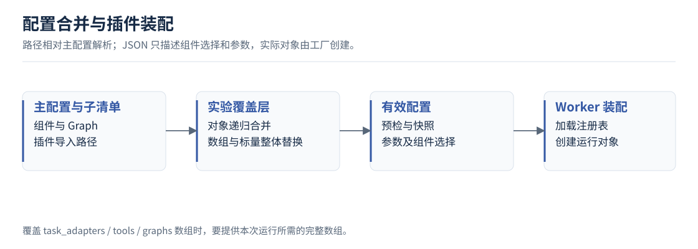
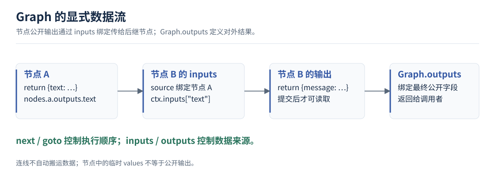
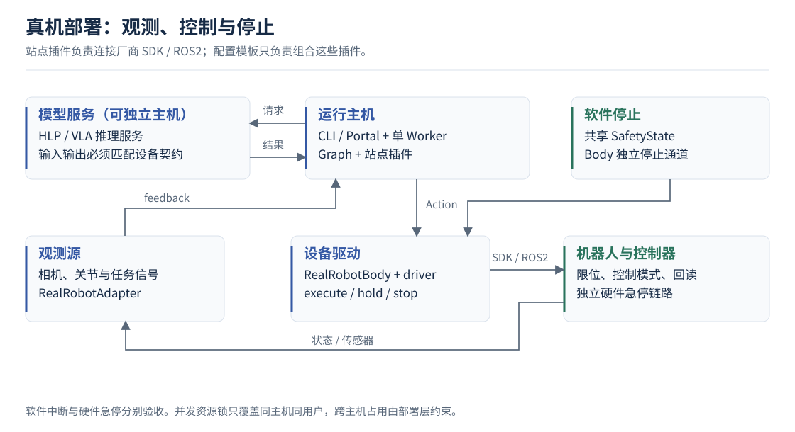

# RoboTenon 开发与使用手册

[English](development-guide.md) · [**简体中文**](development-guide.zh-CN.md)

本手册说明配置装配与组件开发接口。首次安装和运行请从[教程](tutorials/README.zh-CN.md)开始；查参数用[执行与观测参考](execution-and-observability.zh-CN.md)，查子系统职责用[模块参考](module-guide.zh-CN.md)。

示例中的插件代码是接口片段，涉及驱动、模型或环境连接时，需要补齐相应依赖与业务实现。

## 内容导航

| 主题 | 章节 |
| --- | --- |
| 配置与启动 | [基本约定](#0-基本约定)、[主配置](#3-主配置一次装配所有组件)、[实验运行](#4-运行单任务和批量任务) |
| 流程和模型 | [Graph](#5-graph定义运行流程)、[Module](#6-开发-module)、[Tool](#7-开发-tool) |
| 环境和设备 | [Body](#8-开发-body)、[Environment](#9-开发-environmentadapter-和-session)、[TaskAdapter](#10-task-adapter任务集合放在哪里) |
| 运行管理 | [安全与停止](#11-monitor安全和停止)、[观测与 Portal](#12-观测视频trace-和-web-portal)、[部署](#13-benchmark-与真机部署) |
| 排查与维护 | [问题排查](#14-常见问题排查)、[插件检查](#15-新增插件的开发清单)、[代码导航](#16-代码导航) |

## 0. 基本约定

### 0.1 统一实验入口

实验统一从下面的脚本启动：

~~~bash
Tenon run --config runs/robocasa365/config.json
~~~

脚本本身不应该出现 RoboCasa、VLA、HLP、ROS2 或某个具体机器人型号的判断。它只读取主配置，再由注册表装配组件。

### 0.2 参数通过 Params 读取

配置中的业务参数由 Parameter 模块加载，最终注入同一个 ctx.params。模块不要自行读取第二份 JSON：

~~~python
timeout_ms = ctx.params.get("policy.action_timeout_ms", [int, None])
~~~

[类型, 默认值] 是参数访问契约。对必须配置的参数使用 [类型, None]，随后显式检查 None；不要在模块内部悄悄写一个与配置不一致的默认值。

### 0.3 动作通过 Body 执行

Environment 负责连接环境、reset、observe 和 command；Body 负责执行 ActionChunk、动作超时、安全中断和停止。不要在 EnvironmentSession 中添加 apply_action()，也不要在 Module 中直接调用 simulator、ROS2 或机器人 SDK。

## 1. 框架解决什么问题

一次具身实验通常同时包含：

- 一个任务或一组任务；
- 一个仿真器或真实机器人环境；
- 一个高层规划器（HLP）、低层 VLA、验证器等模型；
- 一段带循环、条件跳转和恢复逻辑的 Graph；
- 动作执行、安全监控、观测缓存、Trace 和实验结果。

RoboTenon 把这些职责拆成独立边界，然后由一个主配置组合它们：

~~~mermaid
flowchart LR
    A[主配置] --> P[Params]
    A --> TA[Task Adapter]
    A --> G[入口 Graph]
    A --> E[Environment Adapter]
    A --> B[Body]
    A --> M[Modules]
    A --> T[Tools]
    A --> MO[Monitors]
    TA -->|TaskCase| R[Experiment Runner]
    R -->|SessionSpec| E
    E -->|Feedback| W[GraphRuntime]
    W --> M
    M --> T
    W -->|ActionChunk| B
    B --> D[动作驱动器 / SDK / 仿真 env.step]
    E --> O[Observation Cache]
    W --> X[Trace / Metrics]
~~~

核心边界如下：

| 组件 | 负责什么 | 不负责什么 | 典型实现 |
| --- | --- | --- | --- |
| Task Adapter | 决定一次实验包含哪些任务、顺序、seed、horizon | 不连接摄像头、不执行动作 | robocasa365、single-task |
| EnvironmentAdapter | 管理环境连接，并按 Run 创建 Session | 不执行 Action | RoboCasa365Adapter、RealRobotAdapter |
| EnvironmentSession | reset、observe、command、健康状态和反馈序号 | 不拥有 apply_action | RoboCasa365Session、RealRobotSession |
| Body | 接收 ActionChunk，执行动作、超时、停止、幂等 ack | 不决定任务目标、不替代环境观测 | RoboCasa365Body、RealRobotBody |
| Module | Graph 节点逻辑，读取/更新 GraphContext | 不加载另一个模型实例、不创建环境连接 | PlanModule、VerifyModule |
| Tool | 常驻可复用能力，如 HLP、VLA、Memory、Skill | 不决定 Graph 跳转 | Qwen3.5-VL、Xiaomi-Robotics-1 |
| Monitor | 周期或按请求检查安全/合规状态 | 不直接驱动机器人 | SafetyMonitorService |
| GraphRuntime | 调度节点、条件跳转、恢复和 checkpoint | 不包含厂商 SDK 细节 | workflow/runtime.py |

一个 RoboCasa episode 的调用顺序通常是：

~~~text
Task Adapter.enumerate_cases()
  -> EnvironmentAdapter.open(SessionSpec)
  -> env.reset
  -> plan Module -> HLP Tool
  -> action Module -> VLA Tool -> ActionChunk
  -> body.execute(ActionChunk)
  -> env.observe
  -> verify Module -> HLP/Verifier Tool
  -> evaluate Module
  -> 根据 goto 决定继续 action、重新 plan 或 END
~~~

## 2. 安装与首次运行

安装命令、Fake 冒烟、配置检查与预期输出统一放在[首次运行教程](tutorials/01-first-run.zh-CN.md)。首次仿真见[单任务教程](tutorials/02-first-simulation.zh-CN.md)。

开发时用 `python -m pytest -q` 运行回归；验证新增插件时，应同时覆盖实例装配、调用结果、失败清理和进程模式。历史测试结果见[更新记录](changes/README.zh-CN.md)。

## 3. 主配置：一次装配所有组件

### 3.1 主配置的职责

主配置负责引用各类子清单，并提供所有运行参数。一个最小结构如下：

~~~json
{
  "config_version": 1,
  "modules_config": "modules.json",
  "graphs_config": "graphs.json",
  "tools_config": "tools.json",
  "monitor_config": "monitors.json",
  "bodies_config": "bodies.json",
  "environments_config": "envs.json",
  "task_adapters_config": "task_adapters.json",
  "parameters": {
    "runtime": {
      "environment_id": "fake",
      "graph_id": "demo",
      "horizon": 16
    },
    "task": {
      "task_id": "demo-task",
      "env_id": "fake",
      "seed": 0
    },
    "policy": {
      "action_timeout_ms": 1000,
      "action_chunk_size": 16
    }
  }
}
~~~

各引用路径默认相对于主配置文件所在目录解析。因此主配置是 runs/robocasa365/config.json 时，generated config_graphs.json 指向同一 extension 的 configs 目录，而不是当前 shell 目录下的同名文件。

主配置可以内联子清单，但生产配置建议使用独立文件，便于 Web 端选择、审查和复用。

### 3.2 子清单的共同字段

modules、tools、bodies、environments 和 task_adapters 的单项通常包含：

~~~json
{
  "id": "policy_main",
  "name": "my-policy",
  "version": "1.0.0",
  "kind": "policy",
  "enabled": true,
  "params": {
    "checkpoint": "weights/policy.pt"
  }
}
~~~

- name：注册表中的 provider 名称；
- id：本次配置中实例的稳定名称，Graph/Module 通常引用它；
- version：启动时校验注册实现版本；
- kind：启动时校验类别，如 model、planner、local；
- enabled：是否装配；
- params：可序列化构造参数；不能把 Python 回调、SDK 对象或打开的文件句柄写进 JSON。

同一个 name 可以有多个实例，但必须有不同的 id。同一个 provider 出现多次时，代码必须使用实例 id，不能依赖 provider 名称别名。

### 3.3 参数读取规则

参数 JSON 可以写成嵌套对象：

~~~json
{
  "parameters": {
    "policy": {
      "action_timeout_ms": 1000
    }
  }
}
~~~

代码统一这样读：

~~~python
timeout_ms = ctx.params.get("policy.action_timeout_ms", [int, None])
if timeout_ms is None:
    raise ValueError("missing required parameter: policy.action_timeout_ms")

camera_size = ctx.params.get("render.camera_width", [int, 640])
~~~

规则：

- policy.action_timeout_ms 先按完整 key 查找，再按点号路径查找；
- params.get(name) 只返回值，不做类型校验；
- params.get(name, [type, default]) 会做严格类型校验；
- params.resolve(name) 适合 Task Adapter 读取可选值；
- 参数缺失时使用的默认值应写在调用点，真正影响实验复现的值最好直接写入 config；
- ctx.params 是当前实验冻结后的视图，Module、Tool 和 Runner 看到的是同一份参数。

### 3.4 实验覆盖层

可以在不修改基准配置的情况下提供覆盖层：

~~~bash
Tenon run \
  --config runs/robocasa365/config.json \
  --experiment-config configs/experiments/demo.json
~~~

基础子清单之间使用严格合并：相同叶子 key 会报冲突；实验覆盖层使用显式覆盖规则：对象递归合并，数组和标量整体替换。

## 4. 运行单任务和批量任务

### 4.1 单任务

~~~bash
Tenon run \
  --config runs/robocasa365/config.json \
  --task-id CloseBlenderLid \
  --seed 7 \
  --graph-id benchmark_rollout
~~~

单任务入口会从主配置解析 runtime.environment_id、runtime.graph_id、task.*、model.*、render.* 和 policy.*。命令行参数只做本次请求的覆盖，不会修改 JSON 文件。

### 4.2 批量实验

~~~bash
Tenon run \
  --batch \
  --config runs/robocasa365/config.json \
  --output-dir data/xr365/eval \
  --save-videos \
  --save-traces
~~~

Task Adapter 按主配置清单的数组顺序枚举任务；进程并行时完成顺序不固定。RoboCasa365 的任务集合由环境 registry 和筛选条件决定，展开逻辑属于 Task Adapter。真机通常使用 single-task，一次生成一个 TaskCase。

常用覆盖参数：

| 参数 | 作用 |
| --- | --- |
| --task-set target50 | RoboCasa 任务集合 |
| --task-name OpenFridgeDrawer | 只选指定任务；可重复传入 |
| --max-tasks 10 | 批量最多运行多少任务 |
| --num-trials 2 | 每个任务运行多少 episode |
| --seed 7 | 覆盖基础 seed |
| --horizon 16 | 覆盖每个 case 的步数上限 |
| --save-videos | 每个 episode 保存 mp4 |
| --save-traces | 每个 episode 创建 Trace 目录 |
| --camera-width 640 --camera-height 480 | 覆盖相机观测尺寸 |
| --video-fps 20 --video-stride 1 | 视频帧率和采样步长 |
| --run-id name | 固定批量目录名 |

例如只跑两个任务：

~~~bash
Tenon run --batch \
  --config runs/robocasa365/config.json \
  --task-name OpenFridgeDrawer \
  --task-name CloseBlenderLid \
  --num-trials 1 \
  --save-videos --save-traces
~~~

### 4.3 输出目录

批量结果默认类似：

~~~text
data/xr365/eval/<run-id>/
├── status.json
├── summary.json
├── long_term_memory.json
├── <task-name>/
│   ├── episode_000_seed_7.json
│   ├── episode_000_seed_7.mp4
│   ├── episode_000_seed_7.trace/
│   │   ├── trace.jsonl
│   │   └── trace.sqlite3
│   └── stats.json
~~~

多 Task Adapter 时，任务目录前面会增加 adapter 目录：

~~~text
<run-id>/<adapter-id>/<task-name>/episode_000_seed_0.json
~~~

实时查看进度：

~~~bash
python -m json.tool data/xr365/eval/<run-id>/status.json
python -m json.tool data/xr365/eval/<run-id>/summary.json
~~~

status.json 的 total_episodes、completed_episodes、active 是并行进度来源，current 仅为单项摘要；summary.json 的 num_episodes、successes、episode_success_rate 是汇总来源。不要仅通过目录文件数量推测进度。

### 4.4 终端日志

统一入口默认会输出适合人直接阅读的进度日志。日志写到 `stderr`，最终结果 JSON 仍写到 `stdout`，所以既可以直接看，也可以安全地交给脚本解析：

~~~bash
Tenon run --batch --config runs/robocasa365/config.json 2>run.log
Tenon run-fake >result.json
~~~

批量运行的日志会显示配置、入口 Graph、环境、Task Adapter 顺序、当前任务、`completed/total`、成功/失败、环境步数、耗时和最终成功率；单任务会显示实际 task、env、graph、步数、耗时以及视频/Trace/结果文件路径。终端输出示例（任务数和耗时仅为演示）：

~~~text
────────────────────────────────────────────
 RoboTenon  batch experiment
────────────────────────────────────────────
[12:30:01] INFO    graph=benchmark_rollout  environment=robocasa365
[12:30:01] INFO    task adapters: robocasa365
[12:30:01] RUN     [1/317] robocasa365/OpenFridgeDrawer  episode=0, seed=7
[12:30:18] OK      [1/317]  robocasa365/OpenFridgeDrawer  episode=0  success  steps=16  elapsed=16.7s
...
[12:44:10] OK      success=241/317 (76.0%)  attempted=317  errors=0
~~~

单任务还会在执行期间输出 `NODE` 行，标出 Graph 节点的进入、完成和错误状态，便于没有打开 Web Portal 时判断当前卡在哪一个节点。

需要查看每条任务生成的视频、Trace 和 episode JSON 时加 `--verbose`；在 CI 或脚本中不需要进度日志时加 `--quiet`；日志环境不支持 ANSI 时加 `--no-color`。错误任务会以 `FAIL`/`ERROR` 单独列出，但批量运行会继续执行后续 case，并以 `num_errors` 决定最终退出码。

### 4.5 进程并行与记忆

普通 Graph 也能启用动态模型 batching，不要求从 benchmark 入口运行。`--batch` 用于遍历任务，`runtime.execution.batch_services` 才配置模型合批。完整 CPU 示例、Provider 接口、Tool 配置、8卡部署和独立 Python 环境说明见[普通 Graph 动态 batching](graph-batching.zh-CN.md)。

在主配置的 `parameters.runtime.execution` 中选择 `backend: "process"` 与 `max_workers`；也可使用 `configs/experiments/parallel.json` 覆盖层。每个 Worker 内串行执行任务并复用 Tool，任务各自创建环境、Body、Module 和上下文。不要用同进程 `asyncio.gather` 并发多个 RoboCasa Session。

批量记忆默认使用 `snapshot`：各任务读取输入快照，父进程按 case 顺序归并结果；需要前一任务写入立即影响后一任务时，选择 `sequential` 且只用一个 Worker。进程产物按 attempt 隔离；共享 Trace、Metrics 位于运行的 `observability/`。完整命令、字段和目录见[执行与统一观测](execution-and-observability.zh-CN.md)。

## 5. Graph：定义运行流程

### 5.1 Graph 文件结构

一个 graphs.json 可以放多个有名字的 Graph：

~~~json
{
  "config_version": 1,
  "graphs": [
    {
      "id": "pick_and_place",
      "entry": "reset",
      "backend": "fallback",
      "max_steps": 100,
      "nodes": [{"id": "reset", "type": "system", "operation": "env.reset"}]
    }
  ]
}
~~~

runtime.graph_id 必须指向其中一个 id。Graph 可以嵌套，嵌套 Graph 共享同一个 GraphContext、Environment、Body、Tools 和安全状态。

### 5.2 三种节点

Module 节点：

~~~json
{"id": "plan", "type": "module", "module": "plan"}
~~~

System 节点：

~~~json
{"id": "observe", "type": "system", "operation": "env.observe"}
~~~

Nested Graph 节点：

~~~json
{"id": "recovery", "type": "graph", "graph": "recover_pause"}
~~~

常用 system operation：

~~~text
env.reset
env.observe
env.close
body.execute
body.interrupt
monitor.check
monitor.latest
monitor.request
monitor.request.<monitor_id>
safety.snapshot
graph.stop
~~~

### 5.3 前驱、并行和汇聚

新 Graph 推荐显式写 predecessors：

~~~json
{
  "id": "join",
  "module": "merge_result",
  "predecessors": ["vision", "plan"]
}
~~~

前驱通过 next 同时选中多个后继时可以并行调度；join 必须等所有 predecessors 都完成并选中自己。各节点的 ctx.values 和 NodeResult.state_patch 属于私有工作区，可以使用相同 key；读取前驱结果使用 ctx.results。

互斥分支汇聚时使用内层 OR 组；外层各组之间仍是 AND：

~~~json
{
  "id": "evaluate",
  "module": "evaluator",
  "predecessors": [
    ["capture_after_policy", "capture_after_recovery"]
  ]
}
~~~

上述节点在两个 capture 任一个完成并通过 next 选中它后执行。`["a", ["b", "c"]]` 表示 `a AND (b OR c)`；`[["a", "b"], ["c", "d"]]` 表示两个 OR 组都必须各收到一个凭据。只允许两层，组不能为空，同一前驱不能重复出现在多个组。普通一维 `["a", "b"]` 继续表示严格 AND。`goto` 仍绕过这些等待规则。

### 5.4 条件跳转和结束

~~~json
{
  "id": "evaluate",
  "type": "module",
  "module": "evaluator",
  "predecessors": ["observe"],
  "goto": [
    {"node": "plan", "when": "ctx.results['evaluate']['continue'] == true and ctx.results['evaluate']['needs_plan'] == true"},
    {"node": "action", "when": "ctx.results['evaluate']['continue'] == true and ctx.results['evaluate']['needs_plan'] == false"}
  ],
  "default": "END"
}
~~~

普通后继使用 next 并声明目标 predecessors；跨节点回跳使用 goto；自循环使用 loop（可配置 every 和 when）。所有匹配的分支都会生效，兜底使用 default。END 仅结束分支，停止整个当前图使用 system 操作 graph.stop。

条件语言是受限表达式，只允许 ctx 查找、字面量、比较、and/or/not、in/not in，不允许调用任意 Python 函数。循环必须配置合理的 max_steps。

### 5.5 Emergency 和 Recovery

~~~json
{
  "emergency_graphs": {
    "P3": "emergency_pause",
    "P4": "emergency_stop"
  },
  "recovery": {
    "P3": {
      "mode": "manual",
      "recovery_graph": "recover_pause",
      "resume_graph": "pick_and_place",
      "clear_latched": true
    }
  }
}
~~~

P3/P4 时 Body watchdog 先停止当前动作，Graph 再进入 emergency graph。真实硬件急停必须由机器人安全控制器或 RealRobotBody 的 driver 实现；EnvironmentSession.command("stop") 不是物理急停的替代品。

## 6. 开发 Module

### 6.1 基类和调用契约

官方 Module 应继承 BaseModule：

~~~python
from typing import Any

from robotenon.modules import BaseModule
from robotenon.runtime.registry import register_module

@register_module(
    "my-planner",
    version="1.0.0",
    kind="planner",
    description="A small example planner",
)
class MyPlanner(BaseModule):
    async def run(self, ctx: Any) -> dict[str, Any]:
        task_id = ctx.params.get("task.task_id", [str, None])
        if not task_id:
            raise ValueError("task.task_id is required")
        ctx.values["instruction"] = f"complete {task_id}"
        return {"instruction": ctx.values["instruction"]}
~~~

BaseModule 提供可选 start()/close()，必须实现 run(ctx)。Module Protocol 仍然保留，外部兼容插件也可以只实现结构化的 invoke(arguments, context)；但只有带 Graph run(ctx) 的模块才能直接放入 JSON Graph 节点。

### 6.2 Module 可以从哪里取数据

~~~text
ctx.params           当前实验 Params
ctx.values           跨节点业务状态
ctx.outputs          每个节点最近一次输出
ctx.feedback         最近一次 EnvironmentFeedback
ctx.action_chunk     最近生成的 ActionChunk
ctx.body_result      Body 执行结果
ctx.monitor_report   Monitor 报告
ctx.safety           当前安全快照
ctx.task_item        当前任务信息
ctx.step             Graph 步数
ctx.current_graph    当前 Graph
ctx.current_node     当前节点
~~~

调用 Tool 使用统一的常驻实例：

~~~python
result = await ctx.call_tool(
    "vla_main",
    {"instruction": ctx.values["instruction"], "max_actions": 10},
)
if not result.ok:
    raise RuntimeError(result.error or "VLA failed")
~~~

不要在 run() 中 from_pretrained()、新建数据库连接、创建 Environment Session 或直接操作 Body。大模型、Memory、Skill 都应该进入 Tool。

### 6.3 注册和配置

my_package/planner.py：

~~~python
@register_module("my-planner", kind="planner")
class MyPlanner(BaseModule):
    ...
~~~

configs/modules.json：

~~~json
{
  "plugin_modules": ["my_package.planner"],
  "modules": [
    {
      "id": "planner_main",
      "name": "my-planner",
      "kind": "planner",
      "params": {}
    }
  ]
}
~~~

Graph 使用实例 id：

~~~json
{"id": "plan", "type": "module", "module": "planner_main"}
~~~

plugin_modules 只是导入并触发注册；实例构造由 runtime.factory.build_module_runtime() 统一完成。

## 7. 开发 Tool

### 7.1 Tool 的职责

Tool 是常驻、可复用能力。HLP、VLA、Memory、Skill 和外部推理服务都应该注册成 Tool，而不是塞进某个 Module。Tool 不决定 Graph 的下一步，只返回结果；是否继续、重新规划或停止由 Module/Graph 决定。

Tool 由 WorkerRuntime 持有，模型权重或客户端可跨任务复用；未声明 deployment 时，外部模型服务仍需单独部署；按 Worker 托管部署见[模型部署说明](worker-model-deployment.zh-CN.md)。任务结束调用可选的 `async def end_session(self, session_id)` 清理会话缓存、观测 resolver 和上下文引用，Worker 关闭才释放模型和连接。

### 7.2 实现 BaseTool

~~~python
from collections.abc import Mapping
from typing import Any

from robotenon.tools import BaseTool, ToolContext, ToolResult, register_tool

@register_tool(
    "my-policy-model",
    version="1.0.0",
    kind="model",
    description="A resident policy service",
)
class MyPolicyModel(BaseTool):
    def __init__(self, endpoint: str, timeout_s: float = 30.0):
        self.endpoint = endpoint
        self.timeout_s = timeout_s
        self.client = None

    async def start(self) -> None:
        self.client = await create_client(self.endpoint, timeout=self.timeout_s)

    async def call(
        self,
        arguments: Mapping[str, Any],
        context: ToolContext,
    ) -> ToolResult:
        result = await self.client.generate(
            prompt=str(arguments.get("prompt", "")),
            observation=context.observation,
        )
        return ToolResult(output=result, metadata={"endpoint": self.endpoint})

    async def close(self) -> None:
        if self.client is not None:
            await self.client.close()
            self.client = None
~~~

ToolContext 常用字段：

~~~text
context.ctx          当前 GraphContext/ModuleContext
context.params       当前实验参数
context.values       共享业务状态
context.feedback     当前反馈
context.observation  ObservationResolver 解码后的观测视图
context.session_id   当前 session
await context.call("other_tool", {...})
~~~

Tool 也可以返回原始 JSON 兼容值，Runtime 会自动包装成 ToolResult(ok=True, output=...)。

配置示例：

~~~json
{
  "plugin_tools": ["my_package.models"],
  "tools": [
    {
      "id": "policy_model",
      "name": "my-policy-model",
      "kind": "model",
      "params": {
        "endpoint": "http://127.0.0.1:9000/v1",
        "timeout_s": 60
      }
    }
  ]
}
~~~

构造参数来自 params；无法 JSON 序列化的 client、driver 或共享状态应该由 bootstrap 注入。所有 Tool 在 Module 之前启动一次，应用退出时逆序关闭。

## 8. 开发 Body

### 8.1 Action 数据流

~~~text
Module -> ActionChunk(actions=[Action, ...]) -> Body.execute -> BodyExecutionResult
~~~

ActionChunk 可以包含多个 Action。Body 负责逐个执行、检查 session、deadline、idempotency key、安全等级和当前中断状态。Body 返回 BodyExecutionResult，表达 status、executed_actions、action_results 和错误原因。

### 8.2 官方 Body 基类

~~~python
from robotenon.bodies import BaseBodyService, register_body
from robotenon.schemas import ActionChunk, BodyExecutionResult, EnvironmentHealth

@register_body("my-body", kind="robot", version="1.0.0")
class MyBody(BaseBodyService):
    async def start(self) -> None:
        ...

    async def execute(self, action_chunk: ActionChunk) -> BodyExecutionResult:
        ...

    async def interrupt(self, reason: str, *, safe_action=None) -> BodyExecutionResult:
        ...

    async def health(self) -> EnvironmentHealth:
        ...

    async def close(self) -> None:
        ...
~~~

五个方法都是必要边界：start、execute、interrupt、health、close。InProcessBodyService 已实现通用的安全 watchdog、动作 deadline、幂等 ack 和安全动作逻辑；RoboCasa/真机 Body 通常继承它，只实现 _execute_action 和底层 stop/hold 适配。

### 8.3 RoboCasa 和真机的区别

- RoboCasa365Body：把 Action 转成 simulator action，并通过自己的 action driver 调用 env.step()；这段逻辑在 Body，不在 RoboCasa365Session。
- RealRobotBody：把 Action 转成统一的真机格式，调用注入的 ROS2/SDK/RPC driver；停止时优先调用 driver 的 hold() 或 stop()。
- EnvironmentSession 只负责相机、关节、末端、夹爪等观测和环境命令。

真机 driver 必须由启动代码注入：

~~~python
body = await initialize_body_service(
    loaded.bodies,
    runtime={"driver": ros2_driver},
    safety_state=safety_state,
)
~~~

如果 require_driver=true，没有注入 driver 时必须启动失败，不能把未连接的机器人伪装成 ready。

## 9. 开发 EnvironmentAdapter 和 Session

### 9.1 生命周期

EnvironmentAdapter 负责连接和 Session 管理，EnvironmentSession 是一次 Run 的会话。统一 Runner 按任务创建并关闭两者；独立环境服务可以按自己的所有权规则保持 Adapter 常驻：

~~~text
build adapter -> connect -> open(SessionSpec)
  -> session.reset/observe/command
  -> session.close -> adapter.close
~~~

官方基类：

- BaseEnvironmentAdapter：connect、open、create_session、health、close 和 Session 管理；子类实现 _create_session。
- BaseEnvironmentSession：session id、sequence number、pause/resume/stop、Feedback 构造和 close；子类实现 reset、observe。

Protocol 仍保留给第三方插件。官方维护的 provider 应优先继承基类以复用生命周期逻辑。

### 9.2 最小环境插件

~~~python
from typing import Any

from robotenon.envs import (
    BaseEnvironmentAdapter,
    BaseEnvironmentSession,
    register_environment,
)
from robotenon.schemas import EnvironmentDescriptor, EnvironmentFeedback, Observation, SessionSpec

class MySession(BaseEnvironmentSession):
    async def reset(self, context: Any) -> EnvironmentFeedback:
        self._reset_lifecycle(context)
        return self._new_feedback(
            observation=Observation(state={"ready": True}),
        )

    async def observe(self, request: Any = None) -> EnvironmentFeedback:
        self._ensure_open()
        return self._new_feedback(
            observation=Observation(state={"request": request}),
        )

@register_environment("my-environment")
class MyAdapter(BaseEnvironmentAdapter):
    descriptor = EnvironmentDescriptor(
        env_id="my-environment",
        env_version="1.0.0",
        display_name="My Environment",
        backend_kind="local",
        observation_modalities={"state", "rgb"},
    )

    def _create_session(self, spec: SessionSpec) -> MySession:
        return MySession(spec)
~~~

envs.json：

~~~json
{
  "plugin_environments": ["my_package.environment"],
  "environments": [
    {
      "id": "lab",
      "name": "my-environment",
      "version": "1.0.0",
      "params": {}
    }
  ]
}
~~~

### 9.3 Feedback 和观测帧

每次 reset/observe 应返回 EnvironmentFeedback。图像、深度、状态等放在 Observation 中：

~~~python
Observation(
    frames=[
        ObservationFrame(
            frame_id="camera.front",
            role="policy_input",
            modality="rgb",
            producer="sim_renderer",
            data=image_array,
            shape=[480, 640, 3],
        )
    ],
    state={"gripper": 0.0},
)
~~~

生产运行建议通过 Observation Cache 持久化大媒体，并在 Feedback 中传 ObservationRef/cache URI，而不是把完整 ndarray 长期放进 ctx 或 Trace。Feedback 的 sequence_no 必须单调递增，便于 VLA 历史窗口、轨迹浏览和恢复。

## 10. Task Adapter：任务集合放在哪里

Task Adapter 只决定“本次实验要跑哪些 case”，不负责环境连接和动作执行。

### 10.1 单任务

SingleTaskAdapter 从 task.task_id、task.env_id、task.seed 和 runtime.horizon 生成一个或多个 episode，适合真机：

~~~json
{
  "task_adapters": [
    {
      "id": "real_task",
      "name": "single-task",
      "params": {
        "task_id": "OpenFridgeDrawer",
        "environment_id": "real_robot",
        "num_trials": 1
      }
    }
  ]
}
~~~

### 10.2 RoboCasa365

RoboCasa365TaskAdapter 负责从 RoboCasa task registry 读取集合、筛选 task_names/task_set、展开 TaskCase、计算 horizon，并生成稳定的全局 index 和 seed。任务数量取决于安装的 registry 与筛选条件，展开逻辑不在 scripts/run_experiment.py。

自定义 Adapter：

~~~python
from collections.abc import Iterator

from robotenon.infra.params import Params
from robotenon.task_adapters import BaseTaskAdapter, TaskCase, register_task_adapter

@register_task_adapter("my-dataset", kind="dataset")
class MyDatasetAdapter(BaseTaskAdapter):
    def enumerate_cases(self, *, adapter_id: str, params: Params) -> Iterator[TaskCase]:
        yield TaskCase(
            adapter_id=adapter_id,
            task_id="pick-cup",
            environment_id="my-environment",
            index=0,
            episode=0,
            seed=0,
            horizon=32,
        )
~~~

清单中多个 Adapter 按数组顺序枚举；并行任务可能乱序完成，最终结果按 case 顺序汇总。

## 11. Monitor、安全和停止

Monitor 可以是 resident、request 或 resident + request。Monitor 返回 MonitorReport，由 SafetyStateStore 合并为 P0-P4：

| 等级 | 含义 | 处理 |
| --- | --- | --- |
| P0 | 正常 | 允许动作 |
| P1 | 提示/监控 | 可按策略自动恢复 |
| P2 | 受限 | 进入受限或恢复流程 |
| P3 | 保护暂停 | Body 中断动作，通常需要人工确认 |
| P4 | 急停 | 硬件/Body 安全停止，必须人工或硬件复位 |

Body 的 interrupt() 是动作执行边界；Environment 的 command("stop") 只是环境命令。真实机器人必须让 RealRobotBody 或低层安全控制器提供可靠的 hold/stop。

## 12. 观测、视频、Trace 和 Web Portal

### 12.1 视频和分辨率

~~~json
{
  "parameters": {
    "render": {
      "camera_width": 640,
      "camera_height": 480,
      "video_path": "data/videos/example.mp4",
      "video_stride": 1,
      "video_fps": 20
    }
  }
}
~~~

批量运行使用 --save-videos，Runner 会为每个 case 生成同名 mp4。视频是否生成取决于 Environment 是否支持渲染/录制；真机通常展示实时观测或缓存图片，而不是强行生成仿真视频。

### 12.2 Observation Cache

~~~json
{
  "observation_cache": {
    "enabled": true,
    "backend": "hybrid",
    "storage": {
      "root": "./data/observations",
      "index": "./data/observations/index.sqlite3"
    },
    "uri_scheme": "cache"
  }
}
~~~

cache:// 是逻辑 URI；实际文件由 storage.root 决定，索引在 storage.index。不要把 cache:// 当作操作系统路径直接拼接。

### 12.3 Metrics：聚合指标和自定义打点

Metrics 用来回答“发生了多少次、当前值是多少、延迟分布如何”。它不是业务状态存储，也不应该把每个 `run_id`、`session_id` 或完整模型输出作为 label。推荐的指标类型是：

| 类型 | 适合记录 | 示例 |
| --- | --- | --- |
| `counter` | 单调累加的次数/错误数 | `policy_calls_total` |
| `gauge` | 当前值 | `feedback_sequence`、队列深度 |
| `histogram` | 延迟、耗时、大小分布 | `policy_latency_ms` |

脚本入口可以为当前 episode 开启本地 WAL：

~~~bash
Tenon run \
  --config runs/robocasa365/config.json \
  --metrics-dir data/debug/episode-001
~~~

本地数据源下，单任务生成 `data/debug/episode-001/metrics.jsonl`，批量实验按 episode 分目录；进程批量默认写共享观测目录，显式外部数据源则写配置的目标。MetricsClient 只在控制进程中执行有界入队，后台 flush 负责写 WAL；因此不要在动作关键路径中直接调用 `MetricsDaemon.ingest()`。

在自定义 Module 中通过运行时注入的 `ctx.metrics` 打点：

~~~python
from robotenon.modules import BaseModule

class Planner(BaseModule):
    async def run(self, ctx):
        metrics = ctx.metrics
        if metrics is not None:
            # label 必须低基数；不要把 task_id/run_id 放进 label。
            metrics.counter(
                "planner_calls_total",
                labels={"component": "planner", "mode": "vla"},
                scope="episode",
            )
            metrics.gauge("planner_input_sequence", float(ctx.step), scope="step")
        return {"planned": True}
~~~

`ctx.metrics` 为空是合法情况，插件应当保持可运行。需要显式注册指标定义时使用 `MetricRegistry`，可以限制指标类型、label 名和 histogram bucket：

~~~python
from robotenon.infra.metrics import MetricDefinition, MetricRegistry

registry = MetricRegistry()
registry.register(
    MetricDefinition(
        "planner_latency_ms",
        "histogram",
        unit="ms",
        allowed_labels=frozenset({"component"}),
        histogram_buckets=(10, 25, 50, 100, 250, 1000),
    )
)
~~~

需要独立 metricsd 时，不要让每个插件各自创建 daemon；由应用启动一个 `Tenon metricsd`，插件使用注入的 `MetricsClient`/Unix socket sink。示例程序见 `examples/metrics_grafana_demo.py`。

### 12.4 Trace：持久化关键执行细节

单任务：

~~~bash
Tenon run \
  --config runs/robocasa365/config.json \
  --trace-dir data/debug/episode-001
~~~

批量：

~~~bash
Tenon run --batch \
  --config runs/robocasa365/config.json \
  --save-traces
~~~

本地数据源下，每个 Trace 目录通常包含 `trace.jsonl` 和 `trace.sqlite3`。GraphRuntime 会自动记录 Graph node，ToolRuntime 会自动记录 Tool 调用，并通过 parent span 关联到调用节点。要把自定义 Module 的关键阶段、决策摘要或对账结果落成 Trace，使用 `ctx.trace`：

~~~python
from robotenon.infra.trace import trace_observation, trace_value

class Planner(BaseModule):
    async def run(self, ctx):
        trace = ctx.trace
        if trace is None:
            return {"planned": True}

        attributes = {
            "kind": "module_decision",
            "node": ctx.current_node,
            "step": ctx.step,
            # 只写 URI/元数据，不复制 ndarray 或完整图片。
            **trace_observation(ctx.feedback),
        }
        with trace.span("planner.decision", attributes=attributes) as span:
            decision = {"planned": True, "action_count": 16}
            span.set_attribute("decision", trace_value(decision))
            span.add_event("decision_ready", {"action_count": 16})
            return decision
~~~

异步阶段可以使用 `async with trace.async_span(...)`。Trace span 离开上下文时自动写入开始时间、结束时间和状态；异常会标记为 `status=error` 并记录异常类型。Tool 中对应使用 `context.trace` / `context.metrics`，且 ToolRuntime 已经自动包裹每次 Tool 调用，自定义 span 会自然成为该 Tool span 的子 span。

建议落 Trace 的内容：

- 当前 graph/node、模型版本、请求摘要、输入 observation 的 `cache://` URI；
- HLP/VLA 的结构化输出摘要、动作 chunk 的大小、verifier/evaluator 的结论；
- 重试、超时、停止、恢复、安全等级变化和关键外部调用的结果；
- 任务成功/失败原因和用于复现的参数 hash。

不要落 Trace 的内容：

- 完整图片、视频帧、numpy/tensor 或未经截断的模型 prompt；
- 高基数 `run_id`/`session_id` label（它们放在 Trace 的标准字段中即可）；
- 每个循环都复制一份完整 `ctx`。大媒体应通过 Observation Cache 保存，只在 Trace 中记录 URI、shape、dtype、sequence 和 storage path。

Trace 与 Metrics 的边界是：Metrics 用于聚合和告警，Trace 用于单次执行的因果链和调试。不要把实时指标写进 `ctx.values` 作为持久化替代；`ctx.values` 只保留 Graph 后续节点需要的业务状态。

### 12.5 启动 Web Portal

为一个明确的 Trace 数据库启动只读查询 API：

~~~bash
Tenon web \
  --host 127.0.0.1 --port 8765 \
  --trace-db data/debug/episode-001/trace.sqlite3 \
  --no-experiment-submit --no-auto-grafana
~~~

先运行任务生成该数据库，再打开 <http://127.0.0.1:8765/api/traces?limit=20> 查看 JSON。当前只读模式的首页仍是实验列表，会提示实验提交已禁用。共享运行同样使用 `--trace-db` 指向共享库；也可用 `--source` 读取数据源配置。Web 不推断并行模式，不回退查找其他任务库，也不把 JSONL 重放进 SQLite。

需要完整实验浏览、提交和配置管理时，省略 `--no-experiment-submit`，显式传入 `--project-root . --config-root configs --experiment-output-root data/experiments`，并配置可查询的 Trace 数据源。实验元数据目录与 Trace 数据库是两个来源；实验详情按执行身份过滤配置库，找不到对应身份时显示不可用。

`runtime.web` 自动启动的是只读观测服务，随运行结束关闭，不包含完整实验管理。图片与视频还需要正确的媒体根目录/索引；配置共享 SQL 不会自动汇总所有 Worker 的图片索引。具体参数见[执行与统一观测](execution-and-observability.zh-CN.md)。使用 `Tenon web --help` 查看完整参数。

远程访问可转发端口：

~~~bash
ssh -N -L 18765:127.0.0.1:8765 user@server
~~~

## 13. Benchmark 与真机部署

### 13.1 独立 benchmark extension

Benchmark 统一使用生成的 `benchmark_rollout` Graph。模型作者实现 extension 的
`vla.py`，仿真协议由 `benchmark.py` 提供，`evaluate.py` 根据 `configs/*.json`
生成运行配置。以 RoboCasa365 Xiaomi 为例：

~~~bash
Tenon evaluate --benchmark robocasa365 \
  --profile xiaomi_official --backend ./extensions/benchmarks/systems/robocasa_hierarchical/tool/xiaomi/vla.py --backend-config ./extensions/benchmarks/systems/robocasa_hierarchical/tool/xiaomi/config.json \
  --sim-python /path/to/robocasa/python \
  --model-devices 0,1,2,3,4,5,6,7 \
  --workers-per-gpu 16 --batch-size 8 --wait-ms 50 \
  --output runs/robocasa365
~~~

生成配置中的 Graph 顺序为 reset、policy、execute、observe、terminal。旧 XR365
planner/verifier、独立 Xiaomi Tool/Module 和固定 8 卡配置已经移除。模型接入、
仿真推进、结果聚合和性能测试的边界见 extension README。

### 13.2 真机组合

完整接入与验收见[真机部署教程](tutorials/real-robot.zh-CN.md)。仓库提供核心
`RealRobotAdapter` 和 `RealRobotBody`，站点 extension 负责注入真实观测源、
厂商 driver、动作格式和安全策略。仓库不提供可直接控制硬件的默认主配置。

生产 driver 至少需要提供动作执行、hold/stop、健康检查和关闭，并在首次运行前
单独验证硬件急停。资源锁不能替代设备急停。

## 14. 常见问题排查

- 资源已预约：检查同用户是否已有运行占用相同 `resource_ids`，不要靠更换资源名称绕开同一硬件的互斥。
- Web 中没有任务 Trace：确认配置数据库与执行身份一致；任务目录存在不代表共享库中已有记录。
- Worker 异常退出：进程后端可按 `max_retries` 创建新 attempt；普通任务错误不自动重试。
- Coordinator 退出：当前不支持自动接管/恢复批量调度；Graph checkpoint 是另一层显式能力。
- 未知并行参数：使用 `runtime.execution`，不存在 `runtime.parallel.enabled`、`persistent_gpu_workers` 或 `max_in_flight`。

| 现象 | 优先检查 |
| --- | --- |
| unknown module/tool/body/environment | plugin_* 是否导入注册模块；name 是否拼写一致 |
| no enabled environment/body configuration | 主配置是否引用正确清单；是否至少有一个 enabled |
| multiple enabled configurations | 单进程服务只能选择一个 enabled Body/Environment，用 id 或 runtime.environment_id 明确选择 |
| missing required parameter | 参数是否位于 parameters 下；代码 dotted key 是否正确 |
| ParameterTypeError | JSON 类型是否正确；1 不应当当作字符串 1 |
| unknown configured graph | runtime.graph_id 是否和 graphs[].id 完全一致 |
| Graph 一直循环 | 检查 goto 条件、continue、needs_plan 和 max_steps |
| HLP/VLA endpoint unavailable | 模型进程、host、port、显存、日志和 dry_run |
| VLA 报 observation missing | Feedback 是否包含配置的相机/状态帧，Resolver 是否已启动 |
| 批量显示 0/0 | 先看 status.json；Task Adapter 是否产生 case；是否读错 run-id |
| Web 轨迹 JSON 截断 | Portal 和浏览器是否访问同一端口/隧道；大响应是否完整返回 |
| cache:// 找不到文件 | 查看 observation_cache.storage.root 和 index |
| driver_not_configured | 这是 fail-closed 保护；向 Body bootstrap 注入真实 driver |

建议按顺序定位：

~~~bash
Tenon modules-check --config runs/robocasa365/config.json
Tenon tools-check --config runs/robocasa365/config.json
Tenon graphs-check --config runs/robocasa365/config.json
Tenon run --config runs/robocasa365/config.json --dry-run
~~~

不要一开始就提交完整任务集；先用 Fake、单任务、dry-run，再打开真实模型、视频、Trace 和 Monitor。

## 15. 新增插件的开发清单

- [ ] 实现对应 Base 类，或说明为什么只使用兼容 Protocol；
- [ ] 使用 @register_* 注册稳定、可读的名称；
- [ ] 增加 plugin_* 导入路径和一个配置实例；
- [ ] 所有构造参数都能 JSON 序列化，运行时对象通过 bootstrap 注入；
- [ ] 增加成功、失败、超时、close 和重复启动测试；
- [ ] Module 不直接访问厂商 SDK，Tool 不复制 Graph 状态，Environment 不执行动作；
- [ ] Body 测试 ActionChunk、deadline、interrupt、safe stop 和幂等 key；
- [ ] Environment 测试 sequence、reset、observe、close 和 EnvironmentFeedback；
- [ ] Graph 测试正常路径、goto、循环上限和 emergency/recovery；
- [ ] 运行 pytest -q 和四个 *-check 命令；
- [ ] 文档说明模型、GPU、端口、环境变量和硬件前置条件。

## 16. 代码导航

~~~text
scripts/run_experiment.py       唯一统一实验入口
robotenon/runtime/runner_cli.py   CLI 参数和单任务/批量分流
robotenon/runtime/runner.py       一个 episode 的装配和执行
robotenon/runtime/experiment.py   按 Task Adapter 顺序运行批量实验
robotenon/runtime/config.py       主配置、子清单和 Params 装配
robotenon/runtime/factory.py      注册表加载、实例构造和生命周期
robotenon/workflow/definition.py  Graph JSON schema 和校验
robotenon/workflow/runtime.py     Graph 调度、system operation、恢复
robotenon/infra/params.py         参数合并、类型读取、配置 hash
robotenon/modules/base.py         Module Protocol、BaseModule、ModuleRuntime
robotenon/tools/base.py           ToolContext、BaseTool、ToolRuntime
robotenon/bodies/base.py          BaseBodyService
robotenon/services/body.py        通用安全 Body 实现
robotenon/envs/base/              Environment Protocol 和生命周期基类
robotenon/task_adapters/          TaskCase、Adapter 注册和批量评估
robotenon/infra/observation_*.py  Observation Cache/Resolver/Pipeline
robotenon/infra/trace.py          Trace client/daemon
robotenon/web/                    Portal、实验提交、轨迹和 SQL 查询
configs/                        可直接运行的主配置和子清单
tests/                          注册表、Graph、服务、Portal、缓存回归测试
~~~

专题文档：

- [架构说明](architecture.zh-CN.md)：服务边界、时序、安全和跨进程通信；
- [Graph 工作流](workflow.zh-CN.md)：调度器、恢复和并行规则；
- [插件开发专题](plugin_development.zh-CN.md)：按组件查看接口示例；
- [Observation Cache](observation-cache.zh-CN.md)：观测 URI、落盘、Resolver 和 UDS；
- [迁移说明](changes/migration-2026-09.zh-CN.md)：历史配置和入口迁移；
- [验证记录](changes/verification-2026-09.zh-CN.md)：当前版本回归检查。

执行层代码：`robotenon/runtime/execution.py` 定义配置与资源预约，`parallel.py` 管理进程，`worker.py` 管理常驻工具和任务生命周期，`observability.py` 装配数据源，`robotenon/infra/trace_query.py` 执行只读查询。

完整模块说明：[模块使用手册](module-guide.zh-CN.md)，按输入、输出、配置、生命周期和例子逐项解释。安全与任务判断：[Evaluator、Monitor 和 TaskQueue](evaluation-monitoring-and-task-queue.zh-CN.md)，包含可运行的模拟中断与队列示例。
