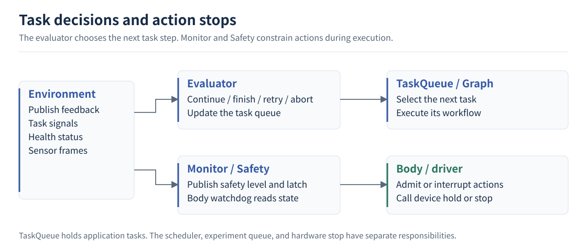
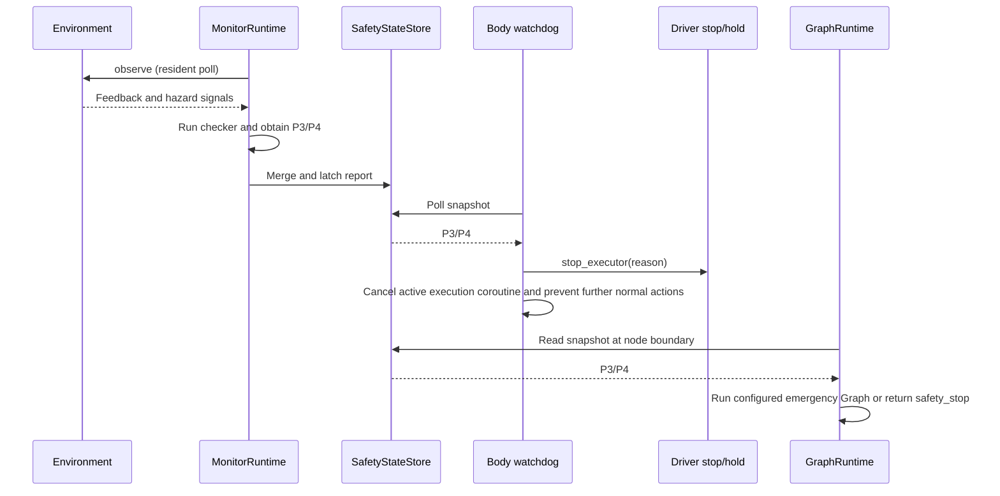

# Evaluator, Monitor, and TaskQueue

[**English**](evaluation-monitoring-and-task-queue.md) · [简体中文](evaluation-monitoring-and-task-queue.zh-CN.md)

Safety storage supports custom providers. `require_shared=true` checks the provider's shared capability. Built-in SQLite remains available. Replacing the store preserves P0–P4 latching, recovery approval, and the Body action boundary. See [infrastructure plugins](infrastructure-plugins.md) for interfaces and ownership.

The default Runner uses the registered MonitorRuntime. TaskQueue is a separate library for explicit integration. The default XR365 and batch execution paths do not consume it. See the [module guide](module-guide.md) for the other components.

## 1. Evaluator and Monitor responsibilities



Both can read images, call models, and produce decisions. Their consumers and invocation schedules differ.

| Aspect | Evaluator | Monitor |
| --- | --- | --- |
| Question | Has the goal been achieved? What should happen next? | Is it safe to continue? Is there a hazard? |
| Implementation | Ordinary Module of `kind="evaluator"` with no separate EvaluatorRuntime | Dedicated Monitor registry and MonitorRuntime |
| Invocation | When the Graph schedules the node | Periodic in resident mode or on demand in request mode |
| Input | GraphContext with task, feedback, action result, and STM | EnvironmentFeedback, optional request, and MonitorContext |
| Main output | Node result, task decision, and application state updates | MonitorReport published to SafetyStateStore |
| Plan updates | Can update Graph application state through node output | Does not revise the plan, advance the task, or clear its queue |
| Lifecycle | Assembled per task by default | Assembled per task by default; a lower-level service may run independently |
| Model access | Through a Tool | May reuse a checker or model client. The default MonitorContext does not guarantee a ToolRuntime |

For example, suppose the robot is closing a blender lid.

- `verify` decides whether the lid has closed. This affects the next planning step.
- `robocasa365_terminal` checks environment success, the step horizon, and Body failure to decide whether the rollout ends.
- Monitor checks for a reported collision or hazard and can trigger a stop even before the task finishes.

An unfinished task alone is not a hazard. Running both decisions only after an action finishes would leave the action unmonitored while in progress. Moving all completion checks to the background would introduce concurrent writes to planning state.

### Reusing model and decision logic

Share **inspection logic and model capabilities** while preserving **Graph-level task decisions and background safety publication**. For example, `inspect_observation(observation)` could return `goal_complete`, `risk_level`, and evidence. The Evaluator would map completion to Graph state, and the Monitor would map risk to MonitorReport.

This is a possible refactor. There is currently no common Checker interface. A slow vision model should not become the only safety channel. The drive stop and required independent monitoring should remain available while a model request queues.

The Evaluator in `task_adapters/evaluator.py` orchestrates and aggregates batch evaluation. The Graph Evaluator plugin is separate, as is the restricted Graph expression evaluator in `workflow/conditions.py`. They have different lifecycles.

## 2. Benchmark task execution

Standalone benchmarks use a common Graph:

```text
reset → policy → body.execute → observe → terminal
          ↑                              │
          └──────── continue ────────────┘
                                         END (success, environment termination, or horizon)
```

After each action the Environment/Body reads the native simulator result. The terminal node publishes success,
env_steps, native_metrics, and native_dimensions. The VLA isolates model history and action caches
by session. This rollout does not contain the old XR365 plan/verify branches. Implement a hierarchical
application as its own extension and Graph.

An action batch is separate from TaskQueue. Horizon counts real environment actions;
Graph.max_steps is the scheduling budget, and a dynamic model batch combines inference requests from multiple sessions.
The three counts are independent.

## 3. How a Monitor interrupt propagates

Monitor publishes a safety state. Body and Graph consume it independently. The Monitor does not directly terminate Graphs, Workers, or Python threads.



Body and Graph read independently. **Either may observe the new state first.** The diagram illustrates responsibilities.

The sequence has five parts.

1. **Evaluate.** The resident loop reads the environment and invokes the plugin. A request call returns a report directly. `feedback-safety` converts existing environment levels and signals; it does not detect collisions visually.
2. **Merge.** `MonitorRuntime._publish()` reconciles signals by Monitor owner. A new report can replace that instance's transient signals. P3/P4 remain latched. One Monitor's P0 cannot erase another source's hazard.
3. **Stop the action.** The Body watchdog defaults to `poll_hz=100` and interrupt threshold P3. On a hazard, interrupt sets the interrupt flag, calls the low-level stop_executor, and cancels the execution coroutine. A configured protective-action factory supplies the protective action. The stop callback defaults to a 0.5-second timeout; a failed stop publishes latched P4.
4. **Stop the workflow.** At a safety checkpoint, the Graph reads the same state and dispatches a mapped emergency_graph or returns safety_stop by default. It stops the normal Graph. Completing the emergency Graph does not imply task success or recovery.
5. **Recover.** After addressing the fault, follow explicit recovery. Higher-level recovery requires approval. A recovery Graph can run self-checks and select a resume entry point. A later P0 alone does not clear the latch.

### Scope of an interrupt

| Configuration | Components that can observe the same interrupt |
| --- | --- |
| One in-memory SafetyStateStore object | Components holding that object in the same process |
| SQLite with `scope="shared"` and the same actual path | Processes and services that read that database |
| SQLite with `scope="task"` | Components bound to the store relocated by the Runner for this task/attempt |
| Two Workers with separate task safety stores | Each is isolated by default; one does not automatically stop the other |
| The same path string on two machines | The stores remain distinct unless the deployment provides shared storage |

If Worker A detects a collision while A and B use separate task stores, A's Body stops and B continues. To stop cooperating processes for one robot, bind them to the same safety source and give each an appropriate stop consumer. **There is currently no controller that broadcasts cancellation of an entire batch experiment on every Monitor fault.**

A shared SQLite safety store and a shared Trace database serve different purposes. Reading shared traces from Web does not cause Workers to share safety state.

### Latency and physical hardware

The default resident Monitor, Graph, and Body watchdog run as asynchronous tasks in one process. `asyncio` schedules cooperatively. A blocking plugin or a long event-loop computation can delay all three. Resident and request calls on the same Monitor share a lock, so a slow request can postpone the next check.

Response time includes sampling, observe/check work, database access, Body polling, and driver stop/hold latency. At 5 Hz, Monitor sleeps for roughly 200 ms; at 100 Hz, Body sleeps for about 10 ms. **These periods do not guarantee a stop within 210 ms.** Loop work and queueing add latency. Updating the safety store does not forcibly cancel an arbitrary pending model request.

A UDS BodyClient uses separate execution and control connections so an interrupt need not wait for a long execute RPC. It cannot kill an arbitrary synchronous driver thread. Cancelling `asyncio.to_thread` may leave the underlying call running. Physical robots require reliable driver stop/hold and device-level watchdog/emergency-stop handling if Python fails. Software P4 itself does not cut hardware power.

Closing an unstarted Monitor does not clear a same-name external heartbeat from the shared store. A started instance clears only heartbeats associated with its own resident loops. Give concurrently active instances unique IDs in one store to avoid owner-name conflicts.

## 4. Runnable example: P3 interrupts a simulated action

Run [examples/monitor_body_interrupt.py](../examples/monitor_body_interrupt.py) from the repository root.

```bash
PYTHONPATH=. python examples/monitor_body_interrupt.py
```

This example simulates an action with an asynchronous sleep. It uses no robot, model, or persistent safety store. Request mode makes the trigger deterministic. Resident mode uses the same publication path after producing a report. To run the regression test, use `python -m pytest -q tests/test_monitor_body_interrupt_demo.py`.

Expect this sequence (log wording can follow the language of the example):

```text
[Body] Starting action, expected duration 30 seconds
[Monitor] Publishing hazard report: P3
[Body stop_executor] Sending low-level stop: safety_level_P3
[Monitor] report=P3, reason=simulated collision
[Body] status=interrupted, interrupted=True, error=safety_level_P3
```

The following code illustrates the complete flow. Use the linked repository file for the runnable example.

```python
import asyncio
from uuid import uuid4

from robotenon.monitors.runtime import MonitorRuntime
from robotenon.runtime.safety import SafetyStateStore
from robotenon.schemas import Action, ActionChunk, ActionType, MonitorReport, SafetyLevel
from robotenon.services.body import InProcessBodyService


class DemoMonitor:
    async def check(self, feedback=None, *, request=None, context=None):
        unsafe = bool((request or {}).get("unsafe"))
        return MonitorReport(
            compliant=not unsafe,
            safety_level=SafetyLevel.P3 if unsafe else SafetyLevel.P0,
            source="demo", reason="simulated hazard" if unsafe else "normal",
        )


async def main():
    safety = SafetyStateStore()
    action_started = asyncio.Event()
    stop_called = asyncio.Event()

    async def execute(action):
        action_started.set()
        await asyncio.sleep(30)  # Cancellable simulated action

    async def stop(reason):
        print("stop_executor:", reason)
        stop_called.set()

    body = InProcessBodyService(execute, safety_state=safety, stop_executor=stop)
    monitor = MonitorRuntime(
        {"demo": DemoMonitor()}, modes={"demo": {"request"}}, safety_state=safety,
    )
    session_id = uuid4()
    chunk = ActionChunk(session_id=session_id, actions=[
        Action(session_id=session_id, action_type=ActionType.WAIT, timeout_ms=60000)
    ])
    await body.start()
    await monitor.start()
    task = asyncio.create_task(body.execute(chunk))
    try:
        await asyncio.wait_for(action_started.wait(), 2)
        report = await monitor.request("demo", {"unsafe": True})
        await asyncio.wait_for(stop_called.wait(), 2)
        result = await asyncio.wait_for(task, 2)
        print("Report:", report.safety_level.value)
        print("Execution:", result.status.value)
        await monitor.request("demo", {"unsafe": False})
        print("Level remains latched after normal report:", safety.snapshot().level.value)
    finally:
        if not task.done():
            task.cancel()
            await asyncio.gather(task, return_exceptions=True)
        await monitor.close()
        await body.close()


asyncio.run(main())
```

Check that stop_executor runs, the execution result is interrupted, and the later P0 report leaves P3 latched. The number of stop log lines is not an exactly-once contract. Design the driver stop interface to tolerate repeated calls.

To see the robot stop while the environment keeps advancing, run the environment-level demo:

```bash
PYTHONPATH=. python examples/monitor_body_environment_demo.py --post-stop-seconds 3
```

The virtual robot moves forward while an obstacle and the environment tick advance independently. After the Monitor publishes P3 and Body returns `interrupted`, the demo runs the environment for three more seconds by default. Body sets the robot velocity to zero while the script continues capturing frames. The outputs are `runs/monitor-body-environment-demo.gif` and `runs/monitor-body-environment-demo.png`. The left comparison is taken at P3; the right shows a later tick, with the robot in the same position and the obstacle displaced. Increase `--post-stop-seconds` to observe a longer interval.

## 5. Using TaskQueue

`robotenon/core/queue.py` implements a **SQLite-backed TaskItem subtask queue**. Its methods include enqueue, claim_next, complete, fail, cancel, clear, branch, snapshot, and events. The `task_items` and `queue_events` tables record queue state and events. Owner/lease checks protect concurrent claims and completions.

The default Runner, GraphRuntime, and parallel backend do not create or consume TaskQueue. The class, unit tests, and Portal support for reading its tables remain available for explicit integrations.

| Mechanism | Contents | Consumer |
| --- | --- | --- |
| TaskQueue | High-level TaskItem subgoals with owner/lease | Explicit application integration |
| TaskAdapter / execution backend | Evaluation cases, episodes, attempts, and available Workers | Default batch execution |
| WaveScheduler | Ready Graph nodes and dependencies | Default Graph execution |
| `stm.remaining` | Remaining semantic subgoals for the current task | plan/verify |
| Xiaomi action queue | Predicted action vectors waiting to execute | Xiaomi Tool |
| Portal experiment queue | Experiment jobs awaiting launch | Web ExperimentManager |
| Metrics/Trace buffers | Observability events pending persistence | Telemetry clients and writers |

Lease recovery for TaskQueue therefore does not provide Coordinator crash recovery or exactly-once execution of physical actions.

### Runnable example: explicit TaskQueue integration

Save this example as `queue_demo.py` and run `python queue_demo.py`. It uses a temporary directory removed on exit. A persistent integration should choose a durable path and store its session ID.

```python
import asyncio
from pathlib import Path
from tempfile import TemporaryDirectory
from uuid import uuid4
from robotenon.core.queue import TaskQueue


async def main():
    with TemporaryDirectory() as directory:
        queue = TaskQueue(Path(directory) / "queue.sqlite3")
        session_id = uuid4()
        owner = "demo-controller"
        try:
            await queue.enqueue_plan(
                session_id=session_id, task_id="tidy the table",
                goals=["place the cup in the tray", "move the tray to the target"],
            )
            first = await queue.claim_next(session_id=session_id, owner=owner)
            print("Claimed:", first.goal, first.status.value, first.attempts)
            # This example assumes verified success. An integration runs its Graph and checks the result here.
            await queue.complete(first.task_item_id, owner=owner)
            second = await queue.claim_next(session_id=session_id, owner=owner)
            print("Claimed:", second.goal)
            await queue.fail(second.task_item_id, owner=owner, retry=True,
                             reason="simulated retryable failure")
            retried = await queue.claim_next(session_id=session_id, owner=owner)
            print("Attempt count:", retried.attempts)
            await queue.complete(retried.task_item_id, owner=owner)
            print("Final:", [item.status.value for item in await queue.snapshot(
                session_id=session_id)])
        finally:
            await queue.close()


asyncio.run(main())
```

The example claims two subgoals in order, claims the second again with attempts=2, and ends with both done. The integration controller is responsible for executing robot actions, checking outcomes, and handling safety signals.

An expired lease is reclaimed on a later claim. No background recovery timer renews it. A long-running task that outlives its lease cannot assume it still has permission to commit. There is no generic lease-renewal API. Fields such as `timeout_s` do not automatically start an action watchdog. Clearing a queue changes task state but cannot replace Body.stop. Before putting this queue in a default path, determine who consumes EvaluationDecision, renews leases, reconciles side effects, and correlates episodes with attempts.

## 6. Source and validation

- Report generation and publication: [MonitorRuntime](../robotenon/monitors/runtime.py), [built-in feedback-safety](../robotenon/monitors/builtin.py).
- Signal merging and latching: [SafetyStateStore](../robotenon/runtime/safety.py), [SQLite backend](../robotenon/storage/safety.py).
- Interrupt and stop: [Body](../robotenon/services/body.py). Graph safety entry point: [GraphRuntime](../robotenon/workflow/runtime.py).
- Task results: [verify](../robotenon/modules/verify.py), [RoboCasa365 terminal](../extensions/benchmarks/benchmark-support/src/robotenon_benchmark_support/modules.py).
- Queue implementation and tests: [TaskQueue](../robotenon/core/queue.py), [queue tests](../tests/test_queue.py).

These examples validate software interactions. Measure stop latency and test the physical emergency stop separately on the target device.
