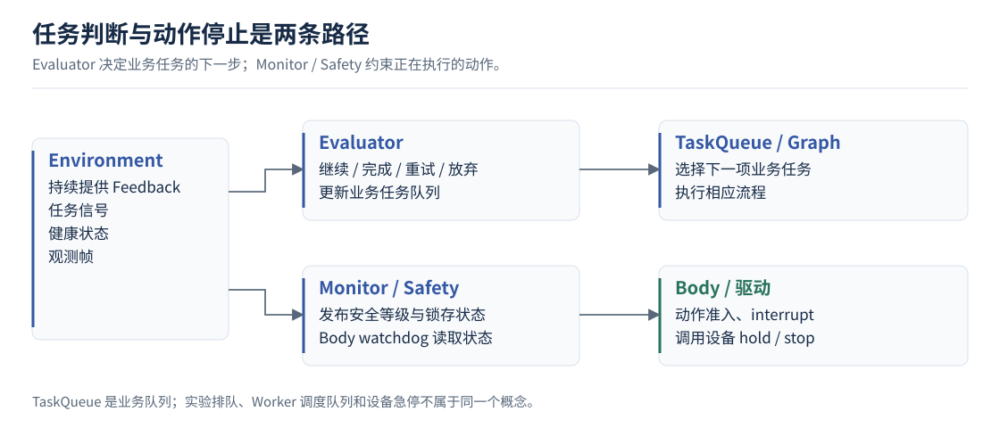
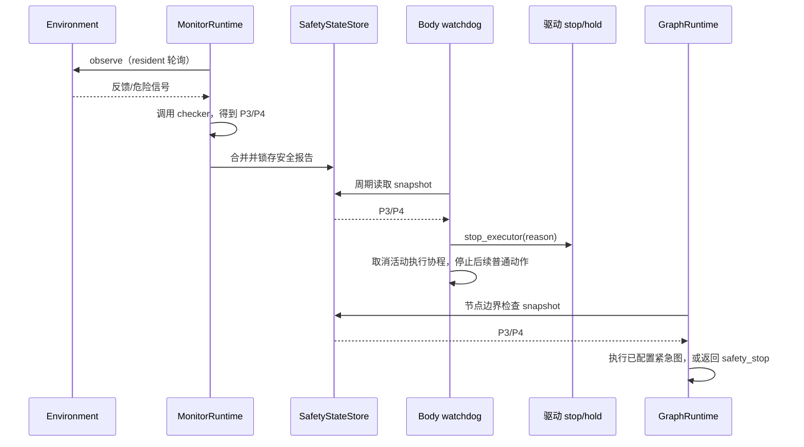

# Evaluator、Monitor 与 TaskQueue：职责和完整例子

[English](evaluation-monitoring-and-task-queue.md) · [**简体中文**](evaluation-monitoring-and-task-queue.zh-CN.md)

安全存储现可通过 provider 扩展；`require_shared=true` 校验 provider 的 shared 能力，内置 SQLite 仍可直接使用。更换存储不改变 P0–P4 锁存、恢复审批或 Body 动作边界。接口与资源所有权见[基础设施插件](infrastructure-plugins.zh-CN.md)。

本文按当前源码说明实际行为。默认 Runner 已使用注册式 MonitorRuntime；TaskQueue 仍是供显式集成的独立库，不在默认 XR365 或批量执行主链路中。各模块的完整导览见[模块使用手册](module-guide.zh-CN.md)。

## 1. Evaluator 与 Monitor 的职责



两者都可能读取图像、调用模型并输出判断，但判断的用途和调用时间不同。

| 对比 | Evaluator | Monitor |
| --- | --- | --- |
| 要回答的问题 | 目标完成了吗，下一步做什么？ | 当前是否允许继续执行，是否出现危险？ |
| 当前实现 | `kind="evaluator"` 的普通 Module，没有独立 EvaluatorRuntime | 独立 Monitor 注册表与 MonitorRuntime |
| 何时调用 | Graph 调度到该节点时 | resident 周期运行；request 由图或调用方按需请求 |
| 输入 | GraphContext，包括任务、反馈、动作结果、STM | EnvironmentFeedback、可选请求以及 MonitorContext |
| 主要输出 | 节点结果、任务决策、业务状态更新 | MonitorReport，发布到 SafetyStateStore |
| 能否更新计划 | 可通过节点输出更新图的业务状态 | 不负责更新计划、推进任务或清空队列 |
| 生命周期 | 默认每个任务装配 | 默认每个任务装配；低层服务也可独立常驻 |
| 模型在哪里 | Tool 中 | 可复用检查函数或模型客户端；不能假定默认 MonitorContext 已注入 ToolRuntime |

例子：机器人正在合上搅拌机盖。

- `verify` 判断“盖子是否已经合上”，结果影响下一轮计划。
- `robocasa365_terminal` 判断环境是否成功、是否达到步数上限、Body 是否失败，结果影响是否结束 rollout。
- Monitor 判断“环境是否报告碰撞/危险”，即使任务尚未完成，也应触发停止路径。

“尚未成功”不等于“危险”。若合并为一个只在动作结束后运行的节点，执行中的动作就缺少持续安全检查；若把所有完成判断都放进后台，又会引入计划状态与图并发写入问题。

### 能力复用与职责边界

建议合并**判断逻辑和模型能力**，保留**图内任务决策与后台安全发布**两个调用边界。例如提取 `inspect_observation(observation)`，返回 `goal_complete`、`risk_level` 和证据。Evaluator 将完成信息转换成图状态；Monitor 将风险信息转换成 MonitorReport。

这是后续重构建议，当前没有新增统一 Checker 接口。也不应为了“统一”把慢速视觉大模型变成唯一安全通道。模型请求排队时，驱动停止和必要的独立监测仍应可执行。

另外，`task_adapters/evaluator.py` 中的 Evaluator 是**批量评测编排/汇总层**，不是图内的 Evaluator 插件；`workflow/conditions.py` 中的条件求值器则只解析图表达式。不要由文件名推断它们共享生命周期。

## 2. Benchmark 任务执行流程

独立 benchmark 使用统一 Graph：

```text
reset → policy → body.execute → observe → terminal
          ↑                              │
          └──────── continue ────────────┘
                                         END（success、环境终止或 horizon）
```

Environment/Body 在每个 action 后读取原生仿真结果，terminal 输出 success、
env_steps、native_metrics 和 native_dimensions。模型历史及 action 缓存由 VLA
按 session 隔离。这个流程不包含旧 XR365 的 plan/verify 分支；需要层级规划的
产品应用应作为单独 extension 和 Graph 实现。

这里的 action batch 不是 TaskQueue。horizon 是实际环境 action 数限制，
Graph.max_steps 是调度预算，模型动态 batch 是多个 session 的推理请求聚合。
三者分别计数。

## 3. Monitor 的中断传播

Monitor 不直接杀 Graph、Worker 或 Python 线程。它发布安全状态，Body 与 Graph 分别消费状态。



Body 和 Graph 是独立读取方，上图帮助理解职责，**不保证它们观察到状态的先后次序**。

实际分为五步：

1. **产生结论**：resident 循环读取环境并调用插件；request 调用直接取得报告。`feedback-safety` 只转换环境已有的安全等级/信号，不会自动进行视觉碰撞检测。
2. **合并状态**：`MonitorRuntime._publish()` 按 Monitor 所有者 reconcile 信号。旧的瞬时信号可被本实例的新报告替换，P3/P4 保持锁存；单个 Monitor 的 P0 不能抹去其他来源的危险。
3. **停止动作**：Body watchdog 默认 `poll_hz=100`、中断阈值 P3。观察到危险后调用 `interrupt`，设置中断标记、调用底层 stop_executor、取消正在执行的协程。配置了保护动作工厂时按相应路径执行保护动作。停止回调默认超时 0.5 秒，失败会发布锁存 P4。
4. **停止业务流程**：Graph 在安全检查点读取同一状态；有对应 emergency_graph 时派发，没有映射时默认返回 safety_stop，不继续普通图。P3/P4 紧急图完成不等于任务完成，也不等于已恢复。
5. **恢复**：排除故障后走显式恢复流程；高等级恢复需要批准，配置图可以做自检后选择恢复入口。不是下一次读到 P0 就自动解除锁存。

### 中断的作用范围

| 配置 | 可观察同一中断的范围 |
| --- | --- |
| 同一个内存 SafetyStateStore 对象 | 持有该对象的当前进程组件 |
| SQLite，`scope="shared"`，实际路径相同 | 读取该数据库的进程/服务 |
| SQLite，`scope="task"` | Runner 为本任务/attempt 重定位后的库对应的组件 |
| 两个 Worker 分别使用任务安全库 | 默认彼此隔离，不自动停止对方 |
| 两台机器各有相同字符串路径 | 不是同一存储，不会因此共享状态 |

例如 A Worker 出现碰撞，若 A/B 使用各自 task 安全库，A 的 Body 停止，B 不因此停止。若要一键停止整台机器人涉及的多个进程，需要让它们显式共享同一安全状态来源，并具备停止消费者。**当前没有“Monitor 报错就自动取消整个批量实验”的广播控制器。**

共享 SQLite 安全库与共享 Trace 观测库是两个概念：Web 读取共享 Trace 不会让 Worker 自动共享安全状态。

### 延迟与真实硬件边界

默认 Runner 中 resident Monitor、Graph 和 Body watchdog 是同进程内的异步任务。`asyncio` 是协作调度：同步阻塞插件、长时间占用事件循环的代码会拖延三者。request 与 resident 同实例还共享调用锁，慢请求会推迟下一次检查。

响应耗时包含采样等待、observe/check 耗时、数据库读写、Body 轮询和驱动 stop/hold 延迟。5 Hz Monitor 的休眠间隔约 200 ms，100 Hz Body 约 10 ms；**不能据此承诺 210 ms 内必停**，循环中的工作和排队还会增加延迟。当前也不会因为安全库改变而强制打断任意正在等待的模型请求。

UDS BodyClient 使用独立执行/控制连接，使 interrupt 不必等长 execute RPC 完成；这不能让同步驱动线程可被强杀。`asyncio.to_thread` 中的调用取消后底层线程可能继续，因此真机必须实现可靠 stop/hold，并依靠设备层 watchdog/急停处理 Python 进程失效。软件 P4 等级本身不是硬件断电。

未启动的 Monitor 关闭时不会清理共享库中同名外部心跳；已启动的实例只清理自己启动过的 resident 循环对应心跳。同一安全库中多个活跃实例仍应使用唯一 ID，避免所有者名称冲突。

## 4. 可运行例子：Monitor 报 P3，Body 终止模拟动作

仓库内已有可直接运行的 [examples/monitor_body_interrupt.py](../examples/monitor_body_interrupt.py)。在项目根目录执行：

```bash
PYTHONPATH=. python examples/monitor_body_interrupt.py
```

此例只使用异步等待模拟动作，不连接机器人、不加载模型、不创建持久安全库；使用 request 模式便于确定性触发。resident 模式产生报告后走相同的发布路径。若希望把它加入回归，可运行 `python -m pytest -q tests/test_monitor_body_interrupt_demo.py`。

预期可以看到下面几行，顺序体现完整链路：

```text
[Body] 开始执行动作，预期持续 30 秒
[Monitor] 发布危险报告：P3
[Body stop_executor] 发送底层停止命令：safety_level_P3
[Monitor] report=P3, reason=模拟碰撞
[Body] status=interrupted, interrupted=True, error=safety_level_P3
```

下面是该示例的完整代码逻辑（实际可运行文件请以仓库文件为准）。

```python
import asyncio
from uuid import uuid4

from robotenon.monitors.runtime import MonitorRuntime
from robotenon.runtime.safety import SafetyStateStore
from robotenon.schemas import Action, ActionChunk, ActionType, MonitorReport, SafetyLevel
from robotenon.services.body import InProcessBodyService


class DemoMonitor:
    async def check(self, feedback=None, *, request=None, context=None):
        unsafe = bool((request or {}).get("unsafe"))
        return MonitorReport(
            compliant=not unsafe,
            safety_level=SafetyLevel.P3 if unsafe else SafetyLevel.P0,
            source="demo", reason="模拟危险" if unsafe else "正常",
        )


async def main():
    safety = SafetyStateStore()
    action_started = asyncio.Event()
    stop_called = asyncio.Event()

    async def execute(action):
        action_started.set()
        await asyncio.sleep(30)  # 可取消的模拟动作

    async def stop(reason):
        print("stop_executor:", reason)
        stop_called.set()

    body = InProcessBodyService(execute, safety_state=safety, stop_executor=stop)
    monitor = MonitorRuntime(
        {"demo": DemoMonitor()}, modes={"demo": {"request"}}, safety_state=safety,
    )
    session_id = uuid4()
    chunk = ActionChunk(session_id=session_id, actions=[
        Action(session_id=session_id, action_type=ActionType.WAIT, timeout_ms=60000)
    ])
    await body.start()
    await monitor.start()
    task = asyncio.create_task(body.execute(chunk))
    try:
        await asyncio.wait_for(action_started.wait(), 2)
        report = await monitor.request("demo", {"unsafe": True})
        await asyncio.wait_for(stop_called.wait(), 2)
        result = await asyncio.wait_for(task, 2)
        print("报告:", report.safety_level.value)
        print("执行:", result.status.value)
        await monitor.request("demo", {"unsafe": False})
        print("随后报告正常，锁存仍为:", safety.snapshot().level.value)
    finally:
        if not task.done():
            task.cancel()
            await asyncio.gather(task, return_exceptions=True)
        await monitor.close()
        await body.close()


asyncio.run(main())
```

观察重点：调用 stop_executor，执行结果为 interrupted，后续 P0 报告不会自动清除 P3。stop 的打印次数不应被业务视为恰好一次；实际驱动停止接口应允许重复调用。

如果要进一步看到“机器人停了，但环境还在走”，运行环境级演示：

```bash
PYTHONPATH=. python examples/monitor_body_environment_demo.py --post-stop-seconds 3
```

它会让一个虚拟机器人持续向前移动，同时让环境中的障碍物和环境 tick 独立推进。默认在 Monitor 发布 P3、Body 返回 `interrupted` 后继续运行环境 3 秒；Body 把机器人速度置零，脚本继续采集环境帧，最后生成 `runs/monitor-body-environment-demo.gif` 和一张前后对比图 `runs/monitor-body-environment-demo.png`。对比图左侧是刚触发 P3，右侧是环境继续运行后的状态：机器人位置不变，障碍物位置和环境 tick 已变化。也可以将 `--post-stop-seconds` 调大，观察更长时间的环境演化。

## 5. TaskQueue 的用途

`robotenon/core/queue.py` 是 SQLite 持久化的 **TaskItem 子任务队列库**。它提供 enqueue、claim_next、complete、fail、cancel、clear、branch、snapshot 和 events；表为 `task_items` 与 `queue_events`，通过 owner/lease 校验处理并发领取和完成。

截至当前代码，默认 Runner、GraphRuntime 和并行执行后端都没有创建或消费 TaskQueue。导出类、单元测试以及 Portal 对相关表的读取能力仍然保留。它是可用的显式集成能力，不是正在驱动所有任务的中心调度器。

| 名称 | 保存什么 | 当前谁使用 |
| --- | --- | --- |
| TaskQueue | 有 owner/lease 的高层 TaskItem 子目标 | 需要调用方显式接入 |
| TaskAdapter / 执行后端 | 评测 case、episode、attempt 与空闲 Worker | 默认批量执行 |
| WaveScheduler | Graph 中可运行节点和依赖 | 默认图执行 |
| `stm.remaining` | 当前任务尚未完成的语义子目标 | plan/verify |
| Xiaomi action queue | 模型产生而尚未消费的动作向量 | Xiaomi Tool |
| Portal 实验管理队列 | 等待启动的实验作业 | Web ExperimentManager |
| Metrics/Trace 缓冲队列 | 等待持久化的观测事件 | 观测客户端/写入端 |

因此 TaskQueue 的 lease 恢复不能解决 Coordinator 崩溃恢复，也不代表物理动作支持恰好执行一次。

### 可运行例子：显式使用 TaskQueue

保存为 `queue_demo.py` 并执行 `python queue_demo.py`。示例用临时目录，退出后删除数据；生产集成应换成明确的持久路径，并稳定保存 session ID。

```python
import asyncio
from pathlib import Path
from tempfile import TemporaryDirectory
from uuid import uuid4
from robotenon.core.queue import TaskQueue


async def main():
    with TemporaryDirectory() as directory:
        queue = TaskQueue(Path(directory) / "queue.sqlite3")
        session_id = uuid4()
        owner = "demo-controller"
        try:
            await queue.enqueue_plan(
                session_id=session_id, task_id="收拾桌面",
                goals=["杯子放入托盘", "托盘移到指定位置"],
            )
            first = await queue.claim_next(session_id=session_id, owner=owner)
            print("领取:", first.goal, first.status.value, first.attempts)
            # 示例假定已验证成功；真实集成在此调用图并检查结果。
            await queue.complete(first.task_item_id, owner=owner)
            second = await queue.claim_next(session_id=session_id, owner=owner)
            print("领取:", second.goal)
            await queue.fail(second.task_item_id, owner=owner, retry=True,
                             reason="模拟一次可重试失败")
            retried = await queue.claim_next(session_id=session_id, owner=owner)
            print("重试次数计数:", retried.attempts)
            await queue.complete(retried.task_item_id, owner=owner)
            print("最终:", [item.status.value for item in await queue.snapshot(
                session_id=session_id)])
        finally:
            await queue.close()


asyncio.run(main())
```

预期依次领取两个子目标，第二项重领时 attempts=2，最终两项都是 done。这里没有自动运行机器人：执行动作、验证结果、处理安全信号都由集成控制器负责。

租约过期在后续 claim 时回收，不是后台定时恢复服务；长任务不能超过租约后仍假定自己拥有提交权。当前没有通用续租 API。`timeout_s` 等任务字段也不会自行创建动作超时 watchdog。清空队列只改变任务状态，不能替代 Body.stop。若未来接入默认路径，应先确定由谁消费 EvaluationDecision、如何续租、如何恢复幂等副作用以及如何关联 episode/attempt，再决定是否保留这层持久队列。

## 6. 定位源码与验证

- 报告生成/发布：[MonitorRuntime](../robotenon/monitors/runtime.py)、[内置 feedback-safety](../robotenon/monitors/builtin.py)。
- 安全合并/锁存：[SafetyStateStore](../robotenon/runtime/safety.py)、[SQLite 后端](../robotenon/storage/safety.py)。
- 中断与 stop：[Body](../robotenon/services/body.py)；图安全入口：[GraphRuntime](../robotenon/workflow/runtime.py)。
- 任务结果：[verify](../robotenon/modules/verify.py)、[RoboCasa365 terminal](../extensions/benchmarks/benchmark-support/src/robotenon_benchmark_support/modules.py)。
- 队列实现：[TaskQueue](../robotenon/core/queue.py)、[队列测试](../tests/test_queue.py)。

上述例子用于验证软件调用关系。真实驱动的停止时延与设备急停需要单独验证。
