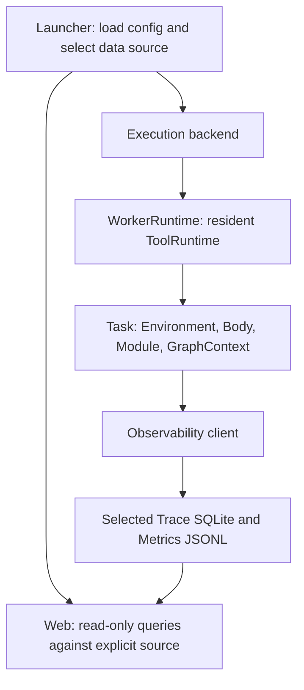
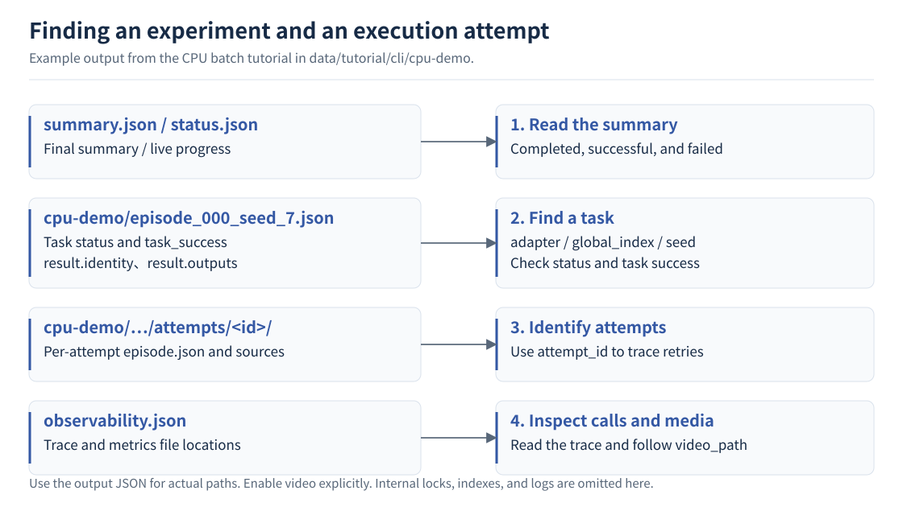
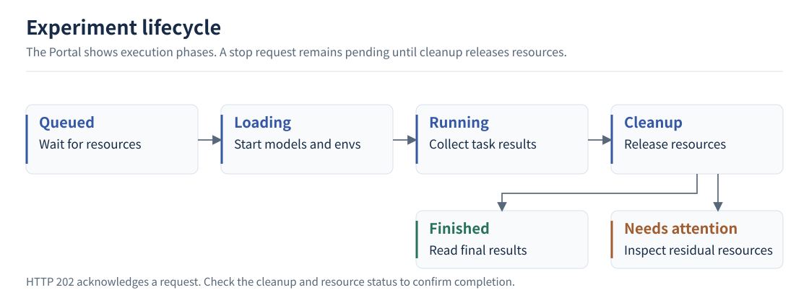

# Single-task execution, parallel runs, and observability

[**English**](execution-and-observability.md) · [简体中文](execution-and-observability.zh-CN.md)

This reference covers experiment execution, telemetry sources, and management interfaces. Start with the [quickstart](quickstart.md) for a first run or the [developer guide](development-guide.md) for plugin implementation. Run commands from the RoboTenon repository root in a Python environment with the dependencies installed.

## 1. Execution and Web boundaries

Single-task, batch, and physical robot runs all use `WorkerRuntime.run_task()` and the same task executor. Configuration selects resources and backends. There is no legacy bypass or device-specific scheduling branch.



The launcher chooses a task-level or shared store and passes its address to execution and Web. Web does not guess the database from the launch mode or fall back to a task store when a shared store has no matching results.

`in_process` executes sequentially in the current process. `process` uses `spawn` for resident Workers. Each Worker runs one task at a time. Tool weights, connections, and clients can be reused. Message history, observation windows, environment sessions, and GraphContext are task-specific.

What stays resident depends on the Tool. An HTTP/RPC Tool holds a client, which does not imply a copy of model weights per Worker. A configured deployment can start a dedicated model service. Otherwise, the Tool connects to an external endpoint. Download weights separately. See [Worker model deployment](worker-model-deployment.md).

## 2. Running experiments

### 2.1 One task

This command assumes configured RoboCasa, MuJoCo, and model services:

```bash
Tenon run \
  --config runs/robocasa365/config.json \
  --output data/debug/episode.json \
  --trace-dir data/debug/trace \
  --metrics-dir data/debug/metrics
```

Results are saved in `data/debug/episode.json` and source metadata in `data/debug/episode.observability.json`. For a run with no simulator or model dependencies, use the [Fake smoke test](quickstart.md). `--dry-run` still initializes the Environment.

### 2.2 Sequential batch execution

```bash
Tenon run --batch \
  --config runs/robocasa365/config.json \
  --max-tasks 2 --num-trials 1 \
  --output-dir data/xr365/eval \
  --save-videos --save-traces
```

With no execution configuration, the default is `in_process` and one Worker. The Task Adapter determines enumeration order; the backend determines execution. Select memory policy separately if later tasks should see earlier memory updates.

### 2.3 Parallel processes

The repository includes a [parallel override](../configs/experiments/parallel.json):

```bash
Tenon run --batch \
  --config runs/robocasa365/config.json \
  --experiment-config configs/experiments/parallel.json \
  --max-tasks 2 --num-trials 1 \
  --output-dir data/xr365/eval
```

The example uses two Workers, GPUs `0` and `1`, and a Web server at `127.0.0.1:8765`. Adjust GPUs, ports, and timeouts to the machine. These settings are an example, not a capacity measurement. Include existing model services and rendering in your VRAM budget.

To check one isolated Worker, copy the override, use `max_workers=1`, and shrink `gpu_ids` to the devices it needs. `--batch` enumerates tasks; `runtime.execution.backend` enables parallelism. A single episode without `--batch` permits only `max_workers=1`.

### 2.4 Full RoboCasa run on an eight-GPU server

See the [eight-GPU server tutorial](tutorials/server-8gpu.md) for setup, launch, GPU mapping, and SSH forwarding. Validate one Worker before increasing concurrency. When two models and rendering share a GPU, check peak VRAM.

## 3. Execution configuration

Place the following fields under `parameters.runtime.execution`:

| Field | Default | Meaning and constraints |
| --- | --- | --- |
| `backend` | `in_process` | Registered execution backend; built-ins are in_process and process |
| `plugin_backends` | `[]` | Python modules that register execution backends when imported |
| `backend_params` | `{}` | Backend-specific factory arguments |
| `max_workers` | `1` | Positive integer. In-process execution requires 1. Parallel dispatch handles at most this many cases concurrently |
| `gpu_ids` | `[]` | Optional device list. Nonempty lists must have unique IDs and a length divisible by Worker count. Each Worker receives an equal ordered share and sees local IDs starting at 0 |
| `egl_device_ids` | `[]` | Optional explicit EGL device list. If present, length must equal Worker count. No mapping is inferred from CUDA |
| `resource_ids` | `[]` | Exclusive resource names within this host and user. If declared, distinct IDs must cover the Worker count |
| `max_retries` | `0` | Extra attempts after Worker loss, startup timeout, or task timeout in process mode |
| `startup_timeout_s` | `120` | Maximum time in seconds to wait for process Worker startup |
| `task_timeout_s` | `3600` | Maximum time in seconds to wait for a task response from a process Worker |
| `shutdown_timeout_s` | `10` | Cooperative shutdown window before terminate/kill if required |
| `recycle_after_tasks` | `50` | Recycle a process Worker after this many tasks and restart it on demand |
| `memory_mode` | `snapshot` | `snapshot`, `disabled`, or `sequential`. Sequential requires one Worker |

Timeouts must be positive; retries cannot be negative. Startup/task timeouts, retry, and recycling are implemented by the process backend. These settings do not impose hard timeouts on in-process execution. There is no separate `max_in_flight` setting.

`gpu_ids` and `resource_ids` participate in reservations. The launcher uses `fcntl` locks in `/tmp/robotenon-resources-<uid>/`. Other RoboTenon launchers running under the same user on the same host cannot reserve the same named resource concurrently. Locks do not coordinate across hosts or prevent external programs from using a GPU or robot. Resource names do not route Workers to a driver or model endpoint.

The reference physical robot configuration declares `resource_ids: ["robot:primary"]` and `max_retries: 0`. All deployments sharing one device should use the same name. Different devices need distinct names and connection settings. Assigning a Worker to a GPU does not move an already running external inference server.

## 4. Memory policy

| Policy | What each task reads | Writes and merging |
| --- | --- | --- |
| `disabled` | No long-term memory | No long-term memory summary |
| `snapshot` | A shared initial snapshot taken at batch start | Each task/attempt gets a private copy. The parent merges successfully returned summaries in Adapter and case order |
| `sequential` | Memory updated by previous tasks | Tasks write to one path. Only one Worker is allowed |

Batch runs save `memory_snapshot.json` and ultimately write `long_term_memory.json`, or the file selected by `--memory`. A retry after Worker loss begins from a fresh copy of the initial snapshot so a failed attempt cannot change its input.

With snapshot policy, later tasks do not see experience just written by earlier tasks. Merging in order after completion cannot recreate that runtime dependency. Compare sequential and parallel execution with the same memory policy, seeds, and model settings, taking model determinism into account.

The batch entry point performs this centralized merge. A single-episode call has no batch reducer. Use `--batch` with an explicit memory policy to accumulate or aggregate experience across executions.

## 5. Explicit observability sources

Configure these fields under `parameters.runtime.observability`:

| Field | Purpose |
| --- | --- |
| `trace_db` | SQLite database for Trace queries |
| `trace_wal` | Trace JSONL records. If given alone, a same-stem `.sqlite3` can be inferred |
| `metrics_wal` | Metrics JSONL records |
| `trace_socket` | Existing shared Trace receiver |
| `metrics_socket` | Existing shared Metrics receiver |

These paths resolve relative to the launch working directory and are written as absolute paths in the source descriptor. Relative references to component manifests instead resolve from the main configuration directory.

- Local mode: without sockets, the task creates local writers. `--trace-dir` and `--metrics-dir` are convenient inputs for the same source object.
- Run-owned shared mode: without external sockets, a batch `process` run creates shared writers under `<output>/<run_id>/observability/` and uses temporary Unix sockets.
- External shared mode: specify both sockets for process execution. The Trace socket also needs the matching query database. The launcher leaves external services running.

The batch process backend rejects an external shared configuration that supplies only a database path without the shared sockets. Use run-owned shared mode or specify a complete external service. Multiple Workers should not open the same files as independent local writers.

Example external services, each run in its own terminal:

```bash
Tenon traced --socket /tmp/robotenon-trace.sock \
  --wal /tmp/robotenon-observability/trace.jsonl \
  --db /tmp/robotenon-observability/trace.sqlite3
```

```bash
Tenon metricsd --socket /tmp/robotenon-metrics.sock \
  --wal /tmp/robotenon-observability/metrics.jsonl \
  --http-host 127.0.0.1 --http-port 9108
```

Matching override fragment:

```json
{
  "parameters": {
    "runtime": {
      "observability": {
        "trace_db": "/tmp/robotenon-observability/trace.sqlite3",
        "trace_wal": "/tmp/robotenon-observability/trace.jsonl",
        "metrics_wal": "/tmp/robotenon-observability/metrics.jsonl",
        "trace_socket": "/tmp/robotenon-trace.sock",
        "metrics_socket": "/tmp/robotenon-metrics.sock"
      }
    }
  }
}
```

`9108/metrics` is an optional Prometheus scrape endpoint. Grafana needs a configured Prometheus data source. Starting shared telemetry does not provision a dashboard. Trace uses SQLite; Metrics currently uses JSONL.

## 6. Web startup and data scope

### 6.1 Standalone read-only observability server

```bash
Tenon web \
  --source data/debug/episode.observability.json \
  --host 127.0.0.1 --port 8765 \
  --no-experiment-submit --no-auto-grafana
```

For a parallel experiment, set `--source` to its `<output>/<run_id>/observability.json`. Open `http://127.0.0.1:8765/`.

Web opens the specified Trace database with `mode=ro` and `query_only`. It neither creates databases nor rebuilds an index by replaying JSONL. Persisted results remain readable after the run's sockets are removed.

The read-only service provides query endpoints including `/api/traces`, `/api/trace/sql`, and `/api/metrics`. `--no-experiment-submit` disables ExperimentManager. The landing page still lists experiments and indicates that submission is disabled. There is no separate read-only results browser. Open <http://127.0.0.1:8765/api/traces?limit=20> or see the [CLI query examples](tutorials/cli-experiments.md#5-query-results-over-read-only-http). Use the full Portal below for interactive browsing, submission, and control.

### 6.2 Observability Web started with a run

```json
{
  "parameters": {
    "runtime": {
      "web": {"enabled": true, "host": "127.0.0.1", "port": 8765}
    }
  }
}
```

The launcher gives the Web server the same data source as the experiment. This server lives for the run and exposes no job submission/stop controls. Start a standalone server to inspect data afterward. A busy port prevents startup; choose another port or disable the option. The browser need not remain connected.

### 6.3 Full experiment Portal

For configuration discovery, experiment lists, submission, and episode details, keep ExperimentManager enabled and supply the source and experiment directories:

```bash
Tenon web \
  --source data/debug/episode.observability.json \
  --project-root . --config-root configs \
  --experiment-output-root data/experiments \
  --run-root data/experiments \
  --no-auto-grafana
```

Replace the example source with that of the desired run. The full Portal reads managed job metadata from its output directory and `jobs.sqlite3`; an initial import preserves old `jobs.json` as a backup. A standalone CLI run does not automatically become a Portal job. Choosing a query source does not redirect writes for newly submitted jobs; experiment configuration selects their writers.

The full Portal selects a Trace database for trajectory details in this order: first the job-local
`<job>/observability/trace.sqlite3`, then the explicit `trace_db` in that job's `observability.json`,
and finally the global database configured at Portal startup. Once a database is selected, the query filters by the result's
`run_id`, `episode_id`, and optional `attempt_id` to avoid mixing traces from parallel tasks.
For historical records lacking a run identity, the Portal does not guess another database.

Images also resolve within their owning task. In parallel runs, the episode JSON commonly stores only a
`cache://<session>/<epoch>/.../<channel>` URI. The actual `.npy` lives under the attempt's
`resources/observations/<session>/<epoch>/<sequence>/`. The details endpoint checks that the file is inside the task directory,
then exposes `/api/experiments/<job_id>/observation?...`. The frontend prefers this address.
Only legacy shared-cache URIs are served by `/api/observations/image?uri=...` using
`--observation-root` and `--observation-index`. A global index cannot replace a parallel task's own
attempt file, and the URL cannot read outside the job directory.

If a node has no available observation image, open
`GET /api/experiments/<job_id>/trajectory?adapter_id=<id>&global_index=<n>` for that task. Check that
`media.live.frames` is nonempty and that each image frame has a `url`. Open a URL directly; expect
`image/png`. Empty `frames` means the episode did not save image references. For a 404,
check whether that attempt's `resources/observations` still exists and whether the task used an older output directory.

`--source` selects the standalone Web server's Trace/Metrics source. It does not scan every job or redirect
writes for new experiments. The full Portal reads its managed output and `jobs.sqlite3` (with an old `jobs.json` backup after initial import).
A standalone CLI run does not automatically appear in this job list.

For remote access, forward the actual Web port using the appropriate login address:

```bash
ssh -N -L 18765:127.0.0.1:8765 user@server
```

Then open `http://127.0.0.1:18765/`. Keep SSH passwords out of configuration and documentation.

### 6.4 Full Portal access boundaries

By default the Portal binds to `127.0.0.1`. Local and SSH-tunneled connections can use it without login.
If `ROBOTENON_PORTAL_TOKEN` is set, both read and control endpoints require authentication. API clients use
`Authorization: Bearer <token>`. Browsers use HTTP Basic with any username and the token as password.
Remote bindings, including `0.0.0.0`, require a token. Protect transport using an HTTPS reverse proxy or an SSH tunnel.
The token stays out of URLs, pages, and logs. Host/Origin checks still apply. A reverse proxy should preserve the browser's Host.
Allow an additional hostname explicitly, for example with `--allowed-host robot.example`.

Compose publishes ports 8765, 3000, 9090, and 9100 only on host `127.0.0.1`.
Use `--loopback-published` only for this topology: the container binds all of its interfaces, but publication on the host must stay loopback-only.
For remote publication, remove that flag and configure authentication plus HTTPS before changing the port binding.

Anonymous Grafana users are Viewers. Editing requires an administrator login. Compose requires an explicit
`GRAFANA_ADMIN_PASSWORD` in `.env` or the process environment. On the Portal's first automatic Grafana launch, if `.env`
is missing, the Portal creates it with mode 0600 and a random password. Existing `.env` files are preserved.
To create a fresh file before launching Compose directly, use this command (it refuses to overwrite an existing file):

```bash
python -c 'import os,secrets; fd=os.open(".env", os.O_WRONLY|os.O_CREAT|os.O_EXCL, 0o600); os.write(fd, ("GRAFANA_ADMIN_PASSWORD="+secrets.token_urlsafe(32)+"\n").encode()); os.close(fd)'
docker compose up -d
```

Changing the environment variable does not rotate the password in an existing Grafana volume. Update it in Grafana account settings.

The read-only observability service disables experiment controls. All POST requests require `Content-Type: application/json`. The maximum request
body is 1 MiB and the connection read timeout is 10 seconds.

## 7. Identities, directories, and status



| Identifier | Meaning |
| --- | --- |
| `experiment_id` | Currently derived from the configuration filename. It is not a globally unique experiment registration |
| `run_id` | One launch. Batch runs can set it using `--run-id` |
| `episode_id` | Logical evaluation unit in a run; retained across process retries |
| `attempt_id` | One execution attempt; each retry receives a new ID |
| `task_id` / `adapter_id` | Domain task and its adapter |
| `worker_id` / `gpu_id` | Worker process instance and assigned GPU. A restarted Worker has a new identity |

`session_id` identifies an environment session and does not replace these run identities. Trace and Metrics carry them as metadata. High-cardinality IDs do not automatically become Prometheus labels.

Example process batch output:

```text
<output>/<run_id>/
├── status.json
├── summary.json
├── observability.json
├── observability/                 # trace.sqlite3、trace.jsonl、metrics.jsonl
├── memory_snapshot.json           # snapshot memory policy
├── long_term_memory.json          # merged batch result
└── <task-directory>/
    ├── stats.json
    ├── episode_000_seed_7.json     # final record accepted by the parent
    └── episode_000_seed_7/attempts/<attempt_id>/
        ├── status.json
        ├── episode.json
        ├── video.mp4              # if recording is enabled and supported
        └── resources/             # attempt-scoped observation/safety storage
```

Multiple Adapters add an Adapter directory. In-process artifacts are usually next to the episode JSON. Read result fields for video and Trace locations instead of guessing their paths.

The parent alone writes global `status.json`, `summary.json`, and `stats.json`. For parallel progress, inspect `active`, `total_episodes`, and `completed_episodes`; `current` is a one-item summary. Attempt states include `assigned`, `running`, `succeeded`, `failed`, `lost`, and `cancelled`. Here `succeeded` means execution returned a result. Read `task_success` for task outcome.

Query by identity:

```text
GET /api/traces?run_id=...&episode_id=...&attempt_id=...
```

Supply `run_id` and `episode_id` together. `attempt_id` is optional. Without filters the endpoint returns recent traces.

## 8. Stopping, retry, and recovery



| Event | Behavior |
| --- | --- |
| Task returns normally with `task_success=false` | Record the evaluation result without automatic retry |
| Provider or execution logic raises an ordinary exception | Record an error and recycle the process Worker. Worker-loss retry does not apply |
| Worker loss, startup timeout, or task timeout | A live Coordinator may create another attempt, subject to `max_retries` |
| Ctrl-C / SIGTERM | Cancel active execution, clean up Workers, then close run-owned shared services |
| Worker fails to exit during its shutdown window | Process backend attempts terminate, then kill as required |
| Coordinator killed or host rebooted | Persisted files remain. There is no automatic resumption or Worker takeover |

Coordinator denotes the parent's scheduling role, implemented mainly by `PersistentExecutionBackend` and the evaluator. It does not require a separately deployed service.

Graph checkpoint recovery, new attempts after Worker loss, and Coordinator crash recovery are distinct. With an explicit ContextStore, a Graph can restore its cursor. The experiment entry point does not automatically save and restore the whole run. Reusing an old `run_id` is not a resume command.

A process exit does not prove a physical emergency stop. Physical stopping still relies on Body interrupt, driver hold/stop, safety state, and hardware protection. Confirm a task can be reset safely before enabling retries. Physical robot configurations default to no automatic retry.

## 9. Reliability and deployment limits

Trace/Metrics provide bounded best-effort telemetry. A failed connection or rejected acknowledgement can trigger requeue. Buffer overflow increments `dropped`; delivery failures increment `send_failures`. There is no durable client outbox. A crash can lose unsent records, and retries after uncertain acknowledgements can duplicate Metrics. Final evaluation results are stored separately. A metric is not a task commit record.

The process backend, Unix sockets, resource locks, and SQLite queries target one host. Web and database should use a local filesystem accessible on that host. Multi-host deployments need their own query/transport layer. Local locks do not provide cluster scheduling or a multi-host training platform.

## 10. Validation entry points

```bash
python -m pytest -q tests/test_execution_backends.py tests/test_worker_faults.py
python -m pytest -q tests/test_observability_runtime.py tests/test_metrics_trace.py
python -m pytest -q tests/test_runner_composition.py tests/test_tools.py
```

These tests cover sequential and process runs, retries, cancellation, resource recycling, session cleanup, and query filtering. See the [validation history](changes/README.md) for recorded environments and historical results. Validate GPUs, rendering, and robot actions on the target system.

## 11. Safety state and Monitor configuration

`runtime.monitor_enabled` controls monitoring only. It does not change the safety backend. With Monitor disabled, Graph and Body still read the `safety_state` store, including externally latched P3/P4.

`safety_state.scope` defaults to `shared`, preserving the configured SQLite path across process attempts. With explicit `task` scope and a provided `resource_root`, the safety store moves to that task's `resources/safety.sqlite3`. Without a task root it retains the configured path. The XR365 template declares task scope; the physical robot template declares shared. The configuration sets scope independently of device type.

When enabled, the Runner starts the configured `MonitorRuntime` and shares it with Graph and Supervisor. The Monitor manifest selects resident/request modes. The default feedback checker is configured through `feedback-safety`, rather than implicitly constructing the legacy service in the Runner.

## 12. Generic integration parameters and infrastructure extensions

Single-task and batch runs use the same registered backend factory. Backends declaring shared_observability receive shared Trace/Metrics sockets. Timeout, GPU, lock, and recycling rules above describe the built-in backends. Custom implementations provide their own scheduling under the common execute/close and result contracts.

The CLI's --environment-parameters accepts a JSON object. --batch --task-adapter-overrides maps Adapter instance IDs or registered names to JSON objects. --split accepts plugin-defined names. Historical shortcuts are declared by TaskAdapter cli_overrides. The Python equivalents are EpisodeRequest/ExperimentRequest.environment_parameters and ExperimentRequest.task_adapter_overrides. Environment parameters merge in configuration → case → request order. Canonical task_env_id, split, IO, and render fields retain precedence.

See [infrastructure plugins](infrastructure-plugins.md) for storage, stream transport, and cross-host boundaries. The built-in Web query contract still uses explicit SQLite/JSONL sources. Other databases need a compatible projection or separate query adapter.


## 13. Configuration snapshots, run identity, and acknowledgements

- On submission and at run start, the system saves the complete merged `config.snapshot.json` with a SHA-256 checksum. Workers, children, historical Portal Graphs, Fork, and in-place reruns use this snapshot. Pin plugin source and model files separately; the snapshot does not package them.
- Default batch run IDs include a UUID. Explicit IDs have a persistent reservation record and file lock; a new run cannot overwrite a used ID. Portal reruns use `.control/resume.json` and require the same configuration hash. Older experiments without snapshots still need their original configuration.
- Portal states `stopping` and `stop_failed` block new dispatch. Stop confirmation covers Coordinator, Workers, and managed models. Their identities are recorded in `.processes`. Children inherit run and resource locks, so killing the Coordinator does not immediately release ownership. Custom commands must stay in the managed process group.
- After a failed task, close resident Tools before rebuilding the Worker. Cleanup failure or timeout permanently disables that Worker instance and requires a replacement process; uncertain resources must not be reused.
- External cancellation of Body sends a bounded stop then propagates `CancelledError`. An outstanding synchronous call blocks new actions. Close timeout is explicit. Normal SDK calls use a single-thread executor, with an independent executor for stops. The robot SDK must support a stop concurrent with an action.
- Successful idempotency records save a request hash covering action type, payload, and resource scope. A reused key with different contents, or an old record without a hash, returns `idempotency_conflict` without re-execution. Reconcile the physical state first and use a fresh key for a genuinely new action. Configure distinct `idempotency_scope` values for robots sharing a ledger. Physical robot defaults include `robot_name` and `action_format`.
- Observation ingestion closes idle clients during shutdown. An in-flight write that times out reports an error. A disconnected client does not imply its write has stopped.

See the [audit repair record](changes/audit-repairs-2026-09-20.md) for itemized evidence and validation scope.


## 14. Historical directories, index recovery, and request capacity

The first time the Portal opens a legacy experiment directory, it imports `jobs.json` into `jobs.sqlite3`. SQLite is authoritative afterward. The old JSON is preserved as a migration backup and no longer updated. Custom scripts should read current state via the Portal API or the new database. Initial migration parses the old file once. Later startup reads on demand. The metadata cache holds up to 128 records within an 8 MiB encoded-size budget, except a single oversized record may be kept alone.

`GET /api/experiments` retains `limit/offset/since/until/search` and adds `next_cursor`. To fetch the next page, use the same filters plus `cursor`; do not combine it with a nonzero `offset`. Existing Portal page controls still support offset. The scheduler queries only pending and active experiments.

Batch execution uses a background writer of capacity 16 and reuses a SQLite connection. Complete results are saved in individual task JSON files, while memory retains compact statistics. Shutdown waits for accepted writes. The index stays incomplete until normal completion of results, summary, and status writes.

When a historical experiment's resources have been released, the Portal checks its episode index in the background and repairs missing, corrupt, or incomplete indexes. Recovery reads single-task JSON and does not require a final `summary.json`. Invalid source records preserve the existing index and produce an error. Queries awaiting repair return `503 + Retry-After`. The experiment's `index_recovery` reports a failure reason. Retry after repairing source files, or run explicitly:

```bash
python scripts/maintain_experiments.py --index-run data/experiments/EXPERIMENT_ID
```

Retention scan progress lives in `.retention.sqlite3` under the output directory. Each round defaults to a five-second budget and 20,000 inspected entries, rotating among experiments. Recheck run locks, pending rerun markers, live processes, and path boundaries each round. Preview uses an in-memory copy without advancing the deletion cursor. Automatic cleanup is disabled by default. When enabled, it normally runs hourly and continues an unfinished scan after about 30 seconds. Default `min_free_gb` is 5. Below that watermark, the report and `/api/health` flag `retention.disk.low_space`. File type and retention period still determine what may be deleted.

The scan time budget is soft. Restoring a directory cursor can require skipping previously visited entries, and filesystem calls cannot be interrupted mid-call. Even when replaying the prefix exhausts the budget, each round advances at least one new entry so a slow filesystem cannot permanently stall progress.

```bash
# Preview only. Add --apply to perform cleanup and save scan progress.
python scripts/maintain_experiments.py --output-root data/experiments \
  --policy configs/operations/retention-policy.json

# Enable background cleanup and set request capacity.
Tenon web \
  --retention-policy configs/operations/retention-policy.json \
  --max-connections 32 --max-queries 8 --control-slots 4
```

By default, the server allows 32 connections and eight ordinary requests. Health checks, experiment stop, and global stop share four additional processing slots. Control requests can proceed when ordinary slots are full. At the total connection limit, new connections receive 503. Retry according to `Retry-After`. See `admission` in `/api/health` for capacity and rejection counts.

See the [history and batch execution repair record](changes/history-repairs-2026-09-21.md) for measurements, compatibility boundaries, and fault tests.
