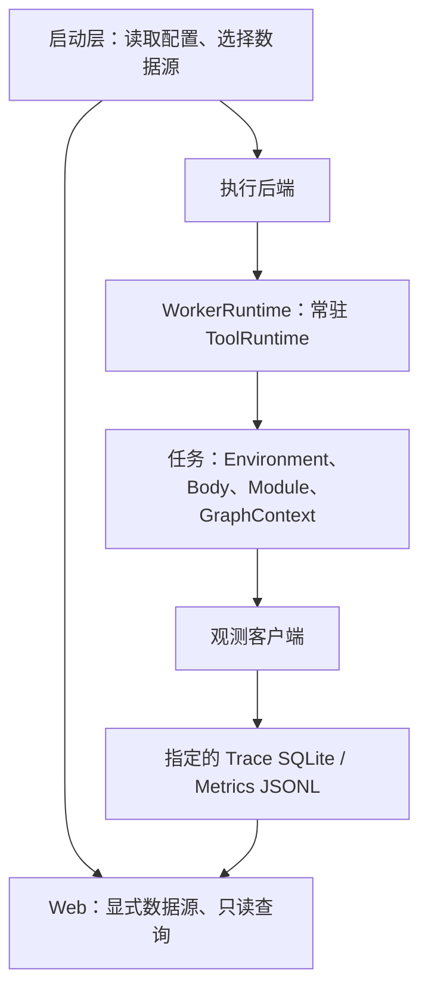
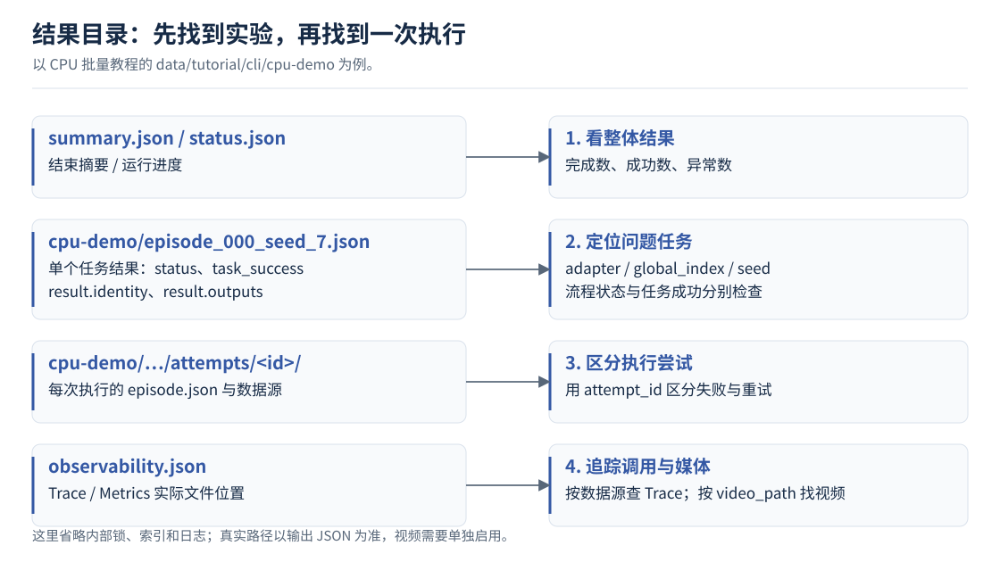
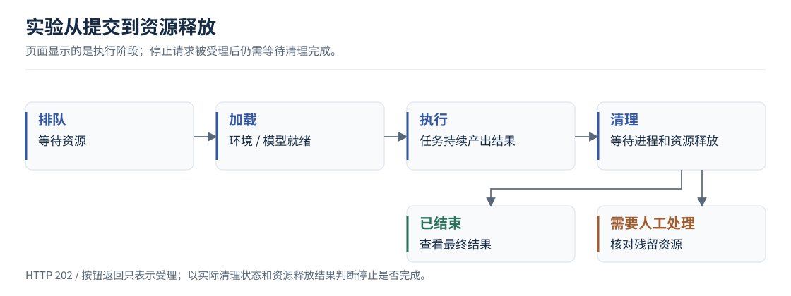

# 单任务、并行执行与统一观测

[English](execution-and-observability.md) · [**简体中文**](execution-and-observability.zh-CN.md)

本文说明实验执行、观测数据源和管理接口。首次使用请先看[快速上手](quickstart.zh-CN.md)；插件实现见[开发手册](development-guide.zh-CN.md)。所有命令默认在 RoboTenon 仓库根目录、已安装依赖的 Python 环境中执行。

## 1. 执行层和 Web 的边界

单任务、批量和真机使用同一个 `WorkerRuntime.run_task()` 与任务执行器，通过配置选择执行后端和资源，不维护旧入口旁路或真机专用调度分支。



启动层选择任务库或共享库，并把地址交给执行器和 Web。Web 不根据启动方式判断数据库，也不会在共享库查不到时回退到任务库。

`in_process` 后端在当前进程顺序执行；`process` 后端用 `spawn` 创建常驻进程。每个 Worker 一次只执行一个任务。Tool 的模型、连接和客户端可以复用，但历史消息、观察窗口、环境会话和 GraphContext 不跨任务复用。

这里的“常驻”以具体 Tool 的实现为准：HTTP/RPC Tool 常驻的是客户端，不代表每个 Worker 都加载了一份模型权重。Tool 配置 deployment 后，可由 Worker 独立启动模型服务；未配置时使用外部端点。框架不自动下载权重。详见[Worker 模型部署](worker-model-deployment.zh-CN.md)。

## 2. 运行方式

### 2.1 单任务

以下命令需要已配置 RoboCasa、MuJoCo 和模型服务：

```bash
Tenon run \
  --config runs/robocasa365/config.json \
  --output data/debug/episode.json \
  --trace-dir data/debug/trace \
  --metrics-dir data/debug/metrics
```

结果保存到 `data/debug/episode.json`，数据源说明保存到 `data/debug/episode.observability.json`。完全不安装仿真或模型依赖时，使用[快速上手中的 Fake 冒烟](quickstart.zh-CN.md)。`--dry-run` 不会跳过 Environment 初始化。

### 2.2 批量顺序执行

```bash
Tenon run --batch \
  --config runs/robocasa365/config.json \
  --max-tasks 2 --num-trials 1 \
  --output-dir data/xr365/eval \
  --save-videos --save-traces
```

未指定执行配置时，后端为 `in_process`，Worker 数为 1。Task Adapter 决定任务枚举顺序，后端决定执行方式。顺序执行不等于使用逐任务更新的记忆；记忆策略需要单独配置。

### 2.3 多进程并行

仓库提供[并行覆盖配置](../configs/experiments/parallel.json)：

```bash
Tenon run --batch \
  --config runs/robocasa365/config.json \
  --experiment-config configs/experiments/parallel.json \
  --max-tasks 2 --num-trials 1 \
  --output-dir data/xr365/eval
```

示例使用两个 Worker、GPU `0` 和 `1`，并在 `127.0.0.1:8765` 启动观测 Web。使用前根据实际机器修改 GPU、端口和超时；该配置不是硬件容量测量结果。若模型服务已经占用这些 GPU，必须一并计算显存和渲染开销。

要先验证单个独立 Worker，可复制此覆盖文件，把 `max_workers` 改为 `1`，并将 `gpu_ids` 缩为该 Worker 所需的设备列表。`--batch` 表示枚举任务，不等于启用并行；并行由 `runtime.execution.backend` 决定。非 `--batch` 的单 episode 请求只允许 `max_workers=1`。

### 2.4 服务器 8 卡全量 RoboCasa

配置、启动、GPU 映射与 SSH 转发的完整步骤见[8 卡服务器教程](tutorials/server-8gpu.zh-CN.md)。先验证一个 Worker，再按资源容量扩展；两个模型与渲染共用一张卡时，需要核对显存峰值。

## 3. 执行配置参考

字段位于 `parameters.runtime.execution`：

| 字段 | 默认值 | 语义与约束 |
| --- | --- | --- |
| `backend` | `in_process` | 注册的执行后端名；内置 in_process/process |
| `plugin_backends` | `[]` | 导入并注册执行后端的 Python 模块 |
| `backend_params` | `{}` | 传给后端工厂的专用参数 |
| `max_workers` | `1` | 正整数；进程内后端只能为 1；并行调度最多同时处理此数量的 case |
| `gpu_ids` | `[]` | 可选设备列表；非空时不可重复，长度须能被 Worker 数整除；按列表顺序均分给 Worker，再映射为从 0 开始的局部编号 |
| `egl_device_ids` | `[]` | 可选 EGL 设备列表；非空时长度等于 Worker 数；不从 CUDA 编号推导映射 |
| `resource_ids` | `[]` | 当前主机、当前系统用户下的排他资源名称；显式声明时，不同资源数量不得小于 Worker 数 |
| `max_retries` | `0` | 进程后端遇到 Worker 丢失、启动或执行超时后的额外尝试次数 |
| `startup_timeout_s` | `120` | 进程 Worker 启动等待上限，单位秒 |
| `task_timeout_s` | `3600` | 进程 Worker 的任务响应等待上限，单位秒 |
| `shutdown_timeout_s` | `10` | 进程 Worker 协作退出等待窗口，随后按需 terminate/kill |
| `recycle_after_tasks` | `50` | 进程 Worker 完成此数量任务后回收；下一次使用时重新启动 |
| `memory_mode` | `snapshot` | `snapshot`、`disabled` 或 `sequential`；后者要求 Worker 数为 1 |

超时必须为正值，重试次数不能为负。启动、任务超时、自动重试和进程回收目前由进程后端实现，不应将这些字段理解为进程内执行的强制超时控制。当前没有独立的 `max_in_flight` 队列参数。

`gpu_ids` 和 `resource_ids` 会参与资源预约。资源锁通过 `fcntl` 实现，文件位于 `/tmp/robotenon-resources-<uid>/`；相同机器、相同用户的其他 RoboTenon 启动器不能同时预约同名资源。它不是跨主机锁，也不阻止外部程序直接使用 GPU/机器人；资源名称本身不会把 Worker 路由到某个驱动或模型服务。

已有真机配置声明了 `resource_ids: ["robot:primary"]`，并设置 `max_retries: 0`。同一台设备的多个部署必须使用相同名称；不同设备应有不同名称及对应的驱动连接配置。多进程绑定不会自动把已运行的模型服务器迁移到另一块 GPU。

## 4. 记忆策略

| 策略 | 任务读取的内容 | 写入与合并 |
| --- | --- | --- |
| `disabled` | 不读取长期记忆 | 不生成长期记忆总结 |
| `snapshot` | 批量开始时的同一份记忆快照 | 每个任务/attempt 使用独立副本，父进程按 Adapter 和 case 顺序合并成功返回的总结 |
| `sequential` | 前面任务更新后的记忆 | 每个任务直接更新同一路径，仅允许一个 Worker |

批量运行会保存 `memory_snapshot.json`，并最终生成 `long_term_memory.json`（或 `--memory` 指定文件）。Worker 丢失后的重试从初始快照重新复制，避免把失败尝试的内容作为新输入。

snapshot 改变了逐任务学习的实验语义：后续任务看不到前面任务刚写入的经验。按顺序合并结果不能恢复这种执行时依赖。比较顺序与并行结果时，应使用相同记忆策略、种子和模型配置，并按模型的确定性设置比较标准。

上述集中合并描述针对批量入口。直接单 episode 入口没有批量 reducer；需要持续积累经验或汇总多次执行时，应使用 `--batch` 和明确的记忆策略。

## 5. 显式观测数据源

字段位于 `parameters.runtime.observability`：

| 字段 | 用途 |
| --- | --- |
| `trace_db` | Trace 的 SQLite 查询数据库 |
| `trace_wal` | Trace 的 JSONL 记录文件；仅提供此字段时，可推导同名 `.sqlite3` |
| `metrics_wal` | Metrics 的 JSONL 记录文件 |
| `trace_socket` | 已运行的共享 Trace 接收端 |
| `metrics_socket` | 已运行的共享 Metrics 接收端 |

这些相对路径按启动工作目录解析，写入数据源说明文件时转为绝对路径。主配置引用子清单的相对路径则按主配置目录解析，两者不能混淆。

- 本地模式：没有 socket 时，由任务创建本地写入器；`--trace-dir`、`--metrics-dir` 是同一数据源对象的便捷输入。
- 自建共享模式：批量 `process` 后端未指定外部 socket 时，启动层在 `<输出目录>/<run_id>/observability/` 创建共享写入器，使用临时 Unix socket。
- 外部共享模式：进程后端需要同时指定两个 socket；Trace socket 还需要匹配的查询数据库地址。启动器不会关闭外部服务。

批量进程后端不接受“只指定数据库路径、却未提供共享 socket”的外部共享配置；使用自建模式，或完整指定已有服务。不要让多个进程各自打开同一组本地写入文件。

外部服务示例，分别在终端运行：

```bash
Tenon traced --socket /tmp/robotenon-trace.sock \
  --wal /tmp/robotenon-observability/trace.jsonl \
  --db /tmp/robotenon-observability/trace.sqlite3
```

```bash
Tenon metricsd --socket /tmp/robotenon-metrics.sock \
  --wal /tmp/robotenon-observability/metrics.jsonl \
  --http-host 127.0.0.1 --http-port 9108
```

对应覆盖层片段：

```json
{
  "parameters": {
    "runtime": {
      "observability": {
        "trace_db": "/tmp/robotenon-observability/trace.sqlite3",
        "trace_wal": "/tmp/robotenon-observability/trace.jsonl",
        "metrics_wal": "/tmp/robotenon-observability/metrics.jsonl",
        "trace_socket": "/tmp/robotenon-trace.sock",
        "metrics_socket": "/tmp/robotenon-metrics.sock"
      }
    }
  }
}
```

`9108/metrics` 是可选 Prometheus 抓取入口；Grafana 还需要已有 Prometheus 数据源。启动共享观测不等于已配置 Grafana 仪表盘。只有 Trace 使用 SQLite，Metrics 目前仍是 JSONL，不应把二者统称为已经迁移到共享 SQL。

## 6. Web 的启动与数据范围

### 6.1 独立只读观测 Web

```bash
Tenon web \
  --source data/debug/episode.observability.json \
  --host 127.0.0.1 --port 8765 \
  --no-experiment-submit --no-auto-grafana
```

并行实验则把 `--source` 改为该运行的 `<输出目录>/<run_id>/observability.json`。浏览器访问 `http://127.0.0.1:8765/`。

Web 使用 `mode=ro` 和 `query_only` 读取指定 Trace 数据库，不创建数据库，也不重放 JSONL 重建索引。数据源说明中的 socket 即使已随任务结束而删除，也不影响读取已落盘结果。

只读观测服务提供 `/api/traces`、`/api/trace/sql` 和 `/api/metrics` 等查询接口。`--no-experiment-submit` 会关闭 ExperimentManager，首页的实验列表会显示提交已禁用；当前没有独立的只读结果浏览界面。直接访问 <http://127.0.0.1:8765/api/traces?limit=20>，或使用 [CLI 教程中的查询示例](tutorials/cli-experiments.zh-CN.md#5-通过只读-http-接口查看数据)。完整实验浏览、提交和控制使用下一节的 Portal。

### 6.2 随实验启动的观测 Web

```json
{
  "parameters": {
    "runtime": {
      "web": {"enabled": true, "host": "127.0.0.1", "port": 8765}
    }
  }
}
```

启动层把同一数据源交给 Web；Web 生命周期与实验相同，不提供任务提交/停止接口。实验结束后，如需继续查看，使用独立启动方式。端口占用会导致 Web 启动失败，应换端口或关闭此选项。运行中不需要浏览器保持连接。

### 6.3 完整实验 Portal

需要配置发现、实验列表、提交与 episode 详情时，保留 ExperimentManager，并显式传入数据源和实验目录：

```bash
Tenon web \
  --source data/debug/episode.observability.json \
  --project-root . --config-root configs \
  --experiment-output-root data/experiments \
  --run-root data/experiments \
  --no-auto-grafana
```

将示例数据源替换为要查询的实际运行。完整 Portal 的实验元数据来自其管理的输出目录与 `jobs.sqlite3`（首次导入旧 `jobs.json` 后保留备份）；独立 CLI 运行不会自动变成 Portal 管理的 job。配置读取数据源也不会反向改变新提交实验的写入地址，写入配置仍由实验配置决定。

完整 Portal 的轨迹详情按以下顺序选择 Trace 数据源：先查当前 job 输出目录下的
`<job>/observability/trace.sqlite3`，再查该 job 的 `observability.json` 中显式声明的
`trace_db`，最后才回退到 Portal 启动时的全局数据库。选定数据库后仍会用结果中的
`run_id`、`episode_id` 和可选的 `attempt_id` 过滤，因此不同并行任务不会互相串轨迹。
旧记录缺少运行身份时不会猜测其他数据库。

图片也按任务归属解析。并行任务的 episode JSON 通常只保存
`cache://<session>/<epoch>/.../<channel>` URI，实际 `.npy` 文件位于该 attempt 的
`resources/observations/<session>/<epoch>/<sequence>/`。详情接口会把任务目录内通过安全校验的
文件转换为 `/api/experiments/<job_id>/observation?...` 地址；前端优先使用这个地址。
只有旧式共享观测缓存中的 URI 才由 `/api/observations/image?uri=...` 从
`--observation-root` 和 `--observation-index` 读取。这样不能用全局索引覆盖并行任务自己的
attempt 文件，也不会允许通过 URL 读取 job 目录以外的文件。

排查“当前节点没有可用观测图片”时，先打开该任务的
`GET /api/experiments/<job_id>/trajectory?adapter_id=<id>&global_index=<n>`，确认
`media.live.frames` 非空且每个图片 frame 有 `url`；再直接访问其中一个 `url`，应返回
`image/png`。如果 `frames` 本身为空，说明 episode 没有保存观测引用；如果 `url` 返回 404，
应检查 attempt 的 `resources/observations` 是否仍在，以及任务是否使用了旧的输出目录。

`--source` 只描述独立 Web 的 Trace/Metrics 数据源，不会自动扫描所有 job 目录，也不会改变
新提交实验的写入地址。完整 Portal 的元数据来自它管理的输出目录与 `jobs.sqlite3`（首次导入旧 `jobs.json` 后保留备份）；独立 CLI
运行不会自动出现在 Portal 的实验列表中。

远程访问可转发端口，替换登录地址和实际 Web 端口：

```bash
ssh -N -L 18765:127.0.0.1:8765 user@server
```

然后访问 `http://127.0.0.1:18765/`。不要把 SSH 密码写进配置或文档。

### 6.4 完整 Portal 的访问边界

Portal 默认绑定 `127.0.0.1`，本机或 SSH 隧道访问可以不登录。
`ROBOTENON_PORTAL_TOKEN` 设置后，读取和控制接口均要求认证；API 使用
`Authorization: Bearer <token>`，浏览器使用 HTTP Basic 登录，用户名任意、密码为该令牌。
远程绑定（包括 `0.0.0.0`）必须配置令牌，通过 HTTPS 反向代理或 SSH 隧道保护传输。
令牌不写入 URL、页面或日志。Host/Origin 校验继续生效；代理保留浏览器 Host，
额外域名通过 `--allowed-host robot.example` 显式配置。

Compose 的 8765、3000、9090、9100 端口仅发布到宿主 `127.0.0.1`。
`--loopback-published` 仅供这种容器部署使用：容器内绑定所有网卡，但宿主必须保持回环发布。
如果需要远程发布，去掉该参数并配置令牌与 HTTPS；不要仅修改端口绑定。

Grafana 匿名用户权限为 Viewer，编辑需管理员登录。Compose 要求 `.env` 或进程环境中提供
`GRAFANA_ADMIN_PASSWORD`，没有默认密码。Portal 首次自动启动 Grafana 时，若 `.env`
不存在，会生成权限为 0600 的文件和随机密码；已有 `.env` 不会被覆盖。
直接启动 Compose 前可用以下命令创建新文件（文件已存在时会拒绝覆盖）：

```bash
python -c 'import os,secrets; fd=os.open(".env", os.O_WRONLY|os.O_CREAT|os.O_EXCL, 0o600); os.write(fd, ("GRAFANA_ADMIN_PASSWORD="+secrets.token_urlsafe(32)+"\n").encode()); os.close(fd)'
docker compose up -d
```

已有 Grafana 数据卷中的管理员密码不会被环境变量自动轮换，需要通过 Grafana 的账户设置更新。

只读观测 Web 仍禁用实验控制接口。所有 POST 要求 `Content-Type: application/json`，请求体上限
为 1 MiB，连接读取超时为 10 秒。

## 7. 身份、目录与状态



| 标识 | 含义 |
| --- | --- |
| `experiment_id` | 当前由配置文件名生成的实验标识；不是全局唯一实验注册号 |
| `run_id` | 一次运行；批量可通过 `--run-id` 指定 |
| `episode_id` | 本次运行中的逻辑评测单元；进程重试时保持 |
| `attempt_id` | 一次实际执行尝试；重试时新建 |
| `task_id` / `adapter_id` | 业务任务与任务适配器 |
| `worker_id` / `gpu_id` | 执行进程实例与所分配的 GPU；进程重启后 Worker 身份改变 |

`session_id` 是环境会话标识，不替代上述运行身份。Trace 和 Metrics 携带这些身份；高基数字段不自动变成 Prometheus label。

进程批量输出示意：

```text
<输出目录>/<run_id>/
├── status.json
├── summary.json
├── observability.json
├── observability/                 # trace.sqlite3、trace.jsonl、metrics.jsonl
├── memory_snapshot.json           # snapshot 策略
├── long_term_memory.json          # 批量合并结果
└── <任务目录>/
    ├── stats.json
    ├── episode_000_seed_7.json     # 被父进程接受的最终记录
    └── episode_000_seed_7/attempts/<attempt_id>/
        ├── status.json
        ├── episode.json
        ├── video.mp4              # 开启录制且环境支持时
        └── resources/             # attempt 独立的观测/安全存储
```

多 Adapter 时会增加 Adapter 目录。进程内模式的产物通常与 episode JSON 同级；定位视频、Trace 等应读取结果字段，不要依赖猜测目录。

父进程是全局 `status.json`、`summary.json`、`stats.json` 的唯一写入方。并行状态看 `active` 列表、`total_episodes` 和 `completed_episodes`；`current` 只是单条摘要。attempt 状态包括 `assigned`、`running`、`succeeded`、`failed`、`lost`、`cancelled`。这里的 `succeeded` 表示执行返回结果，业务是否成功仍看 `task_success`。

按身份查询接口：

```text
GET /api/traces?run_id=...&episode_id=...&attempt_id=...
```

`run_id` 和 `episode_id` 必须一起提供；`attempt_id` 可选。不带筛选时查询最近 Trace。

## 8. 停止、重试和恢复



| 情况 | 当前行为 |
| --- | --- |
| 任务正常返回 `task_success=false` | 记录评测结果，不自动重试 |
| provider/执行逻辑抛出普通异常 | 记录错误，进程 Worker 被回收；不按 Worker 丢失策略重试 |
| Worker 丢失、启动或任务超时 | Coordinator 存活时，按 `max_retries` 新建 attempt |
| Ctrl-C / SIGTERM | 取消活动执行，清理 Worker，再关闭本次拥有的共享服务 |
| Worker 无法在退出窗口内结束 | 进程后端依次尝试 terminate/kill |
| Coordinator 被杀或主机重启 | 已落盘文件保留；没有自动续跑或重新接管 Worker 的能力 |

“Coordinator”在当前代码中是父进程的调度职责，主要由 `PersistentExecutionBackend` 和 evaluator 共同承担，不是另一个必须独立部署的服务。

Graph checkpoint 续跑、Worker 丢失后的新 attempt、Coordinator 崩溃后恢复是三个层次。Graph 支持显式配置 ContextStore 的游标恢复，不代表实验入口会自动保存并恢复整个实验。不要复用原 `run_id` 当作 resume 命令。

进程退出不等于机器人完成了物理急停。现有 Body interrupt、驱动 hold/stop、Safety 和硬件保护仍是停止边界。自动重试前必须确认任务可安全重置；真机配置默认不自动重试。

## 9. 可靠性与部署限制

Trace/Metrics 是有界、尽力投递的观测通道。ACK 被拒绝或连接失败时会尝试重新入队；实际溢出计入 `dropped`，发送失败另计 `send_failures`。目前没有持久化客户端 outbox；进程崩溃可能丢失尚未发送的记录，ACK 不确定时重发也可能造成 Metrics 重复。最终评测结果与遥测分开保存，不能用一条指标代替任务提交记录。

当前进程、Unix socket、资源锁和 SQLite 查询以同机部署为目标。Web 与数据库应位于同一主机可访问的本地文件系统；跨机器需要另外的查询/传输层。不要将资源锁理解为集群调度或将当前模式视为多机训练平台。

## 10. 验证入口

```bash
python -m pytest -q tests/test_execution_backends.py tests/test_worker_faults.py
python -m pytest -q tests/test_observability_runtime.py tests/test_metrics_trace.py
python -m pytest -q tests/test_runner_composition.py tests/test_tools.py
```

这些测试覆盖顺序与多进程执行、重试、取消、资源回收、会话清理和查询过滤。执行环境与历史结果见[验证记录](changes/README.zh-CN.md)；GPU、实际渲染与真机动作另做目标环境验收。

## 11. 安全状态与 Monitor 的配置边界

`runtime.monitor_enabled` 仅控制监测运行，不会替换安全状态后端。即使关闭 Monitor，Graph 和 Body 仍使用 `safety_state` 指定的状态，读取外部锁存 P3/P4。

`safety_state.scope` 默认为 `shared`：保持配置的 SQLite 路径，包括进程 Worker 的 attempt。显式选择 `task` 时，如果启动层提供了 `resource_root`，安全库才重定向到该任务的 `resources/safety.sqlite3`；未提供任务根目录时仍用配置路径。XR365 模板声明 task，真机模板声明 shared。作用域由资源配置表达，不根据是否真机自动分支。

启用 Monitor 时，Runner 启动应用配置中的 `MonitorRuntime`，将同一对象交给 Graph 与 Supervisor。resident 和 request 模式遵循 Monitor 清单；默认反馈检查以 `feedback-safety` 插件配置，不再由 Runner 隐式创建旧服务。

## 12. 通用接入参数与基础设施扩展

单任务与批量都使用注册式后端工厂；声明 shared_observability 的后端会获得共享 Trace/Metrics socket。表中的超时、GPU、锁与回收规则描述内置后端；自定义实现遵循统一 execute/close 和结果契约，具体调度能力由插件实现。

CLI 的 --environment-parameters 接受 JSON 对象，--batch --task-adapter-overrides 接受适配器实例 ID/注册名到 JSON 对象的映射。--split 接受插件自定义名称；历史快捷参数由 TaskAdapter 的 cli_overrides 声明接收。Python API 对应 EpisodeRequest/ExperimentRequest.environment_parameters 和 ExperimentRequest.task_adapter_overrides。环境参数按配置 → case → 请求合并，既有 task_env_id、split、IO、render 规范字段保持优先。

存储/流传输及跨机器部署边界见[基础设施插件](infrastructure-plugins.zh-CN.md)。插件入口不改变内置 Web 对显式 SQLite/JSONL 数据源的查询契约；自定义数据库需提供兼容投影或另外的查询适配。


## 13. 配置快照、运行身份与动作确认

- 提交与运行开始时保存完整合并配置 `config.snapshot.json`，带 SHA-256 校验。Worker、子进程、Portal 历史图、Fork 和原地重跑使用该快照。源码插件与模型文件本身没有打包到快照；它们仍需由部署版本固定。
- 批量默认运行 ID 增加 UUID；显式 ID 有持久化占用记录和文件锁。已使用的 ID 不允许作为新运行覆盖。Portal 重跑走 `.control/resume.json`，只允许相同配置哈希；升级前没有快照的历史实验仍需保留原配置。
- Portal 的 `stopping` / `stop_failed` 均阻止新实验派发。停止确认覆盖 Coordinator、Worker 及托管模型；进程身份记录在 `.processes`。子进程继承资源锁和运行锁，Coordinator 被强杀也不会提前释放占用。自定义命令仍不得自行脱离托管进程组。
- Worker 任务失败后先关闭驻留工具，再重建。清理失败或超时会永久停用该 Worker 实例，要求替换进程，不能再次复用不确定的资源。
- Body 外部取消发送有界停止并继续抛出 `CancelledError`；尚未返回的同步调用阻止新动作，关闭超时明确报错。真实机器人 SDK 的普通调用在单线程执行器运行，停止指令使用独立执行器；SDK 必须支持停止 API 与动作并发调用。
- 幂等成功记录保存请求内容哈希，覆盖动作类型、payload 和资源作用域。相同键、不同内容，以及没有哈希的旧记录返回 `idempotency_conflict`，不自动再次执行。历史记录必须先与真实执行状态核对；确认是新动作后使用新键。多机器人共享账本时配置不同的 `idempotency_scope`，真实机器人默认作用域包含 `robot_name` 和 `action_format`。
- 观测接入关闭会断开空闲客户端；在途写入超时会明确报错，不能把客户端断开当作写入已终止。

逐项证据及验证边界见 [独立审计修复记录](changes/audit-repairs-2026-09-20.zh-CN.md)。


## 14. 历史目录、索引恢复与请求容量

Portal 首次打开旧实验目录时，将 `jobs.json` 一次性导入 `jobs.sqlite3`。之后以 SQLite 为准，旧 JSON 作为迁移前备份保留，不再随状态更新。自定义脚本应通过 Portal API 或新目录数据库读取当前状态。首次迁移仍需解析旧文件；后续启动按需读取，元数据工作集最多缓存 128 条记录，编码大小预算 8 MiB（单条超大记录会独立保留）。

`GET /api/experiments` 保留 `limit/offset/since/until/search`，另外返回 `next_cursor`；下一页可用同样筛选条件加 `cursor`，不能同时传非零 `offset`。Portal 现有页码操作继续兼容 offset。调度器只查询运行中和等待中的实验，不再扫描全部已结束历史。

批量执行使用一个容量为 16 的后台写入器，复用 SQLite 连接。完整结果保存到单任务 JSON，内存保留紧凑统计；关闭时等待已接受的写入完成。索引在执行期间标记为未完成，正常保存结果、汇总和状态后才标记完成。

访问已释放资源的历史实验时，Portal 会在后台核验并恢复未完成、缺失或损坏的 episode 索引。恢复读取单任务 JSON，不要求最终 `summary.json` 存在；有无效记录时保留已有索引并报告错误。等待恢复的查询返回 `503 + Retry-After`，失败原因在实验的 `index_recovery` 字段中。手动修复源文件后可重试；也可显式运行：

```bash
python scripts/maintain_experiments.py --index-run data/experiments/EXPERIMENT_ID
```

清理扫描进度保存在输出目录下的 `.retention.sqlite3`。每轮默认 5 秒、20000 个检查条目，各实验轮流取得扫描机会；运行锁、待重跑标记、存活进程及路径边界每轮重新核验。预览使用进度的内存副本，不推进实际清理位置。自动清理默认关闭；启用后通常每小时运行，扫描未完成时约 30 秒后继续。策略中的 `min_free_gb` 默认 5，低于水位会在清理报告与 `/api/health` 的 `retention.disk.low_space` 标记，删除范围仍由文件类型和保留期限决定。

扫描时间预算为软限制：恢复目录位置需要跳过已扫描的条目，底层文件系统调用也无法中途打断。即使重放目录前缀耗尽预算，每轮仍至少推进一个新条目，避免在慢存储上永久卡在同一断点。

```bash
# 预览；添加 --apply 才会实际清理并保存扫描进度
python scripts/maintain_experiments.py --output-root data/experiments \
  --policy configs/operations/retention-policy.json

# 启用后台清理，并设置请求容量
Tenon web \
  --retention-policy configs/operations/retention-policy.json \
  --max-connections 32 --max-queries 8 --control-slots 4
```

默认最多 32 个连接、8 个普通请求；健康检查、停止实验和全局停止另有 4 个处理槽位。普通请求满额时，这些控制操作仍可处理。总连接达到上限时，新连接统一返回 503；客户端应按 `Retry-After` 重试。容量与拒绝计数可通过 `/api/health` 的 `admission` 查看。

测量、兼容边界及故障测试见[历史与批量执行修复记录](changes/history-repairs-2026-09-21.zh-CN.md)。
