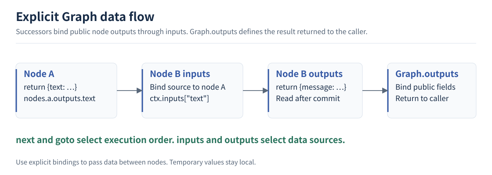

# Explicit Graph data interfaces

[**English**](explicit-graph-data.md) · [简体中文](explicit-graph-data.zh-CN.md)

Plugins supply environment-specific options through `environment.parameters` and each TaskCase's `environment_parameters`. The existing `environment.io` contract retains precedence for standard fields. Extensions may define observation modalities as custom strings. Models must interpret images, state, and actions according to the declared IO contract. See [plugin development](plugin_development.md).

Choose the node `id` independently of `module` or `operation`, which identify the plugin or system operation to invoke. When renaming a node, update topology, conditions, and input/output references. Its Python plugin can keep the same implementation.

## Node inputs and field ownership



```json
{
  "id": "move_arm",
  "module": "xiaomi_robotics_1_action",
  "inputs": {
    "instruction": "nodes.choose_goal.outputs.instruction",
    "env_steps": {
      "source": "nodes.check_done.outputs.env_steps",
      "default": 0
    }
  }
}
```

The module reads both fields through `ctx.inputs`. This immutable snapshot contains only the declared inputs. Other nodes' complete results are not merged automatically, and inputs are not automatically published as outputs.

- `nodes.<id>.outputs.<field>` reads a committed return value in the current Graph invocation. Modules normally return dictionaries. For `NodeResult`, this refers to `output` rather than `state_patch`.
- `inputs.<field>` reads initial Graph input.
- `previous.<field>` reads the current node's most recently committed private state, for example a loop counter.
- `source` may list paths. The runtime checks them in order and selects the first existing path, even when its value is `null`. Write timestamps do not affect the choice.
- Use `default` when an upstream result may be absent, for example in the first iteration. A missing required input without a default fails before module invocation.
- `inputs: {}` declares no inputs. Omitting `inputs` preserves the legacy behavior of reading initial Graph inputs. Names such as plan/evaluate do not trigger implicit bindings.
- Parallel nodes read the snapshot from their activation batch. A sibling's completion does not change it. Use predecessors/next to wait explicitly for a current upstream result.
- A mapping establishes a data reference. Declare scheduling dependencies separately. A `goto` or loop may read a result committed in an earlier activation.

Each result belongs to the producing node. For example, `check_done.env_steps` owns the counter, and `choose_goal.instruction` owns the instruction. Plan and verify no longer copy env_steps into their outputs. Bind env_steps explicitly on action modules that need it.

## Public Graph outputs

The Graph's `outputs` declaration is its external interface. Modules return their data directly without `source`. The Graph selects which node results to publish. Write a string for a direct mapping, or use `{ "source": ..., "default": ... }` for fallbacks and defaults.

Declare the mapping at the top level of the Graph.

```json
{
  "outputs": {
    "success": "nodes.check_done.outputs.success",
    "reason": "nodes.check_done.outputs.reason",
    "env_steps": "nodes.check_done.outputs.env_steps",
    "instruction": "nodes.choose_goal.outputs.instruction"
  }
}
```

`GraphResult.outputs` returns this mapping. The episode runner, live progress display, and optional experience summary consume public outputs without relying on specific node IDs. Only boolean `true` in `success` marks the task successful. A completed Graph with no success output does not imply task success.

During execution an output may be temporarily absent. On normal completion, a missing output without a default raises an error. Graphs with early exits should define suitable defaults for fields produced by nodes that might never run. The migrated RoboCasa Graph uses null as the default for success when evaluation has not yet run.

The parent node's return value contains its subgraph's public outputs under `outputs`. For example, a parent Graph can read `nodes.child_task.outputs.outputs.success`. Nodes with identical IDs in different subgraphs have separate result scopes.

## Environment observations and action descriptions

`EnvironmentFeedback.io` describes the IO contract and is persisted with feedback.

```json
{
  "cameras": {
    "front_camera": {"role": "external", "flip_vertical": false},
    "hand_camera": {"role": "wrist", "flip_vertical": false}
  },
  "state_keys": ["joint_positions"],
  "action": {"format": "joint_delta_7d", "dimensions": 7, "robot_type": "my_robot"}
}
```

The environment can declare IO in feedback, or the configuration can pass it to the Session using `parameters.environment.io`. A physical robot's observation source can include a top-level `io` in a dictionary response. Without explicit camera declarations, the base Session derives channels from RGB ObservationFrame records and leaves images unflipped. It does not infer an action space.

Qwen selects images by the actual camera channels and roles. It flips an image only when its camera declares flip_vertical. An explicitly requested missing channel raises an error instead of silently invoking text-only inference. The RoboCasa adapter declares its image orientation and 12-dimensional action convention.

The action module checks the Tool's returned format and dimensions against the environment declaration. The Xiaomi Tool implements a specific 12D policy. The current RoboCasa adapter requires robocasa365_native_12d. A model swap alone cannot confer control of a different robot. Each Tool maps its vendor-specific inputs to environment channels with `params.observation_mapping`. EnvironmentIO carries no model names or policy-specific input layout. Tools may give the same channel different input names. Before real inference, the runtime checks that the environment declares and supplies the mapping targets.

Migration: move `io.policy_observation_maps.<model-name>` into the corresponding Tool's `params.observation_mapping`. The RoboCasa action format was renamed from `xr_native_12d` to `robocasa365_native_12d`. Dimension order and numeric semantics are unchanged. Environment, Body, and the policy adapter use the new name. Historical results retain their original format. Update the declaration in custom action producers.

## Playing Graph images

Playback follows observation_groups / observations / frames in execution records. Any node may carry images. For nodes with no image, only the node highlight advances. A capture referenced by multiple nodes plays once. Run video plays independently.

## Compatibility and migration

The current runs/robocasa365/config_graphs.json declares explicit inputs and public outputs. Existing custom Graphs that call plan/verify/action must declare those inputs as well as their edges. The read_values API remains available for migrating other plugins. The official modules above and the episode runner no longer use it.

Graph fingerprints include these declarations. If an older checkpoint no longer matches the Graph, restart the run. A running process does not hot-swap modules.
