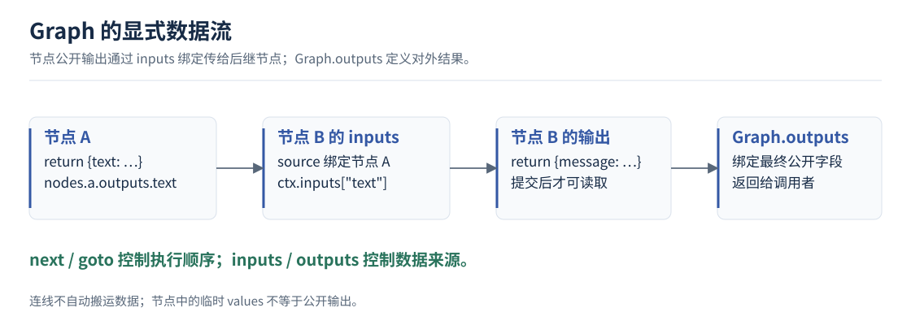

# 显式 Graph 数据接口

[English](explicit-graph-data.md) · [**简体中文**](explicit-graph-data.zh-CN.md)

插件通过 `environment.parameters` 和每个 TaskCase 的 `environment_parameters` 传入环境专用选项；既有 `environment.io` 保持规范字段优先级。观测模态可自定义字符串，但模型仍须按声明的 IO 契约解释图片/状态/动作。通用入口见[插件开发](plugin_development.zh-CN.md)。

节点 `id` 是用户选择的名称。`module` / `operation` 标识要调用的插件或系统能力，与节点名称独立。修改节点名称时同步修改拓扑、条件和输入/输出引用，不需要修改插件 Python 代码。

## 节点输入与字段归属



```json
{
  "id": "move_arm",
  "module": "xiaomi_robotics_1_action",
  "inputs": {
    "instruction": "nodes.choose_goal.outputs.instruction",
    "env_steps": {
      "source": "nodes.check_done.outputs.env_steps",
      "default": 0
    }
  }
}
```

模块从 `ctx.inputs` 读取上述两个字段。它是不可变快照，不会自动合并其他节点整份结果，也不会自动进入当前节点的输出。

- `nodes.<id>.outputs.<field>`：同一个 Graph 调用作用域内，该节点已提交的返回值。普通模块返回 dict；使用 `NodeResult` 时对应其 `output`，不是 `state_patch`。
- `inputs.<field>`：Graph 初始输入。
- `previous.<field>`：当前节点上一次提交的私有状态，适合循环累计计数。
- `source` 可以是路径列表，按声明顺序选择第一个存在的路径；这是明确的回退顺序，不是按写入时间混合数据。`null` 算已有值。
- `default` 用于循环首轮尚不存在的上游结果。没有默认值的必需输入缺失时，调用模块前报错。
- `inputs: {}` 表示没有输入；省略 `inputs` 时保留旧接口的图初始输入行为，但不恢复按名称猜测 plan/evaluate 的旧逻辑。
- 并行节点读取激活批次的快照，同批其他节点刚完成的结果不会中途改变其输入。需要当前结果时，通过 predecessors/next 明确等待上游。
- 映射只建立数据引用，不自动创建调度依赖；`goto` 和循环可能使用上一次已提交的结果。

每个结果属于产出它的节点。例如计数属于 `check_done.env_steps`，指令属于 `choose_goal.instruction`。plan/verify 不再复制输入的 env_steps 到输出中；动作模块必须显式接入 env_steps。

## Graph 对外输出

这里的 `outputs` 是整个 Graph 的对外接口，不是模块函数的返回值。模块直接返回数据，不需要 `source`；Graph 显式选择使用哪个节点的结果。简单映射直接写字符串，仅默认值或备用来源需要 `{ "source": ..., "default": ... }`。

在 Graph 顶层声明：

```json
{
  "outputs": {
    "success": "nodes.check_done.outputs.success",
    "reason": "nodes.check_done.outputs.reason",
    "env_steps": "nodes.check_done.outputs.env_steps",
    "instruction": "nodes.choose_goal.outputs.instruction"
  }
}
```

`GraphResult.outputs` 返回这份映射。episode runner、实时进度和可选经验总结使用公开输出，不读取特定节点名。任务成功只接受 `success` 的布尔值 `true`；Graph 执行完成与任务成功仍是两个概念。无 success 输出不会被推断为任务成功。

正在运行时未就绪的输出可暂时缺省；Graph 正常完成时缺少无默认值的输出会报告错误。提前退出的 Graph 应对可能未运行的节点字段声明适当默认值。当前 RoboCasa Graph 已迁移，评估尚未执行时 success 默认为 null。

子 Graph 的公开输出在父节点返回值的 `outputs` 下。例如父 Graph 可用 `nodes.child_task.outputs.outputs.success`。不同子 Graph 内同名节点的结果彼此隔离。

## 环境观测与动作描述

`EnvironmentFeedback.io` 是随反馈持久化的描述：

```json
{
  "cameras": {
    "front_camera": {"role": "external", "flip_vertical": false},
    "hand_camera": {"role": "wrist", "flip_vertical": false}
  },
  "state_keys": ["joint_positions"],
  "action": {"format": "joint_delta_7d", "dimensions": 7, "robot_type": "my_robot"}
}
```

环境可在反馈中声明，也可通过 `parameters.environment.io` 传给 Session。真实机器人观测源的字典响应支持顶层 `io`。没有相机声明时，基础 Session 从 RGB ObservationFrame 推导通道，默认不翻转；不猜测动作空间。

Qwen 按实际相机通道和角色选择图像，只在相机声明 flip_vertical 时翻转。显式要求缺失通道会报错，避免悄悄变成纯文本推理。RoboCasa 适配器明确声明其图像方向和 12 维动作约定。

动作模块按环境声明校验工具返回的 format 和维度。Xiaomi 工具本身仍是专用 12D 策略，当前 RoboCasa 适配必须匹配 robocasa365_native_12d；更换模型并不自动赋予该模型其他机器人的控制能力。其供应商输入布局由 Tool 的 `params.observation_mapping` 映射到环境通道，EnvironmentIO 不再维护任何模型名或策略输入布局。不同 Tool 可以把同一环境通道映射成各自所需输入名，映射目标在真实推理前检查是否已由环境声明并提供。

迁移：旧的 `io.policy_observation_maps.<模型名>` 移到对应 Tool 的 `params.observation_mapping`。RoboCasa 动作格式名称从 `xr_native_12d` 改为 `robocasa365_native_12d`，12 维顺序和数值语义不变；环境、Body 与策略适配器已同步修改。历史结果保留原格式，不重写；旧的自定义动作生产者需更新格式声明。

## Graph 图片播放

按执行记录中的 observation_groups / observations / frames 播放。任意节点均可携带图片，没有图片只推进节点高亮。同一捕获记录被多个节点引用时只播放一次，避免把重复引用当成新画面。运行视频仍独立播放。

## 兼容与迁移

当前 runs/robocasa365/config_graphs.json 已声明输入、公开输出。旧自定义 Graph 如果调用 plan/verify/action，需要显式配置其输入；只复制旧节点连线不够。保留 read_values 供其他旧插件迁移，但官方上述模块和 episode runner 已不再使用它。

Graph 的 fingerprint 包含这些声明，旧 checkpoint 与新 Graph 不匹配时需要原地重跑。运行中的旧进程不会热替换模块。
