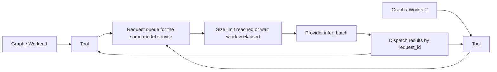

# Dynamic model batching in a regular Graph

[**English**](graph-batching.md) · [简体中文](graph-batching.zh-CN.md)

Dynamic batching is a core capability and **can run independently of any benchmark**. Each Worker runs its own Graph. Tools submit requests to a shared model service, which combines compatible requests into one inference call and routes each result back to its Graph.

Start with a complete CPU example, then configure a real model and multiple GPUs. Run commands from the repository root.

## 1. Three kinds of parallelism

| Concept | What it controls | Configuration |
| --- | --- | --- |
| Concurrent Graph nodes | Which nodes can run together within one task | Graph JSON dependencies and routing |
| Parallel tasks | Number of simultaneous tasks or simulator processes | `runtime.execution.max_workers` |
| Dynamic model batching | Maximum requests processed in one inference call | `batch_services[].max_batch_size` |

CLI `--batch` enumerates the Task Adapter's tasks. **Configure a shared model service separately to enable inference batching.** For example, 16 Workers can share a model with a maximum batch size of 8.



## 2. Run the complete CPU example

In a Python environment with the project dependencies installed, run:

```bash
Tenon run \
  --config examples/graph_batching/config.json \
  --batch \
  --output-dir runs/graph-batching \
  --run-id cpu-demo
```

This example needs no benchmark extension, model weights, GPU, or simulator assets.

- `examples/graph_batching/config.json` provides the complete Module, Tool, Graph, Environment, and execution configuration.
- `examples/graph_batching/providers.py` implements the `AskModel` Module and `EchoModel` Provider.
- Four Workers execute seven tasks using one Echo service with a batch limit of four and a 25 ms wait window.
- The Graph executes reset → ask. The ask node calls the Tool and returns the input text and actual batch size.

Echo demonstrates request grouping and response routing. It does not run a neural network, so its timings cannot establish a GPU speedup. Batches may contain fewer than four requests.

Results are under `runs/graph-batching/cpu-demo/`. Inspect completion and error counts and per-task results in `summary.json`, then examine `batch-metrics/` in the run artifacts.

## 3. Implementing a batched service

### 3.1 Model with existing batching support

Configure the checkpoint, service factory, GPUs, and execution parameters. The built-in queue and transport handle batching without a special Graph node.

### 3.2 New model Provider

One possible system layout is shown below. **The Graph is JSON and does not require a graph directory.**

```text
my_system/
├── module/           # Decisions, task state, and workflow logic
├── tool/             # Model loading, preprocessing, and batch inference
└── configs/
    ├── system.json
    └── graphs.json
```

The service process must be able to import the model's Python module, for example `my_system.tool.policy:Provider`. Install the package or configure the source path explicitly. Placing files in a directory alone does not register a package.

The following interface example leaves `preprocess_batch`, model forward, and `decode_batch` to the application.

```python
class Provider:
    def __init__(self, model_path):
        self.model = load_model(model_path)  # Load once per replica.
        self.sessions = {}

    def open_session(self, session_id, metadata):
        self.sessions[session_id] = metadata

    def infer_batch(self, requests):
        inputs = preprocess_batch([r['observation'] for r in requests])
        outputs = decode_batch(self.model(inputs))
        return [
            {'request_id': r['request_id'], 'output': output}
            for r, output in zip(requests, outputs)
        ]

    def close_session(self, session_id, result):
        self.sessions.pop(session_id, None)

    def close(self):  # Optional cleanup at run end.
        self.sessions.clear()
        self.model = None
```

Provider requirements:

- Each request includes `request_id`, `session_id`, `step_id`, and `observation`.
- Output IDs must match input IDs exactly, without missing, duplicate, or extra results. Results may be reordered.
- Isolate history, RNG state, and caches by session. Batch indices do not identify episodes.
- For real batched inference, stack or pad inputs and run one batched model computation. A Python loop over individual examples does not by itself accelerate GPU inference.
- Lifecycle hooks and inference calls are serialized on one dedicated thread. Load model weights once per replica.
- An optional `batch_key(request)` returns a compatibility key. It must be fast, stateless, and hashable. Separate services or compatibility groups never share a batch.

### 3.3 Calling the service from a Tool and Module

Declare the Tool in the main configuration's `tools` manifest:

```json
{
  "id": "model",
  "name": "shared_batch_model",
  "kind": "model",
  "params": {
    "service": "policy",
    "timeout_s": 120,
    "batch_key": "default"
  }
}
```

The Module makes a normal Tool call:

```python
result = await ctx.call_tool('model', {'question': 'What should happen next?'})
if not result.ok:
    raise RuntimeError(result.error)
return {'answer': result.output}
```

`id` is the name the Module uses. `service` must match the shared service's `name`. Multiple Tools can use one service. For example, a planner and verifier can share Qwen if the Provider supports both input contracts.

Ordinary Tool payloads must be transportable. Do not send an in-process resolver, model, or connection. Resolve images into arrays first. MessagePack plus raw array bytes preserves dtype and shape but requires copies. The application adapts robot actions, camera layout, and model history to its model.

Only one outstanding request is allowed per Tool session. Requests from different Workers/sessions may be batched. Existing Tools calling a single-example service can still run independently, but must connect to a shared service to participate in this mechanism.

## 4. One GPU and multiple Workers

This is **a fragment for `parameters.runtime.execution` in a main configuration**. Section 2 links a complete runnable configuration.

```json
{
  "backend": "process",
  "max_workers": 4,
  "memory_mode": "disabled",
  "worker_devices": ["0", "0", "0", "0"],
  "batch_services": [
    {
      "name": "policy",
      "factory": "my_system.tool.policy:Provider",
      "params": {"model_path": "/models/my-checkpoint"},
      "devices": ["0"],
      "mode": "batch",
      "max_batch_size": 4,
      "max_wait_ms": 50,
      "max_pending": 256
    }
  ]
}
```

Run your own complete configuration:

```bash
Tenon run --batch \
  --config my_system/configs/system.json \
  --output-dir runs/my-system --run-id batch-demo
```

Include Environment, Task Adapter, and Graph declarations. A list of Graph nodes alone is insufficient. Ensure that the Task Adapter produces enough tasks to exercise multiple Workers.

| Field | Meaning |
| --- | --- |
| `max_workers` | Number of task or simulation processes |
| `worker_devices` | One binding per Worker. Length must equal the Worker count; repeated devices are allowed |
| `devices` | Devices for replicas of one model service. Entries within that service must be unique |
| `max_batch_size` | Maximum samples per inference call. A batch can be smaller |
| `max_wait_ms` | Time allowed to form a batch once the service can process work. Additional waiting and computation contribute to end-to-end latency |
| `max_pending` | Queue capacity, at least as large as the batch limit |
| Tool `timeout_s` | Overall request timeout including queueing, transport, and inference |

When the model is busy, a request can wait well beyond 50 ms. The wait window does not guarantee an action in 50 ms. Graphs have no additional process-wide synchronization barrier, so a Worker can pick up another task when idle.

## 5. Eight GPUs, two models and 16 Workers per GPU

Configure the following:

1. `max_workers=128`。
2. Give `worker_devices` 128 device bindings, for example by repeating `["0", ..., "7"]` 16 times.
3. Declare separate Xiaomi and Qwen services under `batch_services`. Set both `devices` lists to GPUs `0` through `7`.
4. Configure `max_batch_size=8` and `max_wait_ms=50` on each service.
5. Bind the policy Tool to Xiaomi and the planner/verifier Tools to Qwen.

The runtime prefers a replica on the Worker's device. Each GPU houses two model replicas and 16 Workers, supporting 128 task Graphs in total. The Workers share the models. The two services batch independently; requests do not form cross-model batches.

Without a same-device replica, binding uses round-robin assignment by Worker index. The runtime does not select an idle GPU per request. Each replica has its own queue, and binding stays fixed for the task.

`worker_devices` and `gpu_ids` are mutually exclusive. Set `egl_device_ids` separately when required; CUDA binding alone does not configure EGL. Before colocating services, measure peak VRAM with both models, full batches, and concurrent simulation.

## 6. Disable dynamic batching

Set each service to `"mode": "single"`. The Provider then receives one-element request lists without waiting to fill a batch. Graph, Module, and Provider interfaces stay the same.

Multiple Workers and GPUs can still execute in parallel. To serialize the entire run, set `max_workers=1` and adjust the device lists. Configuration takes effect at startup; it cannot be switched live.

## 7. Benchmark entry point and separate Python environments

| Entry point | Purpose |
| --- | --- |
| `scripts/run_experiment.py --batch --config ...` | Run a regular system Graph, with optional dynamic batching through configured shared services |
| `Tenon evaluate ...` | Combine a benchmark protocol, VLA backend, separate simulator and model Python environments, and evaluation statistics |

A core Provider implements `infer_batch()` and returns `output`. A benchmark VLA backend declares `SPEC + create() + act_batch()` and returns actions, which an adapter converts to the shared service protocol. A new model does not require a separate copy of `vla.py` in every benchmark. See the [model interface](../extensions/benchmarks/models/README.md) and [system integration](../extensions/benchmarks/SYSTEMS.md).

For ordinary process runs, automatically launched services and Workers default to the launcher's Python interpreter. `--model-python` and `--sim-python` are evaluate options; `run_experiment.py` does not expose them.

The core also supports launching model services separately:

```bash
/envs/model/bin/python -m robotenon.runtime.batch_services \
  --config /path/to/services.json \
  --ready-file /path/to/ready.json \
  --metrics-dir /path/to/batch-metrics
```

`services.json` is a JSON array of service configurations. The readiness file maps each name to its replicas' `[device, socket_path]` pairs. The orchestrator reads the file, supplies the sockets as `external_batch_services` in Worker configuration (one address per service or one per Worker), and launches the Graph using the simulator Python. It owns startup, shutdown, and cleanup for external services. Do not declare a service name as both internal and external. The benchmark evaluator implements this orchestration. Regular Graphs using separate environments must supply their own.

The transport uses same-host Unix sockets. It does not provide cross-host serving or automatic model tensor parallelism.

## 8. Verify that requests actually batch

Inspect `batch-metrics/<service-index>-<replica-index>.json` in the run artifacts:

- `requests` counts processed requests; `batches` counts actual Provider calls.
- `batch_sizes` is a frequency distribution. A size above one demonstrates that requests were grouped.
- `inference_sec` and `queue_wait_sec` are cumulative durations.
- `pending`, `sessions`, and `status` describe queue, session, and service state. A clean shutdown leaves no sessions.

Metrics refresh about every five seconds during the run, followed by a final snapshot at shutdown. A forced kill can leave an older snapshot. Inspect the real model implementation to confirm it executes a batched forward pass as well as receiving grouped requests.

Troubleshooting:

| Symptom | What to check |
| --- | --- |
| Batches always have size 1 | Task and Worker count, dispersed arrivals, different batch_key values, or a short wait window |
| Batching configured but model still runs one example at a time | Verify that the Tool uses the shared service and the Provider does a batched forward |
| Service not found | Verify the Tool's service name and the configured name. Use process execution or supply a valid endpoint |
| Factory cannot import | Verify that the package and dependencies are installed in the model service's Python |
| Mixed responses or request ID errors | Check one-to-one ID matching and isolate caches by session |
| GPU OOM | Count replicas per GPU and check peak batch memory and concurrent EGL/simulation contexts |
| Responses exceed 50 ms | Check earlier inference, queue backlog, image transport, and model computation |

If a Worker disconnects or times out, queued requests that have not begun are cancelled. An active forward usually cannot be immediately interrupted, and its result is not passed to a new session. A model-service failure fails its affected requests. The framework does not promise to restart the model or replay submitted actions automatically.

## 9. Optimization and Web video

Dynamic batching, summary tracing, and history caching do not require disabling video. A summary trace omits some per-node detail while the environment can continue producing images.

**The generic native benchmark path currently does not write video files.** Its `BenchmarkSession` creates an `EpisodeRecorder` without a `video_sink`, and evaluate has no video CLI flag. The Web UI can replay an existing video file; enabling an optimization or supplying a video setting cannot produce one on this path.

The ordinary `run_experiment.py` supports `--save-videos`. File creation requires an environment session that implements recording and returns the video path. The Web server must be able to access the run and its artifacts. Playback of a recorded file is separate from live streaming.
