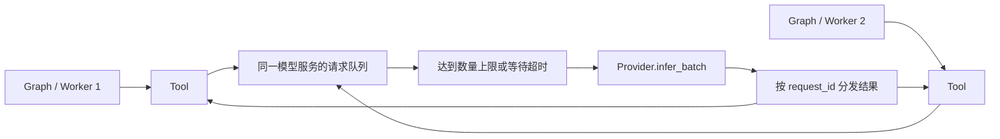

# 普通 Graph 与动态模型 batching

[English](graph-batching.md) · [**简体中文**](graph-batching.zh-CN.md)

动态 batching 是核心框架能力，**不需要从 benchmark 启动**。多个 Worker 执行各自的 Graph，Tool 把请求提交给共享模型服务，服务把兼容请求组成一次模型推理，再把结果返回各自的 Graph。

本页先运行无需 GPU 的完整示例，再解释如何接入真实模型与配置多卡。所有命令从仓库根目录执行。

## 1. 三个容易混淆的概念

| 概念 | 控制内容 | 对应配置 |
| --- | --- | --- |
| Graph 节点并发 | 一个任务内部哪些节点可以同时运行 | Graph JSON 的依赖和路由 |
| 多任务并行 | 同时运行多少个任务/仿真进程 | `runtime.execution.max_workers` |
| 模型动态 batching | 一次模型推理处理多少个请求 | `batch_services[].max_batch_size` |

CLI 的 `--batch` 表示遍历 Task Adapter 的任务清单，**本身不启用模型合批**。模型合批由共享服务配置启用。16 个 Worker 并不代表 batch 必须为16；它们可以共享一个 batch 上限为8的模型。



## 2. 先运行一个完整 CPU 示例

在已安装本项目依赖的 Python 环境中执行：

```bash
Tenon run \
  --config examples/graph_batching/config.json \
  --batch \
  --output-dir runs/graph-batching \
  --run-id cpu-demo
```

此示例不需要 benchmark extension、模型权重、GPU 或仿真资产：

- `examples/graph_batching/config.json`：完整 Module、Tool、Graph、Environment 和执行配置。
- `examples/graph_batching/providers.py`：`AskModel` Module 和 `EchoModel` Provider。
- 4个 Worker 执行7个任务，共享一个 Echo 服务；batch 上限4、等待25ms。
- Graph 执行 reset → ask；ask 调用 Tool，返回输入文本和本次实际 batch 大小。

Echo 只演示请求合并与返回路径，不做神经网络推理，不能用它的耗时证明 GPU 加速。实际 batch 可能小于上限，不应要求每一批都满4。

结果位于 `runs/graph-batching/cpu-demo/`。检查 `summary.json` 中的完成数、错误数及逐任务结果；再检查运行产物中的 `batch-metrics/`。

## 3. 用户要实现什么

### 3.1 已有支持 batching 的模型

只需填写 checkpoint、服务 factory、GPU 和执行参数。无需新增队列、通信协议或合批 Graph 节点。

### 3.2 新模型：在 Tool 的模型实现中提供 Provider

系统可以按以下方式组织；**Graph 由 JSON 定义，无需 graph 文件夹**：

```text
my_system/
├── module/           # 决策、任务状态和工作流逻辑
├── tool/             # 模型加载、预处理、batch 推理
└── configs/
    ├── system.json
    └── graphs.json
```

模型实现的 Python 模块必须可由服务进程导入，例如 `my_system.tool.policy:Provider`。目录位置不自动提供 Python 包注册，需安装系统包或正确设置源码路径。

以下是接口示意，`preprocess_batch`、模型 forward 和 `decode_batch` 需由用户实现：

```python
class Provider:
    def __init__(self, model_path):
        self.model = load_model(model_path)  # 每个副本只加载一次
        self.sessions = {}

    def open_session(self, session_id, metadata):
        self.sessions[session_id] = metadata

    def infer_batch(self, requests):
        inputs = preprocess_batch([r['observation'] for r in requests])
        outputs = decode_batch(self.model(inputs))
        return [
            {'request_id': r['request_id'], 'output': output}
            for r, output in zip(requests, outputs)
        ]

    def close_session(self, session_id, result):
        self.sessions.pop(session_id, None)

    def close(self):  # 可选的运行结束清理
        self.sessions.clear()
        self.model = None
```

必须遵守以下约定：

- 每个请求含 `request_id`、`session_id`、`step_id`、`observation`。
- 输出 ID 必须恰好覆盖输入，无遗漏、重复或额外结果；输出顺序可以不同。
- 历史、随机状态和缓存按 session 隔离，不能用 batch 下标识别 episode。
- 真正合批应 stack/pad 后执行批量模型计算；循环调用单样本模型不会自动获得 GPU batch 加速。
- Provider 的生命周期和推理在同一专用线程串行调用；不要每次请求重新加载权重。
- 可选 `batch_key(request)` 返回兼容性分组键，必须快速、无状态且可 hash；不同服务或不同分组不混批。

### 3.3 Tool 和 Module 怎样调用

主配置的 `tools` 清单中声明：

```json
{
  "id": "model",
  "name": "shared_batch_model",
  "kind": "model",
  "params": {
    "service": "policy",
    "timeout_s": 120,
    "batch_key": "default"
  }
}
```

Module 保持普通 Tool 调用方式：

```python
result = await ctx.call_tool('model', {'question': '下一步做什么？'})
if not result.ok:
    raise RuntimeError(result.error)
return {'answer': result.output}
```

`id` 是 Module 使用的 Tool 名，`service` 必须与共享服务的 `name` 一致。一个服务可由多个 Tool 使用，例如 planner 和 verifier 共用 Qwen，但 Provider 必须支持两种输入协议。

普通 Tool 的 payload 必须是可传输数据，不能发送进程内 resolver、模型或连接对象。图像应解析为数组后传入；当前传输使用 MessagePack 和数组原始字节，保留 dtype/shape，但不是零拷贝。通用 Tool 不会自动理解机器人 action、相机排列或模型历史，相关适配仍由系统实现。

每个 Tool 会话仅允许一个未完成请求；不同 Worker/session 的请求可以一起合批。旧 Tool 若直接调用单样本服务，仍可继续运行，但必须接入共享服务才能参与此处的合批。

## 4. 单卡、多 Worker 的执行配置

下面是**放入主配置 `parameters.runtime.execution` 的片段**，不是完整可运行主配置。完整结构参考第2节示例。

```json
{
  "backend": "process",
  "max_workers": 4,
  "memory_mode": "disabled",
  "worker_devices": ["0", "0", "0", "0"],
  "batch_services": [
    {
      "name": "policy",
      "factory": "my_system.tool.policy:Provider",
      "params": {"model_path": "/models/my-checkpoint"},
      "devices": ["0"],
      "mode": "batch",
      "max_batch_size": 4,
      "max_wait_ms": 50,
      "max_pending": 256
    }
  ]
}
```

启动自己的完整主配置：

```bash
Tenon run --batch \
  --config my_system/configs/system.json \
  --output-dir runs/my-system --run-id batch-demo
```

主配置也需要 Environment、Task Adapter 和 Graph 等声明，不能只传 Graph 节点列表。Task Adapter 必须产生足够多的任务，才能观察到多 Worker 并发。

| 字段 | 含义 |
| --- | --- |
| `max_workers` | 仿真/任务进程数量 |
| `worker_devices` | 每个 Worker 的设备绑定，长度必须等于 Worker 数；可重复 |
| `devices` | 每个模型服务的副本设备列表；同一服务内不能重复 |
| `max_batch_size` | 每次推理样本数上限，不保证每批都满 |
| `max_wait_ms` | 服务可开始处理时的组批等待；不是端到端延迟上限 |
| `max_pending` | 队列容量限制，必须不小于 batch 上限 |
| Tool 的 `timeout_s` | 请求整体超时，包含排队、通信和推理 |

模型正忙时，请求仍可能等待较长时间，不能把50ms理解为“50ms内返回动作”。进程内没有额外的全局 Graph 同步屏障，任务完成后空闲 Worker 可继续处理后续任务。

## 5. 八卡、每卡两个模型与16个 Worker

需要配置：

1. `max_workers=128`。
2. `worker_devices` 提供128项设备绑定，例如 `["0", ..., "7"]` 重复16次。
3. 在 `batch_services` 中分别声明 Xiaomi 和 Qwen 两个服务；两者的 `devices` 都为 `0` 到 `7`。
4. 两个服务分别设置 `max_batch_size=8`、`max_wait_ms=50`。
5. policy Tool 绑定 Xiaomi 服务；planner/verifier Tool 绑定 Qwen 服务。

框架优先选择与 Worker 同设备的服务副本。因此每张卡有两份模型和16个 Worker，共128个任务 Graph。它们共享模型，不会为每个 Worker 再加载两份权重。两类服务各自合批，不能合成一个跨模型 batch。

没有同设备副本时，会按 Worker 索引轮询绑定服务副本；这不是每次请求随机选空闲 GPU。当前合批以各副本队列为单位，不存在全局跨卡合批。设备在任务执行期间固定。

`worker_devices` 与 `gpu_ids` 互斥。EGL 渲染设备还需按环境要求配置 `egl_device_ids`，不要假定 CUDA 绑定会自动完成 EGL 绑定。同卡部署须先测双模型、满 batch 和并发仿真的显存峰值。

## 6. 关闭动态 batching

将每个服务设置为 `"mode": "single"`。此时每次调用 Provider 的请求列表长度为1，不等待组批；Graph、Module 和 Provider 接口保持不变。

保留多个 Worker 和 GPU 仍可以并行。如果需要整个运行串行，再设置 `max_workers=1` 并相应调整设备列表。配置在启动时生效，不支持运行中热切换。

## 7. 与 benchmark 入口、独立 Python 环境的关系

| 入口 | 用途 |
| --- | --- |
| `scripts/run_experiment.py --batch --config ...` | 普通系统 Graph，配置共享服务即可动态合批 |
| `Tenon evaluate ...` | benchmark 协议、VLA 后端、环境与模型 Python 隔离、评测统计的上层封装 |

普通核心 Provider 使用 `infer_batch()` 返回 `output`。统一 benchmark 的 VLA 后端使用 `SPEC + create() + act_batch()` 返回 action，由适配器转换到共享服务接口；不要把两种接口混为一谈。当前新模型不必给每个 benchmark 分别复制一份 `vla.py`。详见[模型接口](../extensions/benchmarks/models/README.zh-CN.md)与[系统接入](../extensions/benchmarks/SYSTEMS.zh-CN.md)。

普通 process 运行自动启动的模型服务与 Worker 默认使用启动器的 Python。`run_experiment.py` 没有 `--model-python` / `--sim-python` 参数；这些参数属于统一 evaluate。

核心也支持独立启动模型服务：

```bash
/envs/model/bin/python -m robotenon.runtime.batch_services \
  --config /path/to/services.json \
  --ready-file /path/to/ready.json \
  --metrics-dir /path/to/batch-metrics
```

`services.json` 是服务配置对象的 JSON 数组。就绪文件将服务名映射到各副本的 `[device, socket_path]` 列表。编排方读取它，把 socket 路径填入 Worker 配置的 `external_batch_services`（每个服务一条地址或每 Worker 一条地址），再用仿真 Python 启动 Graph。外部服务的启停与清理由编排方负责；同名服务不能同时声明为内部和外部。统一 evaluate 已封装此流程，普通 Graph 若需要独立环境则需自行编排。

当前传输为同一主机的 Unix socket；不提供跨机器服务或自动模型张量并行。

## 8. 如何判断真正生效

检查运行产物中的 `batch-metrics/<服务序号>-<副本序号>.json`：

- `requests`：处理的请求数；`batches`：实际 Provider 调用数。
- `batch_sizes`：实际批大小的次数分布。出现大于1的键才说明确实合批。
- `inference_sec`、`queue_wait_sec`：累计值，不是单次时延。
- `pending`、`sessions`、`status`：队列、会话及服务状态；正常关闭后应清空会话。

指标运行中约每5秒更新，结束时再写最终快照。强制杀进程可能只留下旧快照。真实模型仍要确认其内部执行了批量 forward，不能只看合批次数。

常见问题：

| 现象 | 检查方向 |
| --- | --- |
| 始终 batch=1 | 任务数/Worker太少、请求到达分散、不同 batch_key、等待窗口过短 |
| 配了 batch 但旧模型仍单次运行 | Tool 是否连接共享服务；Provider 是否只是循环单次推理 |
| 找不到服务 | Tool 的 service 与配置 name 是否一致；是否使用 process 或传入有效 endpoint |
| factory 无法导入 | 模型服务 Python 是否安装了系统包和依赖 |
| 请求串线或报 ID 错误 | 返回 ID 是否与输入逐一对应；缓存是否按 session 管理 |
| GPU OOM | 每卡模型副本数、真实 batch 峰值、仿真 EGL 与上下文共同占用 |
| 50ms设置下响应仍慢 | 前一批推理占用、队列积压、图像传输和模型计算耗时 |

Worker断开或超时后取消尚未执行的请求；已开始的forward通常不能立即中断，结果不会转交新会话。模型服务故障会使相关请求失败；不要假定框架自动重启模型或重新执行已经提交的动作。

## 9. 优化与 Web 视频

动态 batching、摘要 trace 和历史缓存本身不要求关闭视频。摘要 trace 会减少逐节点详情，但不等于停止环境产生图像。

不过，**当前通用 native benchmark 链路尚未接通视频文件写入**：`BenchmarkSession` 创建的 `EpisodeRecorder` 没有绑定 `video_sink`，统一 evaluate 也没有视频 CLI 参数。Web 虽支持播放已生成的视频文件，这条链路目前不能仅靠打开优化或传一个视频选项就自动产出视频。

普通 `run_experiment.py` 提供 `--save-videos`，但是否生成视频仍取决于环境 session 是否实现录制并返回视频路径。Web 服务还必须能访问该运行及其产物。录制文件回放和实时直播是不同功能，不应混称。
