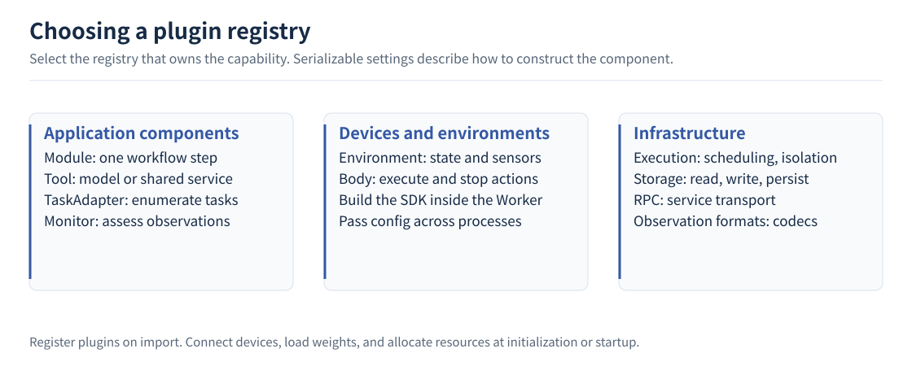

# Infrastructure plugins and extension boundaries

[**English**](infrastructure-plugins.md) · [简体中文](infrastructure-plugins.zh-CN.md)

Environment, Body, Module, Tool, Monitor, and TaskAdapter have six application-level registries.
Execution backends, persistence, and RPC stream transports use separate registration APIs. The core assembles them
according to their protocols and declared capabilities. Package new plugins separately and import them through configuration without modifying the built-in manifests.

## 1. Execution backends



Register with `robotenon.runtime.execution_registry.register_execution_backend`.
The factory receives a keyword `context: ExecutionBackendContext` and the expanded keywords from `backend_params`.
The context contains `options`, the Worker's startup `profile`, and `make_request` to build per-task requests.
Return an object exposing `max_workers`, `async execute(configured, case, context)`, and `async close()`.
The factory constructs the object. Start resources during execution. close must work even if execute has never run.

```json
{
  "parameters": {
    "runtime": {
      "execution": {
        "backend": "my-executor",
        "plugin_backends": ["my_package.execution"],
        "backend_params": {"endpoint": "scheduler.example"},
        "max_workers": 1
      }
    }
  }
}
```

Declare `capabilities` at registration.

| Capability | Framework behavior |
| --- | --- |
| `local_worker` | Requires one Worker and binds configured CUDA-visible devices at Worker startup |
| `managed_workers` | Validates that the Worker's startup budget covers all model services' startup budgets |
| `shared_observability` | Prepares a shared Trace/Metrics socket data source for single-task and batch runs |

The built-in `in_process` backend declares `local_worker`; `process` declares the other two.
Single-task and batch runs use the same factory and execute protocol. An unknown registration name raises an error.
`max_workers` must match the configuration. Built-in resource locks apply on one host. A remote backend must provide its own remote resource management,
result transport, and failure handling. Registration alone does not implement distributed scheduling.

## 2. Persistence

Register stores with `robotenon.storage.registry.register_store(kind, name, capabilities=...)`.
Valid kinds are `safety`, `context`, `actions`, and `observation`. The factory receives
`context: StoreContext` and the expanded keywords in configuration `params`.
The context includes the full configuration, main configuration directory, Metrics, and `context.path(value)` for resolving relative paths.

| Purpose | Configuration location | Protocol and ownership |
| --- | --- | --- |
| Safety state | Top-level `safety_state` | snapshot/update/reconcile/clear/heartbeat/recover and related operations. The application owns instances it creates from configuration |
| Graph checkpoint | `parameters.runtime.context_store` | load/save with revision-based CAS. The application closes the store |
| Action deduplication | Body constructor's `idempotency_store_config` | load/save. The Body owns the instance and reconstructs it when restarted after close |
| Observation cache | Top-level `observation_cache` | Async start/close/append/read_uri_bytes plus query operations. The application owns the instance |

This configuration example assumes a separate implementation in `my_package.storage`.

```json
{
  "safety_state": {
    "backend": "my-shared-safety",
    "plugin_stores": ["my_package.storage"],
    "params": {"endpoint": "safety.example"},
    "require_shared": true
  },
  "parameters": {
    "runtime": {
      "context_store": {
        "backend": "sqlite",
        "path": "./data/context.sqlite3"
      }
    }
  }
}
```

`require_shared=true` requires a provider that declares the `shared` capability. The provider implements the promised sharing semantics;
the framework adds no distributed consistency protocol. Implementations must honor safety latching, CAS, and action idempotency.
Injected safety state and ToolRuntime remain caller-owned. Resources created from configuration are cleaned up on normal exit and on startup failure.
A custom close method can be synchronous or asynchronous. Observation cache lifecycle methods are asynchronous by contract.

Compatibility options `idempotency_db`, `ROBOTENON_ACTION_DB`, and `ROBOTENON_CONTEXT_DB` remain supported.
Do not combine `idempotency_store_config` with an explicit idempotency_store or idempotency_db.
Relative Body store paths resolve from the current working directory. Application-level store paths resolve from the main configuration directory.

Built-in safety stores support memory and sqlite. Context and action stores support sqlite. Observations default to hybrid. The legacy
memory/filesystem names are aliases of the original hybrid implementation. They do not select pure RAM or disable the hot cache.
The remote backend creates an observation service client and accepts socket_path, shared_root, and other options through params.
Raw media require shared file storage accessible to both client and server. A network address alone cannot make the files visible.
Custom observation backends handle their own URIs. Built-in hybrid storage continues using cache URIs.

## 3. Environment RPC and transport

Environment RPC calls reset, observe, health, command, and related methods across process or host boundaries.
The caller uses the Environment service protocol. Action execution uses the independent Body protocol.

Register the underlying stream transport for JSON-lines RPC with
`robotenon.services.transports.register_transport(name)`.
The factory receives `endpoint` and expanded `transport_params` keywords and returns an object implementing these methods:

- `async connect(limit=...)` returns a connection compatible with asyncio StreamReader/StreamWriter.
- `async listen(handler, limit=...)` returns a listener compatible with asyncio AbstractServer.
- `async close()` releases resources owned by the transport. It must also work after failed startup.

All service client and server constructors accept `transport`, `plugin_transports`, and `transport_params`.
Body's execution and control connections share the configuration but remain independent, so control requests need not queue behind a long execute.
The existing `socket_path` parameter name is kept for compatibility. A custom transport interprets its value.

```json
{
  "bodies": [{
    "id": "body_main",
    "name": "ipc",
    "params": {
      "socket_path": "robot.example:9000",
      "transport": "my-stream",
      "plugin_transports": ["my_package.transport"],
      "transport_params": {"profile": "robot"}
    }
  }]
}
```

The example requires a my-stream implementation. The built-in transport is uds. Replacing the stream preserves JSON-lines encoding and protocol versioning.
For other application protocols such as gRPC or ROS2, implement an existing Environment, Body, or Monitor provider.
The Graph can remain unchanged. The deployment is responsible for connection authentication, encryption, and access to media across hosts.
UDS cleans up only the socket it bound. Closing a second service after a failed bind does not delete the working endpoint.

## 4. New observation modalities

ObservationFrame.modality/producer and ObservationChannel.modality accept nonempty strings.
Prefix custom names with the package name, for example vendor.event_stream. The pipeline preserves an explicitly declared modality
rather than classifying it as other by name. The built-in cache still normalizes compatible proprio/image aliases.
Behavioral fields such as frame role and capture_policy retain their defined contracts.
Custom binary payloads can travel through ObservationRef, cache, and resolver. The Tool decodes them for its application.

## 5. Validation and scope

`tests/test_infrastructure_plugins.py` creates plugins outside the repository to exercise single-task and batch custom backends,
process backend extensions, four store kinds, failure cleanup, action store restart, external stream transport, Body control connections, and a custom sensor.
`tests/test_architecture_boundaries.py` keeps entry points independent of the concrete process backend and keeps the observation pipeline independent of concrete caches.

The core retains a common Graph scheduler, result protocol, safety levels, lifecycles, and serialization constraints.
These extension points do not supply a new cluster scheduler, database, robot driver, or network deployment.
Resolve incompatible Python, CUDA, or MuJoCo dependencies with separate processes or environments.
