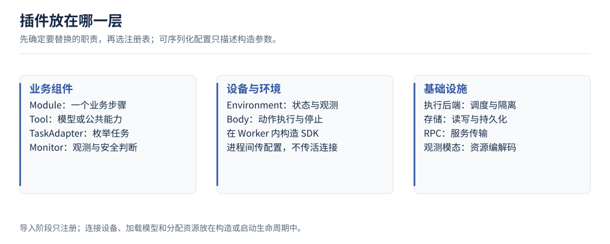

# 基础设施插件与解耦边界

[English](infrastructure-plugins.md) · [**简体中文**](infrastructure-plugins.zh-CN.md)

环境、Body、Module、Tool、Monitor、TaskAdapter 使用六类业务注册表。
执行后端、持久化和 RPC 流传输使用独立的基础设施注册入口，核心入口按协议和能力装配，
通过后端声明的能力选择装配方式。新增插件放在独立 Python 包中，通过配置导入，无需修改内置清单。

## 1. 执行后端



注册入口为 `robotenon.runtime.execution_registry.register_execution_backend`。
工厂接收关键字 `context: ExecutionBackendContext` 及 `backend_params` 展开的关键字；
context 提供 `options`、Worker 启动用的 `profile` 和创建逐任务请求的 `make_request`。
返回对象必须具有 `max_workers`、`async execute(configured, case, context)` 和 `async close()`。
工厂只构造对象，资源启动放到执行阶段，close 必须能够处理尚未执行的实例。

```json
{
  "parameters": {
    "runtime": {
      "execution": {
        "backend": "my-executor",
        "plugin_backends": ["my_package.execution"],
        "backend_params": {"endpoint": "scheduler.example"},
        "max_workers": 1
      }
    }
  }
}
```

能力由注册时的 `capabilities` 声明：

| 能力 | 框架行为 |
| --- | --- |
| `local_worker` | 要求单 Worker；Worker 启动时绑定配置的 CUDA 可见设备 |
| `managed_workers` | 校验 Worker 启动预算能够容纳所有模型服务的启动预算 |
| `shared_observability` | 单任务与批量入口准备共享 Trace/Metrics socket 数据源 |

内置 `in_process` 声明 `local_worker`；`process` 声明另外两项。
单任务和批量入口都通过相同工厂与 execute 协议执行。未知注册名报错，不回退。
`max_workers` 必须与配置一致。资源锁仍是同机锁；远程后端必须实现自己的远程资源管理、
结果回传和故障处理。注册入口本身不提供分布式调度实现。

## 2. 持久化

注册入口为 `robotenon.storage.registry.register_store(kind, name, capabilities=...)`。
kind 为 `safety`、`context`、`actions`、`observation`。工厂接收
`context: StoreContext` 和配置 `params` 展开的关键字。
context 提供完整配置、主配置目录、Metrics，以及解析相对路径的 `context.path(value)`。

| 用途 | 配置位置 | 协议与所有权 |
| --- | --- | --- |
| 安全状态 | 顶层 `safety_state` | snapshot/update/reconcile/clear/heartbeat/recover 等安全状态接口；应用拥有配置创建的实例 |
| Graph checkpoint | `parameters.runtime.context_store` | load/save（含 CAS revision）；应用关闭时释放 |
| 动作去重 | Body 构造参数 `idempotency_store_config` | load/save；Body 拥有实例，关闭后重启会重新构造 |
| 观测缓存 | 顶层 `observation_cache` | async start/close/append/read_uri_bytes 与查询接口；应用拥有实例 |

例如，以下是需要另行实现 `my_package.storage` 的配置片段：

```json
{
  "safety_state": {
    "backend": "my-shared-safety",
    "plugin_stores": ["my_package.storage"],
    "params": {"endpoint": "safety.example"},
    "require_shared": true
  },
  "parameters": {
    "runtime": {
      "context_store": {
        "backend": "sqlite",
        "path": "./data/context.sqlite3"
      }
    }
  }
}
```

`require_shared=true` 要求 provider 声明 `shared` 能力；这是插件对共享语义的承诺，
不是框架自动提供的分布式一致性。安全锁存、CAS 和动作幂等语义仍由实现遵守。
显式注入的安全状态与 ToolRuntime 不由应用关闭；配置创建的资源在正常结束与启动失败时均清理。
自定义 close 可以同步或异步；观测缓存的生命周期方法按协议使用 async。

兼容路径：原 `idempotency_db`、`ROBOTENON_ACTION_DB`、`ROBOTENON_CONTEXT_DB` 继续可用。
`idempotency_store_config` 不能与显式 idempotency_store/idempotency_db 同时设置。
Body 内的 store 相对路径按当前工作目录解释；应用级 store 使用主配置目录。

内置安全后端有 memory/sqlite，context/actions 有 sqlite。观测默认 hybrid；历史
memory/filesystem 名称保留为原 hybrid 实现的别名，不代表纯内存或禁用热缓存。
remote 现在真正创建远程观测客户端，通过 params 指定 socket_path、shared_root 等选项；
传原始媒体时需要客户端和服务端可访问的共享文件存储，不能仅配置一个网络地址。
自定义观测后端自行处理其 URI；内置 hybrid 仍使用 cache URI。

## 3. Environment RPC 与传输

Environment RPC 指通过另一进程或机器调用环境的 reset、observe、health、command 等接口；
调用方仍使用 Environment 服务协议。动作执行属于独立的 Body 协议。

JSON-lines RPC 的底层流传输通过
`robotenon.services.transports.register_transport(name)` 注册。
工厂接收 `endpoint` 和 `transport_params` 展开的关键字；返回对象实现：

- `async connect(limit=...)`：返回兼容 asyncio StreamReader/StreamWriter 的连接。
- `async listen(handler, limit=...)`：返回兼容 asyncio AbstractServer 的监听对象。
- `async close()`：释放该传输实例拥有的资源，允许失败启动后调用。

所有服务客户端/服务端构造函数接受 `transport`、`plugin_transports`、`transport_params`。
Body 的执行与控制连接使用相同配置，但保持独立连接，控制请求不排在长 execute 后面。
现有 `socket_path` 参数名为兼容保留，自定义 transport 负责解释其值。

```json
{
  "bodies": [{
    "id": "body_main",
    "name": "ipc",
    "params": {
      "socket_path": "robot.example:9000",
      "transport": "my-stream",
      "plugin_transports": ["my_package.transport"],
      "transport_params": {"profile": "robot"}
    }
  }]
}
```

上述 my-stream 是待实现插件；内置传输仍为 uds。更换流传输保留 JSON-lines 编码和版本协议；
gRPC/ROS2 等不同应用协议可直接实现现有 Environment/Body/Monitor provider，
不需要修改 Graph。连接认证、加密及跨机器媒体可达性由具体部署实现。
UDS 只清理自己绑定的 socket；另一个服务启动失败后关闭不会删除正在工作的端点。

## 4. 新观测模态

ObservationFrame.modality/producer 和 ObservationChannel.modality 接受非空字符串，
建议自定义名称带包前缀，例如 vendor.event_stream。明确声明的 modality 会原样进入观测管线，
不再按名称猜成 other；兼容的 proprio/image 别名仍会在内置缓存中规范化。
Frame 的 role/capture_policy 等行为字段保持固定契约，不作为任意扩展标签。
自定义二进制内容可经 ObservationRef、缓存和 resolver 传递，Tool 负责业务解码。

## 5. 验证与边界

`tests/test_infrastructure_plugins.py` 在仓库外生成插件，验证自定义执行后端的单任务/批量、
进程后端扩展、四类存储、失败清理、动作存储重启、外部流传输、Body 控制连接和自定义传感器。
`tests/test_architecture_boundaries.py` 防止入口重新依赖具体进程后端或观测管线导入具体缓存。

核心保留统一的 Graph 调度与结果协议、安全等级、生命周期和序列化约束。
这次改造开放接入边界，并没有实现新的集群调度器、数据库、机器人驱动或网络部署。
同进程的 Python/CUDA/MuJoCo 依赖冲突仍需独立进程或环境部署解决。
