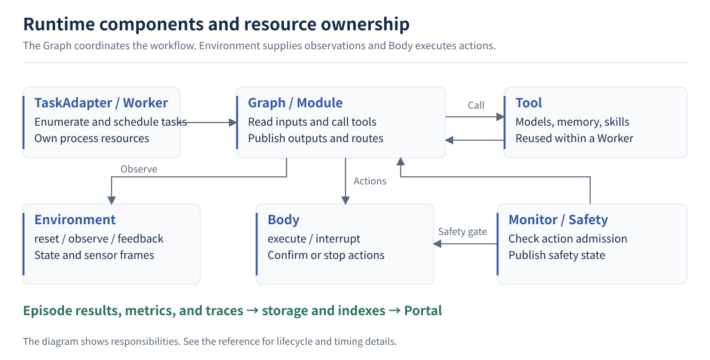

# Module reference

[**English**](module-guide.md) · [简体中文](module-guide.zh-CN.md)

Infrastructure extensions sit below the six application plugin families. `execution_registry` builds task execution backends, `storage.registry` builds safety/checkpoint/action/observation stores, and `services.transports` builds RPC stream transports. See [infrastructure plugins](infrastructure-plugins.md). Built-in model or action constraints described here belong to their respective plugins.

This guide follows a task from enumeration to its results. It covers framework subsystems as well as **Modules**, the plugins used as Graph nodes. Paths and commands are relative to the repository root. The linked reference pages contain full parameter tables; this guide explains why the parameters exist and what changing them affects.

## 1. The path of one task

Consider a task to close a blender lid. Assume the environment has not reported success and the model services are available.



The execution backend assigns a case to a Worker. The Runner creates an environment, Body, Monitor, Modules, and context for the task while reusing the Worker's models. Plan selects a subgoal. The Xiaomi Module requests actions, Body executes them, Environment returns fresh state, and verify/terminal decide where to go next. At task end, task resources are released and the next case can reuse the model.

**TaskQueue is outside this default path.** Single and parallel tasks use the same lifecycle. The backend determines placement and scheduling. Physical robots use the same boundaries.

## 2. Configuration, Params, and factories

Sources: [config.py](../robotenon/runtime/config.py), [params.py](../robotenon/infra/params.py), [factory.py](../robotenon/runtime/factory.py).

Configuration selects plugins, instance IDs, constructor arguments, and runtime parameters. The factory imports plugins, looks them up, constructs objects, injects dependencies, and cleans up after partial startup. Modules need no independent configuration loaders.

Generated `runs/robocasa365/config.json` contains or references the modules, graphs, tools, monitors, bodies, environments, and task_adapters manifests. `name` is the registered type, `id` names this configured instance, and `params` are constructor arguments. `parameters` supplies shared runtime Params.

For example:

```json
{
  "id": "planner_model",
  "name": "Qwen3.5-VL",
  "params": {"temperature": 0.0, "max_completion_tokens": 1024}
}
```

This is **one Tool manifest entry**. To select it from plan, also set `parameters.model.hlp_tool` to `planner_model`. Changing only the ID leaves the caller unable to resolve the Tool. Use explicit IDs if several instances share a registration name.

Inside a Module method that receives ctx:

```python
horizon = ctx.params.get("runtime.horizon", [int, None])
if horizon is None or horizon < 1:
    raise ValueError("runtime.horizon must be a positive integer")
```

References to component configuration files resolve relative to their owning configuration. Other values, including output and model paths, follow their own field contracts. Arrays such as `tools` are replaced as a whole by an experiment override. An override containing only Qwen drops the original Xiaomi entry.

Start by checking the configuration:

```bash
Tenon modules-check --config runs/robocasa365/config.json
Tenon tools-check --config runs/robocasa365/config.json
Tenon monitors-check --config runs/robocasa365/config.json
Tenon graphs-check --config runs/robocasa365/config.json
```

These commands check assembly and Graph definitions. They do not validate a real model, renderer, or robot. For a complete local workflow, see the [quickstart](quickstart.md).

## 3. CLI, Runner, and experiment entry points

Sources: [runner.py](../robotenon/runtime/runner.py), [experiment.py](../robotenon/runtime/experiment.py), [run script](../scripts/run_experiment.py).

The single-task entry point passes task, environment, seed, and output settings to the common WorkerRuntime. Batch execution additionally enumerates cases, creates a run directory, and aggregates results. The Runner assembles resources for each episode; model ownership belongs to the Worker.

Complete smoke test without hardware:

```bash
Tenon run-fake --config configs/config.json --output runs/module-demo
```

Single simulated task, requiring simulator dependencies and an available model:

```bash
Tenon run --config runs/robocasa365/config.json \
  --task-id CloseBlenderLid --env-id robocasa/CloseBlenderLid --seed 7 \
  --output data/module-demo/episode.json \
  --trace-dir data/module-demo/trace --metrics-dir data/module-demo/metrics
```

After startup, inspect the termination reason, then task success. A process exit, completed Graph, and environment success describe different outcomes. `dry_run` changes behavior in participating providers. It may still construct a simulator and does not isolate a physical driver by itself.

## 4. TaskAdapter selects cases

Source: [task_adapters](../robotenon/task_adapters/base.py).

Given runtime parameters and Adapter configuration, `enumerate_cases()` yields TaskCase records containing adapter_id, task_id, environment_id, index, episode, seed, horizon, and related fields. `run_case()` executes one case and by default delegates to the episode runner. The parent owns global summaries.

Two environments with three trials each produce six cases. Each is an independent trial. `index` stabilizes enumeration and merging. `episode` distinguishes trials of the same task. The EnvironmentAdapter connects the environment; TaskAdapter selects cases. You can change a dataset without changing the device integration.

Use built-in single-task for one explicit case. The RoboCasa365 Adapter enumerates simulated cases from a task set. A custom Adapter must be reconstructible through an importable module. A case passed to a spawned Worker cannot contain the parent's connected simulator.

## 5. Execution backend, Coordinator, and WorkerRuntime

Sources: [execution.py](../robotenon/runtime/execution.py), [parallel.py](../robotenon/runtime/parallel.py), [worker.py](../robotenon/runtime/worker.py).

- `in_process` runs the shared Worker lifecycle in the calling process.
- `process` dispatches from a parent to resident spawned Workers, each executing one case at a time.
- The parent owns run-level status and summaries. Each Worker owns its Tools and task resources.

With four cases and two Workers, each Worker starts and loads its model once, then runs case 0 or 1. Idle Workers claim the remaining cases. They might finish in order 1, 0, 3, 2. Aggregation follows the planned case order. Concurrent Graph nodes do not create extra Workers.

After Worker loss, the execution layer cleans up its resources and uses `max_retries` to decide whether to launch a new attempt. A retry **starts the case again**. It does not resume a physical action. Old attempt artifacts remain available. Coordinator crash recovery and redispatch are not automatic.

For GPU pools, timeouts, recycling, resource_ids, and directory examples, see [execution and observability](execution-and-observability.md). Resource IDs provide exclusion without mapping a device address. Declare ownership even for a single-Worker physical robot.

## 6. Module and ModuleRuntime

Sources: [module base](../robotenon/modules/base.py), [module contract](../robotenon/contracts/module.py).

The Graph calls `await module.run(ctx)`. A Module handles an application step such as input preparation, planning, action generation, or verification. It calls models through `ctx.call_tool()`. By default each task gets new Modules so task state cannot leak into the next episode.

Prefer `NodeResult(output=..., state_patch=...)`. output is recorded separately; state_patch updates only the current node's private values. A returned dictionary also merges only into this node. Different nodes may use the same keys. Read published values through `ctx.results[node_id]`. See [node-private context](node-private-context.md).

Save the example as `module_demo.py` and run it directly. Without a Graph, the demo applies the patch manually to show what the runtime ordinarily does:

```python
import asyncio
from robotenon.contracts.context import GraphContext
from robotenon.contracts.module import NodeResult


class ChooseInstruction:
    async def run(self, ctx):
        instruction = ctx.inputs.get("goal", "Close the blender lid")
        return NodeResult(
            output={"chosen": instruction},
            state_patch={"instruction": instruction, "needs_plan": False},
        )


async def main():
    ctx = GraphContext(task_id="demo")
    result = await ChooseInstruction().run(ctx)
    ctx.values.update(result.state_patch)
    print(result.output)
    print(ctx.values)


asyncio.run(main())
```

For a real Graph, register with `@register_module(...)`, configure plugin_modules and the instance manifest, and reference the instance ID from the node's module field. Do not reapply a returned patch in Module code. See [plugin development](plugin_development.md).

### Built-in and reference application Modules

| Registered name | Inputs and calls | Output or role | Example and boundary |
| --- | --- | --- | --- |
| `echo` | ctx and configured prefix | Diagnostic output | Exercises node connectivity without a real model |
| `wait-agent` | Current feedback and wait action parameters | Action/ActionChunk | Fake policy that still executes through Body |
| `terminal-evaluator` | EvaluationInput/current feedback | EvaluationDecision and continue state | Generic termination check. queue_operation is not applied automatically |
| `plan` | task, feedback, STM, ltm_records; calls hlp_tool | instruction, planner_result, STM | Chooses one object-level subgoal. Stop also requires recent verification success and an empty remaining list |
| `xiaomi_robotics_1_action` | feedback, instruction, action budget; calls vla_tool | 12D ActionChunk, needs_plan | Validates dimensions and respects the remaining horizon; does not touch the device directly |
| `verify` | Two current camera views and a subgoal; calls hlp_tool | verifier_result, STM, needs_plan | Skips visual verification while queued actions remain |
| `robocasa365_terminal` | feedback, body_result, safety, horizon | continue, terminal, success, reason | Safety stops and Body failures take precedence over ordinary termination |

Plan and verify can share one Qwen Tool. They ask different questions without loading two models. See the [Evaluator/Monitor guide](evaluation-monitoring-and-task-queue.md).

## 7. Graph compiler, scheduler, and conditions

Sources: [compiler](../robotenon/workflow/compiler.py), [scheduler](../robotenon/workflow/scheduler.py), [conditions](../robotenon/workflow/conditions.py), [runtime](../robotenon/workflow/runtime.py).

The compiler validates node/subgraph references, Module capability, conditions, and predecessor relationships and builds an executable structure. WaveScheduler selects ready nodes. GraphRuntime assembles context, invokes nodes, records outputs, and checks safety.

This complete Graph manifest uses an existing `debug_echo` instance to demonstrate dependencies without sending device actions:

```json
{
  "graphs": [{
    "id": "parallel_prepare", "entry": "prepare", "max_steps": 10,
    "nodes": [
      {"id": "prepare", "module": "debug_echo", "next": [{"node": "left"}, {"node": "right"}]},
      {"id": "left", "module": "debug_echo", "predecessors": ["prepare"], "next": [{"node": "join"}]},
      {"id": "right", "module": "debug_echo", "predecessors": ["prepare"], "next": [{"node": "join"}]},
      {"id": "join", "module": "debug_echo", "predecessors": ["left", "right"]}
    ]
  }]
}
```

prepare runs first, left/right share a wave, then join runs. If left fails, the scheduler cancels a sibling that is still running. Production state patches are private to each node. Echo here only tests the scheduler.

`predecessors` defines acyclic dependencies. Use goto for a back-edge and loop for repetition of the current node. In the reference XR365 Graph, evaluate returns to action for `continue=true && needs_plan=false`, to plan if replanning is needed, and otherwise to END. Conditions use restricted comparisons, logic, and ctx reads without invoking arbitrary Python.

Nested Graphs share application ctx but keep an ExecutionFrame per async branch to track path, node, and step. See the [workflow reference](workflow.md).

## 8. GraphContext, ExecutionFrame, and ContextStore

Sources: [contracts/context.py](../robotenon/contracts/context.py), [contracts/execution.py](../robotenon/contracts/execution.py), [storage/context.py](../robotenon/storage/context.py).

GraphContext provides private node values, read-only inputs/results, current feedback and action, Body result, safety snapshot, and diagnostic outputs. ExecutionFrame isolates the current position of parallel subgraphs. Model connections and service handles are outside persisted JSON state.

Configure or inject a ContextStore for recovery. SQLite checkpoints use revision/CAS to prevent lost updates and save the Graph fingerprint and scheduling cursor. Resume with the same session and a matching Graph. Committed nodes are skipped, and in-flight nodes may retry.

Suppose A committed and B sent an external request before a crash. Recovery skips A, but B may send its request again. Give B a stable idempotency key or look up the original result. Checkpoints cannot undo external effects. history/scoped_outputs are bounded diagnostics, not a permanent log.

## 9. ToolRuntime and Tools

Sources: [tools/base.py](../robotenon/tools/base.py), [tools/registry.py](../robotenon/tools/registry.py).

Tools implement `call(arguments, context) -> ToolResult`. ToolRuntime manages start/call/end_session/close in the Worker. A Module calls when needed, while the Tool reuses its client, cache, or model service. Handle `ok=false` before assuming a successful output shape.

| Tool | Inputs and capabilities | Output or state | Example |
| --- | --- | --- | --- |
| Xiaomi-Robotics-1 | instruction, current observation, max_actions | Action vectors and remaining queue length; history isolated by session | A 16-step prediction consumed four steps at a time needs four calls before new inference |
| Qwen3.5-VL | prompt, system_prompt, image_keys | Parsed model output and call metadata | plan requests a subgoal and verify checks completion |
| GPT provider | Configured model service and prompt | ToolResult | Replace the high-level model at the same Module boundary; configure endpoint and credentials on the provider |
| `model` | echo/static backend and prompt | Deterministic output | Smoke test without a model download |
| `memory` | op=add/search, record, or filters | MemoryRecord or search results | Retrieve quality-filtered experience from earlier experiments |
| `skill` | op=heads/get/register, skill_id/version | Versioned skill definition | Retrieve metadata for a version without executing robot actions |
| `echo` | Arbitrary arguments | Debug data including arguments and session | Verify ctx.call_tool and dependency injection |

Within a method receiving ctx:

```python
result = await ctx.call_tool("planner_model", {
    "prompt": "Determine whether the lid is fully closed. Return JSON only.",
    "image_keys": ["video.robot0_agentview_left", "video.robot0_eye_in_hand"],
})
if not result.ok:
    raise RuntimeError(result.error or "Model call failed")
answer = result.output
```

image_keys must match environment channels. Renaming a key can remove the intended camera input. See [plugin development](plugin_development.md) for registration and lifecycle.

## 10. Per-Worker model services

Source: [model_services.py](../robotenon/runtime/model_services.py).

ModelService starts processes, allocates loopback ports, sets visible GPUs, waits for readiness, saves logs, and handles shutdown. DeployedTool binds the client to the resulting address. This applies only to Tools with a deployment declaration. A model service and the robot Body are separate resources.

Consider physical pool `[2,3,4,5,6,7]`, two Workers, and Tools configured for Xiaomi `[0]` and Qwen `[1,2]`:

| Level | Worker 0 | Worker 1 |
| --- | --- | --- |
| Assigned physical GPUs | 2, 3, 4 | 5, 6, 7 |
| Worker-local IDs | 0, 1, 2 | 0, 1, 2 |
| Physical GPU for Xiaomi | 2 | 5 |
| Physical GPUs for Qwen | 3, 4 | 6, 7 |
| IDs inside Qwen service | 0, 1 | 0, 1 |

The Qwen child sees only its two assigned GPUs, so local numbering starts at zero again. See [Worker model deployment](worker-model-deployment.md) for runnable configuration, paths, timeout settings, and logs. Transformers balanced places model layers/weights on devices; vLLM tensor parallel uses a different execution strategy. Device visibility alone is not an inference performance measurement.

## 11. EnvironmentAdapter, Session, and EnvironmentService

Sources: [envs](../robotenon/envs/__init__.py), [environment service](../robotenon/services/environment.py).

EnvironmentAdapter opens the environment using SessionSpec. Session holds one simulator or device session. EnvironmentService exposes start/reset/observe/command/health/close. EnvironmentFeedback carries session, sequence number, state, image references, terminal/success, and safety information.

For example, `reset` returns initial camera images and joints. After Body executes an action segment, `observe` returns the new images and task status. Observing must not execute actions; otherwise Monitor sampling would change the world.

Fake supports control-flow validation without hardware. RoboCasa365 uses simulation. Physical integration provides real sensor and command interfaces. The Worker shares one in-process environment handle and runs only one task at a time. For UDS, `close_connection()` releases the client connection. Individual clients must not close a server-owned Session arbitrarily.

## 12. Body, acknowledgements, and idempotency

Sources: [Body service](../robotenon/services/body.py), [action ledger](../robotenon/services/action_ledger.py), [Body plugins](../robotenon/bodies/__init__.py).

Body accepts an ActionChunk containing Actions and time budgets. It checks safety admission, calls the driver for each action, enforces deadlines, records ActionExecution, and returns BodyExecutionResult. A Module's prediction alone is not execution.

If the second action of a four-action chunk times out, Body sends stop and records deadline_exceeded. The remaining two actions are not sent as ordinary actions. The terminal evaluator may end the task and record the Body failure. `executed_actions` counts execution, not predicted vectors.

The durable action ledger deduplicates successful acknowledgements by session/idempotency_key. If a device moves and the process dies before saving the acknowledgement, a retry requires driver reconciliation. Physical exactly-once execution is not guaranteed. Do not reuse the same session for unrelated tasks as if they were retries.

A physical robot requires its own executor and stop_executor. A cancelled coroutine cannot kill a synchronous SDK thread. Set safe_action_factory for the actual device; homing is not universally appropriate. See the [Monitor interrupt sequence](evaluation-monitoring-and-task-queue.md#3-how-a-monitor-interrupt-propagates).

## 13. Evaluator and Monitor

Evaluator is a semantic category of Graph Module. Monitor is a separately registered resident/request plugin. Completion decisions guide task flow; safety reports affect action admission and stopping through SafetyStateStore.

A lid still open may yield verify=false and another attempt. Hazardous gripper contact may produce Monitor=P3 and require stopping before completion. The components can share vision models or check functions. A check after each action cannot replace safety monitoring during execution.

See the [monitoring guide](evaluation-monitoring-and-task-queue.md) for timing, examples, and shared logic. Run `PYTHONPATH=. python examples/monitor_body_interrupt.py` to observe P3, `stop_executor`, and `interrupted`. Run `PYTHONPATH=. python examples/monitor_body_environment_demo.py` to see the robot remain stationary as obstacles and environment ticks advance. The default XR365 reference configuration disables Monitor. It still uses the selected safety_state backend and sees signals from an external shared store.

## 14. SafetyStateStore, SafetyGate, and RecoveryController

Sources: [safety.py](../robotenon/runtime/safety.py), [storage/safety.py](../robotenon/storage/safety.py), [recovery.py](../robotenon/workflow/recovery.py).

The Store merges signals, heartbeats, and latched levels from multiple sources. The Gate decides whether an action is allowed under a snapshot. Explicit use of RecoveryController adds incident deduplication, bounded attempts, and approvals. P0 is normal, P1 calls for attention, P2 restricts actions, and P3/P4 trigger protective or emergency stops.

If Monitor A reports P3 while B reports P0, the merged level remains P3. A subsequent P0 from A does not clear the latch. After investigating the fault, approve recovery and run self-checks. Do not call clear(include_latched=True) unconditionally in normal operation.

`scope=task` isolates safety state per parallel task. `scope=shared` preserves the configured shared path. Only readers of the same store observe a given signal. Disabling the local Monitor leaves the safety mechanism intact. See the [monitoring guide](evaluation-monitoring-and-task-queue.md) for scope and hardware latency.

## 15. Supervisor and IPC

Sources: [supervisor](../robotenon/services/supervisor.py), [IPC](../robotenon/services/ipc.py), [protocols](../robotenon/services/protocol.py).

Supervisor manages service start/health/close and releases initialized resources on partial startup failure. UDS carries same-host requests and responses with a serializable ServiceContext. Live models and the Graph call stack stay in their owning process.

For a long Body execute RPC, a separate control connection can send interrupt immediately. A single serialized connection would place stop behind execute. BodyClient separates the channels. RPC deadlines include waiting for the request lock as well as network I/O.

Health monitoring does not provide Coordinator crash recovery. An in-process Supervisor exits with its owner. Deployment configuration determines whether Body or Monitor uses a separate service.

## 16. TaskQueue and other queues

Source: [core/queue.py](../robotenon/core/queue.py).

TaskQueue manages persistent TaskItems, leases, claims, completion, failures, branches, and events. The default execution path does not consume it. plan's remaining list belongs to STM, Xiaomi caches action vectors, and the batch backend dispatches TaskCase records.

For example, explicitly use TaskQueue to split "tidy the table" into two subgoals available to different processes. A controller claims a subgoal, calls the Graph, and commits its result. An Evaluator returning `queue_operation=NEXT` alone does not advance the queue. See the [TaskQueue guide](evaluation-monitoring-and-task-queue.md#5-using-taskqueue) for a runnable example, lease recovery, and stop boundaries.

## 17. Observation cache, resolver, and media

The [observation cache guide](observation-cache.md) identifies the source entry points for each layer.

An environment can send images or point clouds to the pipeline for hot caching and persistence. Feedback carries references. A Resolver retrieves the actual data so ctx and RPC envelopes do not repeatedly carry large arrays. Tools read images by channel.

For example, feedback contains a `cache://...` reference for the left camera. Qwen requests `video.robot0_agentview_left`. The Resolver looks it up and builds model input. Do not treat a cache URI as a local filename or public HTTP address.

Check hot-cache capacity, persistence queue policy, and retention together. If an async persistence queue is full, a pending write may be dropped. An image available during inference may therefore be missing from later replay. Cleanup must preserve resources used by other active tasks.

## 18. Metrics, Trace, Recorder, and observability sources

Sources: [infra](../robotenon/infra/__init__.py), [observability](../robotenon/runtime/observability.py), [daemon entry points](../robotenon/daemons/__init__.py).

Metrics records numbers such as counts and durations. Trace records spans and events. Recorder saves task artifacts. Bounded client buffers keep telemetry off the synchronous action path. A shared writer or external daemon persists the data. Safety decisions use a separate store.

Suppose Qwen fails on Worker 1 in attempt 2. Filter Trace by experiment/run/episode/attempt/worker to find the Tool error and compare durations in Metrics. Filtering only by task_id can mix trials.

Web can read a task-level source or a source shared across parallel Workers. ObservabilitySource paths determine which data are used. Buffer overflow, process crashes, and abnormal exit can lose events. Trace does not serve as a transactional recovery log. See [execution and observability](execution-and-observability.md) for directories and SQL examples.

## 19. Web Portal, queries, and experiment management

Sources: [server](../robotenon/web/server.py), [query](../robotenon/web/query.py), [experiments](../robotenon/web/experiments.py), [access](../robotenon/web/access.py).

Read-only mode exposes queries for an explicit source. The full Portal also manages experiment jobs, media, and controls. The read-only landing page still shows an experiment list. To query CLI data, use an endpoint such as `/api/traces` from the [CLI tutorial](tutorials/cli-experiments.md#5-query-results-over-read-only-http). The experiment launch queue is separate from robot subgoals in TaskQueue.

Reopen a completed task's observability data using its actual sidecar path:

```bash
Tenon web \
  --source data/module-demo/episode.observability.json \
  --host 127.0.0.1 --port 8765 \
  --no-experiment-submit --no-auto-grafana
```

If no traces appear, check the source path, database content, and run identity. Loopback access works locally or through an SSH tunnel. With `ROBOTENON_PORTAL_TOKEN` set, both reads and controls require authentication. Remote binding requires a token and Host/Origin validation. See [access boundaries](execution-and-observability.md#64-full-portal-access-boundaries).

## 20. Memory, Skill, Dataset, Release, and Deployment extensions

These [extensions](../robotenon/extensions/__init__.py) provide optional application capabilities. Their presence does not wire them into the default Runner.

| Component | Input, output, and role | Example and limitation |
| --- | --- | --- |
| MemoryStore | Writes MemoryRecords and filters by task, outcome, or tag | Keep quality-filtered successes. Parallel evaluation uses explicit snapshot/sequential/disabled policies |
| SkillRegistry | Registers and retrieves versioned SkillDefinition records | Look up `pick@1.0` metadata. A separate driver implements execution |
| DatasetBuilder | Filters episode records into a dataset | Build a dataset version from successful rollouts without starting training |
| FrozenExperiment | Freezes an experiment declaration and summary | Record parameters and provenance. External dependencies are not captured in full |
| SystemRegistry | Registers artifacts/releases and reads manifests | Associate model and config versions without downloading or publishing them remotely |
| ExperimentReleaseRegistry | Stores release records and state transitions | Mark a version released after checks. Actual service deployment is separate |
| DeploymentManager | Calls start/stop/health on an injected Target and saves current/previous versions | Explicitly deploy, drain, or roll back. Target implements the deployment |

DeploymentManager is a generic release-target state machine. Worker ModelService manages model processes during execution. Configuring a model deployment does not create an experiment release or guarantee automatic cross-host rollback.

## 21. Diagnosing three common scenarios

### A. Unsuccessful task without an execution error

Inspect the terminal reason and environment success, followed by verify and planner_result. Reaching the horizon is a valid termination without success. Check the actual action count, whether the instruction retains the subgoal, and whether both camera views reached the model before changing timeouts.

### B. Monitor reported P3 but the device still moves

Verify the actual safety store paths for Monitor/Body/Graph, that the Body watchdog is active and the event loop is responsive, and that stop_executor ran without failure or timeout. Confirm the driver sent a real device stop command. A Graph safety_stop log alone is insufficient evidence of a physical stop.

### C. One parallel Worker failed

Find the Worker and model server.log for the specific attempt. Distinguish model startup failure, task timeout, process exit, and environment errors. A configured retry assembles new task resources and preserves old artifacts. After a parent crash, neither TaskQueue nor Web automatically resumes the experiment.

## 22. Where to make a change

| Goal | First place to check |
| --- | --- |
| Change planning prompts or subgoals | modules/plan.py and the corresponding Tool output contract |
| Change completion or termination reasons | verify.py, robocasa365_terminal.py, and Graph goto rules |
| Add a model protocol | Tool plugin, with deployment if a managed process is needed |
| Add simulation or physical hardware | EnvironmentAdapter/Session, Body, and stop_executor |
| Add a continuous risk check | Monitor plugin, modes, frequencies, and safety source settings |
| Change case selection or enumeration order | TaskAdapter |
| Change Worker count, GPUs, or retries | Execution configuration and backend |
| Change Graph order | Graph configuration. Change the scheduler only for new scheduling semantics |
| Change which experiment Web displays | ObservabilitySource and query filters |
| Add a persistent subtask queue | Explicit TaskQueue integration in a controller |

Run component checks before modifying an integration. Exercise action, safety, and parallel lifecycle regressions when changing those paths. See the [validation record](changes/verification-2026-09.md) for tested scope and outstanding hardware tests.
