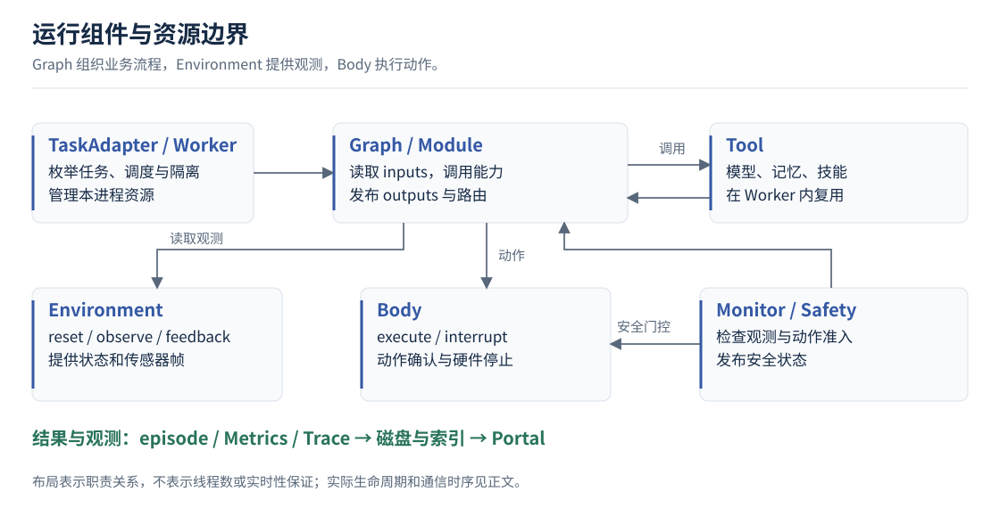

# 模块参考

[English](module-guide.md) · [**简体中文**](module-guide.zh-CN.md)

基础设施扩展独立于六类业务插件：`execution_registry` 装配任务执行后端，`storage.registry` 装配安全/checkpoint/动作去重/观测存储，`services.transports` 装配 RPC 流传输。详见[基础设施插件](infrastructure-plugins.zh-CN.md)。下文内置模块的模型和动作约束属于对应插件，不是框架对新插件的限制。

本手册按“一次任务从哪里来、经过谁、结果到哪里去”介绍当前框架。这里的“模块”包括框架子系统；代码中的 **Module** 则专指 Graph 节点插件。文中的路径均相对仓库根目录，命令在根目录执行。完整参数表由各专题文档维护，本手册解释参数为何需要、改变后会发生什么。

## 1. 一次任务的执行流程

以“合上搅拌机盖”为例，假设环境尚未成功，模型服务可用：



执行后端把一个 case 交给 Worker；Worker 复用模型，Runner 新建本次任务的环境、Body、Monitor、Module 和上下文。plan 选择子目标，Xiaomi Module 请求动作，Body 执行，Environment 回报新状态，verify/terminal 判断后继。任务结束后收回任务资源；下一个 case 可继续复用该 Worker 的模型。

**TaskQueue 不在这条默认主链路中。** 单任务和并行任务使用同一生命周期，后端只改变承载与调度方式。真机也没有按设备类型绕过这套结构的特殊执行分支。

## 2. 配置、Params 与装配 factory

源码：[config.py](../robotenon/runtime/config.py)、[params.py](../robotenon/infra/params.py)、[factory.py](../robotenon/runtime/factory.py)。

配置描述“选择哪个插件、实例 ID 是什么、构造参数和运行参数是什么”。factory 导入插件、查注册表、构建对象、注入依赖并管理启动失败时的清理；普通 Module 不需要自行加载配置文件。

生成后的 `runs/robocasa365/config.json` 包含或引用 modules、graphs、tools、monitors、bodies、environments、task_adapters 清单。`name` 是注册字符串，`id` 是本次配置中的实例名称，`params` 传给构造器；`parameters` 是运行共享的 Params。

例如：

```json
{
  "id": "planner_model",
  "name": "Qwen3.5-VL",
  "params": {"temperature": 0.0, "max_completion_tokens": 1024}
}
```

这是 **Tool 清单中的单项**，不是完整主配置。要让 plan 使用它，还需把 `parameters.model.hlp_tool` 改为 `planner_model`。只改 ID 而不改调用方参数，会造成 Tool 解析失败。若同一个注册名配置多个实例，使用明确 ID，避免模糊别名。

Module 内读取参数的例子（已有 ctx 的方法内片段）：

```python
horizon = ctx.params.get("runtime.horizon", [int, None])
if horizon is None or horizon < 1:
    raise ValueError("runtime.horizon 必须配置为正整数")
```

配置文件引用相对其所属配置位置解析；业务输出/模型路径仍需按对应字段语义核对，不能假设所有字符串都相对同一目录。实验覆盖中的 `tools` 数组整体替换，不能只写 Qwen 一项并期待自动保留 Xiaomi。

检查配置可先运行：

```bash
Tenon modules-check --config runs/robocasa365/config.json
Tenon tools-check --config runs/robocasa365/config.json
Tenon monitors-check --config runs/robocasa365/config.json
Tenon graphs-check --config runs/robocasa365/config.json
```

这些命令检查装配/图定义，不证明实际模型、渲染器或机器人可用。完整流程见[快速上手](quickstart.zh-CN.md)。

## 3. CLI、Runner 与实验入口

源码：[runner.py](../robotenon/runtime/runner.py)、[experiment.py](../robotenon/runtime/experiment.py)、[运行脚本](../scripts/run_experiment.py)。

单任务入口收集 task/env/seed/output 等参数并交给统一 WorkerRuntime；批量入口还要枚举 case、创建运行目录和汇总结果。Runner 是每次 episode 的资源装配边界，不是长期模型所有者。

无硬件完整冒烟：

```bash
Tenon run-fake --config configs/config.json --output runs/module-demo
```

实际仿真单任务（需要已安装仿真依赖和可用模型）：

```bash
Tenon run --config runs/robocasa365/config.json \
  --task-id CloseBlenderLid --env-id robocasa/CloseBlenderLid --seed 7 \
  --output data/module-demo/episode.json \
  --trace-dir data/module-demo/trace --metrics-dir data/module-demo/metrics
```

成功启动后先看结果的终止原因，再看任务是否成功。进程正常退出、图结束、环境 success 是三个不同层次。`dry_run` 只改变相关 provider 行为，不意味着不创建仿真器或隔离真实驱动。

## 4. TaskAdapter：决定做哪些任务

源码：[task_adapters](../robotenon/task_adapters/base.py)。

输入是参数与 Adapter 配置，`enumerate_cases()` 产出 TaskCase：包含 adapter_id、task_id、environment_id、index、episode、seed、horizon 等。`run_case()` 执行一个 case，默认委托统一 episode runner。它不应自己写全局实验汇总。

例如选择 2 个环境、各跑 3 次，会形成 6 个 case；每个 case 是一次独立试验，不是一个 Graph 节点。`index` 用于稳定枚举/归并，`episode` 区分同任务试验。环境 Adapter 决定“怎样连接环境”，TaskAdapter 决定“这次实验包含哪些 case”，二者分开便于替换数据集而保留设备接入。

内置 single-task 适合明确的单 case；RoboCasa365 Adapter 从任务集合枚举仿真 case。自定义 Adapter 必须能从可导入模块重建，不能把父进程已连接的仿真器对象直接塞进 case 传给 spawn Worker。

## 5. 执行后端、Coordinator 与 WorkerRuntime

源码：[execution.py](../robotenon/runtime/execution.py)、[parallel.py](../robotenon/runtime/parallel.py)、[worker.py](../robotenon/runtime/worker.py)。

- `in_process`：在当前进程运行统一 Worker 生命周期。
- `process`：父进程分派，spawn 多个常驻 Worker；每个 Worker 同时只处理一个 case。
- 父进程负责运行级状态和汇总；Worker 负责自己的 Tool 与任务资源。

例如 4 个 case、2 个 Worker：启动两个 Worker，各加载一次模型；先分别运行 case 0/1，谁空闲谁领取后续 case。完成顺序可能是 1、0、3、2，汇总仍按既定 case 顺序处理。Graph 内并行节点不会因此变成额外 Worker。

若 Worker 崩溃，执行层识别丢失、清理它的资源，按 `max_retries` 决定新 attempt；重试是**重新执行该 case**，不是从崩溃前那一个物理动作继续。旧 attempt 保留诊断产物。Coordinator 本身崩溃后当前没有自动接管/续派。

GPU 池、超时、回收、resource_ids 和目录的完整示例见[执行与统一观测](execution-and-observability.zh-CN.md)。资源 ID 只承担互斥，不自动选择设备地址；真机使用一个 Worker 也应明确设备资源所有权。

## 6. Module 与 ModuleRuntime：图中的业务步骤

源码：[modules](../robotenon/modules/base.py)、[模块契约](../robotenon/contracts/module.py)。

图调用统一为 `await module.run(ctx)`。Module 负责一个业务步骤，例如准备输入、规划、生成动作、验证结果；模型能力由 `ctx.call_tool()` 提供。默认每个任务新建 Module，避免任务 A 的状态残留到任务 B。

推荐返回 `NodeResult(output=..., state_patch=...)`：output 用于诊断输出，state_patch 只更新当前节点的私有 values。普通 dict 返回值也只合并到本节点。不同节点允许相同键名；成功后从只读 `ctx.results[节点ID]` 读取。完整执行边界见[私有上下文](node-private-context.zh-CN.md)。

下面是可保存为 `module_demo.py` 直接执行的最小例子，展示接口；它没有启动 Graph，因此手动展示 Graph 平时负责应用的 patch：

```python
import asyncio
from robotenon.contracts.context import GraphContext
from robotenon.contracts.module import NodeResult


class ChooseInstruction:
    async def run(self, ctx):
        instruction = ctx.inputs.get("goal", "合上搅拌机盖")
        return NodeResult(
            output={"chosen": instruction},
            state_patch={"instruction": instruction, "needs_plan": False},
        )


async def main():
    ctx = GraphContext(task_id="demo")
    result = await ChooseInstruction().run(ctx)
    ctx.values.update(result.state_patch)
    print(result.output)
    print(ctx.values)


asyncio.run(main())
```

接入真正 Graph 时加 `@register_module(...)`、配置 plugin_modules 和实例清单，再将节点的 module 指向实例 ID；不要在 Module 中再次应用返回的 patch。完整注册步骤见[插件开发](plugin_development.zh-CN.md)。

### 当前所有内置业务 Module

| 注册名 | 输入与调用 | 输出/作用 | 例子与边界 |
| --- | --- | --- | --- |
| `echo` | ctx 和配置 prefix | 调试输出 | 验证节点连接，不调用真实模型 |
| `wait-agent` | 当前反馈、等待动作参数 | Action/ActionChunk | Fake 示例策略，仍经 Body 执行 |
| `terminal-evaluator` | EvaluationInput/当前反馈 | EvaluationDecision 与继续状态 | 通用结束判断；queue_operation 不自动生效 |
| `plan` | task、feedback、STM、ltm_records；调用 hlp_tool | instruction、planner_result、STM | 选择一个对象级子目标；stop 还需最近验证成功且 remaining 为空 |
| `xiaomi_robotics_1_action` | feedback、instruction、动作预算；调用 vla_tool | 12D ActionChunk、needs_plan | 校验动作维度，按 horizon 剩余额度取动作；不直接操纵设备 |
| `verify` | 当前双视角观测、子目标；调用 hlp_tool | verifier_result、STM、needs_plan | 动作缓存未耗尽时跳过视觉验证 |
| `robocasa365_terminal` | feedback、body_result、safety、horizon | continue、terminal、success、reason | 安全停止/Body 失败优先于普通结束判断 |

plan 和 verify 可以共用同一 Qwen Tool。两次调用回答不同问题，不需要加载两套模型。详细数据流见[Evaluator/Monitor 专题](evaluation-monitoring-and-task-queue.zh-CN.md)。

## 7. Graph 编译、调度与条件

源码：[compiler](../robotenon/workflow/compiler.py)、[scheduler](../robotenon/workflow/scheduler.py)、[conditions](../robotenon/workflow/conditions.py)、[runtime](../robotenon/workflow/runtime.py)。

编译器检查节点/子图引用、Module 能力、条件和前驱关系，将配置转成统一可执行结构。WaveScheduler 决定哪些节点现在能跑；GraphRuntime 装配上下文、调用节点、记录结果并检查安全。

下面是完整图清单示例，可配合已有 `debug_echo` 实例使用；它仅演示依赖，不执行设备动作：

```json
{
  "graphs": [{
    "id": "parallel_prepare", "entry": "prepare", "max_steps": 10,
    "nodes": [
      {"id": "prepare", "module": "debug_echo", "next": [{"node": "left"}, {"node": "right"}]},
      {"id": "left", "module": "debug_echo", "predecessors": ["prepare"], "next": [{"node": "join"}]},
      {"id": "right", "module": "debug_echo", "predecessors": ["prepare"], "next": [{"node": "join"}]},
      {"id": "join", "module": "debug_echo", "predecessors": ["left", "right"]}
    ]
  }]
}
```

顺序为 prepare，随后 left/right 同一 wave，最后 join。若 left 失败，调度器取消仍在运行的兄弟节点；不能把它当作两个完全独立的任务。生产并行节点的 state_patch 属于各自命名空间，echo 仅用于调度冒烟。

`predecessors` 表达无环依赖，跨节点回跳用 goto，自循环用 loop。例如当前 XR365 evaluate 在 `continue=true && needs_plan=false` 时回 action，否则需要规划时回 plan，最后兜底 END。条件语言支持受限比较/逻辑与 ctx 读取，不执行任意 Python 函数。

嵌套图共享业务 ctx，但每个异步分支有独立 ExecutionFrame，记录图路径、节点和 step。详细循环/恢复语义见[工作流说明](workflow.zh-CN.md)。

## 8. GraphContext、ExecutionFrame 与 ContextStore

源码：[contracts/context.py](../robotenon/contracts/context.py)、[contracts/execution.py](../robotenon/contracts/execution.py)、[storage/context.py](../robotenon/storage/context.py)。

GraphContext 提供节点私有 values、只读 inputs/results、当前反馈、动作、Body 结果、安全快照及诊断输出。ExecutionFrame 保存当前调用位置，避免并行子图把“当前节点”互相覆盖。模型连接、服务句柄等运行对象不属于持久 JSON 状态。

需要恢复时显式配置/注入 ContextStore；SQLite checkpoint 通过 revision/CAS 避免覆盖更新，保存图指纹与调度游标。恢复时使用相同 session 与匹配图配置，已提交节点不重放，执行中节点可能重试。

例子：节点 A 已完成且 checkpoint 提交，B 发出外部请求后进程崩溃。恢复可跳过 A，但 B 可能再次调用外部服务。因此 B 需要稳定幂等键或查询原请求结果；checkpoint 不会自动撤销现实副作用。history/scoped_outputs 是有界诊断窗口，不能用它们替代无限期日志。

## 9. ToolRuntime 与各类 Tool

源码：[tools/base.py](../robotenon/tools/base.py)、[tools/registry.py](../robotenon/tools/registry.py)。

Tool 的接口为 `call(arguments, context) -> ToolResult`。ToolRuntime 在 Worker 内管理 start/call/end_session/close；Module 每次发请求，Tool 可复用客户端、缓存或模型服务。`ok=false` 应由调用 Module 处理，不能假设 output 总有成功结构。

| Tool | 能力和输入 | 输出/状态 | 使用例子 |
| --- | --- | --- | --- |
| Xiaomi-Robotics-1 | instruction、当前观测、max_actions | 动作向量和剩余缓存数量；按 session 隔离历史 | 同一模型输出 16 步，每次取 4 步，四次消费后再推理 |
| Qwen3.5-VL | prompt、system_prompt、image_keys | 解析后的模型结果、调用 metadata | plan 问下一子目标，verify 问是否完成 |
| GPT provider | 配置的模型服务与提示词 | ToolResult | 替换高层模型时保持 Module 调用边界；具体端点/凭据按 provider 配置 |
| `model` | echo/static 后端和 prompt | 确定性输出 | 无模型下载的接口冒烟，不等价于真实推理 |
| `memory` | op=add/search、record 或筛选条件 | MemoryRecord 或检索结果 | 为下次实验提供经过筛选的经验 |
| `skill` | op=heads/get/register、skill_id/version | 版本化技能定义 | 获取指定版本的技能元数据；不自动执行机器人动作 |
| `echo` | 任意 arguments | 参数与 session 等调试信息 | 验证 ctx.call_tool 与注入关系 |

已有 ctx 的方法内调用示例：

```python
result = await ctx.call_tool("planner_model", {
    "prompt": "判断盖子是否完全合上，仅返回 JSON。",
    "image_keys": ["video.robot0_agentview_left", "video.robot0_eye_in_hand"],
})
if not result.ok:
    raise RuntimeError(result.error or "模型调用失败")
answer = result.output
```

image_keys 必须匹配环境观测通道；不能随意改名后期待模型仍收到相机图像。Tool 自定义注册和生命周期见[插件开发](plugin_development.zh-CN.md)。

## 10. 每 Worker 的模型部署服务

源码：[model_services.py](../robotenon/runtime/model_services.py)。

ModelService 负责启动进程、分配回环端口、配置可见 GPU、等待就绪、保存日志及退出清理；DeployedTool 回填客户端地址。只有显式声明 deployment 的 Tool 才由它管理。模型服务与机器人 Body 属于不同资源。

假设物理池为 `[2,3,4,5,6,7]`，两个 Worker，Tool 配置 Xiaomi `[0]`、Qwen `[1,2]`：

| 层次 | Worker 0 | Worker 1 |
| --- | --- | --- |
| 分配到的物理 GPU | 2、3、4 | 5、6、7 |
| Worker 局部编号 | 0、1、2 | 0、1、2 |
| Xiaomi 使用物理 GPU | 2 | 5 |
| Qwen 使用物理 GPU | 3、4 | 6、7 |
| Qwen 服务内部编号 | 0、1 | 0、1 |

Qwen 子进程再次编号，因为它只看到自己获分配的两张卡。完整可运行配置、程序路径、超时及日志定位见[Worker 模型部署](worker-model-deployment.zh-CN.md)。Transformers balanced 是模型权重/层分配，vLLM tensor parallel 是另一种多卡执行方式，不把 GPU 可见性当作推理性能证明。

## 11. EnvironmentAdapter、Session 与 EnvironmentService

源码：[envs](../robotenon/envs/__init__.py)、[environment service](../robotenon/services/environment.py)。

EnvironmentAdapter 根据 SessionSpec 打开环境；Session 持有一次仿真/设备会话；EnvironmentService 向运行时提供 start/reset/observe/command/health/close 边界。反馈为 EnvironmentFeedback，包含 session、序号、状态、图像引用、terminal/success 和安全信息。

例子：`reset` 得到初始相机画面和关节状态；Body 执行一段动作后，`observe` 得到新画面和任务是否成功。observe 不能偷偷执行动作，否则 Monitor 的每次采样都会改变世界。

Fake 适合无硬件控制流验证；RoboCasa365 适配仿真；真机接入由驱动提供实际观测与命令。进程内环境绑定是 Worker 内共享入口，因此当前一个 Worker 同时只跑一个任务。UDS 部署中 `close_connection()` 关闭客户端，不应由每个客户端随意关闭服务端持有的 Session。

## 12. Body、动作确认与幂等记录

源码：[Body 服务](../robotenon/services/body.py)、[action_ledger](../robotenon/services/action_ledger.py)、[Body 插件](../robotenon/bodies/__init__.py)。

输入是 ActionChunk，由多条 Action 及时间预算组成。Body 是实际执行边界：检查安全准入、逐项调用驱动、处理 deadline、保存 ActionExecution，返回 BodyExecutionResult。Module 生成动作不代表动作已执行。

例子：Chunk 有 4 条 Action，第 2 条超时。Body 触发 stop，记录 deadline_exceeded，后两条不会作为普通动作继续发送。terminal evaluator 看到 Body 失败，可以结束任务并记录原因。`executed_actions` 与模型返回的向量数量不能混用。

持久 action ledger 按 session/idempotency_key 对已成功确认的动作去重。若设备已经动作、但进程在保存 ack 前死亡，重试仍需驱动对账；不具备物理动作 exactly-once 保证。不同任务不应复用同一个 session 假装是重试。

真机必须提供与设备匹配的 executor 和 stop_executor；同步 SDK 可能在工作线程运行，取消协程不能杀死该线程。保护动作由 safe_action_factory 配置，不能默认所有设备都适合“回零”。详细停止示例见[Monitor 中断链路](evaluation-monitoring-and-task-queue.zh-CN.md#3-monitor-的中断传播)。

## 13. Evaluator 与 Monitor

Evaluator 是图内 Module 的语义类别；Monitor 是可 resident/request 调用的独立插件。完成判断决定任务流程，安全判断通过 SafetyStateStore 影响动作准入与停止。

例子：盖子尚未合上时，verify=false 可以继续尝试；夹爪出现危险接触时，Monitor=P3 必须进入停止路径，即使任务还没完成。相同视觉模型或判定函数可以复用，但不能用“每轮动作结束后检查一次”替代执行中的安全监测。

完整比较、源码时序、可运行的 P3 中断示例和合并建议见[专题文档](evaluation-monitoring-and-task-queue.zh-CN.md)。可直接运行 `PYTHONPATH=. python examples/monitor_body_interrupt.py`，观察 Monitor 报 P3、Body 调用 `stop_executor` 并返回 `interrupted`；运行 `PYTHONPATH=. python examples/monitor_body_environment_demo.py`，可看到环境 tick/障碍物继续变化而机器人位置保持不变。默认 XR365 参考配置关闭 Monitor；这不会改变 safety_state 后端，也不会屏蔽外部共享库中的安全信号。

## 14. SafetyStateStore、SafetyGate 与 RecoveryController

源码：[safety.py](../robotenon/runtime/safety.py)、[storage/safety.py](../robotenon/storage/safety.py)、[recovery.py](../robotenon/workflow/recovery.py)。

Store 汇总多来源信号、心跳与锁存等级；Gate 根据快照判断动作是否允许；RecoveryController 在显式使用时管理事件去重、恢复次数和批准流程。P0 正常，P1 关注，P2 受限，P3/P4 走高等级停止路径。

例子：Monitor A 报 P3，B 报 P0，汇总仍为 P3；A 下一次报 P0 也不会自行解除先前锁存。现场排除问题后通过恢复入口批准并运行自检，不能在普通循环中无条件 clear(include_latched=True)。

`scope=task` 使并行任务安全状态隔离，`scope=shared` 保留配置的共享路径；只有同一存储的读者能观察到同一信号。关闭本地 Monitor 不等于关闭安全机制。完整边界和真机时延限制见[专题文档](evaluation-monitoring-and-task-queue.zh-CN.md)。

## 15. Supervisor 与 IPC

源码：[supervisor](../robotenon/services/supervisor.py)、[ipc](../robotenon/services/ipc.py)、[服务协议](../robotenon/services/protocol.py)。

Supervisor 管理已装配服务的 start/health/close，启动中途失败会清理已有资源。UDS 将同主机服务边界转换成请求/响应，传递可序列化 ServiceContext，不传整个模型对象或图调用栈。

例子：Body 的 execute RPC 很长，另一个控制连接仍可发送 interrupt。若只有一条带串行请求锁的连接，stop 会排在 execute 后；当前 BodyClient 已分离控制与执行通道。RPC deadline 包含等待请求锁的时间，不能只统计网络读取。

服务健康监测不等于 Coordinator 自动恢复；进程内 Supervisor 随所属进程死亡，不会有隐形外部守护者接管。是否把 Body/Monitor 独立成服务由具体部署装配决定。

## 16. TaskQueue 与各种“队列”

源码：[core/queue.py](../robotenon/core/queue.py)。

TaskQueue 管理持久 TaskItem、租约、领取、完成、失败、分支与事件。当前默认执行链路不消费它；plan 的 remaining 是 STM 字段，Xiaomi 缓存是动作向量队列，批量后端分派的是 TaskCase，三者均不是 TaskQueue。

例如业务想把“整理桌面”拆为可跨进程领取的两个子目标，可以显式用 TaskQueue，再由控制器调用 Graph 并提交结果。仅在 Evaluator 返回 `queue_operation=NEXT` 不会自动推进它。完整可运行示例、租约回收与安全停止边界见[TaskQueue 说明](evaluation-monitoring-and-task-queue.zh-CN.md#5-taskqueue-的用途)。

## 17. Observation Cache、Resolver 与媒体

源码：[观测缓存专题](observation-cache.zh-CN.md)中列有各层入口。

环境产生图像/点云后，观测管线可写入内存热缓存与持久存储，并在反馈中携带引用；Resolver 根据引用提供实际数据。这样 ctx 和 RPC 不必反复携带大数组，Tool 也可按通道读取图像。

例子：feedback 包含 `cache://...` 的左相机帧引用，Qwen 请求 `video.robot0_agentview_left`，Resolver 找到相应记录再形成模型输入。把 URI 当成本地文件名或可公开访问的 HTTP 地址会失败。

需要同时核对热缓存容量、持久队列策略与保留周期。异步写入且队列拥塞时可能丢弃待持久化项，因此“当前推理读到图像”不保证任务结束后还能回放全部图像。清理会话/缓存不应误删其他正在运行的任务资源。

## 18. Metrics、Trace、Recorder 与统一观测源

源码：[infra](../robotenon/infra/__init__.py)、[observability](../robotenon/runtime/observability.py)、[daemon 入口](../robotenon/daemons/__init__.py)。

Metrics 记录计数/耗时等数值，Trace 记录调用 span 和事件，Recorder 保存任务相关产物。客户端采用有界缓冲，让观测旁路不变成动作同步阻塞点；运行内共享写入端或外部 daemon 负责落盘。它们不是控制安全状态的数据库。

例子：Worker 1 的第 2 次 attempt 调用 Qwen 失败，按 experiment/run/episode/attempt/worker 身份筛选 Trace，查看具体 Tool 错误；Metrics 则用于比较调用耗时。只按 task_id 查询会混入同名任务的其他试验。

单任务 Web 可以读任务观测源，parallel 拉起的 Web 可以读共享观测源；区别由 ObservabilitySource 的路径决定，Web 不猜测来自哪个启动器。缓冲区、进程崩溃与异常退出可能造成观测丢失，Trace 不能当作事务性恢复日志。目录与 SQL 示例见[执行与统一观测](execution-and-observability.zh-CN.md)。

## 19. Web Portal、查询与实验管理

源码：[server](../robotenon/web/server.py)、[query](../robotenon/web/query.py)、[experiments](../robotenon/web/experiments.py)、[access](../robotenon/web/access.py)。

只读模式从显式数据源提供查询 API；完整 Portal 管理实验作业、媒体与控制操作。只读模式的首页仍显示实验列表，查看 CLI 数据应使用 `/api/traces` 等接口，见[CLI 教程](tutorials/cli-experiments.zh-CN.md#5-通过只读-http-接口查看数据)。实验管理的排队状态属于启动器作业，不是 TaskQueue 中的机器人子目标。

任务完成后重新打开其观测（替换为实际存在的 sidecar 路径）：

```bash
Tenon web \
  --source data/module-demo/episode.observability.json \
  --host 127.0.0.1 --port 8765 \
  --no-experiment-submit --no-auto-grafana
```

无轨迹时先核对 source 指向的文件、数据库内容与运行身份。本机或 SSH 隧道的回环访问可以直接使用 Portal；设置 `ROBOTENON_PORTAL_TOKEN` 后，读取和控制接口均要求认证。远程绑定必须配置令牌，Host/Origin 也受检查。完整规则见[访问边界](execution-and-observability.zh-CN.md#64-完整-portal-的访问边界)。

## 20. Memory、Skill、Dataset、Release 与 Deployment 扩展

这些位于 [extensions](../robotenon/extensions/__init__.py)，提供可选业务能力，不能仅因类存在就认为默认 Runner 会自动串联执行。

| 组件 | 输入/输出与用途 | 具体例子与限制 |
| --- | --- | --- |
| MemoryStore | 写 MemoryRecord、按任务/结果/标签检索 | 保存通过质量筛选的成功经验；并行评测采用显式 snapshot/sequential/disabled 策略 |
| SkillRegistry | 注册/查找版本化 SkillDefinition | 查询 `pick@1.0` 定义；不是执行技能的机器人驱动 |
| DatasetBuilder | 从 episode 记录按条件构建数据集 | 筛选成功 rollout 为某一版本数据集；不会自动训练模型 |
| FrozenExperiment | 冻结实验声明和摘要 | 记录本次实验参数，便于核对来源；不包含所有外部依赖的可重现环境 |
| SystemRegistry | 注册 artifact/release 并读取清单 | 关联模型/配置版本；不自动下载或发布到远程平台 |
| ExperimentReleaseRegistry | 存储发布记录与状态转换 | 满足发布检查后标记 released；不等于服务已上线 |
| DeploymentManager | 调用注入 Target 的 start/stop/health，保存当前/上一版本 | 显式 deploy/drain/rollback；实际部署能力由 Target 实现 |

这里的 DeploymentManager 和每 Worker 的 ModelService 不是同一个入口：前者是通用发布目标状态机，后者是运行期间托管模型进程。当前模型部署配置不会自动创建实验发布记录，也没有由这层扩展提供的跨机器自动回滚保证。

## 21. 三种场景的排查顺序

### 场景 A：任务没成功，但没有报错

先读 terminal reason 和环境 success，再看 verify 与 planner_result；horizon 用尽是合法终止但不是成功。检查实际执行动作数、instruction 是否保持子目标、模型是否真的收到两路图像。不要先调大所有超时。

### 场景 B：Monitor 已报 P3，设备仍有动作

确认 Monitor/Body/Graph 的实际安全库路径相同；确认 Body watchdog 在运行且事件循环未阻塞；检查 stop_executor 是否执行、是否失败或超时；核对驱动是否确实把 stop 转成设备停止命令。Graph 的日志中出现 safety_stop 不能替代设备停止证据。

### 场景 C：一个并行 Worker 失败

按 attempt 找 Worker 日志和模型 server.log；区分模型启动失败、任务运行超时、进程退出与环境异常。若配置了重试，新 attempt 重新装配任务资源；旧产物保留。若父进程已退出，不应期待 TaskQueue 或 Web 自动续跑实验。

## 22. 扩展或修改时去哪里

| 想改变什么 | 首先修改/检查 |
| --- | --- |
| 规划提示词、子目标逻辑 | modules/plan.py 与对应 Tool 输出契约 |
| 完成判断、结束原因 | verify.py / robocasa365_terminal.py / 图 goto |
| 新模型协议 | Tool 插件；需托管进程时再接 deployment |
| 新仿真/真机 | EnvironmentAdapter/Session、Body 与 stop_executor |
| 新持续风险判断 | Monitor 插件、模式/频率及安全来源配置 |
| case 集合与枚举顺序 | TaskAdapter |
| Worker 数量/GPU/重试 | execution 配置与后端 |
| 图执行顺序 | graphs 配置；新增内核语义才修改 scheduler |
| Web 展示哪个实验 | ObservabilitySource / 查询筛选 |
| 持久子任务队列 | 显式集成 TaskQueue 的控制器，当前没有默认接入 |

动手前运行相关组件检查；改动作、安全、并行生命周期时执行对应回归。已验证范围与尚未进行的硬件测试见[验证记录](changes/verification-2026-09.zh-CN.md)。
