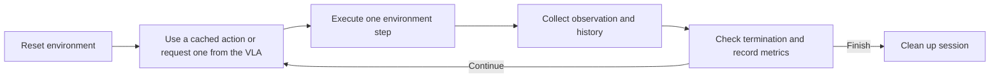

# Benchmark Graph and model contracts

[**English**](native-benchmark-graph.md) · [简体中文](native-benchmark-graph.zh-CN.md)

The [benchmark guide](benchmarks.md) covers installation and launch commands. This page describes the generated Graph and the responsibilities of the model, simulator, and shared runtime.

## Layout and entry points

```text
extensions/benchmarks/
├── benchmark-support/       Common evaluator, model loading, scheduling, and runtime
├── models/<model>/
│   ├── vla.py               Public model entry point, which can live outside the repository
│   └── config.json          Checkpoint, model RNG, and other model settings
└── <benchmark>/
    ├── README.md / SETUP.md
    ├── requirements.txt
    ├── configs/*.json      Protocol settings: tasks, seeds, horizons, and episodes
    └── src/robotenon_*/       Environment adapter and metrics
```

Run `Tenon evaluate`. Older entry points in individual extensions remain for compatibility. Integrate new models through a standalone backend rather than by editing a simulator extension's old `vla.py`. See the [benchmark catalog](benchmark-catalog.json) and each environment's README for available protocols.

## Generated synchronous Graph



The evaluator writes `config.json`, `config_graphs.json`, and `config_modules.json` to the output directory. The shared runtime manages sessions, observation history, action chunks, model communication, and statistics. The benchmark defines reset behavior, seeds, native actions, success, horizons, and metric dimensions.

Every step collects an observation, including steps that consume cached actions. When the episode terminates, the runtime discards the rest of the chunk and stops requesting actions. RoboCasa365 terminates as soon as a step succeeds. Other environments follow their own protocols. The Kinetix live profile uses a dedicated Graph with asynchronous inference. See [Kinetix](../extensions/benchmarks/kinetix/README.md).

## Standalone model interface

This example illustrates the interface. Implement inference and conversion to native environment actions in `act_batch`.

```python
SPEC = {
    "api_version": 1,
    "supported_benchmarks": ["robocasa365"],
    "supports_batch": True,
    "history": {"length": 4, "interval": 2},
    "replan_steps": 16,
}

class VLA:
    def open_session(self, session_id, task_info):
        pass

    def act_batch(self, requests):
        # Return one result per request, preserving its request_id.
        # action = {"native_actions": [{"actions": action_vector}, ...]}
        raise NotImplementedError("Implement model inference and native action conversion")

    def close_session(self, session_id, result):
        pass

    def close(self):
        pass


def create(**params):
    return VLA()  # Load the model from params once per replica.
```

Single-request and dynamically batched inference use the same interface. With `supports_batch=False`, the maximum supported batch size is one. Match results by `request_id` and isolate model state by `session_id`. The `task_info` mapping includes the stable episode identity, task, action_spec, and observation_spec. Each benchmark defines its native action representation, which may be a vector or another structure.

SPEC declares history length, sampling interval, and replanning horizon. The model owns preprocessing, state concatenation, its RNG, and action denormalization. The simulator process does not import model dependencies. The model and simulator can use separate Python environments. See the [model interface](../extensions/benchmarks/models/README.md) for message formats and the [Fake backend](../extensions/benchmarks/models/fake/vla.py) for a runnable implementation.

## Parallelism, scheduling, and results

A global queue distributes episodes. Each Worker stays bound to its GPU and model service; each replica batches independently. Shuffling preserves protocol identities and environment seeds. Under official_stream, request order affects how the model assigns random draws, so trajectories and final scores can change.

Results include episode records, per-task statistics, rates for benchmark-defined dimensions, and overall success. Infrastructure errors and attempts remain available. See [progress and results](benchmarks.md#5-inspect-progress-speed-and-results), the [parallel execution options](../extensions/benchmarks/EVALUATION.md), and [multi-model system Graphs](../extensions/benchmarks/SYSTEMS.md).
