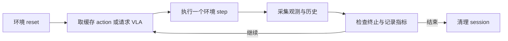

# Benchmark Graph 与模型契约

[English](native-benchmark-graph.md) · [**简体中文**](native-benchmark-graph.zh-CN.md)

运行命令和安装步骤见 [Benchmark 使用指南](benchmarks.zh-CN.md)。本文说明统一入口生成的 Graph，以及模型、仿真和公共 runtime 的职责。

## 目录与入口

```text
extensions/benchmarks/
├── benchmark-support/       统一 evaluate、模型加载、调度和公共 runtime
├── models/<model>/
│   ├── vla.py               独立模型公开入口，也可位于仓库外
│   └── config.json          checkpoint、模型 RNG 等
└── <benchmark>/
    ├── README.md / SETUP.md
    ├── requirements.txt
    ├── configs/*.json      任务、seed、horizon、episode 等协议
    └── src/robotenon_*/       环境适配与指标
```

使用 `Tenon evaluate`；已有 extension 内旧入口只用于兼容。新模型不应通过编辑仿真 extension 的旧 `vla.py` 接入。内置协议清单可查 [benchmark-catalog.json](benchmark-catalog.json)及各环境 README。

## 生成的同步 Graph



入口在 output 写入 `config.json`、`config_graphs.json` 和 `config_modules.json`。公共 runtime 管理 session、观测历史、action chunk、模型通信和统计；benchmark 负责 reset、seed、原生动作、success、horizon 和指标维度。

即使正在消费缓存 action，每一步仍采集观测。episode terminal 后丢弃剩余 chunk，不再请求模型。RoboCasa365 每步 success 立即 terminal；其他环境保留自己的协议。Kinetix live profile 使用异步推理的专用 Graph，详见 [Kinetix](../extensions/benchmarks/kinetix/README.zh-CN.md)。

## 独立模型接口

下面是接口示意，`act_batch` 中需要实现真实推理与环境动作转换：

```python
SPEC = {
    "api_version": 1,
    "supported_benchmarks": ["robocasa365"],
    "supports_batch": True,
    "history": {"length": 4, "interval": 2},
    "replan_steps": 16,
}

class VLA:
    def open_session(self, session_id, task_info):
        pass

    def act_batch(self, requests):
        # 每个 request 返回一个带原 request_id 的结果。
        # action = {"native_actions": [{"actions": action_vector}, ...]}
        raise NotImplementedError("实现模型推理和 native action 转换")

    def close_session(self, session_id, result):
        pass

    def close(self):
        pass


def create(**params):
    return VLA()  # 在此按 params 加载模型；每副本初始化一次
```

B=1 和动态 batch 使用相同接口。`supports_batch=False` 的模型不能配置 batch size >1。结果按 `request_id` 对应，模型状态按 `session_id` 隔离；`task_info` 包括稳定 episode 身份、task、action_spec 和 observation_spec。原生 action 不一定是向量，由 benchmark 定义。

历史长度、采样间隔、replan 长度由 SPEC 声明。模型负责预处理、state 拼接、模型 RNG 和 action 反归一化。仿真进程不导入模型依赖，模型与仿真使用各自 Python 环境。详细消息结构见[模型接口](../extensions/benchmarks/models/README.zh-CN.md)，可执行示例见 [fake 后端](../extensions/benchmarks/models/fake/vla.py)。

## 并行、调度与结果

全局队列分配 episode；每个 Worker 的 GPU 和模型服务绑定固定，各模型副本独立组 batch。shuffle 保留协议身份和环境 seed，但 official_stream 下请求顺序会影响模型 RNG 分配，不能据此承诺轨迹或最终分数不变。

结果包含逐 episode、逐任务、benchmark 声明维度和整体成功率，保留基础设施错误与尝试记录。查看[进度与结果](benchmarks.zh-CN.md#5-查看进度速度和结果)、[全部并行选项](../extensions/benchmarks/EVALUATION.zh-CN.md)和[多模型系统 Graph](../extensions/benchmarks/SYSTEMS.zh-CN.md)。
