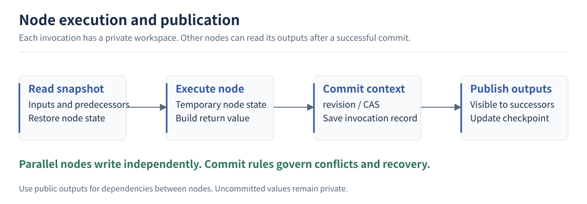

# Node-private context

[**English**](node-private-context.md) · [简体中文](node-private-context.zh-CN.md)

The `run(ctx)` signature and identity of ctx are stable. A ContextVar binds a separate workspace to each node invocation, so node computations can proceed without holding a global write lock.

| Interface | Contract |
| --- | --- |
| `ctx.trigger` | Read-only, task-local invocation source: entry, next, goto, or loop. Available in when conditions |
| `ctx.inputs` | Recursively read-only mapping declared by the node; falls back to initial Graph input when omitted |
| `ctx.values` | Private writable workspace for this invocation, initially empty |
| `ctx.previous` | Read-only values last published successfully by this node, initially empty |
| `ctx.results[node_id]` | Read-only view of published values in the current Graph scope |
| `ctx.result_versions[node_id]` | Scheduler activation version of the result |
| `ctx.read_values(*node_ids)` | Returns an independent copy merging inputs with the named results, with later versions taking precedence |
| `ctx.outputs` | Diagnostic return values, read-only inside a node. Use results for cross-node application data |

## Node example

```python
async def run(self, ctx):
    observation = ctx.results["observe"]
    ctx.values["attempt"] = ctx.previous.get("attempt", 0) + 1
    ctx.values["plan"] = await self.compute(ctx.inputs["goal"], observation)
```

Declare both the source node's next edge and this node's predecessors. Every member of a flat predecessor list must complete and select the target. A nested list is an OR group. For example, `["observe", ["retry_left", "retry_right"]]` invokes the target once observe and either retry node have arrived. Two parallel nodes can each write their own `plan`.
A dictionary return value merges into the current node's workspace. `NodeResult.state_patch` also updates only this node. Explicit `NodeResult.output` does not automatically become application state in values.
Subtasks sharing one workspace can call `atomic_update` for atomic read-modify-write. Aggregate results across nodes in a join node.

## Execution and commit



1. At the start of each scheduling batch, snapshot published results, diagnostic outputs, and typed application fields.
2. Create a workspace for each invocation and bind its execution path, node, and activation version. Normal nodes in the same batch read the same version. Each self-loop iteration has its own snapshot.
3. On normal return, validate and freeze values, then close the workspace. Subsequent access through dictionary or list references raises an error.
4. During a short serialized commit, put new results, typed field assignments, and the node's done record in one checkpoint.
5. After storage commits successfully, publish in memory and emit exit. Schedule successors according to next/goto/loop/predecessors.

Exceptions, cancellation, serialization failures, and storage failures discard the draft and preserve the last successful result. If a storage thread has started its commit, cancellation waits for the commit to finish before propagating, keeping recovery state consistent with the write.
Without a ContextStore, publication is atomic in memory; recovery after a process crash is unavailable. Physical actions and network requests fall outside this transaction and require idempotency or application-level compensation.

## Loops, subgraphs, and recovery

Each loop iteration starts with an empty workspace. Read the last published version explicitly using `ctx.previous`. A failed iteration preserves that version.
Results are scoped by Graph invocation path and node, and each record has an activation version. Nodes with identical names in parallel subgraphs stay isolated.
After a subgraph succeeds, its results are published under the parent node's `ctx.results[parent]["results"][child]`. The runtime then cleans up that invocation's cursor and internal result scope to bound growth across iterations.
Only the latest successful values are kept for each node. Trace/Recorder provides the full execution history.

Checkpoint recovery preserves each batch's original read view, trigger, invalidation markers, and committed done records. Committed siblings are skipped. Unfinished nodes resume against the original batch view, and invalidated self-loops stay inactive.
Explicitly restart an old in-progress checkpoint if it lacks the private-workspace version or has a different Graph fingerprint. It cannot resume silently under the new rules.

## Boundaries

- Published values become immutable JSON-safe mappings and sequences. Place large images or tensors in the observation cache and store references. Keep connection objects out of values.
- Workspace assignment detaches externally mutable references. Nested objects in input and published-result views cannot be modified.
- Subtasks inherit the workspace and must finish persistent writes before the node exits. The framework does not take ownership of user-created background tasks.
- `asyncio.to_thread` propagates the context. Other threads and thread pools must propagate it explicitly. Access without an execution context raises an error. Cross-process data uses serialization.
- Reading typed fields such as action, feedback, and decision returns copies; assignments are staged. Two branches writing the same field in a batch conflict. Reassign a modified copy to stage a change.
- SafetyStateStore, live environment and Tool handles, resident Module/Tool instance state on `self`, and the observation_updates channel are outside workspace isolation and may be shared.
- Outside a node, access to `ctx.values` raises after the Graph has run. Use `GraphContext(values=...)` to construct initial inputs before execution or in standalone tests. Direct module calls bypass scheduler isolation and commit guarantees.

## Migration

Replace `ctx.values["other_node_result"]` with `ctx.results["other_node"]["result"]` and read initial input from `ctx.inputs`.
Name sources in conditions, for example `goto plan when ctx.results['evaluate']['continue']`.
Built-in robot modules explicitly read plan/action/verify/evaluate results. If you customize node IDs, adjust their input sources.
In serialized context, `values` holds initial inputs. Published state lives under `node_records[scope][node_id]["values"]` rather than a flat global dictionary.

## Predecessor invocations and self-loop races

Predecessor next activations and loop publications use one commit lock to establish order. If an older loop's storage commit has begun, the runtime waits for it before recording invalidation, preserving its committed result. If invalidation wins, later commits from that loop or its nested subgraphs are rejected.

After cancellation, the runtime waits for the old invocation to exit, then gives the new invocation a snapshot of the latest results, typed fields, and outputs. Their writable workspaces are separate. The old invocation's result snapshot stays consistent and cannot overwrite new values. Checkpoints record the invalidation intent and pending next trigger, so a restart cannot revive the old loop.

Normal batches still check for write conflicts. Concurrent live batches share typed-field write claims to prevent different nodes from overwriting action, feedback, or other typed fields in parallel. Each node's values remain private. Module/Tool instance state, external threads, and hardware side effects are outside this transaction.

Before a periodic invocation, the scheduler rechecks loop.when on a fresh snapshot and uses the same snapshot for a matching invocation. graph.stop commits its termination marker with the node result. Late publications from the stopped Graph and its nested invocations are rejected. Already committed history is retained.

Declare inter-module data dependencies with explicit `inputs` mappings and expose task results through Graph `outputs`. See [Explicit Graph data interfaces](explicit-graph-data.md).
