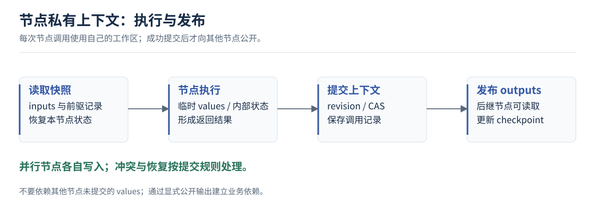

# 节点私有上下文

[English](node-private-context.md) · [**简体中文**](node-private-context.zh-CN.md)

`run(ctx)` 的签名和 ctx 对象身份不变。每个节点执行实例拥有独立的工作区，使用 ContextVar 绑定，不需要为节点计算持有全局写锁。

| 接口 | 约定 |
| --- | --- |
| `ctx.trigger` | 当前调用来源 entry/next/goto/loop，只读且任务局部；可用于 when |
| `ctx.inputs` | 节点声明的输入映射，递归只读；未声明映射时兼容图初始输入 |
| `ctx.values` | 当前调用的私有可写工作区，初始为空 |
| `ctx.previous` | 当前节点上次成功发布的 values，只读；首次执行为空 |
| `ctx.results[node_id]` | 当前图作用域内已发布 values 的只读视图 |
| `ctx.result_versions[node_id]` | 对应结果的调度激活版本 |
| `ctx.read_values(*node_ids)` | 显式合并 inputs 与列出的节点结果，按版本先后覆盖，返回独立副本 |
| `ctx.outputs` | 诊断返回值；节点内只读，跨节点业务数据优先使用 results |

## 节点代码

```python
async def run(self, ctx):
    observation = ctx.results["observe"]
    ctx.values["attempt"] = ctx.previous.get("attempt", 0) + 1
    ctx.values["plan"] = await self.compute(ctx.inputs["goal"], observation)
```

图中需要同时声明 observe 的 next 和此节点的 predecessors。一维多个前驱必须全部完成并选中目标；内层列表是 OR 组，例如 `["observe", ["retry_left", "retry_right"]]` 表示 observe 与两个 retry 之一均到达后调用目标。两个并行节点可以各写自己的 `plan`，不会覆盖彼此。
普通字典返回值合并进本节点工作区。`NodeResult.state_patch` 也只更新本节点；显式 `NodeResult.output` 不自动成为业务 values。
节点内部如有子任务共享工作区，可使用 `atomic_update` 做原子读改写；跨节点聚合应交给汇合节点。

## 执行与提交



1. 每个调度批次开始时保存已发布结果、诊断输出和 typed 业务字段的读取快照。
2. 为每次节点调用创建新工作区。绑定执行路径、节点和激活版本；同一批普通节点使用相同的读取版本；每轮 self-loop 使用独立快照。
3. 正常返回后，校验并冻结 values，关闭工作区；所有字典/列表引用的后续读写都会报错。
4. 框架通过短暂串行提交，将新结果、业务字段赋值和节点 done 记录放进同一份 checkpoint。
5. 存储提交成功后才发布到内存并通知 exit，后继随后按 next/goto/loop/predecessors 规则调度。

异常、取消、序列化失败或存储失败不会发布草稿，也不会覆盖上次成功结果。存储线程已经开始提交时，取消会等待该提交完成再传播，避免后台写入与恢复状态脱节。
如果未配置 ContextStore，提供内存发布保证，不承诺进程崩溃后恢复。物理动作、网络请求等外部副作用不在此事务内，仍需幂等或业务补偿。

## loop、子图与恢复

loop 每次都建立新工作区，使用 `ctx.previous` 显式读取上一版。失败保留上一版；不会自动将历史 values 填入新工作区。
结果内部按图调用路径和节点隔离，每个记录有激活版本；并行子图中同名节点不会混写。
子图成功后，其结果以父节点的 `ctx.results[parent]["results"][child]` 发布；已完成子图的内部 cursor/结果作用域随后清理，避免循环中无限增长。
每个节点只保存最新成功 values；完整执行历史仍由 Trace/Recorder 提供。

恢复 checkpoint 时保留每个 batch 的原始读取视图、触发来源、失效标记和已提交 done 记录。已提交兄弟节点不重放，未完成节点继续使用原批次视图；已失效的 self-loop 不重新启动。
旧的进行中 checkpoint 缺少私有工作区版本或图指纹不匹配时，必须显式重新开始，不能按新语义静默恢复。

## 边界

- 发布时转换成 JSON 安全的不可变映射和序列。大图像、张量、连接等不应放入 values，应放在 observation cache 并保存引用。
- 工作区赋值会断开外部可变引用；读取输入和发布结果不能修改嵌套对象。
- 子任务继承工作区，必须在节点结束前完成需要保留的写入；不自动接管用户自行创建的后台任务。
- `asyncio.to_thread` 传播上下文；普通线程、线程池必须显式传播，缺少执行上下文时访问工作区会报错。跨进程通过序列化传递数据。
- action、feedback、decision 等 typed 字段提供副本读取和赋值暂存。同批次两个分支写同一字段报冲突；修改读取副本后必须显式赋值。
- SafetyStateStore、环境/工具句柄、常驻 Module/Tool 实例的 `self` 状态以及 observation_updates 实时缓存通道独立于 values 隔离，不应把它们当作节点私有对象。
- 图运行后，节点之外访问 `ctx.values` 会报错。运行前的 `GraphContext(values=...)` 初始化与独立单元测试仍可构造输入；直接调用模块不经过调度器，不能获得图执行的隔离和提交保证。

## 迁移

将 `ctx.values["other_node_result"]` 改为 `ctx.results["other_node"]["result"]`，将初始配置读取改为 `ctx.inputs`。
路由条件也需要明确来源，例如 `goto plan when ctx.results['evaluate']['continue']`。
内置机器人模块显式读取 plan/action/verify/evaluate 的结果；自定义节点 ID 时需要相应修改输入来源。
serialized context 的 `values` 保留初始输入；发布状态位于 `node_records[scope][node_id]["values"]`，不再平铺成全局字典。

## 前驱调用与自循环竞争

前驱 next 触发与 loop 结果发布使用同一个提交锁确定先后。若旧 loop 的存储提交已经开始，先等待它提交完成，再记录 loop 失效；不回滚已经提交的结果。若失效先发生，旧 loop 及其嵌套子图的后续提交会被拒绝。

取消后等待旧调用结束，随后新调用读取最新结果、typed 字段和 outputs 快照；两个调用不共用可写工作区。旧调用持有的 results 快照不会中途变化，也不能覆盖新调用的 values。失效意图和等待中的 next 触发进入 checkpoint，重启后不会复活旧循环。

普通批次的写冲突检查继续存在；同时存活的批次共享 typed 字段写入声明，避免不同节点并行覆盖 action/feedback 等字段。节点自身 values 始终私有。这个机制不为 Module/Tool 的 self、外部线程或硬件副作用提供事务隔离。

周期到期前使用新建的读取快照重查 loop.when，判断通过的调用使用同一份快照。graph.stop 将终止标记与节点结果一同提交，终止后的本图及嵌套调用无法发布迟到结果；已提交历史保留。

模块之间的新数据依赖使用显式 `inputs` 映射；任务结果由 Graph 的 `outputs` 声明。详见 [显式 Graph 数据接口](explicit-graph-data.zh-CN.md)。
