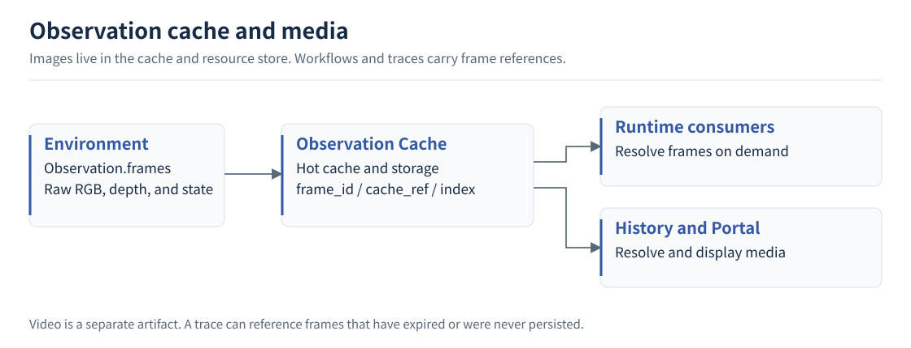

# Observation pipeline and cache

[**English**](observation-cache.md) · [简体中文](observation-cache.zh-CN.md)

The pipeline uses the ObservationStore protocol. Select an external implementation with `observation_cache.backend/plugin_stores/params`. ObservationFrame modality/producer and ObservationChannel.modality accept nonempty strings. An explicitly declared modality stays intact rather than being reclassified as other. This guide describes persistence and queries for the built-in hybrid backend. See [infrastructure plugins](infrastructure-plugins.md) for custom backends, remote configuration, and compatibility aliases.

Observation storage is infrastructure. EnvironmentAdapter returns facts about the environment, `ObservationPipeline` normalizes the feedback, and `ObservationCache` stores media and exposes metadata. GraphContext carries `ObservationRef` and `cache://` URIs so nodes can reference images, video frames, and point clouds without copying them.

See [execution and observability](execution-and-observability.md) for runtime configuration and [plugin development](plugin_development.md) for provider contracts.

## 1. Connect an environment service



This integration example assumes an existing environment service and context `ctx`.

```python
from robotenon.infra import ObservationCache, ObservationPipeline
from robotenon.services import EnvironmentServiceClient

cache = ObservationCache(
    "./data/observations",
    max_records=64,
    max_bytes=268435456,
    ttl_seconds=300,
)
pipeline = ObservationPipeline(cache)
env = EnvironmentServiceClient(
    "/tmp/robotenon-env.sock",
    observation_pipeline=pipeline,
)
feedback = await env.reset(ctx)
feedback = await env.observe()
```

`reset`, `observe`, and `command(type="reset")` use the same pipeline. By default, a write updates memory and enqueues persistence without waiting for disk. Call `await cache.flush()` to wait for queued records. Use `await cache.append(feedback, durable=True)` to wait for a particular record to be persisted. These calls do not create a distributed transaction with physical actions.

`ObservationEnvironmentService` can wrap an existing service. `initialize_application()` creates the configured cache, binds in-process observation infrastructure, and supplies the resolver to Tools and Monitors. It leaves a service that already has a pipeline unwrapped. Standalone integrations own cache startup, flush, and close.

## 2. Feedback contract

`EnvironmentFeedback.frames` maps camera or sensor names to `ObservationRef` records. The compatibility field `feedback.observation.channels` also contains URI-only channels. The pipeline removes raw `ObservationFrame.data` before passing feedback to the Workflow. State, reward, terminal, and info remain JSON-serializable metadata.

```python
ref = feedback.frames["front_camera"]
# Example URI: cache://<session>/epoch-0/feedback-<id>/front_camera
pixels = await pipeline.resolver.resolve_ref(ref)
history = await cache.history(feedback.session_id, length=4, interval=2)
old = await cache.get_by_feedback_id(feedback_id)
```

The `feedback_id` above comes from saved feedback. Resolve `cache://` references through the resolver; they are not OS paths suitable for `open()`. Depending on the encoding, the generic resolver returns bytes, arrays, JSON, or text. Model providers handle any further decoding and preprocessing.

## 3. Tool and Monitor access

```python
from robotenon.runtime.factory import build_tool_runtime, build_monitor_runtime

tools = build_tool_runtime(tools_config, observation_resolver=pipeline.resolver)
monitors = build_monitor_runtime(
    monitors_config,
    observation_resolver=pipeline.resolver,
)
```

This assembly example assumes `tools_config` and `monitors_config` from the configuration loader. The runtime injects a temporary `observation_view` into ToolContext/MonitorContext. Graph context keeps references and metadata only. Modules continue to implement `run(ctx)` without managing the cache lifecycle.

Resident Tools must release observation views, resolvers, and windows from the previous task. The Runner calls `end_session(session_id)` and removes runtime bindings when a task ends. Release session-specific VLA history there. Keep weights or client connections until the Tool's `close()`.

## 4. Storage layers and retention

| Layer | Contents | Purpose |
| --- | --- | --- |
| L0 | Bounded, locked in-memory records | Current reads and history windows |
| L1 | Per-frame media files | Temporary write, sync, and atomic replacement |
| L2 | SQLite index | Feedback/frame metadata and storage locations; no media BLOBs |

Persistence workers apply `retention.keep_sessions` and `retention.keep_days` outside the environment-control coroutine. Configure queue size and overflow behavior under `persist`. Capacity and retention limits make the cache unsuitable as a permanent dataset archive without additional configuration.

Example main configuration:

```json
{
  "observation_cache": {
    "enabled": true,
    "backend": "hybrid",
    "hot": {"max_records": 64, "max_bytes": 268435456, "ttl_seconds": 300},
    "storage": {"root": "./data/observations", "index": "./data/observations/index.sqlite3"},
    "persist": {"async": true, "queue_size": 256, "workers": 2, "on_queue_full": "drop_oldest"},
    "retention": {"keep_sessions": 20, "keep_days": 30},
    "uri_scheme": "cache"
  }
}
```

`observation_cache` is a top-level media setting. `parameters.runtime.observability` selects Trace/Metrics data sources.

## 5. Isolation for process-backed tasks

The process backend assigns each attempt a separate `resource_root`. Its observations are stored under `resources/observations/`, so one Worker's retention cleanup and session state do not affect another. Only `safety_state.scope=task` moves safety storage under that root. The default shared scope retains its configured path so device-side safety signals remain visible.

Shared Trace SQLite stores URIs and storage locations; the media remain in their observation store. With external safety or observation services, verify the effective bindings used by every participating component.

## 6. Standalone cache service and Web access

```bash
Tenon observation-cached --socket /tmp/robotenon-observation.sock \
  --root ./data/observations
```

On the Environment side, use `ObservationCacheServiceClient("/tmp/robotenon-observation.sock", shared_root="./data/observations")`. It writes media to shared storage and sends URIs, checksums, and feedback metadata over UDS. Readers resolve media against the same storage configuration. Restarting the service should preserve its existing index and files.

Set the Web server's media query scope using `--observation-root` and `--observation-index`, or `ROBOTENON_OBSERVATION_ROOT` and `ROBOTENON_OBSERVATION_INDEX`. Available endpoints include:

- `/api/observations/latest` returns the latest feedback for a session.
- `/api/observations/history` queries historical feedback.
- `/api/observations/metadata?uri=cache://...` returns reference metadata.
- `/api/observations/image?uri=cache://...` reads an image subject to supported formats and server-side path restrictions.

See `robotenon/web/server.py` for parameters. A metadata query does not fetch large media. `--source observability.json` selects only the Trace/Metrics source. Select the matching cache root and index separately.

## 7. Metrics and troubleshooting

The cache integrates with MetricsClient and provides a local `metric_snapshot()`. Common metrics include:

- `observation_cache_append_total`, `hit_total`, and `miss_total` count writes, hits, and misses.
- `observation_cache_evicted_total`, `persisted_total`, and `dropped_total` count evictions, persisted records, and drops.
- `observation_cache_resolve_latency_ms` and `persist_latency_ms` measure lookup and persistence latency.
- `observation_cache_memory_bytes`, `disk_bytes`, `queue_depth`, and `stale_total` track capacity, backlog, and stale records.

All abbreviated names above use the `observation_cache_` prefix. For an unresolved URI, check the session identity, effective resource root, SQLite metadata, media file, retention, and permissions in that order. A trace can outlive the media it references.
