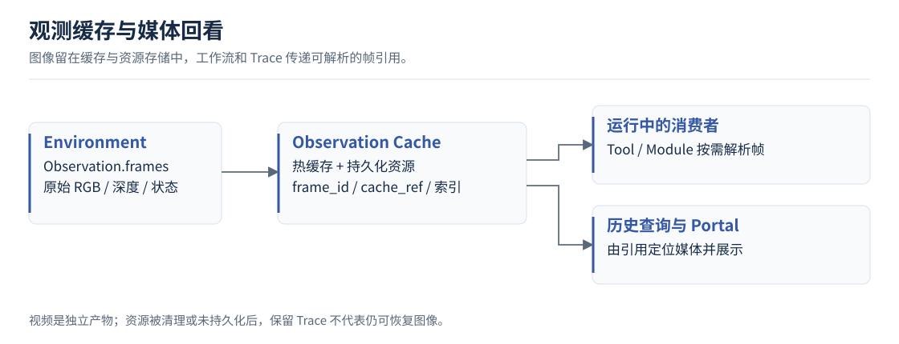

# 观测流水线与缓存

[English](observation-cache.md) · [**简体中文**](observation-cache.zh-CN.md)

观测管线依赖 ObservationStore 协议，`observation_cache.backend/plugin_stores/params` 可选择外部实现。ObservationFrame 的 modality/producer 和 ObservationChannel.modality 使用非空字符串，明确声明的模态不会重新猜测成 other。内置 hybrid 的落盘与查询行为见下文；自定义后端、remote 配置和兼容别名见[基础设施插件](infrastructure-plugins.zh-CN.md)。

观测存储属于基础设施。EnvironmentAdapter 负责返回环境事实，`ObservationPipeline` 负责归一化反馈，`ObservationCache` 保存媒体并提供元数据。GraphContext 中传递 `ObservationRef` 和 `cache://` URI，避免在每个节点之间复制图像、视频帧或点云。

相关运行配置见[执行与统一观测](execution-and-observability.zh-CN.md)，插件契约见[插件开发](plugin_development.zh-CN.md)。

## 1. 接入环境服务



以下是需要已有环境服务和上下文 `ctx` 的集成片段：

```python
from robotenon.infra import ObservationCache, ObservationPipeline
from robotenon.services import EnvironmentServiceClient

cache = ObservationCache(
    "./data/observations",
    max_records=64,
    max_bytes=268435456,
    ttl_seconds=300,
)
pipeline = ObservationPipeline(cache)
env = EnvironmentServiceClient(
    "/tmp/robotenon-env.sock",
    observation_pipeline=pipeline,
)
feedback = await env.reset(ctx)
feedback = await env.observe()
```

`reset`、`observe`、`command(type="reset")` 使用同一流水线。默认写入先更新内存层，再将持久化任务放入队列，不同步等待磁盘。需要等待已排队记录落盘时调用 `await cache.flush()`；单条记录需要等待持久化时使用 `await cache.append(feedback, durable=True)`。这些接口不构成硬件动作与落盘之间的分布式事务。

`ObservationEnvironmentService` 可以包装现有服务。`initialize_application()` 按配置创建缓存，绑定进程内观测基础设施，并将 resolver 传给 Tool/Monitor；已有流水线的服务不会重复包装。独立集成代码应负责缓存启动、flush 和关闭。

## 2. 反馈契约

`EnvironmentFeedback.frames` 是相机或传感器名称到 `ObservationRef` 的映射。兼容字段 `feedback.observation.channels` 也保存只含 URI 的通道。反馈交给 Workflow 前会清除原始 `ObservationFrame.data`；state、reward、terminal 和 info 保持为可 JSON 序列化的元数据。

```python
ref = feedback.frames["front_camera"]
# URI 形如 cache://<session>/epoch-0/feedback-<id>/front_camera
pixels = await pipeline.resolver.resolve_ref(ref)
history = await cache.history(feedback.session_id, length=4, interval=2)
old = await cache.get_by_feedback_id(feedback_id)
```

上述片段中的 `feedback_id` 来自已保存反馈。`cache://` 不是操作系统路径，不能直接传给 `open()`。通用 resolver 根据编码信息返回字节、数组或 JSON/文本等数据；模型 provider 负责其所需的具体解码和预处理。

## 3. Tool 与 Monitor 的访问

```python
from robotenon.runtime.factory import build_tool_runtime, build_monitor_runtime

tools = build_tool_runtime(tools_config, observation_resolver=pipeline.resolver)
monitors = build_monitor_runtime(
    monitors_config,
    observation_resolver=pipeline.resolver,
)
```

这是组件组装片段，`tools_config` 和 `monitors_config` 来自配置加载器。运行时向 ToolContext/MonitorContext 注入临时 `observation_view`，图上下文仍只保留引用与元数据。Module 继续使用 `run(ctx)`，无需管理缓存生命周期。

常驻 Tool 不能保存上一任务的 observation view、resolver 或观察窗口。统一 Runner 在任务结束时调用 `end_session(session_id)` 并解除运行时绑定；VLA 的每会话历史也应在此释放。模型权重或客户端连接留到 Tool 的 `close()` 再关闭。

## 4. 存储层与保留策略

| 层 | 内容 | 作用 |
| --- | --- | --- |
| L0 | 有界、加锁的内存记录 | 当前执行读取与历史窗口 |
| L1 | 每帧媒体文件 | 临时文件写入、同步与原子替换 |
| L2 | SQLite 索引 | 反馈/帧元数据与存储位置，不保存媒体 BLOB |

持久化工作线程执行 `retention.keep_sessions` 和 `retention.keep_days` 清理，不在环境控制协程中执行保留期扫描。队列大小与满队列策略由 `persist` 配置控制。缓存是有容量和保留期的，不能未经配置就当作永久数据集归档。

主配置示例：

```json
{
  "observation_cache": {
    "enabled": true,
    "backend": "hybrid",
    "hot": {"max_records": 64, "max_bytes": 268435456, "ttl_seconds": 300},
    "storage": {"root": "./data/observations", "index": "./data/observations/index.sqlite3"},
    "persist": {"async": true, "queue_size": 256, "workers": 2, "on_queue_full": "drop_oldest"},
    "retention": {"keep_sessions": 20, "keep_days": 30},
    "uri_scheme": "cache"
  }
}
```

`observation_cache` 位于主配置顶层，与 `parameters.runtime.observability` 不同。前者管理媒体，后者管理 Trace/Metrics 数据源。

## 5. 进程任务的隔离

当前进程后端给每个 attempt 指定独立 `resource_root`。装配层将该 attempt 的观测存储位置设置到 `resources/observations/`，避免多个 Worker 的保留期清理和会话状态互相影响。只有显式配置 `safety_state.scope=task` 时，安全存储才随该资源根目录隔离；默认 shared 保持原路径，以便读取设备侧共享安全信号。

这不代表所有媒体已经合并到共享 Trace SQLite：Trace 只记录 URI 和存储位置。使用外部 Safety/观测服务时，需要确认所有相关组件读取的是本次实际绑定的位置，不能沿用猜测的全局路径。

## 6. 独立缓存服务与 Web

```bash
Tenon observation-cached --socket /tmp/robotenon-observation.sock \
  --root ./data/observations
```

Environment 侧可使用 `ObservationCacheServiceClient("/tmp/robotenon-observation.sock", shared_root="./data/observations")`。它将媒体写入共享存储，通过 UDS 发送 URI、校验和与反馈元数据。消费端通过同一存储配置解析媒体；服务重启不应删除历史索引或文件。

Web 通过 `--observation-root`、`--observation-index` 指定媒体查询范围，也可使用对应的 `ROBOTENON_OBSERVATION_ROOT`、`ROBOTENON_OBSERVATION_INDEX` 环境变量。接口包括：

- `/api/observations/latest`：按会话查询最新反馈。
- `/api/observations/history`：查询历史反馈。
- `/api/observations/metadata?uri=cache://...`：查询引用元数据。
- `/api/observations/image?uri=cache://...`：按服务端支持的格式及路径约束读取图像。

具体参数见 `robotenon/web/server.py`。元数据查询不会自动读取大媒体。`--source observability.json` 只选择 Trace/Metrics，不会自动扫描各 attempt 的观测索引；查看特定媒体时应显式选择对应缓存根目录和索引。

## 7. 指标与排查

缓存可接入 MetricsClient，并提供本地 `metric_snapshot()`。常用指标包括：

- `observation_cache_append_total`、`hit_total`、`miss_total`：写入、命中与未命中。
- `observation_cache_evicted_total`、`persisted_total`、`dropped_total`：淘汰、落盘与丢弃。
- `observation_cache_resolve_latency_ms`、`persist_latency_ms`：解析和持久化耗时。
- `observation_cache_memory_bytes`、`disk_bytes`、`queue_depth`、`stale_total`：容量、积压和陈旧记录。

上表缩写项均使用 `observation_cache_` 前缀。出现 URI 无法解析时，依次检查会话身份、实际资源根目录、SQLite 元数据、媒体文件、保留期和权限。Trace 存在不代表对应媒体文件必然仍在保留期内。
