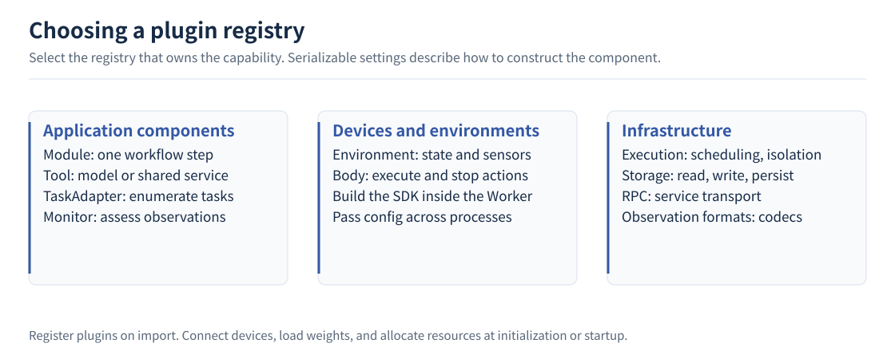

# Plugin development: Module, Tool, Body, Environment, Monitor, and TaskAdapter

[**English**](plugin_development.md) · [简体中文](plugin_development.zh-CN.md)

Use Modules for policies, VLA decision logic, and Evaluators. Models, Memory, Skill, and reusable external capabilities are Tools. A Body executes physical actions, and an EnvironmentAdapter connects a simulator or robot observation source. A Monitor checks compliance continuously or on request. The six provider families have separate registries and lifecycles and are assembled from the main configuration. Plugins register and implement their capabilities without modifying Workflow, TaskQueue, or Portal. Execution backends, stores, and transports have separate [infrastructure plugin APIs](infrastructure-plugins.md). A Graph Module takes only `ctx`, reads settings from `ctx.params`, and calls the `robotenon.envs.environment` singleton for environment access.

## 1. Module contract



```python
from robotenon.runtime.registry import register_module

@register_module(
    "my-policy",
    kind="policy",
    version="1.0.0",
    description="A resident policy",
)
class MyPolicy:
    def __init__(self, model_tool: str = "model_main"):
        self.model_tool = model_tool

    async def start(self):
        # ToolRuntime is bound before ModuleRuntime.start().
        if self.tools is None:
            raise RuntimeError("model ToolRuntime is required")

    async def run(self, ctx):
        # All inputs for this GraphRuntime invocation come through ctx.
        timeout_ms = ctx.params.get("policy.action_timeout_ms", [int, 1000])
        # When needed, use the process-local environment handle:
        # from robotenon.envs import environment
        # feedback = await environment.observe()
        result = await ctx.call_tool(self.model_tool, {"prompt": str(ctx.inputs)})
        return {"action_plan": result.output}

    async def close(self):
        pass
```

`kind` is used for discovery and configuration validation. Common Module kinds include `policy`, `vla`, `evaluator`, `safety`, and `service`. Register model access, Memory, Skill, and other reusable capabilities in ToolRegistry.

### Invocation forms

- Graph nodes implement `async run(ctx)`. They receive the shared `GraphContext` identity, with node-private `ctx.values` and read-only `ctx.inputs`/`ctx.results`. The framework stages application field assignments and commits them on success.
- For calls outside Graphs, optionally implement `async invoke(arguments, ModuleContext)`, which is invoked through `ModuleRuntime.call(name, arguments)`.
- With `build_module_runtime(..., tools=tools)`, the runtime attempts to bind the shared
  `ToolRuntime` to `self.tools`. Graph and non-Graph calls always receive it through `ctx.tools` and
  `ModuleContext.tools`, respectively. Implement `set_tools(tools)` for explicit binding.

Use `start()` for one-time initialization. Keep weights and connections in resident components rather than reloading them for every episode.

## 2. Body registration and assembly

Body is the dedicated service for robot actions. It is the only execution boundary that receives `ActionChunk`. Construct and start a resident Body at process startup. Implement `start()`, `execute()`, `interrupt()`, `health()`, and `close()`.

```python
from robotenon.bodies import register_body

@register_body("my-body", kind="robot", version="1.0.0")
class MyBody:
    def __init__(self, *, endpoint: str, executor, safety_state=None):
        self.endpoint = endpoint
        self.executor = executor
        self.safety_state = safety_state

    async def start(self): ...
    async def execute(self, action_chunk): ...
    async def interrupt(self, reason, *, safe_action=None): ...
    async def health(self): ...
    async def close(self): ...
```

Select the registered provider in `body_configs.json`. Use JSON-serializable `params` for endpoints, timeouts, and driver options. Inject nonserializable Python objects, such as an SDK `executor` or shared safety state, via `runtime`.

```json
{
  "config_version": 1,
  "plugin_bodies": ["my_robot.body"],
  "bodies": [
    {"id": "body_main", "name": "my-body", "kind": "robot", "params": {"endpoint": "192.0.2.8"}}
  ]
}
```

```python
from robotenon.runtime.factory import initialize_body_service

body = await initialize_body_service(
    loaded.bodies,
    runtime={"executor": robot_driver.send_action},
    safety_state=safety,
)
```

A process uses one enabled Body. If several configurations are enabled, select one explicitly with `body_id` or startup fails. Built-in `in-process`/`in_process` supports local drivers. `ipc`/`uds` constructs a `BodyServiceClient` for a separate Body process. GraphRuntime invokes it through `body.execute`. Modules do not own the driver.

## 3. EnvironmentAdapter registration and assembly

EnvironmentAdapter connects RoboLab, RoboDojo, simulators, or custom hardware. It is independent of Body, Workflow, and Monitor. The Adapter stays resident and creates Sessions from each Run's `SessionSpec`.

```python
from robotenon.envs import register_environment

@register_environment("my-env")
class MyAdapter:
    descriptor = ...

    def __init__(self, *, endpoint: str):
        self.endpoint = endpoint

    async def connect(self): ...
    async def open(self, spec): ...
    async def close(self): ...
```

Select the Adapter in `envs_configs.json` and import `plugin_environments`:

```json
{
  "config_version": 1,
  "plugin_environments": ["my_robot.env"],
  "environments": [
    {"id": "lab_a", "name": "my-env", "version": "1.0.0", "params": {"endpoint": "192.0.2.9"}}
  ]
}
```

```python
from robotenon.runtime.factory import initialize_environment_adapter
from robotenon.envs import bind_environment

adapter = await initialize_environment_adapter(loaded.environments)
session = await adapter.open(session_spec)
bind_environment(session)
```

`environment_registry.build()`/`get()` constructs one instance per registration string. Changing its constructor arguments after construction is rejected. The owning envs service closes the Adapter; each Session closes at run end. Workflow, Monitor, and Web use the process-level `environment` singleton or an EnvironmentService UDS client. Modules still receive only `ctx`.

## 4. Registration and configuration

### Environment Session parameters

Pass task-specific environment settings through `SessionSpec.parameters`. The Runner needs no new
fields for suites, initial states, or scene layout and does not interpret them. Put defaults in the main configuration:

```json
{
  "parameters": {
    "environment": {
      "parameters": {
        "suite": "libero_10",
        "init_state_id": 0,
        "settle_steps": 10
      }
    }
  }
}
```

A TaskAdapter can set the per-case values as follows:
`parameters={"environment_parameters": {"init_state_id": trial_index}}`。
A single Python call may also provide
`EpisodeRequest(environment_parameters={"settle_steps": 20})`。
Precedence is configuration (including experiment overrides), then TaskCase, then EpisodeRequest. Objects merge recursively.
Arrays and scalars are replaced. An empty object does not clear defaults. All values must be JSON-serializable.
Other TaskCase parameters go to `ctx.params.task` and are not forwarded automatically.

Canonical fields are written last. The Runner's selected environment ID is authoritative for `task_env_id`.
Configured `task.split`, `environment.io`, and `render` override pass-through fields with the same names.
Task identity and seed use dedicated SessionSpec fields. `runtime.horizon` limits runtime steps.
To set a simulator's own horizon, explicitly supply `horizon` as an environment parameter.
An EnvironmentAdapter consumes its own settings and translates them to vendor names. It should not blindly forward unknown
framework fields into the simulator constructor. The LIBERO fields above demonstrate the interface, independent of plugin implementation status.

Production entry points use one main configuration. Individual modules do not read separate JSON files.

The batch API accepts `ExperimentRequest(task_adapter_overrides={"adapter_id": {...}},
environment_parameters={...})`. Select TaskAdapter overrides by configured instance ID or registration name.
The instance ID takes precedence. Override values merge recursively into constructor arguments. An unknown explicit target fails.
The corresponding CLI options are `--batch --task-adapter-overrides '{"adapter_id":{"suite":"demo"}}'`
and `--environment-parameters '{"init_state_id":3}'`. The latter also supports a single task.
`--split` accepts a name defined and validated by the plugin.
A provider can declare legacy batch shortcuts, such as `--task-set` and `--num-trials`, in its `cli_overrides` registration metadata. Built-in RoboCasa365 declares its legacy fields.
New plugins should use explicit overrides or configuration instead of adding provider-specific Runner/CLI options.

External plugins can be independently installable Python packages. Import them through the six `plugin_*` settings
without editing `load_builtin_*`. The Worker's Python environment must be able to import the package too.

```json
{
  "modules_config": "modules_configs.json",
  "graphs_config": "graphs.json",
  "tools_config": "tools_configs.json",
  "monitor_config": "monitor_configs.json",
  "body_config": "body_configs.json",
  "environments_config": "envs_configs.json",
  "parameters": {"policy": {"action_timeout_ms": 1000}}
}
```

```python
from robotenon.runtime.config import load_application_config

loaded = load_application_config("configs/config.json", "configs/experiments/demo.json")
timeout_ms = loaded.params.get("policy.action_timeout_ms", [int, 1000])
```

Parameter resolves, merges, and validates the configuration. Base leaf keys in the six component manifests must be unique. Experiment overrides may replace existing values. `loaded.modules`, `loaded.graphs`, `loaded.tools`, `loaded.monitors`, `loaded.bodies`, and `loaded.environments` come from one merged snapshot.

Import third-party packages through `plugin_modules` before startup:

```json
{
  "config_version": 1,
  "plugin_modules": ["my_robot.plugins"],
  "modules": [
    {
      "id": "policy",
      "name": "my-policy",
      "version": "1.0.0",
      "kind": "policy",
      "params": {"checkpoint": "weights/policy.pt"}
    }
  ],
  "workflow": {
    "backend": "langgraph",
    "policy": "policy",
    "evaluator": "evaluator_main"
  }
}
```

Start the runtime:

```python
from robotenon.runtime.config import load_modules_config
from robotenon.runtime.factory import initialize_module_runtime

config = load_modules_config("configs/modules_configs.json")
runtime = await initialize_module_runtime(config)
policy = runtime.resolve("policy")
```

Each instance of the same registered type needs a distinct `id`. When multiple instances use one registration name, that ambiguous alias is disabled. Call instances by ID.

## 5. Resident Tool contract

In the standard Runner, a Tool lives for the lifetime of its Worker, while Module, Body, Environment, and GraphContext are task-scoped. Weights and connections may persist across tasks. Old ctx, feedback, observation resolvers, and session caches must be released. Implement the optional cleanup hook:

```python
async def end_session(self, session_id: str) -> None:
    self.session_cache.pop(session_id, None)
```

This method assumes the plugin initialized `session_cache`. Release shared resources in `close()` at Worker shutdown. Spawned processes reconstruct objects by importing their plugins; do not send live sockets, SDK objects, locks, or GPU tensors. Keeping a Tool resident does not deploy an external model service.


Tools provide reusable capabilities. The Graph selects its next step. Implement `async call(arguments, context)` and optionally `start/close`. `ToolRuntime` constructs each configured instance once at process startup and closes them in reverse order.

```python
from robotenon.tools import ToolContext, ToolResult, register_tool

@register_tool(
    "my-vla-model",
    kind="model",
    version="1.0.0",
    description="Resident VLA inference provider",
)
class MyVLAModel:
    async def start(self):
        self.model = load_model("weights/vla.pt")

    async def call(self, arguments, context: ToolContext):
        output = await self.model(
            image=arguments.get("image"),
            instruction=arguments["instruction"],
        )
        return ToolResult(output=output)

    async def close(self):
        self.model = None
```

Declare an instance in `configs/tools_configs.json`. `plugin_tools` imports registration modules before assembly:

```json
{
  "config_version": 1,
  "plugin_tools": ["my_robot.tools"],
  "tools": [
    {
      "id": "vla_main",
      "name": "my-vla-model",
      "kind": "model",
      "version": "1.0.0",
      "params": {"device": "cuda:0"}
    }
  ]
}
```

```python
from robotenon.runtime.config import load_tools_config
from robotenon.runtime.factory import initialize_tool_runtime

tools = await initialize_tool_runtime(load_tools_config("configs/tools_configs.json"))
result = await tools.call("vla_main", {"instruction": "pick the mug", "image": frame})
```

A Graph Module's `ctx` automatically carries the shared `ToolRuntime`. Do not reload weights or create Memory/Skill connections inside the Module.

```python
@register_module("planner", kind="policy")
class Planner:
    async def run(self, ctx):
        memory = await ctx.call_tool("memory_main", {"op": "search", "task_id": ctx.task_id})
        plan = await ctx.call_tool("vla_main", {
            "instruction": ctx.task_item.goal if ctx.task_item else "",
            "memory": memory.output,
        })
        return {"plan": plan.output}
```

Built-in Tools include:

- `model` supports `echo`/`static` for smoke tests without model dependencies.
- `memory` wraps `extensions.MemoryStore` and supports `add` and `search`.
- `skill` wraps `extensions.SkillRegistry` and supports `heads`, `get`, and `register`.
- `echo` tests connectivity and context propagation.

Constructor arguments come from `params` in `tools_configs.json`. Call by instance ID when several instances share a registered name. A Tool may return a JSON-compatible object or `ToolResult(ok=False, error=...)` for a recoverable error. It does not directly modify TaskQueue or own env/body/monitor connections.

## 6. Modules in a Graph

Use instance IDs to compose nodes in `configs/graphs.json`:

```json
{
  "graphs": [
    {
      "id": "pick",
      "entry": "plan",
      "nodes": [
        {"id": "plan", "type": "module", "module": "policy", "next": [{"node": "body_execute"}]},
        {"id": "body_execute", "type": "system", "operation": "body.execute", "predecessors": ["plan"], "next": [{"node": "observe"}]},
        {"id": "observe", "type": "system", "operation": "env.observe", "predecessors": ["body_execute"], "next": [{"node": "judge"}]},
        {
          "id": "judge",
          "type": "module",
          "module": "evaluator_main",
          "predecessors": ["observe"],
          "goto": [
            {"node": "plan", "when": "ctx.results['judge']['retry'] == true"}
          ],
          "default": "END"
        }
      ]
    }
  ]
}
```

Set initial inputs with `GraphContext(values=...)` or `run(initial_values=...)`. Nodes read the immutable `ctx.inputs` view.
On success the runtime publishes node-private `ctx.values` to `ctx.results[node_id]`. Declare dependencies when reading other nodes' results.
An ordinary edge requires both a source next and a target predecessors declaration. Use `goto: {"node": "plan", "when": "ctx.results['judge']['retry'] == true"}` for a back-edge without adding a reverse predecessor.
Keep static parameters in each instance's params. See [node-private context](node-private-context.md) for versions, lifecycle, and checkpoint rules.

## 7. EnvironmentAdapter plugins

```python
from robotenon.envs import EnvironmentSession, register_environment
from robotenon.schemas import EnvironmentFeedback, EnvironmentDescriptor, SessionSpec

@register_environment("my-robot")
class MyAdapter:
    descriptor = EnvironmentDescriptor(
        env_id="my-robot",
        display_name="My Robot",
        capabilities={"manipulation"},
        action_types={"cartesian_pose", "gripper"},
        observation_modalities={"rgb", "proprioception"},
        backend_kind="remote",
    )

    async def open(self, spec: SessionSpec) -> EnvironmentSession:
        return MySession(spec)

class MySession:
    async def reset(self, ctx) -> EnvironmentFeedback: ...
    async def close(self) -> None: ...
```

Encapsulate differences among RoboLab, RoboDojo, simulators, and custom hardware inside the Adapter/Session. The Adapter resides in `environment_registry`. Bind the service to the process-level `environment` singleton and create and bind a Session for each Run:

```python
from robotenon.envs import bind_environment, environment_registry

adapter = environment_registry.get("my-robot", endpoint="127.0.0.1:9000")
session = await adapter.open(session_spec)
bind_environment(session)
result = await graph_runtime.run("embodied_loop", ctx=ctx, body=body, monitor=monitor)
await session.close()
```

The Graph-side `EnvironmentService` contract includes `start()`, `reset(ctx)`, `observe()`, `command()`, `health()`, and `close()`. BodyService executes actions. The environment supplies feedback, is not passed as a Module argument, and is not reconstructed by nested Graphs. Modules access the current service with methods such as `await environment.observe()`. Camera frames, point clouds, and proprioception enter `ctx.feedback` through `EnvironmentFeedback.observation`. Use `ServiceSupervisor` to manage health probes and lease renewal for cross-process clients.

## 8. Evaluator contract

An Evaluator is a regular Graph Module. It can return NodeResult or a dictionary and route successors through next. Use a structured `EvaluationDecision` for generic decisions and safety signals. Import the required types for the following interface example:

```python
@register_module("my-evaluator", kind="evaluator")
class MyEvaluator:
    async def run(self, ctx):
        # GraphRuntime passes only ctx to a Graph node.
        decision = await self.evaluate(ctx.inputs["evaluation_input"])
        ctx.decision = decision
        return {"decision": decision}

    async def evaluate(self, item):
        return EvaluationDecision(
            session_id=item.session_id,
            decision=EvaluationDecisionType.CONTINUE,
            reason_code="ok",
            based_on_feedback_id=item.feedback.feedback_id,
            based_on_sequence_no=item.feedback.sequence_no,
            context_revision=item.context_revision,
            task_success=False,
            task_item_success=True,
            queue_operation=QueueOperation.NEXT,
        )

    async def invoke(self, arguments, context):
        return ModuleResult(ok=True, output=await self.evaluate(arguments["item"]))
```

Put safety findings in `safety_level`/`safety_signals`. P3/P4 enter the shared safety state for Body interruption and Graph safety checks. The Graph does not clear TaskQueue or automatically consume queue_operation. An Evaluator does not own a SQLite connection or call `next/clear/branch` directly.

## 9. Monitor registration and invocation modes

Monitor is a service boundary independent of Environment and Body. Register Monitor plugins in their own registry. An instance can enable both modes:

- `resident` starts an asyncio task that calls Environment `observe()` at `poll_hz` and publishes findings to shared `SafetyStateStore`.
- `request` lets Workflow call `MonitorRuntime.request()` or the Graph's `monitor.request[.<monitor_id>]` node on demand and receive a `MonitorReport` from the same instance.

### 9.1 Plugin implementation

Implement `check(feedback, *, request, context)`. In resident mode `request` and `context` are `None`. A Workflow request carries a payload and `GraphContext`. The runtime normalizes a returned `MonitorReport`, `SafetyLevel`, JSON object, or `bool` to `MonitorReport`.

```python
from robotenon.monitors import MonitorContext, register_monitor
from robotenon.schemas import MonitorReport, SafetyLevel

@register_monitor(
    "workspace-collision",
    kind="safety",
    version="1.0.0",
    description="Checks the workspace on a timer and on demand",
)
class WorkspaceCollisionMonitor:
    def __init__(self, *, distance_m: float = 0.15):
        self.distance_m = distance_m
        self.check_count = 0

    async def check(self, feedback, *, request=None, context: MonitorContext | None = None):
        self.check_count += 1
        threshold = (request or {}).get("distance_m", self.distance_m)
        unsafe = bool(feedback and feedback.state.get("collision", False))
        return MonitorReport(
            session_id=feedback.session_id if feedback else None,
            compliant=not unsafe,
            safety_level=SafetyLevel.P3 if unsafe else SafetyLevel.P0,
            reason=f"distance_threshold={threshold}",
            source="workspace-collision",
        )
```

### 9.2 Configuration

Select an instance by its registered name in `configs/monitor_configs.json`. `modes` accepts one or both modes. `kind` is a semantic category, independent of mode.

```json
{
  "config_version": 1,
  "plugin_monitors": ["my_robot.monitors"],
  "poll_hz": 20.0,
  "on_error_level": "P3",
  "monitors": [
    {
      "id": "collision_main",
      "name": "workspace-collision",
      "version": "1.0.0",
      "kind": "safety",
      "modes": ["resident", "request"],
      "poll_hz": 50.0,
      "on_error_level": "P3",
      "params": {"distance_m": 0.15}
    }
  ]
}
```

Use distinct `id` values when configuring multiple instances of one registered type. The runtime disables an ambiguous registration alias and gives every instance its own invocation lock. Dual-mode calls share weights, caches, and connections but cannot enter the same plugin concurrently.

### 9.3 Startup, requests, and Graph nodes

```python
from robotenon.runtime.factory import initialize_monitor_runtime

monitor = await initialize_monitor_runtime(
    "configs/monitor_configs.json",
    environment_service=environment_service,
    safety_state=safety,
    params=loaded.params,
)
report = await monitor.request(
    "collision_main",
    {"distance_m": 0.10},
    feedback=ctx.feedback,
    context=ctx,
)
```

Within a Graph, use:

```json
{
  "id": "request_collision",
  "type": "system",
  "operation": "monitor.request.collision_main",
  "predecessors": ["observe"]
}
```

The node reads its JSON payload from `ctx.inputs["monitor_request"]`. Without an instance ID, `monitor.request` calls all request-capable instances. The report is saved in `ctx.monitor_report` and published to the Workflow process's SafetyStateStore. Remote MonitorServiceClient uses the same RPC method.

## 10. Environment, Body, and Monitor services

These services are outside `ModuleRuntime`. Body and Environment select implementations through
`BodyRegistry` and `EnvironmentRegistry` respectively:

- A resident `EnvironmentService` holds a simulated or physical Session and implements `start/reset/observe/command/health/close`. Workflow and Monitor can use separate clients for the same service.
- A resident `BodyService` holds the driver and accepts `ActionChunk`. Supply `stop_executor` and `safe_action_factory` (or `safe_action_factories={"P3": ..., "P4": ...}`) to `InProcessBodyService`. When the watchdog detects P3/P4, the first requests a low-level stop and the second selects a protective action from `SafetyStateSnapshot.level`.
- For every Action, Body returns an `ActionExecution` acknowledgement in `BodyExecutionResult.action_results`. An expired absolute `deadline_ns`, relative `timeout_ms`, or Chunk `max_duration_ms` sends stop, returns `deadline_exceeded`, and suppresses subsequent Actions. The stop callback defaults to 0.5 seconds. Failure escalates to latched P4. Retries must reuse the same `idempotency_key`, scoped to the session.
- Legacy `MonitorService` periodically polls a separate Environment client and writes `MonitorReport` to `SafetyStateStore`. Registered `MonitorRuntime` supports resident and request modes. Use `monitor.check` for compatibility checks, `monitor.latest` for the latest finding, or `monitor.request[.<id>]` for on-demand checks. A blocking synchronous plugin can delay the background loop and Graph on their shared event loop. A read error defaults to latched P3. Redundant monitoring may choose `on_error_level="P2"`.

The envs process runs `EnvironmentServiceServer`. Workflow and Monitor use `EnvironmentServiceClient`. Body and Monitor also expose corresponding client/server protocols. For cross-process deployment, configure the same `SQLiteSafetyStateStore` path in all processes:

```python
safety = SQLiteSafetyStateStore("runs/safety.sqlite3")
monitor = SafetyMonitorService(env_client, safety_state=safety, poll_hz=20)
body = InProcessBodyService(
    driver.send_action,
    safety_state=safety,
    poll_hz=100,
    stop_executor=driver.stop_now,
    safe_action_factory=driver.safe_action_for,
    idempotency_db="runs/action-executions.sqlite3",
)
```

Declare P3/P4 protective Graphs and per-level recovery Graphs in `emergency_graphs` and `recovery` in `graphs.json`. Use `GraphRuntime.recover(..., approved=True)` for an explicit manual reset. Recovery, self-test, and resume Graphs reuse the original `ctx` and service references.

A resident service can create a `RecoveryController`. It deduplicates by `incident_id` and limits recovery attempts per incident. `mode="auto"` starts recovery automatically. `mode="manual"` waits for on-site confirmation through `await controller.approve(incident_id)`. Use `recovery_timeout_s` to bound one recovery Graph's execution.

## 11. Metrics / Trace

Modules may use injected `ctx.metrics` / `ctx.trace`; Tools use `context.metrics` / `context.trace`. Clients enqueue into bounded memory buffers. A parent-process writer or external daemon handles persistence. Keep high-cardinality `run_id/session_id` out of Prometheus labels. Record them in WAL/Trace and query with Portal SQL. See [developer guide, sections 12.3 and 12.4](development-guide.md) for commands, low-cardinality labels, span attributes, and observation cache URIs.

This fragment assumes an async method and an injected inference `provider`. The runtime supplies execution identity. A plugin should not launch another daemon or overwrite attempt_id. Abrupt termination can lose buffered events.

```python
if ctx.metrics is not None:
    ctx.metrics.counter(
        "policy_calls_total",
        labels={"metric_group": "policy", "mode": "vla"},
        scope="episode",
    )
if ctx.trace is not None:
    with ctx.trace.span("policy.inference", attributes={"model": "v1"}):
        output = await provider.infer(ctx.feedback)
else:
    output = await provider.infer(ctx.feedback)
```

## 12. Test checklist

At minimum, test:

1. Constructor arguments and version validation.
2. One start and one close for each lifecycle.
3. Action/Feedback session IDs, sequencing, and schema checks.
4. Conditional Graph edges, loop limits, and nested Graphs.
5. No further ordinary Actions after P3/P4.
6. A full Metrics/Trace queue does not block the control path.

Run the full tests:

```bash
pytest
Tenon modules-check
Tenon tools-check
Tenon graphs-check
```


## 13. Interface and migration notes

- Prefer `GraphModule.run(GraphContext) -> NodeResult`. `NodeResult.state_patch` updates only this node's private values. `output` is recorded as the node output. Different nodes may use identical patch keys in independent namespaces.
- `ModuleRuntime.call()` uses invoke when the plugin provides it. A run-only plugin receives GraphContext, which includes fields such as action_chunk omitted by ModuleContext.
- Before startup, the compiler validates references, module run capability, the predecessor DAG, and conditions. Do not mix edges with predecessors/next.
- Read `ctx.current_node/current_graph/graph_stack` to inspect the task's ExecutionFrame. Do not assign scheduler fields. `ctx.scoped_outputs` uses JSON keys including Graph path and activation to avoid collisions between nested node IDs. Legacy `outputs[node_id]` exposes the latest value.
- A plain import neither registers every built-in plugin nor creates databases. Use build_module_runtime/initialize_module_runtime for assembly. To query the built-in registry alone, first call load_builtin_components().
- Remote reset/check receives a ServiceContext with session/task/feedback/safety/values/context_revision and omits the call stack, history, and scheduler cursor.
- JSON Graphs merge safety findings from returned EvaluationDecision objects. Ordinary nodes do not implicitly modify external queues or databases.
- Give recoverable actions stable idempotency keys. A successful durable Body acknowledgement can deduplicate retries. A crash after physical completion but before the acknowledgement reaches storage requires reconciliation with the driver.

## 14. TaskAdapter and process plugins

TaskAdapter enumerates TaskCase records and executes one case. The parent process writes global experiment state. Manifest order defines enumeration; process execution may finish out of order. The parent merges results deterministically. Use a unique output path per task and a new attempt subdirectory for each retry.

Register custom Adapters through importable modules and rebuild their runtime dependencies in child processes. Inputs, configuration, and results must be serializable. Do not pass an already-connected robot or simulator from the parent to a Worker. Resource IDs coordinate mutual exclusion; they do not route a driver connection.

Test isolation across two consecutive tasks, end_session cleanup, spawn imports, cancellation, startup/failure cleanup, and exclusive-resource conflicts. See `tests/test_execution_backends.py`, `tests/test_worker_faults.py`, and `tests/test_observability_runtime.py`. For configuration, see [execution and observability](execution-and-observability.md). For installation, see the [quickstart](quickstart.md).

A Tool may declare `deployment` so its Worker manages the model process. Xiaomi/Qwen support endpoint binding. Custom Tools implement `bind_deployment(host, port, model_path)` and use Worker-local GPU indices. See [Worker model deployment](worker-model-deployment.md).

See the [module guide](module-guide.md) for component overviews and runnable examples. The [monitoring and queue guide](evaluation-monitoring-and-task-queue.md) explains Evaluator/Monitor boundaries, stop scope, and TaskQueue integration.
