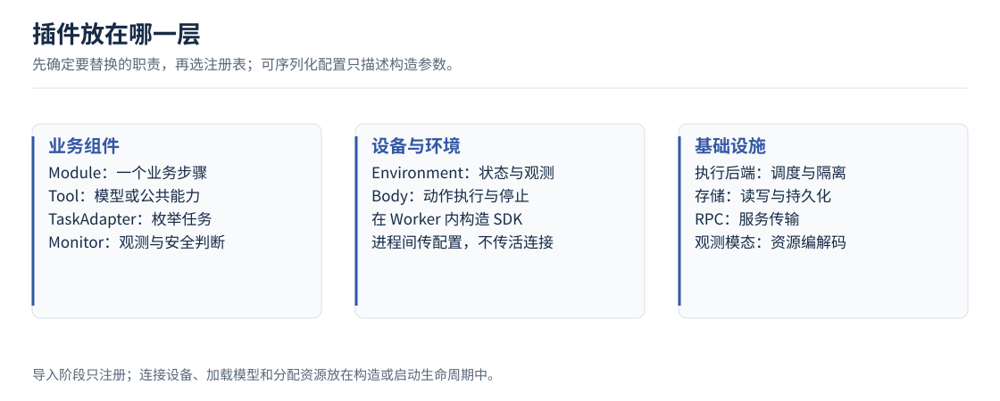

# 插件开发：Module、Tool、Body、Environment、Monitor 与 TaskAdapter

[English](plugin_development.md) · [**简体中文**](plugin_development.zh-CN.md)

策略、VLA、Evaluator 是 Module；模型、Memory、Skill 以及可复用外部能力是独立的 Tool；本体动作执行器是 Body；仿真/真机端点是 EnvironmentAdapter；需要持续观察环境或响应 Workflow 查询的合规检查器是 Monitor。六类业务 provider 分别进入自己的注册表和生命周期边界，都由主配置装配。插件只负责注册和实现自己的能力，不修改 Workflow、TaskQueue 或 Portal。执行后端、存储和流传输使用独立基础设施注册入口，详见[基础设施插件](infrastructure-plugins.zh-CN.md)。图 Module 的唯一输入是 `ctx`：参数从 `ctx.params` 读取，环境从 `robotenon.envs.environment` 单例调用。

## 1. Module 约定



```python
from robotenon.runtime.registry import register_module

@register_module(
    "my-policy",
    kind="policy",
    version="1.0.0",
    description="A resident policy",
)
class MyPolicy:
    def __init__(self, model_tool: str = "model_main"):
        self.model_tool = model_tool

    async def start(self):
        # ToolRuntime is bound before ModuleRuntime.start().
        if self.tools is None:
            raise RuntimeError("model ToolRuntime is required")

    async def run(self, ctx):
        # GraphRuntime 的所有输入都来自同一个 ctx
        timeout_ms = ctx.params.get("policy.action_timeout_ms", [int, 1000])
        # 环境不是 run() 参数；需要时调用进程单例：
        # from robotenon.envs import environment
        # feedback = await environment.observe()
        result = await ctx.call_tool(self.model_tool, {"prompt": str(ctx.inputs)})
        return {"action_plan": result.output}

    async def close(self):
        pass
```

`kind` 只用于发现和配置校验，Module 常见值有 `policy`、`vla`、`evaluator`、`safety`、`service`。模型、Memory、Skill 和工具类能力不要伪装成 Module，应注册到独立的 ToolRegistry。

### 调用形式

- 图节点必须实现 `async run(ctx)`：收到共享身份的 `GraphContext`，`ctx.values` 是节点私有工作区，`ctx.inputs`/`ctx.results` 只读；业务字段赋值由框架暂存并在成功时提交。
- 非图调用可额外实现 `async invoke(arguments, ModuleContext)`：由 `ModuleRuntime.call(name, arguments)` 调用。
- 当模块通过 `build_module_runtime(..., tools=tools)` 装配时，运行时会尽力把同一个
  `ToolRuntime` 绑定到模块的 `self.tools`；图节点和非图调用则始终通过 `ctx.tools`/
  `ModuleContext.tools` 注入。插件也可以实现 `set_tools(tools)` 做显式绑定。

模块的 `start()` 只做一次初始化，不能在每个 episode 重新加载权重或建立连接。

## 2. Body 注册与装配

Body 是小脑/本体服务，不是 Graph Module。它是接收 `ActionChunk` 的唯一动作边界，并且应在进程启动时构造、常驻和启动。注册实现需要提供 `start()`、`execute()`、`interrupt()`、`health()`、`close()` 五个方法：

```python
from robotenon.bodies import register_body

@register_body("my-body", kind="robot", version="1.0.0")
class MyBody:
    def __init__(self, *, endpoint: str, executor, safety_state=None):
        self.endpoint = endpoint
        self.executor = executor
        self.safety_state = safety_state

    async def start(self): ...
    async def execute(self, action_chunk): ...
    async def interrupt(self, reason, *, safe_action=None): ...
    async def health(self): ...
    async def close(self): ...
```

在 `body_configs.json` 中选择注册字符串。`params` 必须是 JSON，可序列化地描述端点、超时和驱动选项；无法序列化的 Python 对象（例如本地 SDK 的 `executor`、共享安全状态）通过 `runtime` 注入：

```json
{
  "config_version": 1,
  "plugin_bodies": ["my_robot.body"],
  "bodies": [
    {"id": "body_main", "name": "my-body", "kind": "robot", "params": {"endpoint": "192.0.2.8"}}
  ]
}
```

```python
from robotenon.runtime.factory import initialize_body_service

body = await initialize_body_service(
    loaded.bodies,
    runtime={"executor": robot_driver.send_action},
    safety_state=safety,
)
```

一个进程只应有一个启用的 Body；多个 enabled 配置必须通过 `body_id` 显式选择，否则启动失败。内置 `in-process`/`in_process` 适合本地驱动，`ipc`/`uds` 创建 `BodyServiceClient` 访问独立本体进程。GraphRuntime 仍通过 `body.execute` 调用它，Module 不直接持有驱动对象。

## 3. EnvironmentAdapter 注册与装配

EnvironmentAdapter 负责连接 RoboLab、RoboDojo、仿真器或自研硬件；它与 Body、Workflow、Monitor 是独立边界。Adapter 常驻，Session 按每次 Run 的 `SessionSpec` 创建：

```python
from robotenon.envs import register_environment

@register_environment("my-env")
class MyAdapter:
    descriptor = ...

    def __init__(self, *, endpoint: str):
        self.endpoint = endpoint

    async def connect(self): ...
    async def open(self, spec): ...
    async def close(self): ...
```

`envs_configs.json` 选择 Adapter 并导入 `plugin_environments`：

```json
{
  "config_version": 1,
  "plugin_environments": ["my_robot.env"],
  "environments": [
    {"id": "lab_a", "name": "my-env", "version": "1.0.0", "params": {"endpoint": "192.0.2.9"}}
  ]
}
```

```python
from robotenon.runtime.factory import initialize_environment_adapter
from robotenon.envs import bind_environment

adapter = await initialize_environment_adapter(loaded.environments)
session = await adapter.open(session_spec)
bind_environment(session)
```

`environment_registry.build()`/`get()` 对同一个注册字符串只构造一次；构造参数改变会被拒绝。Adapter 关闭由拥有它的 envs 服务负责，Run 结束时关闭 Session。Workflow、Monitor 和 Web 使用进程级 `environment` 单例或 EnvironmentService UDS Client；Module 仍然只收到 `ctx`。

## 4. 注册和配置

### 环境 Session 的通用参数

新环境的任务专用参数通过 `SessionSpec.parameters` 传递，Runner 不需要增加
suite、初始状态、场景布局等字段，也不解释这些字段的含义。默认值放在主配置：

```json
{
  "parameters": {
    "environment": {
      "parameters": {
        "suite": "libero_10",
        "init_state_id": 0,
        "settle_steps": 10
      }
    }
  }
}
```

TaskAdapter 为每个 TaskCase 设置
`parameters={"environment_parameters": {"init_state_id": trial_index}}`。
单次 Python 调用也可以传
`EpisodeRequest(environment_parameters={"settle_steps": 20})`。
优先级为配置（包含实验覆盖）→ TaskCase → EpisodeRequest；对象递归合并，
列表和标量整体替换，空对象不清空默认值。所有值应可 JSON 序列化。
其他 TaskCase 参数仍只进入 `ctx.params.task`，不自动传给环境。

既有规范字段最后写入：`task_env_id` 始终以 Runner 选择的环境 ID 为准；
已设置的 `task.split`、`environment.io` 和 `render` 参数覆盖同名透传值。
任务身份和 seed 仍使用 SessionSpec 的专用字段。`runtime.horizon` 是运行步数限制；
需要仿真器自身 horizon 的插件可显式传入环境参数 `horizon`。
EnvironmentAdapter 应消费自身参数并完成厂商参数名转换，不应把未识别的通用字段
直接传给仿真构造函数。上述 LIBERO 字段仅演示接口，并不表示已实现 LIBERO 插件。

生产入口使用一个主配置，而不是让各模块分别读取 JSON：

批量 API 支持 `ExperimentRequest(task_adapter_overrides={"adapter_id": {...}},
environment_parameters={...})`。TaskAdapter 覆盖按配置实例 ID 或注册名选择，
实例 ID 优先；覆盖值与构造参数递归合并。未知的显式目标会报错。
CLI 对应 `--batch --task-adapter-overrides '{"adapter_id":{"suite":"demo"}}'`
和 `--environment-parameters '{"init_state_id":3}'`。后者也支持单任务。
`--split` 接受插件定义的名称，由插件验证。
历史批量快捷参数（如 `--task-set`、`--num-trials`）由 provider 注册元数据 `cli_overrides` 声明接收；内置 RoboCasa365 已声明原有字段。
新插件使用显式覆盖或配置，不增加新的 Runner/CLI 专用参数。

外部插件可以放在独立可安装的 Python 包中，通过六类 `plugin_*` 配置导入，
无需编辑 `load_builtin_*`。Worker 使用的 Python 环境也必须能够导入该包。

```json
{
  "modules_config": "modules_configs.json",
  "graphs_config": "graphs.json",
  "tools_config": "tools_configs.json",
  "monitor_config": "monitor_configs.json",
  "body_config": "body_configs.json",
  "environments_config": "envs_configs.json",
  "parameters": {"policy": {"action_timeout_ms": 1000}}
}
```

```python
from robotenon.runtime.config import load_application_config

loaded = load_application_config("configs/config.json", "configs/experiments/demo.json")
timeout_ms = loaded.params.get("policy.action_timeout_ms", [int, 1000])
```

Parameter 模块负责解析、合并和类型校验；六个子配置的基础叶子 key 不能重复，实验层可以覆盖已有 key。`loaded.modules`、`loaded.graphs`、`loaded.tools`、`loaded.monitors`、`loaded.bodies` 和 `loaded.environments` 都来自同一个合并快照。

第三方包在启动前通过 `plugin_modules` 导入：

```json
{
  "config_version": 1,
  "plugin_modules": ["my_robot.plugins"],
  "modules": [
    {
      "id": "policy",
      "name": "my-policy",
      "version": "1.0.0",
      "kind": "policy",
      "params": {"checkpoint": "weights/policy.pt"}
    }
  ],
  "workflow": {
    "backend": "langgraph",
    "policy": "policy",
    "evaluator": "evaluator_main"
  }
}
```

启动：

```python
from robotenon.runtime.config import load_modules_config
from robotenon.runtime.factory import initialize_module_runtime

config = load_modules_config("configs/modules_configs.json")
runtime = await initialize_module_runtime(config)
policy = runtime.resolve("policy")
```

同一个注册字符串可以配置多个实例，但必须给每个实例不同 `id`；如果有多个实例，注册字符串别名会被关闭，调用时使用实例 ID。

## 5. Tool 约定（常驻能力）

统一 Runner 中 Tool 的寿命是 Worker，Module/Body/Environment/GraphContext 的寿命是任务。跨任务可保留模型和连接，不能保留旧任务的 ctx、feedback、观测 resolver 或会话缓存。实现可选清理钩子：

```python
async def end_session(self, session_id: str) -> None:
    self.session_cache.pop(session_id, None)
```

这是方法片段，`session_cache` 由插件初始化。关闭 Worker 时再通过 `close()` 释放共享资源。spawn 子进程应通过可导入插件重建对象，不能传活跃 socket、SDK、锁或 GPU tensor。外部模型服务的部署不由 Tool 常驻机制完成。


Tool 的职责是提供可复用能力，而不是决定 graph 的下一步。推荐实现 `async call(arguments, context)`，可选 `start/close` 生命周期；`ToolRuntime` 会在进程启动时构造每个配置实例一次，并在退出时逆序关闭。

```python
from robotenon.tools import ToolContext, ToolResult, register_tool

@register_tool(
    "my-vla-model",
    kind="model",
    version="1.0.0",
    description="Resident VLA inference provider",
)
class MyVLAModel:
    async def start(self):
        self.model = load_model("weights/vla.pt")

    async def call(self, arguments, context: ToolContext):
        output = await self.model(
            image=arguments.get("image"),
            instruction=arguments["instruction"],
        )
        return ToolResult(output=output)

    async def close(self):
        self.model = None
```

在 `configs/tools_configs.json` 中声明实例，`plugin_tools` 会在装配前导入注册模块：

```json
{
  "config_version": 1,
  "plugin_tools": ["my_robot.tools"],
  "tools": [
    {
      "id": "vla_main",
      "name": "my-vla-model",
      "kind": "model",
      "version": "1.0.0",
      "params": {"device": "cuda:0"}
    }
  ]
}
```

```python
from robotenon.runtime.config import load_tools_config
from robotenon.runtime.factory import initialize_tool_runtime

tools = await initialize_tool_runtime(load_tools_config("configs/tools_configs.json"))
result = await tools.call("vla_main", {"instruction": "pick the mug", "image": frame})
```

Graph Module 收到的 `ctx` 自动带有同一个 `ToolRuntime`，不应在模块内部重新加载模型或创建 Memory/Skill 连接：

```python
@register_module("planner", kind="policy")
class Planner:
    async def run(self, ctx):
        memory = await ctx.call_tool("memory_main", {"op": "search", "task_id": ctx.task_id})
        plan = await ctx.call_tool("vla_main", {
            "instruction": ctx.task_item.goal if ctx.task_item else "",
            "memory": memory.output,
        })
        return {"plan": plan.output}
```

内置工具包括：

- `model`：`echo`/`static` 后端，保证无模型依赖也能运行冒烟测试；
- `memory`：包装 `extensions.MemoryStore`，支持 `add` 和 `search`；
- `skill`：包装 `extensions.SkillRegistry`，支持 `heads`、`get`、`register`；
- `echo`：用于连接与上下文传递测试。

构造参数来自 `tools_configs.json` 的 `params`；如果同一个注册字符串配置多个实例，必须使用实例 ID 调用。Tool 的返回值可以是任意 JSON 兼容对象，也可以使用 `ToolResult(ok=False, error=...)` 返回可处理错误。Tool 不直接修改 TaskQueue，也不持有 env/body/monitor 连接。

## 6. Graph 模块

在 `configs/graphs.json` 中通过实例 ID 组图：

```json
{
  "graphs": [
    {
      "id": "pick",
      "entry": "plan",
      "nodes": [
        {"id": "plan", "type": "module", "module": "policy", "next": [{"node": "body_execute"}]},
        {"id": "body_execute", "type": "system", "operation": "body.execute", "predecessors": ["plan"], "next": [{"node": "observe"}]},
        {"id": "observe", "type": "system", "operation": "env.observe", "predecessors": ["body_execute"], "next": [{"node": "judge"}]},
        {
          "id": "judge",
          "type": "module",
          "module": "evaluator_main",
          "predecessors": ["observe"],
          "goto": [
            {"node": "plan", "when": "ctx.results['judge']['retry'] == true"}
          ],
          "default": "END"
        }
      ]
    }
  ]
}
```

初始输入用 `GraphContext(values=...)` 或 `run(initial_values=...)`，节点从只读 `ctx.inputs` 读取。
节点私有 `ctx.values` 在成功时发布到 `ctx.results[节点ID]`；读取其他节点结果必须声明对应依赖。
普通边需要源 next 和目标 predecessors 双向声明；回跳用 `goto: {"node": "plan", "when": "ctx.results['judge']['retry'] == true"}`，无需增加回边前驱。
静态参数仍放实例清单的 params。详细版本、生命周期和 checkpoint 规则见[节点私有上下文](node-private-context.zh-CN.md)。

## 7. EnvironmentAdapter 插件

```python
from robotenon.envs import EnvironmentSession, register_environment
from robotenon.schemas import EnvironmentFeedback, EnvironmentDescriptor, SessionSpec

@register_environment("my-robot")
class MyAdapter:
    descriptor = EnvironmentDescriptor(
        env_id="my-robot",
        display_name="My Robot",
        capabilities={"manipulation"},
        action_types={"cartesian_pose", "gripper"},
        observation_modalities={"rgb", "proprioception"},
        backend_kind="remote",
    )

    async def open(self, spec: SessionSpec) -> EnvironmentSession:
        return MySession(spec)

class MySession:
    async def reset(self, ctx) -> EnvironmentFeedback: ...
    async def close(self) -> None: ...
```

RoboLab、RoboDojo、仿真器或自研硬件的差异全部封装在 Adapter/Session 中。Adapter 在 `environment_registry` 中常驻，环境服务绑定到进程级 `environment` 单例；Session 按 Run 创建并由运行时绑定：

```python
from robotenon.envs import bind_environment, environment_registry

adapter = environment_registry.get("my-robot", endpoint="127.0.0.1:9000")
session = await adapter.open(session_spec)
bind_environment(session)
result = await graph_runtime.run("embodied_loop", ctx=ctx, body=body, monitor=monitor)
await session.close()
```

`EnvironmentService` 的图运行时边界是 `start()`、`reset(ctx)`、`observe()`、`command()`、`health()`、`close()`；动作统一由 BodyService 执行，Env 只提供环境反馈。环境不会作为 Module 输入或配置，也不会被嵌套 Graph 重复创建；模块通过 `await environment.observe()` 等方法使用当前服务，相机帧、点云、proprioception 等通过 `EnvironmentFeedback.observation` 写入 `ctx.feedback`。跨进程 Client 应由 `ServiceSupervisor` 统一探活和续租。

## 8. Evaluator 约定

Evaluator 是普通图 Module，可以返回 NodeResult/字典并通过 next 控制后继；需要表达通用决策和安全信号时可返回结构化 `EvaluationDecision`。下面是接口片段，所需类型须按项目接口导入：

```python
@register_module("my-evaluator", kind="evaluator")
class MyEvaluator:
    async def run(self, ctx):
        # GraphRuntime 图节点统一只接收 ctx
        decision = await self.evaluate(ctx.inputs["evaluation_input"])
        ctx.decision = decision
        return {"decision": decision}

    async def evaluate(self, item):
        return EvaluationDecision(
            session_id=item.session_id,
            decision=EvaluationDecisionType.CONTINUE,
            reason_code="ok",
            based_on_feedback_id=item.feedback.feedback_id,
            based_on_sequence_no=item.feedback.sequence_no,
            context_revision=item.context_revision,
            task_success=False,
            task_item_success=True,
            queue_operation=QueueOperation.NEXT,
        )

    async def invoke(self, arguments, context):
        return ModuleResult(ok=True, output=await self.evaluate(arguments["item"]))
```

安全结论填写 `safety_level`/`safety_signals`；P3/P4 进入共享安全状态，由 Body 中断与 Graph 安全检查处理；当前 Graph 不自动清空 TaskQueue，也不自动消费 queue_operation。Evaluator 不持有 SQLite 连接，也不直接调用 `next/clear/branch`。

## 9. Monitor 注册与双模式运行

Monitor 与 Environment/Body 是独立的服务边界。Monitor 插件使用独立注册表；同一个实例可以同时开启两种调用模式：

- `resident`：运行时启动一个常驻 asyncio 任务，按 `poll_hz` 调用 Environment 的 `observe()`，把结果发布到共享 `SafetyStateStore`；
- `request`：Workflow 通过 `MonitorRuntime.request()` 或 Graph 的 `monitor.request[.<monitor_id>]` 节点即时请求，返回 `MonitorReport`；不会额外构造插件实例。

### 9.1 插件实现

统一实现 `check(feedback, *, request, context)`；`request` 和 `context` 在常驻调用中分别为 `None`，在 Workflow 调用中携带请求载荷和 `GraphContext`。返回值可以是 `MonitorReport`、`SafetyLevel`、JSON 对象或 `bool`，运行时会归一化为 `MonitorReport`。

```python
from robotenon.monitors import MonitorContext, register_monitor
from robotenon.schemas import MonitorReport, SafetyLevel

@register_monitor(
    "workspace-collision",
    kind="safety",
    version="1.0.0",
    description="Checks the workspace on a timer and on demand",
)
class WorkspaceCollisionMonitor:
    def __init__(self, *, distance_m: float = 0.15):
        self.distance_m = distance_m
        self.check_count = 0

    async def check(self, feedback, *, request=None, context: MonitorContext | None = None):
        self.check_count += 1
        threshold = (request or {}).get("distance_m", self.distance_m)
        unsafe = bool(feedback and feedback.state.get("collision", False))
        return MonitorReport(
            session_id=feedback.session_id if feedback else None,
            compliant=not unsafe,
            safety_level=SafetyLevel.P3 if unsafe else SafetyLevel.P0,
            reason=f"distance_threshold={threshold}",
            source="workspace-collision",
        )
```

### 9.2 配置

`configs/monitor_configs.json` 通过注册字符串选择实例；`modes` 可以写一个或两个值。`kind` 只表示语义分类，不表示调用模式。

```json
{
  "config_version": 1,
  "plugin_monitors": ["my_robot.monitors"],
  "poll_hz": 20.0,
  "on_error_level": "P3",
  "monitors": [
    {
      "id": "collision_main",
      "name": "workspace-collision",
      "version": "1.0.0",
      "kind": "safety",
      "modes": ["resident", "request"],
      "poll_hz": 50.0,
      "on_error_level": "P3",
      "params": {"distance_m": 0.15}
    }
  ]
}
```

同一个注册字符串配置多个实例时必须使用不同 `id`；重复注册字符串的模糊别名会自动关闭。运行时会为每个实例建立一个调用锁，所以“双模式”共享权重、缓存和连接，但不会让两个检查协程同时进入同一插件。

### 9.3 启动、请求与 Graph 节点

```python
from robotenon.runtime.factory import initialize_monitor_runtime

monitor = await initialize_monitor_runtime(
    "configs/monitor_configs.json",
    environment_service=environment_service,
    safety_state=safety,
    params=loaded.params,
)
report = await monitor.request(
    "collision_main",
    {"distance_m": 0.10},
    feedback=ctx.feedback,
    context=ctx,
)
```

Graph 中可使用：

```json
{
  "id": "request_collision",
  "type": "system",
  "operation": "monitor.request.collision_main",
  "predecessors": ["observe"]
}
```

节点从 `ctx.inputs["monitor_request"]` 读取 JSON 请求载荷；不指定实例时使用 `monitor.request` 请求所有 request-capable 实例。返回报告会写入 `ctx.monitor_report` 并发布到 Workflow 所在进程的 SafetyStateStore；远程 MonitorServiceClient 也使用同一 RPC 方法。

## 10. Env / Body / Monitor 服务

这三个服务不注册到 `ModuleRuntime`；Body 和 Environment 分别通过
`BodyRegistry`、`EnvironmentRegistry` 选择实现：

- `EnvironmentService` 常驻持有一个仿真或真机 Session，提供 `start/reset/observe/command/health/close`。Workflow 和 Monitor 可以各自使用一个 client 请求同一个服务。
- `BodyService` 常驻持有本体驱动，接收 `ActionChunk`。实现 `InProcessBodyService` 时传入 `stop_executor` 和 `safe_action_factory`（或 `safe_action_factories={"P3": ..., "P4": ...}`）；前者在 watchdog 观察到 P3/P4 后请求底层停止，后者根据 `SafetyStateSnapshot.level` 返回自定义保护动作。
- Body 对每个 Action 返回 `BodyExecutionResult.action_results` 中的 `ActionExecution` ack；Action 的绝对 `deadline_ns`、相对 `timeout_ms` 或 Chunk `max_duration_ms` 到期时立即发送 stop、标记 `deadline_exceeded`，并不再发送后续 Action。stop 回调默认 0.5 秒超时，失败会升为锁存 P4。重试必须复用同一个 `idempotency_key`；去重范围为 session。
- 旧的 `MonitorService` 周期性调用独立的 Environment client，将 `MonitorReport` 写入 `SafetyStateStore`。新的 `MonitorRuntime` 通过注册表统一支持 resident/request 双模式；Workflow 可以在图中用 `monitor.check` 获取兼容检查、`monitor.latest` 读取最近结论，或使用 `monitor.request[.<id>]` 做按需检查。后台循环与图协作调度，同步阻塞插件仍可能阻塞共同的事件循环；默认读取失败按 P3 锁存，也可传 `on_error_level="P2"` 配合冗余监控。

envs 进程使用 `EnvironmentServiceServer`，Workflow/Monitor 通过 `EnvironmentServiceClient` 访问；Body 和 Monitor 同样使用各自的服务端/客户端协议。跨进程部署时所有进程用同一个 `SQLiteSafetyStateStore` 路径：

```python
safety = SQLiteSafetyStateStore("runs/safety.sqlite3")
monitor = SafetyMonitorService(env_client, safety_state=safety, poll_hz=20)
body = InProcessBodyService(
    driver.send_action,
    safety_state=safety,
    poll_hz=100,
    stop_executor=driver.stop_now,
    safe_action_factory=driver.safe_action_for,
    idempotency_db="runs/action-executions.sqlite3",
)
```

P3/P4 保护图和各等级恢复图在 `graphs.json` 的 `emergency_graphs`、`recovery` 字段中声明。`GraphRuntime.recover(..., approved=True)` 是唯一推荐的手动复位入口；恢复图、自检图和恢复后的 resume graph 都沿用原来的 `ctx`/服务引用。

若希望恢复逻辑常驻运行，可在服务进程中创建 `RecoveryController`。它按 `incident_id` 去重并限制每个事件的最大尝试次数；`mode="auto"` 自动执行，`mode="manual"` 先进入等待状态，现场确认后调用 `await controller.approve(incident_id)`。可用 `recovery_timeout_s` 限制一次恢复图的最长执行时间。

## 11. Metrics / Trace

模块和工具可以使用运行时注入的 `ctx.metrics` / `ctx.trace`（Tool 中是 `context.metrics` / `context.trace`）。客户端只入有界内存队列，配置的写入端负责持久化，可位于父进程或独立 daemon。不要把高基数 `run_id/session_id` 作为 Prometheus label；它们写入 WAL/Trace，用 Portal SQL 查询。完整的启用命令、低基数 label、Trace span 属性和 Observation Cache URI 约定见 [`docs/development-guide.md` 第 12.3/12.4 节](development-guide.zh-CN.md)。

以下为异步方法内的片段，`provider` 为已注入的推理对象。执行身份由运行时注入，插件不要另起 daemon 或覆写 attempt_id。有界缓冲在异常终止时可能丢失事件。

```python
if ctx.metrics is not None:
    ctx.metrics.counter(
        "policy_calls_total",
        labels={"metric_group": "policy", "mode": "vla"},
        scope="episode",
    )
if ctx.trace is not None:
    with ctx.trace.span("policy.inference", attributes={"model": "v1"}):
        output = await provider.infer(ctx.feedback)
else:
    output = await provider.infer(ctx.feedback)
```

## 12. 测试清单

插件至少覆盖：

1. 构造参数和版本校验；
2. `start/close` 只调用一次；
3. Action/Feedback session ID、序号和 schema 校验；
4. Graph 条件边、循环上限、嵌套图；
5. P3/P4 安全信号下不再发 Action；
6. Metrics/Trace 队列满载时不阻塞控制路径。

运行全部测试：

```bash
pytest
Tenon modules-check
Tenon tools-check
Tenon graphs-check
```


## 13. 接口与迁移约定

- 图插件推荐实现 `GraphModule.run(GraphContext) -> NodeResult`；`NodeResult.state_patch` 只更新当前节点的私有 values，`output` 写节点输出。不同节点的 state_patch 属于独立命名空间，可以使用同一个 key。
- `ModuleRuntime.call()` 对具备 invoke 的插件始终走 invoke；只有 run 的插件也收到 GraphContext，不再收到缺少 action_chunk 等字段的 ModuleContext。
- 编译器在启动前校验引用、插件 run 能力、前驱 DAG、条件表达式。edges 与 predecessors/next 不得混用。
- 读取 `ctx.current_node/current_graph/graph_stack` 获得当前任务的 ExecutionFrame；不要写这些调度字段。`ctx.scoped_outputs` 使用带图路径和激活编号的 JSON key，避免嵌套节点同名覆盖；旧 `outputs[node_id]` 保留最后值兼容视图。
- 普通 import 不注册全部内置插件、不创建数据库。使用 build_module_runtime/initialize_module_runtime 完成装配；若仅查询内置注册表，先调用 load_builtin_components()。
- 远程 reset/check 收到 ServiceContext（session/task/feedback/safety/values/context_revision），不包含调用栈、历史或调度游标。
- JSON Graph 会合并模块返回的 EvaluationDecision 安全结论；普通节点不会隐式修改外部队列或数据库。
- 需要恢复的动作模块必须使用稳定幂等键。Body 已成功持久化的 ack 可用于重试去重；物理动作完成但 ack 尚未落盘时，需要驱动层对账，不能视为 exactly-once。

## 14. TaskAdapter 与进程插件

TaskAdapter 负责枚举 TaskCase 并执行单个 case，不负责写全局实验状态。清单顺序定义枚举顺序，进程模式允许乱序完成；父进程负责确定性归并。任务输出路径必须唯一，重试使用新的 attempt 子目录。

自定义 Adapter 必须通过可导入模块注册，并在子进程重建运行依赖。任务输入、配置和结果遵守序列化边界，不把已连接的机器人或仿真器从父进程传给 Worker。资源 ID 是互斥标识，不会自动路由驱动地址。

插件测试应增加连续两次任务的状态隔离、end_session 清理、spawn 导入、取消、失败清理和独占资源冲突。参考 `tests/test_execution_backends.py`、`tests/test_worker_faults.py`、`tests/test_observability_runtime.py`。具体配置见[执行与统一观测](execution-and-observability.zh-CN.md)，安装命令见[快速上手](quickstart.zh-CN.md)。

Tool 还可声明 `deployment`，由 Worker 管理模型进程；Xiaomi/Qwen 已支持端点回填。自定义 Tool 实现 `bind_deployment(host, port, model_path)`，GPU 编号为 Worker 内局部编号，详见[Worker 模型部署](worker-model-deployment.zh-CN.md)。

完整组件导览与可执行例子见[模块使用手册](module-guide.zh-CN.md)；Evaluator/Monitor 的区别、停止范围及 TaskQueue 的实际接入状态见[专题说明](evaluation-monitoring-and-task-queue.zh-CN.md)。
