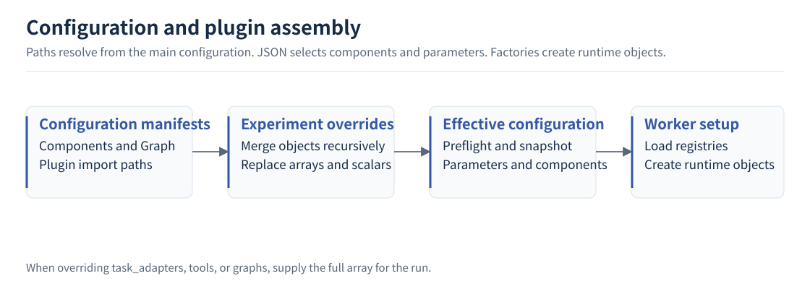

# 01 First run

[**English**](01-first-run.md) · [简体中文](01-first-run.zh-CN.md)

Run a local task on the CPU and inspect the configuration it uses. The example requires no model service or robot.

## Set up Python

Open a terminal at the repository root. Check that `pyproject.toml`, `robotenon/`, and `configs/` are present. The commands below use Python 3.10 or later on Linux or macOS.

```bash
python3 --version
python3 -m venv .venv
source .venv/bin/activate
python -m pip install -e '.[dev]'
python -c 'import sys, robotenon; print(sys.executable); print(robotenon.__file__)'
```

The last command should show the interpreter in the new virtual environment and the `robotenon` package in this checkout. In a new terminal, run `source .venv/bin/activate` first.

The `dev` extra installs pytest, Ruff, and Mypy. Model services, simulators, and device drivers have their own installation instructions.

## Run a fake task

```bash
mkdir -p runs/tutorial
Tenon run-fake --config configs/config.json \
  --output runs/tutorial | tee runs/tutorial/result.json
```

Look for these two fields in the output:

```json
{
  "success": true,
  "workflow_status": "completed"
}
```

`session_id` identifies the environment session, `steps` counts Graph steps, and `final_sequence_no` is the sequence number of the last environment feedback. A Graph step can perform work other than a robot action.

The command loads the built-in modules and tools, runs the workflow in the fake environment, and closes the services. It writes JSON to standard output. This example uses `tee` to save it to `runs/tutorial/result.json`. The Portal lists batch experiments, so this smoke test has no entry there.

## Read the configuration



Open [configs/config.json](../../configs/config.json). The configuration references component manifests and sets runtime parameters.

| Setting | Purpose |
| --- | --- |
| Component manifests, including `modules_config` and `tools_config` | Select components and register plugins |
| `graphs_config` | Define nodes, routing, inputs, and outputs |
| `parameters` | Set parameters for modules and execution |
| `safety_state` and `observation_cache` | Configure safety state and observation storage |

Manifest paths resolve against the directory containing the main configuration. Runtime resources have their own path rules. When changing output locations, check the safety database, memory store, and observation cache as well.

Validate each group with the CLI:

```bash
Tenon modules-check --config configs/config.json
Tenon tools-check --config configs/config.json
Tenon graphs-check --config configs/config.json
Tenon monitors-check --config configs/config.json
```

A `"status": "ok"` result means the manifest can be parsed and its components assembled. Validation imports custom plugins. Keep their import-time code limited to registration.

## Apply experiment overrides

[configs/experiments/demo.json](../../configs/experiments/demo.json) changes `runtime.profile` to `demo` and `policy.action_timeout_ms` to `750`. Inspect the merged settings:

```bash
python - <<'PY'
from robotenon.runtime.config import load_application_config

loaded = load_application_config(
    "configs/config.json", "configs/experiments/demo.json"
)
print(loaded.params.get("runtime.profile", [str, None]))
print(loaded.params.get("policy.action_timeout_ms", [int, None]))
PY
```

Expected output:

```text
demo
750
```

Run with the same overrides:

```bash
Tenon run-fake --config configs/config.json \
  --experiment-config configs/experiments/demo.json \
  --output runs/tutorial/override
```

Object fields merge recursively. Arrays and scalars are replaced as a unit. Supply the entire list when overriding `tools` or `graphs`.

## Verify the installation

```bash
python -m pytest -q tests/test_components.py tests/test_graph_runtime.py
```

These checks cover the core components and Graph. Use `python -m pytest -q` for the full regression suite. Frontend tests also require Node.js.

Run the same CPU experiment from the [CLI](cli-experiments.md) or the [Portal](03-portal.md), then [inspect its results](view-results.md). Continue to the [first simulation](02-first-simulation.md) after installing the model and simulator dependencies, or [write a module](04-custom-module.md) to extend the graph.
