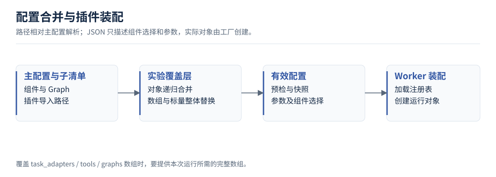

# 01 首次运行

[English](01-first-run.md) · [**简体中文**](01-first-run.zh-CN.md)

本教程完成一次不依赖 GPU、模型服务或机器人的运行，并说明配置如何生效。

## 准备 Python 环境

在仓库根目录打开终端，确认能看到 `pyproject.toml`、`robotenon/` 和 `configs/`。使用 Python 3.10 或更高版本；下列命令适用于 Linux/macOS。

```bash
python3 --version
python3 -m venv .venv
source .venv/bin/activate
python -m pip install -e '.[dev]'
python -c 'import sys, robotenon; print(sys.executable); print(robotenon.__file__)'
```

最后一条命令应显示刚创建的虚拟环境解释器，以及当前仓库中的 `robotenon` 包。以后重新打开终端时，先执行 `source .venv/bin/activate`。

`dev` 包含 pytest、Ruff 和 Mypy。模型服务、仿真器和设备驱动不在核心安装中。

## 跑一次 Fake 任务

```bash
mkdir -p runs/tutorial
Tenon run-fake --config configs/config.json \
  --output runs/tutorial | tee runs/tutorial/result.json
```

检查输出中的两个字段：

```json
{
  "success": true,
  "workflow_status": "completed"
}
```

`session_id` 是本次环境会话，`steps` 是 Graph 执行步数，`final_sequence_no` 是最后一条环境反馈的序号。Graph 步数不等于机器人动作次数。

这条命令装配内置模块和工具，在 Fake 环境中执行工作流，然后关闭服务。输出 JSON 写到标准输出；示例通过 `tee` 保存到 `runs/tutorial/result.json`。它不创建正式批量实验记录，因此 Portal 实验列表中不会出现这一条 Fake 冒烟。

## 看懂主配置



打开 [configs/config.json](../../configs/config.json)。主配置主要包含两部分：

| 配置项 | 用途 |
| --- | --- |
| `modules_config`、`tools_config` 等子清单 | 选择组件和注册插件 |
| `graphs_config` | 定义节点、路由及输入输出 |
| `parameters` | 给模块和执行层提供运行参数 |
| `safety_state`、`observation_cache` | 配置安全状态和观测资源 |

子清单路径相对主配置文件所在目录解析。不同类型的运行资源有自己的路径规则；改输出位置时同时核对安全库、记忆库和观测缓存配置。

先用 CLI 检查这些组合：

```bash
Tenon modules-check --config configs/config.json
Tenon tools-check --config configs/config.json
Tenon graphs-check --config configs/config.json
Tenon monitors-check --config configs/config.json
```

返回 `"status": "ok"` 表示对应清单可以解析并装配。自定义插件会在检查时导入，因此插件的导入阶段应只完成注册。

## 使用实验覆盖层

[configs/experiments/demo.json](../../configs/experiments/demo.json) 将 `runtime.profile` 改为 `demo`，将 `policy.action_timeout_ms` 改为 `750`。查看合并结果：

```bash
python - <<'PY'
from robotenon.runtime.config import load_application_config

loaded = load_application_config(
    "configs/config.json", "configs/experiments/demo.json"
)
print(loaded.params.get("runtime.profile", [str, None]))
print(loaded.params.get("policy.action_timeout_ms", [int, None]))
PY
```

预期输出：

```text
demo
750
```

用同一覆盖层运行：

```bash
Tenon run-fake --config configs/config.json \
  --experiment-config configs/experiments/demo.json \
  --output runs/tutorial/override
```

对象字段递归合并，数组和标量整体替换。尤其要注意：覆盖 `tools` 或 `graphs` 数组时，需要保留完整的目标清单。

## 检查安装结果

```bash
python -m pytest -q tests/test_components.py tests/test_graph_runtime.py
```

这是核心组件和 Graph 的验证入口。完整回归使用 `python -m pytest -q`；前端测试另外需要 Node.js。

下一步用[命令行](cli-experiments.zh-CN.md)或 [Portal](03-portal.zh-CN.md)跑同一份正式 CPU 实验，再按[结果教程](view-results.zh-CN.md)查看产物。准备好模型和仿真依赖后进入[首次仿真](02-first-simulation.zh-CN.md)；开发节点可读[自定义模块](04-custom-module.zh-CN.md)。
