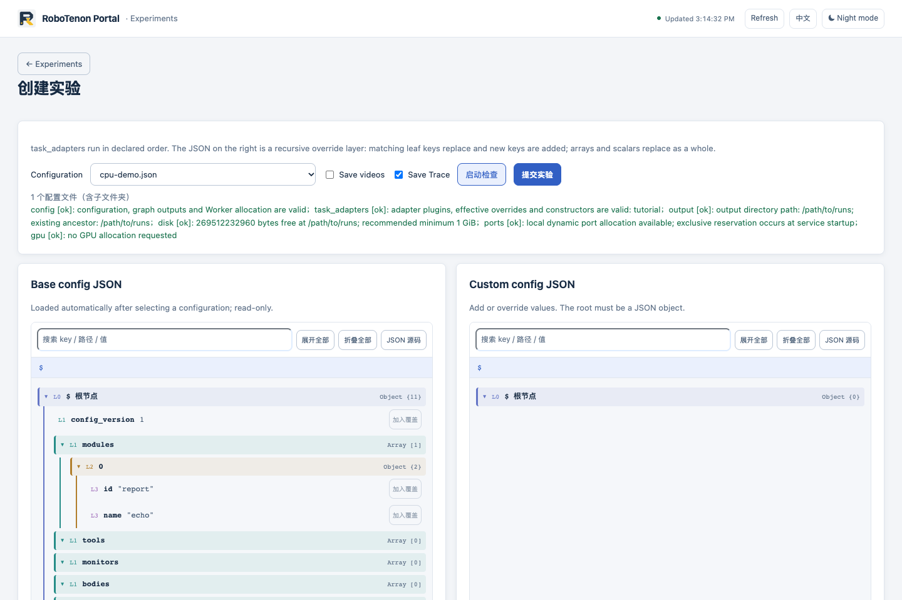
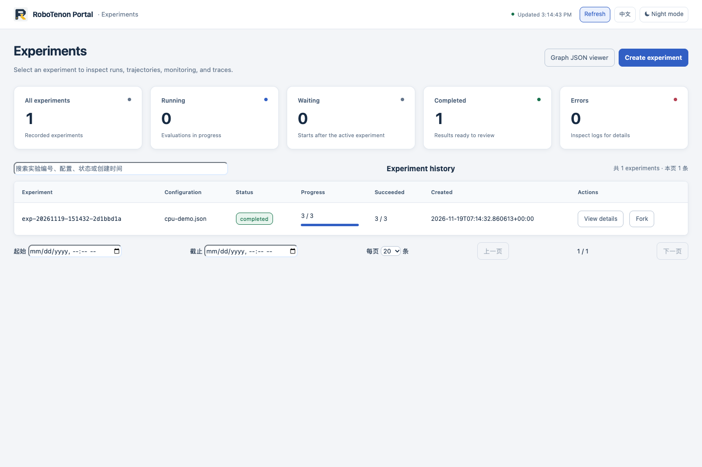
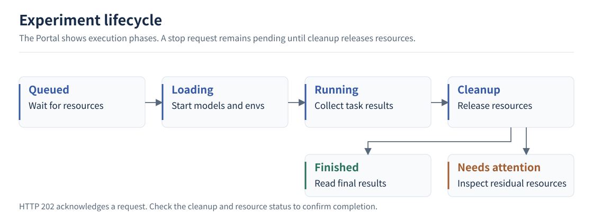
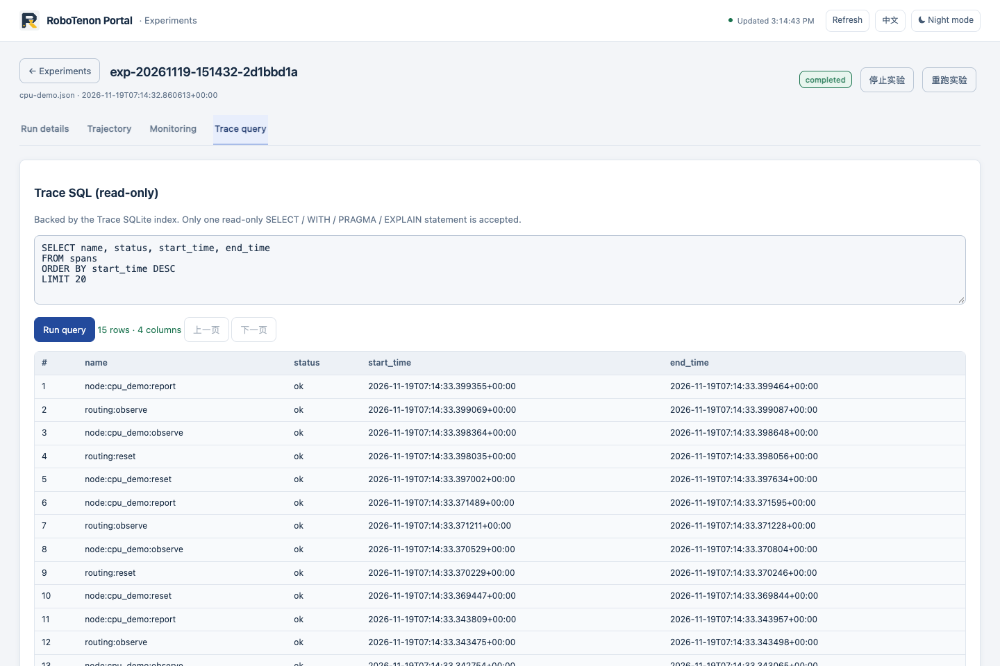

# 03 Web Portal

[**English**](03-portal.md) · [简体中文](03-portal.zh-CN.md)

Submit a CPU experiment from the Portal, then inspect its tasks, nodes, traces, and media. Use the environment from [First run](01-first-run.md). The same example is available through the [CLI](cli-experiments.md) and the [Python API](python-api.md).

The screenshots show a completed CPU experiment in the Portal. Diagrams are labeled separately. This example checks fake-environment readiness and produces no robot motion or camera frames.

## 1. Start the Portal

Run this command from the repository root in the environment where RoboTenon is installed:

```bash
Tenon web \
  --host 127.0.0.1 --port 8765 \
  --project-root . --config-root docs/tutorials/examples \
  --experiment-output-root data/tutorial/portal \
  --run-root data/tutorial/portal \
  --no-auto-grafana
```

Open <http://127.0.0.1:8765/> and leave the terminal running. The experiment list is empty on the first launch.

- `--config-root` sets the configuration directory shown in the selector. This example contains only `cpu-demo.json`.
- `--experiment-output-root` stores experiments submitted from the Portal. Use the same directory on subsequent launches to see previous runs.
- Child processes use the Python interpreter that launched the Portal by default. To select another interpreter, add `--experiment-python /path/to/environment/bin/python`.
- `--no-auto-grafana` starts only the Portal and skips metrics dashboard setup.

## 2. Submit the experiment

1. Choose **Create experiment** and select `cpu-demo.json`.
2. Leave the custom configuration at `{}`. The base configuration is on the left, the override on the right, and the merged preview below. Use **JSON source** to edit the JSON directly.
3. Select **Save trace** and leave **Save video** unchecked.
4. Choose **Preflight** and check that no item reports `error`.
5. Choose **Submit experiment** to open its details.



The example runs three short tasks. Temporary directories, experiment IDs, and timestamps differ across runs. Preflight checks the configuration and selected resources. The model and device report readiness during startup.

## 3. Inspect run status

Return to **Experiments**. On completion, the progress should read `3 / 3`, the success count `3 / 3`, and the status `completed`.



| Phase or status | Meaning | Where to look |
| --- | --- | --- |
| Queued | Waiting for earlier experiments and available resources | Experiment list |
| Loading | Starting workers, models, or the environment | Run details and experiment log |
| Running | Executing tasks | Progress, trajectories, and traces |
| Cleaning up | Releasing processes and resources | Run details and stop progress |
| Needs attention | Automatic cleanup was incomplete or another issue needs intervention | Error details and remaining resources |
| Terminal status such as `completed` | Execution has ended | Check total successes and individual task results |



For this example, success means the fake environment passed its readiness check. In a real experiment, a completed run can include tasks whose goals were unmet.

## 4. Inspect tasks, nodes, and traces

Open **Details** and use the following views:

| Tab | What to check |
| --- | --- |
| Run details | Configuration, output directory, effective parameters, and the `cpu_demo` Graph |
| Trajectories | Select adapter `tutorial`, then the task row for `cpu-demo`. The right pane should show three completed nodes, `reset`, `observe`, and `report`. |
| Metrics | Recorded metrics. This example produces no model or action performance metrics. |
| Trace query | Run the SQL below to find the node and route spans. |

```sql
SELECT name, status, start_time, end_time
FROM spans
ORDER BY start_time DESC
LIMIT 20
```



The CPU example produces no camera video. Empty observation panes or undecodable entries such as `trace_db` are expected. Use task results and traces for this example. For media prerequisites, result fields, and queries, see [Inspect experiment results](view-results.md).

## 5. Switch to RoboCasa

Follow [Use extensions](extensions.md) to install `robotenon-robocasa365` and [Demo resources](download-data.md) to prepare assets and models. Complete the setup in [First simulation](02-first-simulation.md). Then start a Portal pointed at the extension configuration directory. Use a second terminal and a different port to keep both Portals running:

```bash
Tenon web \
  --host 127.0.0.1 --port 8767 \
  --project-root . --config-root extensions/benchmarks/robocasa365/configs \
  --experiment-output-root data/tutorial/simulation-portal \
  --run-root data/tutorial/simulation-portal \
  --no-auto-grafana
```

Open <http://127.0.0.1:8767/>, select `generated config.json`, and enter the override below as custom JSON. Adjust the model paths for your installation:

```json
{
  "parameters": {
    "model": {"path": "/path/to/Xiaomi-Robotics-1-RoboCasa365"},
    "runtime": {"horizon": 64}
  },
  "task_adapters": [
    {
      "id": "robocasa365",
      "name": "robocasa365",
      "kind": "dataset",
      "params": {"task_set": "all_tasks", "max_tasks": 1, "num_trials": 1}
    }
  ]
}
```

This override runs one trial of one task. Review the preflight results and select **Save video** and **Save trace** as needed. Supply the entire `task_adapters` array when overriding any entry.

The generic `configs/config.json` configuration is a component smoke test with no batch task collection to submit. For hardware, select your site's integrated device configuration. See [Physical robot deployment](real-robot.md).

## 6. Stop, rerun, or fork

- **Stop experiment / task** submits a stop request. Follow cleanup progress until the process exits.
- **Rerun** uses the original configuration and updates the selected task results. Check the experiment, adapter, and task selection first.
- **Fork experiment** creates a new experiment from the original configuration, for example to compare a different parameter value.

Task selection and filtering apply to the current page. Closing the browser or Portal leaves the experiment running. Use the stop control and confirm that cleanup has released resources before shutting down the service. On hardware, verify the physical stop separately as described in [Physical robot deployment](real-robot.md).

## 7. CLI results and remote access

The CLI's `observability.json` output can back a read-only query API. That run remains separate from the Portal's experiment list. See [Query CLI results](cli-experiments.md#5-query-results-over-read-only-http).

Leave the remote Portal bound to the loopback interface and forward its port over SSH:

```bash
ssh -N -L 18765:127.0.0.1:8765 user@server
```

Replace `user@server` with your server address and open <http://127.0.0.1:18765/> locally. Listening on an external interface requires `ROBOTENON_PORTAL_TOKEN` and the corresponding access settings. See [Access controls](../execution-and-observability.md#64-full-portal-access-boundaries).

If a page is empty, check the output directory, time range, and launch mode, then consult [Troubleshooting](../troubleshooting.md).
