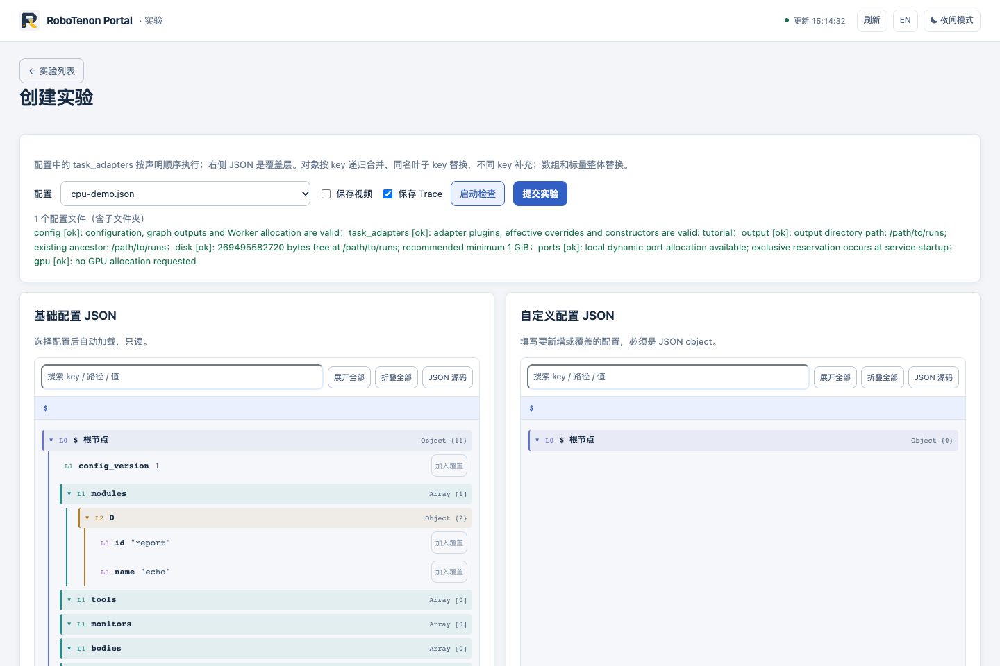
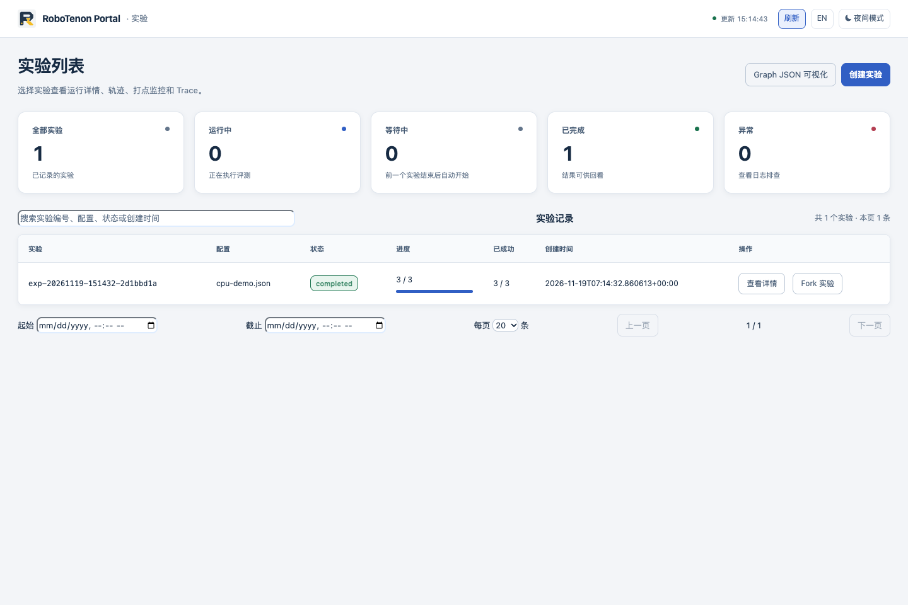
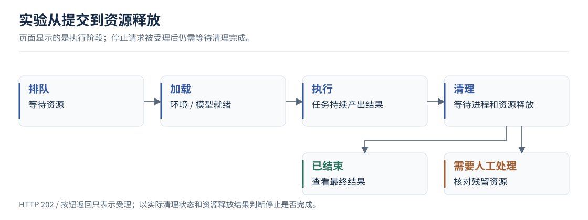
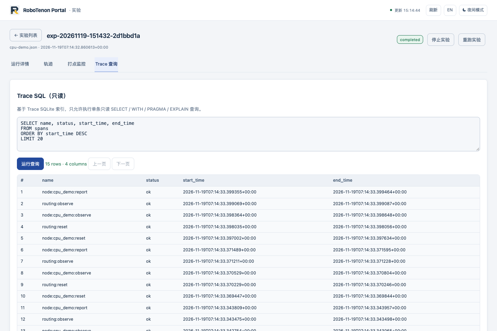

# 03 Web Portal 可视化教程

[English](03-portal.md) · [**简体中文**](03-portal.zh-CN.md)

本教程说明 RoboTenon 的 Web 可视化方式：从网页提交一个 CPU 示例，再查看实验、任务、节点、Trace 和媒体。安装要求与[首次运行](01-first-run.zh-CN.md)相同，不需要先装仿真器或模型。命令行使用同一示例的步骤见[命令行运行实验](cli-experiments.zh-CN.md)，在代码中调用见 [Python API](python-api.zh-CN.md)。

文中的截图来自当前 Portal 上实际完成的 CPU 实验，示意图另行标注。CPU 示例只检查 Fake 环境就绪，没有机器人动作和相机画面。

## 1. 启动教程 Portal

在仓库根目录、已安装框架的 Python 环境中执行：

```bash
Tenon web \
  --host 127.0.0.1 --port 8765 \
  --project-root . --config-root docs/tutorials/examples \
  --experiment-output-root data/tutorial/portal \
  --run-root data/tutorial/portal \
  --no-auto-grafana
```

打开 <http://127.0.0.1:8765/>，保持启动终端运行。第一次打开时实验列表为空。

- `--config-root` 决定配置选择器可见的目录；本例只有 `cpu-demo.json`。
- `--experiment-output-root` 保存 Portal 提交的实验；再次启动时使用同一目录才能继续看到这些记录。
- 子进程默认使用启动 Portal 的 Python。需要其他解释器时加 `--experiment-python /path/to/environment/bin/python`。
- `--no-auto-grafana` 让本例只启动 Portal，不自动准备指标面板。

## 2. 创建并提交实验

1. 点击 **创建实验**，选择 `cpu-demo.json`。
2. 自定义配置保持 `{}`。左侧是基础配置，右侧是覆盖层，下方是合并预览；需要直接编辑 JSON 时使用 **JSON 源码**。
3. 勾选 **保存 Trace**，不勾选“保存视频”。
4. 点击 **启动检查**，确认检查项没有 `error`。
5. 点击 **提交实验**，页面进入详情。



本例运行三个任务，通常很快完成。截图中的临时目录、实验编号和时间会与本机不同。预检检查配置和部分资源条件；模型或设备配置还需在实际启动阶段确认就绪。

## 3. 查看运行状态

返回 **实验列表**。完成后应看到进度 `3 / 3`、已成功 `3 / 3`，状态为 `completed`。



| 状态或阶段 | 含义 | 检查入口 |
| --- | --- | --- |
| 排队 | 等待前序实验和可用资源 | 实验列表 |
| 加载 | 启动 Worker、模型或环境 | 运行详情、实验日志 |
| 执行 | 正在运行任务 | 进度、轨迹、Trace |
| 清理 | 回收进程和资源 | 运行详情、停止进度 |
| 需要人工处理 | 自动清理未完成等异常 | 错误信息、残留资源 |
| `completed` 等结束状态 | 执行已经结束 | 再检查成功数量和每条任务结果 |



本例的“成功”仅表示 Fake 环境就绪检查通过。真实实验即使正常结束，也可能有未完成目标的任务。

## 4. 查看任务、节点和 Trace

点击 **查看详情**，按照下面的顺序浏览：

| 标签页 | 本例怎么查看 |
| --- | --- |
| 运行详情 | 核对配置、输出目录、有效参数和 `cpu_demo` Graph |
| 轨迹 | 选择 `tutorial` Adapter，再点击 `cpu-demo` 的任务行；右侧应有 `reset`、`observe`、`report` 三个完成的节点 |
| 打点监控 | 查看实际产生的指标；本例没有模型或动作性能指标 |
| Trace 查询 | 执行下方 SQL，确认存在节点与路由 span |

```sql
SELECT name, status, start_time, end_time
FROM spans
ORDER BY start_time DESC
LIMIT 20
```



CPU 示例没有可播放的相机录像。观测区域出现空白或 `trace_db` 等无法解码项时，不要当作真实相机故障；本例以任务结果和 Trace 为准。视频与图像的查看前提、结果字段和查询示例见[查看实验结果](view-results.zh-CN.md)。

## 5. 换成 RoboCasa 仿真

先按[使用 extensions](extensions.zh-CN.md)安装 `robotenon-robocasa365`，按[Demo 数据与模型下载](download-data.zh-CN.md)准备 RoboCasa 资产和模型，再完成[首次仿真](02-first-simulation.zh-CN.md)的环境与模型准备。然后启动一个使用 extension 配置目录的 Portal。另开终端、使用不同端口可以与教程 Portal 并存：

```bash
Tenon web \
  --host 127.0.0.1 --port 8767 \
  --project-root . --config-root extensions/benchmarks/robocasa365/configs \
  --experiment-output-root data/tutorial/simulation-portal \
  --run-root data/tutorial/simulation-portal \
  --no-auto-grafana
```

打开 <http://127.0.0.1:8767/>，选择 `generated config.json`，在自定义 JSON 中使用下列覆盖层。模型路径需要替换为本机位置：

```json
{
  "parameters": {
    "model": {"path": "/path/to/Xiaomi-Robotics-1-RoboCasa365"},
    "runtime": {"horizon": 64}
  },
  "task_adapters": [
    {
      "id": "robocasa365",
      "name": "robocasa365",
      "kind": "dataset",
      "params": {"task_set": "all_tasks", "max_tasks": 1, "num_trials": 1}
    }
  ]
}
```

这份覆盖层只运行一个任务、一次试验。确认启动检查结果后，按需要勾选“保存视频”和“保存 Trace”。`task_adapters` 数组整体替换，不能只填写数组中想改动的一小项。

通用 `configs/config.json` 用于组件冒烟，没有可提交的批量任务集合。真机必须选择已经完成设备接入的站点配置，见[真机部署](real-robot.zh-CN.md)。

## 6. 停止、重跑和 Fork

- **停止实验 / 任务**：提交后观察清理进度，请求已受理不代表进程已退出。
- **重跑**：使用原配置，更新所选任务的结果；操作前核对实验、Adapter 和任务范围。
- **Fork 实验**：基于原实验配置创建新实验，适合修改参数做对照。

任务勾选和筛选受分页范围影响。关闭浏览器或 Portal 不等于停止实验；先通过停止操作确认实验与资源结束，再关闭服务。设备上的物理停止还必须按[真机部署](real-robot.zh-CN.md)单独确认。

## 7. CLI 结果与远程访问

CLI 的 `observability.json` 可用于启动只读查询 API，但不会因此进入本 Portal 的实验列表。完整命令见[只读查询 CLI 数据](cli-experiments.zh-CN.md#5-通过只读-http-接口查看数据)。

服务器上的 Portal 可以继续监听回环地址，在本地电脑建立 SSH 转发：

```bash
ssh -N -L 18765:127.0.0.1:8765 user@server
```

把 `user@server` 替换为实际地址，本地浏览器打开 <http://127.0.0.1:18765/>。直接对外监听时需要 `ROBOTENON_PORTAL_TOKEN` 和相应访问配置，见[访问边界](../execution-and-observability.zh-CN.md#64-完整-portal-的访问边界)。

页面没有数据时先核对输出目录、时间范围和启动模式，再按[常见问题](../troubleshooting.zh-CN.md)检查。
