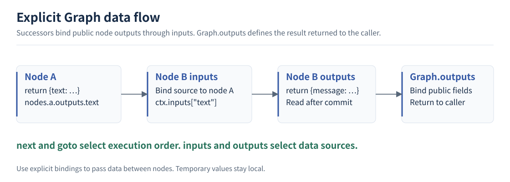

# 04 Write a custom module

[**English**](04-custom-module.md) · [简体中文](04-custom-module.zh-CN.md)

Create two modules, bind the output of the first to the input of the second, and read the Graph's public result. Complete the installation in [First run](01-first-run.md). This example runs without an environment, model, or robot.

## Build a runnable Graph

Create `my_graph.py` at the repository root:

```python
import asyncio
import json

from robotenon.contracts.context import GraphContext
from robotenon.modules import ModuleRuntime
from robotenon.modules.base import BaseModule
from robotenon.runtime.registry import register_module
from robotenon.runtime.safety import SafetyStateStore
from robotenon.workflow import GraphRuntime
from robotenon.workflow.definition import GraphDefinition


@register_module("tutorial-greeting", kind="demo")
class Greeting(BaseModule):
    async def run(self, ctx):
        return {"message": "Hello, " + ctx.inputs["name"]}


@register_module("tutorial-check", kind="demo")
class CheckGreeting(BaseModule):
    async def run(self, ctx):
        message = ctx.inputs["message"]
        return {"success": message.startswith("Hello, "), "message": message}


async def main():
    graph = GraphDefinition.model_validate({
        "id": "tutorial",
        "entry": "greet",
        "nodes": [
            {
                "id": "greet",
                "module": "greeting",
                "inputs": {"name": "inputs.name"},
                "next": "check",
            },
            {
                "id": "check",
                "module": "checker",
                "predecessors": ["greet"],
                "inputs": {"message": "nodes.greet.outputs.message"},
            },
        ],
        "outputs": {
            "success": "nodes.check.outputs.success",
            "message": "nodes.check.outputs.message",
        },
    })
    modules = ModuleRuntime({"greeting": Greeting(), "checker": CheckGreeting()})
    runtime = GraphRuntime([graph], modules, safety_state=SafetyStateStore())
    await modules.start()
    try:
        result = await runtime.run(
            "tutorial", ctx=GraphContext(values={"name": "RoboTenon"})
        )
        if not result.success:
            raise RuntimeError(result.error)
        print(json.dumps(dict(result.outputs), ensure_ascii=False))
    finally:
        await modules.close()


if __name__ == "__main__":
    asyncio.run(main())
```

Run the script:

```bash
python my_graph.py
```

Expected output:

```json
{"success": true, "message": "Hello, RoboTenon"}
```

## Names and IDs



| Name | Example | Purpose |
| --- | --- | --- |
| Registered name | `tutorial-greeting` | Resolves the plugin class when loading configuration |
| Module instance ID | `greeting` | Referenced by the Graph's `module` field |
| Graph node ID | `greet` | Identifies workflow dependencies and result references |
| Public output name | `message` | Identifies a result that callers can read |

`ctx.inputs` contains the node's declared, read-only inputs. The dictionary returned by the module becomes its output. The successor reads it through `nodes.greet.outputs.message`.

`next` and `predecessors` specify execution order. `inputs` specifies the data source. A data binding alone does not make the runtime wait for an upstream node.

`result.success` indicates successful Graph execution. `result.outputs["success"]` is the business result declared by this Graph. The experiment entry point requires a public `outputs.success` field so it can distinguish a missing result interface from a failed task.

## Assemble the modules from configuration

The example constructs `ModuleRuntime` directly. A module manifest can create the same two instances:

```json
{
  "plugin_modules": ["my_graph"],
  "modules": [
    {"id": "greeting", "name": "tutorial-greeting", "kind": "demo"},
    {"id": "checker", "name": "tutorial-check", "kind": "demo"}
  ]
}
```

Save the manifest as `configs/tutorial_modules.json` and check plugin registration and instance configuration:

```bash
Tenon modules-check --config configs/tutorial_modules.json
```

Put `my_graph.py` in the repository root where the active Python interpreter can import it. The `if __name__ == "__main__"` guard allows import-time registration without running the Graph. Package production plugins separately and install the same version on each Worker.

See [Explicit Graph data](../explicit-graph-data.md) for business inputs and outputs, [Node-private context](../node-private-context.md) for state isolation, and [Plugin development](../plugin_development.md) for tool and device lifecycles.
