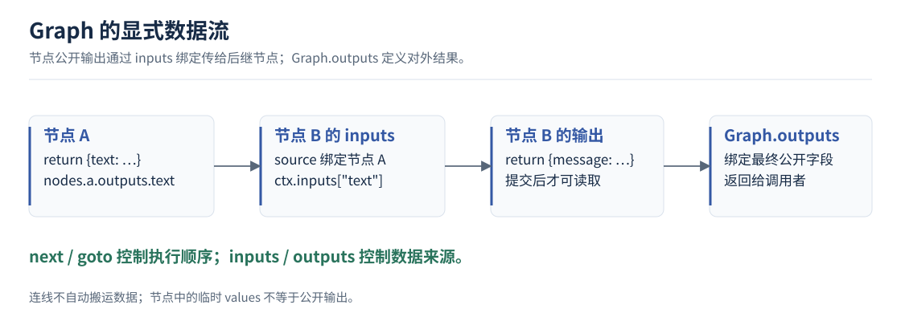

# 04 第一个自定义模块

[English](04-custom-module.md) · [**简体中文**](04-custom-module.zh-CN.md)

本教程创建两个 Module，使用显式输入映射连接它们，再从 Graph 的公开输出读取结果。无需环境、模型或机器人。先完成[首次运行](01-first-run.zh-CN.md)中的安装。

## 写一个可运行的 Graph

在仓库根目录新建 `my_graph.py`：

```python
import asyncio
import json

from robotenon.contracts.context import GraphContext
from robotenon.modules import ModuleRuntime
from robotenon.modules.base import BaseModule
from robotenon.runtime.registry import register_module
from robotenon.runtime.safety import SafetyStateStore
from robotenon.workflow import GraphRuntime
from robotenon.workflow.definition import GraphDefinition


@register_module("tutorial-greeting", kind="demo")
class Greeting(BaseModule):
    async def run(self, ctx):
        return {"message": "Hello, " + ctx.inputs["name"]}


@register_module("tutorial-check", kind="demo")
class CheckGreeting(BaseModule):
    async def run(self, ctx):
        message = ctx.inputs["message"]
        return {"success": message.startswith("Hello, "), "message": message}


async def main():
    graph = GraphDefinition.model_validate({
        "id": "tutorial",
        "entry": "greet",
        "nodes": [
            {
                "id": "greet",
                "module": "greeting",
                "inputs": {"name": "inputs.name"},
                "next": "check",
            },
            {
                "id": "check",
                "module": "checker",
                "predecessors": ["greet"],
                "inputs": {"message": "nodes.greet.outputs.message"},
            },
        ],
        "outputs": {
            "success": "nodes.check.outputs.success",
            "message": "nodes.check.outputs.message",
        },
    })
    modules = ModuleRuntime({"greeting": Greeting(), "checker": CheckGreeting()})
    runtime = GraphRuntime([graph], modules, safety_state=SafetyStateStore())
    await modules.start()
    try:
        result = await runtime.run(
            "tutorial", ctx=GraphContext(values={"name": "RoboTenon"})
        )
        if not result.success:
            raise RuntimeError(result.error)
        print(json.dumps(dict(result.outputs), ensure_ascii=False))
    finally:
        await modules.close()


if __name__ == "__main__":
    asyncio.run(main())
```

运行：

```bash
python my_graph.py
```

预期输出：

```json
{"success": true, "message": "Hello, RoboTenon"}
```

## 理解四个名字



| 名称 | 示例 | 作用 |
| --- | --- | --- |
| 注册名 | `tutorial-greeting` | 配置加载时找到插件类 |
| Module 实例 ID | `greeting` | Graph 的 `module` 字段引用该实例 |
| Graph 节点 ID | `greet` | 表达流程关系与结果引用 |
| 公开输出名 | `message` | Graph 外部读取结果的接口 |

`ctx.inputs` 是节点声明的只读输入。模块返回的字典作为节点输出；下一节点通过 `nodes.greet.outputs.message` 显式读取。

`next` 与 `predecessors` 声明执行先后，`inputs` 声明数据从哪里来。只有数据映射不会自动让框架等待上游节点。

`result.success` 表示 Graph 是否正常执行；`result.outputs["success"]` 是该 Graph 自己声明的业务结果。正式实验入口要求公开 `outputs.success`，避免将缺少结果接口误当成任务失败。

## 通过配置装配

上面的脚本为了展示调用过程，直接构造了 `ModuleRuntime`。在项目配置中可以用以下 Module 清单装配同样的两个实例：

```json
{
  "plugin_modules": ["my_graph"],
  "modules": [
    {"id": "greeting", "name": "tutorial-greeting", "kind": "demo"},
    {"id": "checker", "name": "tutorial-check", "kind": "demo"}
  ]
}
```

将它保存为 `configs/tutorial_modules.json`，再检查注册和实例配置：

```bash
Tenon modules-check --config configs/tutorial_modules.json
```

`my_graph.py` 放在仓库根目录，并保证当前 Python 能导入它。脚本中的 `if __name__ == "__main__"` 让导入只注册模块，不执行 Graph。正式插件建议使用独立可安装包，所有 Worker 都安装同一版本。

继续开发时，业务数据接口查[显式 Graph 数据接口](../explicit-graph-data.zh-CN.md)，节点状态隔离查[私有上下文](../node-private-context.zh-CN.md)，工具与设备生命周期查[插件开发](../plugin_development.zh-CN.md)。
