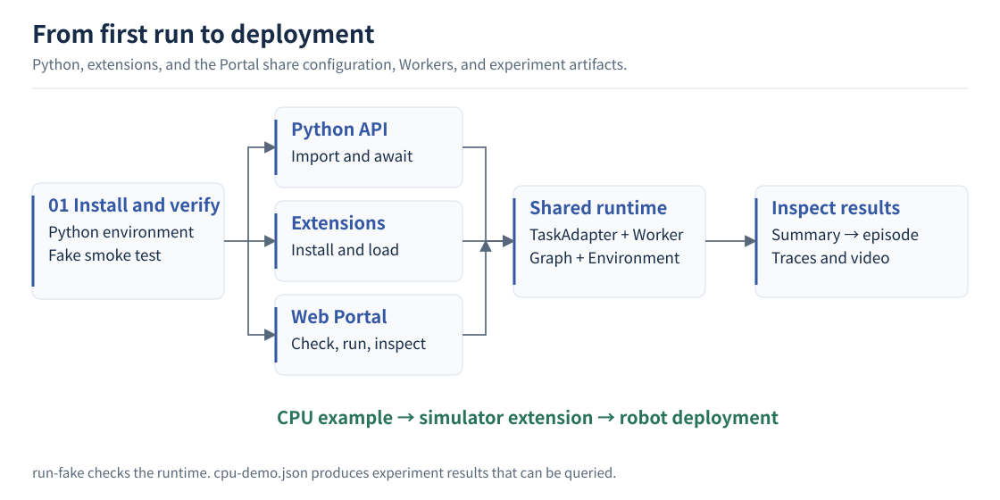

# Tutorials

[**English**](README.md) · [简体中文](README.zh-CN.md)

Start with a CPU example, then select a Python, command-line, or Portal workflow. All three paths use the same configuration and produce compatible task results and traces. Install simulator, model, or device extensions when you are ready to use them.

For a first installation, start with the [quickstart](../quickstart.md).

## Choose a tutorial

| Goal | Guide | Outcome |
| --- | --- | --- |
| Install and verify the framework | [First run](01-first-run.md) | A fake smoke test and configuration checks |
| Run from Python | [Python API](python-api.md) | A single episode, a batch experiment, and parameter overrides |
| Run from a terminal | [CLI experiments](cli-experiments.md) | Three CPU tasks, result files, and trace queries |
| Submit and visualize experiments | [Web Portal](03-portal.md) | Experiment submission and task and node views |
| Evaluate with dynamic batching on multiple GPUs | [Benchmark guide](../benchmarks.md) | Model and simulator isolation, protocols, progress, and success rates |
| Add an environment, model, or device | [Use extensions](extensions.md) | Installation, configuration, and three launch methods |
| Diagnose results | [Inspect experiment results](view-results.md) | File-to-view mapping, SQL queries, images, and videos |
| Connect RoboCasa and a model | [First simulation](02-first-simulation.md) | A single task, a small batch, video, and observations |
| Obtain assets, weights, or demonstrations | [Demo resources](download-data.md) | Download commands, storage locations, and file checks |
| Connect a physical robot | [Physical robot deployment](real-robot.md) | Site drivers, observations, acceptance checks, and two launch methods |
| Write a workflow node | [First custom module](04-custom-module.md) | A runnable two-node Graph |
| Evaluate RoboCasa365 on multiple GPUs | [Xiaomi + RoboCasa365](benchmark-h100-xiaomi.md) | Launch configuration and results for 224 Workers on eight GPUs |
| Evaluate VLABench on multiple GPUs | [Xiaomi + VLABench](benchmark-h100-xiaomi-vlabench.md) | Launch configuration and results for 160 Workers on eight GPUs |
| Evaluate LIBERO on multiple GPUs | [Xiaomi Robotics 0 + LIBERO](benchmark-h100-xiaomi-libero.md) | Four suites, 2,000 episodes, reproduction, and troubleshooting |
| Evaluate LIBERO-Plus on multiple GPUs | [Xiaomi Robotics 0 + LIBERO-Plus](benchmark-h100-xiaomi-libero-plus.md) | Eight GPUs, 288 Workers, 10,030 cases, and full results |
| Scale to a multi-GPU server | [Eight-GPU deployment](server-8gpu.md) | Worker and GPU assignment and remote access |

## Learning paths

**Python API** — [Install](01-first-run.md), [run from Python](python-api.md), then [inspect results](view-results.md).

**Command line** — [Install](01-first-run.md), [run the CLI](cli-experiments.md), then [inspect results](view-results.md).

**Web Portal** — [Install](01-first-run.md), [submit an experiment](03-portal.md), then [inspect results](view-results.md).

The CPU example runs with no extra data or GPU. The simulation tutorial needs RoboCasa, MuJoCo, weights, and a model environment. Hardware requires a device plugin and on-site acceptance testing.

The CLI path makes configuration, output directories, and errors visible in one terminal. You can use the same configuration from Python or the Portal afterward.

Run commands from the repository root unless specified. Replace `/path/to/...`, `user@server`, and example device addresses. IDs, paths, and timings depend on the run. See [examples/cpu-demo.json](examples/cpu-demo.json) and the [figure catalog](../assets/README.md).

See the [reference](../README.md#reference) for interfaces and parameters, the [glossary](../glossary.md) for terminology, [troubleshooting](../troubleshooting.md) for startup errors, and the [change history](../changes/README.md) for earlier releases.
