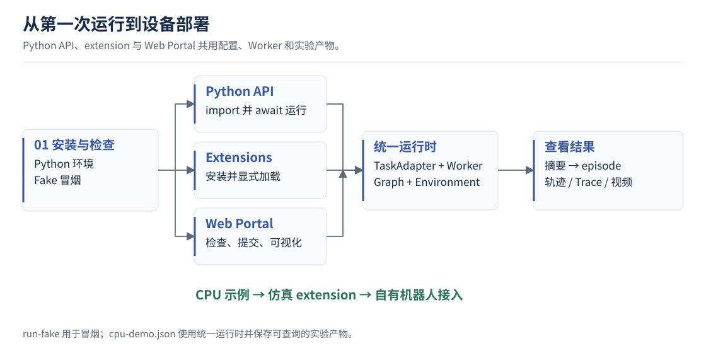

# 教程：跟着做，不用先读完架构

[English](README.md) · [**简体中文**](README.zh-CN.md)

先完成一个不需要 GPU 的例子，再按目标选择 Python、命令行或网页。三条路线使用同一个 CPU 配置，生成相同格式的任务结果和 Trace；等这条链路跑通后，再安装仿真、模型或设备 extension。

如果还没运行过任何命令，请从[快速上手](../quickstart.zh-CN.md)开始。

## 按目标选择

| 目标 | 教程 | 完成后得到什么 |
| --- | --- | --- |
| 安装并确认框架可用 | [首次运行](01-first-run.zh-CN.md) | Fake 冒烟结果、配置检查 |
| 在 Python 程序中运行 | [Python API](python-api.zh-CN.md) | 单个 episode、批量实验和参数覆盖 |
| 在终端运行实验 | [命令行运行实验](cli-experiments.zh-CN.md) | 三个 CPU 任务、结果文件、Trace 查询 |
| 在网页运行和可视化 | [Web Portal 可视化](03-portal.zh-CN.md) | 网页提交、实验列表、任务与节点查看 |
| 运行 benchmark 与多卡动态 batch | [Benchmark 使用指南](../benchmarks.zh-CN.md) | 模型/仿真隔离、正式协议、进度与成功率 |
| 接入可选环境、模型或设备 | [使用 extensions](extensions.zh-CN.md) | 安装、配置加载和三种运行入口 |
| 判断成败和定位问题 | [查看实验结果](view-results.zh-CN.md) | 文件与界面对照、SQL、图像和视频入口 |
| 接入 RoboCasa 与模型 | [首次仿真](02-first-simulation.zh-CN.md) | 单任务、小批量、视频与观测数据 |
| 准备 demo 所需的场景、模型或演示轨迹 | [Demo 数据与模型下载](download-data.zh-CN.md) | 保存目录、下载命令与文件检查 |
| 部署到物理机器人 | [真机部署](real-robot.zh-CN.md) | 站点驱动、观测接入、验收与两种启动方式 |
| 编写自己的节点 | [第一个自定义模块](04-custom-module.zh-CN.md) | 可运行的双节点 Graph |
| 配置 RoboCasa365 多卡评测 | [Xiaomi + RoboCasa365](benchmark-h100-xiaomi.zh-CN.md) | 8 卡、224 个 Worker、启动命令与完整结果 |
| 配置 VLABench 多卡评测 | [Xiaomi + VLABench](benchmark-h100-xiaomi-vlabench.zh-CN.md) | 8 卡、160 个 Worker、启动命令与完整结果 |
| 配置 LIBERO 多卡评测 | [Xiaomi Robotics 0 + LIBERO](benchmark-h100-xiaomi-libero.zh-CN.md) | 四 suite、2,000 个 episode、复现与排错 |
| 配置 LIBERO-Plus 多卡评测 | [Xiaomi Robotics 0 + LIBERO-Plus](benchmark-h100-xiaomi-libero-plus.zh-CN.md) | 8 卡、288 个 Worker、10,030 个案例与完整结果 |
| 扩展到多卡服务器 | [8 卡服务器部署](server-8gpu.zh-CN.md) | Worker / GPU 分配与远程访问 |

## 三条上手路线

**Python API**：[安装](01-first-run.zh-CN.md) → [Python 中调用](python-api.zh-CN.md) → [查看结果](view-results.zh-CN.md)。

**命令行**：[安装](01-first-run.zh-CN.md) → [CLI 运行](cli-experiments.zh-CN.md) → [查看结果](view-results.zh-CN.md)。

**可视化网页**：[安装](01-first-run.zh-CN.md) → [Portal 提交](03-portal.zh-CN.md) → [查看结果](view-results.zh-CN.md)。

三条路线的 CPU 示例都不需要 GPU 或额外数据。仿真教程需要 RoboCasa、MuJoCo、权重与模型环境；真机教程需要另行实现并验收设备插件。

不知道选哪条时，先走命令行路线。它最容易看清配置、输出目录和报错，跑通后再切到 Python 或 Portal。

所有命令默认在仓库根目录执行。`/path/to/...`、`user@server` 和文档示例设备地址需要替换；动态 ID、目录与耗时以本次输出为准。示例文件保存在 [examples/cpu-demo.json](examples/cpu-demo.json)，配图说明见[图片目录](../assets/README.zh-CN.md)。

参数与接口查[参考手册](../README.zh-CN.md#参考手册)，术语查[术语表](../glossary.zh-CN.md)，启动错误查[常见问题](../troubleshooting.zh-CN.md)，历史变更查[更新记录](../changes/README.zh-CN.md)。
