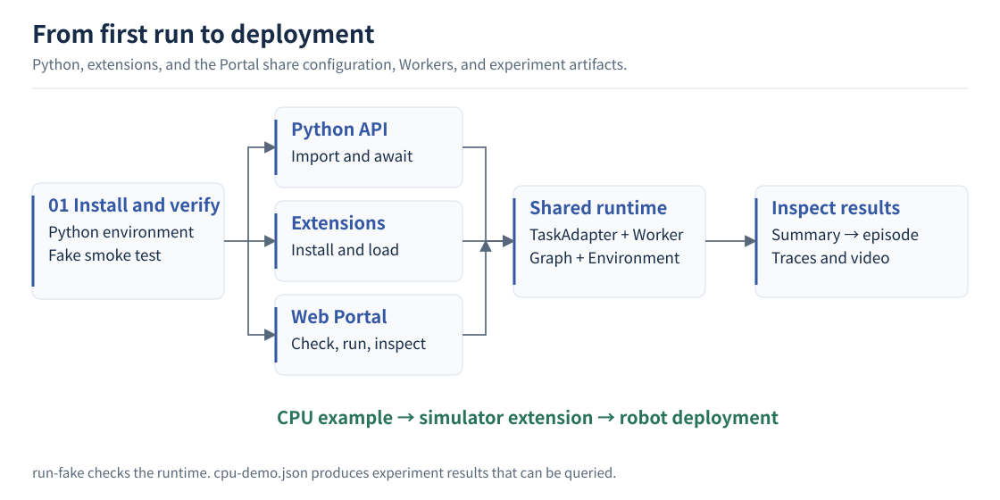

# Run experiments from the command line

[**English**](cli-experiments.md) · [简体中文](cli-experiments.zh-CN.md)

Use [cpu-demo.json](examples/cpu-demo.json) to preflight, run a batch, and query results. Install the framework in a Python environment on Linux or macOS as described in [First run](01-first-run.md). Run the commands from the repository root. For RoboCasa simulation, first [prepare the demo resources](download-data.md), then follow [First simulation](02-first-simulation.md).

The example runs `reset → observe → report` to check whether the fake environment is ready. `success: true` means that readiness check passed. The example issues no robot motion.



## 1. Check the configuration and output directory

```bash
Tenon run --preflight \
  --config docs/tutorials/examples/cpu-demo.json \
  --output-dir data/tutorial/cli
```

Check that `ok` is `true` in the returned JSON. The CPU example assigns no GPU. Its configuration, output, disk, and local port checks should pass. Review `warning` and `deferred` items individually. Model and device readiness are confirmed at startup.

## 2. Run three tasks

```bash
Tenon run --batch \
  --config docs/tutorials/examples/cpu-demo.json \
  --run-id cpu-demo \
  --output-dir data/tutorial/cli \
  --save-traces
```

The configuration selects adapter `single-task` and runs it three times with seeds 7, 8, and 9. One CPU Worker executes them in order and writes the results to `data/tutorial/cli/cpu-demo/`. `--output-dir` is the parent directory and `--run-id` names the experiment.

For a new run, change `--run-id` to a fresh name such as `cpu-demo-02`. Existing directories and locks protect earlier experiment results.

The terminal shows progress followed by a summary. To inspect the running experiment, open a second terminal:

```bash
python -m json.tool data/tutorial/cli/cpu-demo/status.json
```

After completion, inspect the summary:

```bash
python - <<'PY'
import json
from pathlib import Path

root = Path("data/tutorial/cli/cpu-demo")
summary = json.loads((root / "summary.json").read_text())
for key in ("num_episodes", "num_completed", "successes", "num_errors"):
    print(f"{key}: {summary[key]}")
PY
```

Expected output:

```text
num_episodes: 3
num_completed: 3
successes: 3
num_errors: 0
```

## 3. Inspect one task

```bash
python - <<'PY'
import json
from pathlib import Path

path = Path("data/tutorial/cli/cpu-demo/cpu-demo/episode_000_seed_7.json")
record = json.loads(path.read_text())
result = record["result"]
print("status:", record["status"])
print("task_success:", record["task_success"])
print("graph_status:", result["graph_status"])
print("outputs:", result["outputs"])
print("identity:", result["identity"])
PY
```

Both `status` and `graph_status` should be `completed`, `task_success` should be `True`, and `outputs` should contain `success: True`. In the directory path, the first `cpu-demo` is the run ID. The second occurrence is the task ID.

The `run_id`, `episode_id`, and `attempt_id` fields in `identity` correlate a task with its traces. The process exit code and `graph_status` indicate execution status. Read the task result to assess goal success. See [Inspect experiment results](view-results.md).

## 4. Query traces from a terminal

Read the SQLite path from the data source file and open it read-only. This also prevents a typo from creating an empty database:

```bash
python - <<'PY'
import json
import sqlite3
from pathlib import Path

root = Path("data/tutorial/cli/cpu-demo")
source = json.loads((root / "observability.json").read_text())
db = Path(source["trace_db"]).resolve()
with sqlite3.connect(db.as_uri() + "?mode=ro", uri=True) as conn:
    rows = conn.execute(
        "SELECT name, status, start_time FROM spans "
        "ORDER BY start_time DESC LIMIT 10"
    ).fetchall()
for row in rows:
    print(*row, sep=" | ")
PY
```

Look for `node:cpu_demo:reset`, `node:cpu_demo:observe`, `node:cpu_demo:report`, or their routing events. Successful spans have status `ok`. The CPU example performs no real model inference.

## 5. Query results over read-only HTTP

To inspect CLI artifacts in a browser or another tool, start the query service in a second terminal:

```bash
Tenon web \
  --source data/tutorial/cli/cpu-demo/observability.json \
  --run-root data/tutorial/cli/cpu-demo \
  --host 127.0.0.1 --port 8766 \
  --no-experiment-submit --no-auto-grafana
```

Open <http://127.0.0.1:8766/api/traces?limit=10> in a browser to read JSON, or query it from the terminal:

```bash
curl -fsS 'http://127.0.0.1:8766/api/traces?limit=10' \
  | python -m json.tool
```

For SQL, use the read-only query endpoint:

```bash
curl -fsS http://127.0.0.1:8766/api/trace/sql \
  -H 'Content-Type: application/json' \
  --data '{"query":"SELECT name, status FROM spans ORDER BY start_time DESC LIMIT 10"}' \
  | python -m json.tool
```

The home page displays the Portal experiment list. In `--no-experiment-submit` mode, experiment submission is disabled. Use the query API to inspect CLI results.

To use the interactive experiment list, trajectories, and task controls, submit the same configuration through the [Portal](03-portal.md). CLI runs are recorded separately.

## 6. Run one episode

Without `--batch`, the runner executes a single episode. `--output` selects the output base. This configuration uses the process backend, which writes attempt results in the derived `attempts/` directory:

```bash
Tenon run \
  --config docs/tutorials/examples/cpu-demo.json \
  --output data/tutorial/single-cpu/episode.json \
  --trace-dir data/tutorial/single-cpu/trace \
  --metrics-dir data/tutorial/single-cpu/metrics
```

In the returned JSON, `output_path` points to the actual file, with a path such as `data/tutorial/single-cpu/episode/attempts/<attempt_id>/episode.json`. List the attempts:

```bash
python - <<'PY'
import json
from pathlib import Path

root = Path("data/tutorial/single-cpu")
for path in sorted(root.glob("episode/attempts/*/episode.json")):
    result = json.loads(path.read_text())
    print(path, result["graph_status"], result["task_success"])
PY
```

Single-run JSON exposes `graph_status`, `task_success`, and `outputs` at the top level. Batch records store these fields under `result` and add index and summary fields outside it. Read the trace location from the source file at `data/tutorial/single-cpu/episode.observability.json`. Since layouts vary by backend, prefer the returned `output_path`.

## 7. Run a simulation or hardware experiment

| Goal | What to change | Next guide |
| --- | --- | --- |
| RoboCasa simulation | Use the XR365 configuration, install the simulator and models, and start with one task | [First simulation](02-first-simulation.md) |
| Multiple Workers or GPUs | Configure the execution backend, GPU pool, and per-Worker models | [Server deployment](server-8gpu.md) |
| Physical robot | Supply the site Body, observation source, model, and action contract | [Physical robot deployment](real-robot.md) |

`--dry-run` keeps the configured environment. On hardware, motion remains possible. Use the CPU configuration above to practice execution and result inspection.
