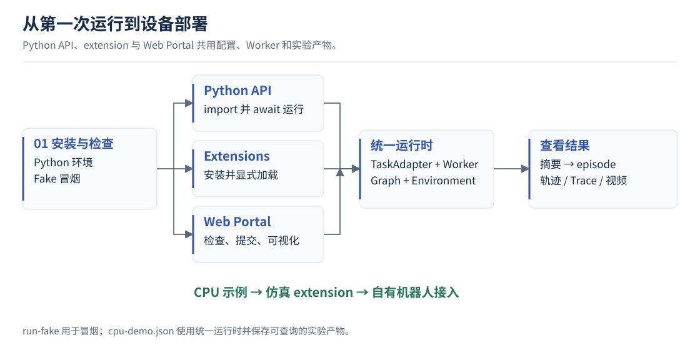

# 命令行运行实验

[English](cli-experiments.md) · [**简体中文**](cli-experiments.zh-CN.md)

本教程使用 [cpu-demo.json](examples/cpu-demo.json) 完成预检、批量运行和结果查询。只需要已安装框架的 Python 环境，支持 Linux/macOS，不需要模型、GPU、仿真器或设备。安装步骤见[首次运行](01-first-run.zh-CN.md)。所有命令在仓库根目录执行。想切换到 RoboCasa 仿真时，先按[Demo 数据与模型下载](download-data.zh-CN.md)准备资源，再看[首次仿真](02-first-simulation.zh-CN.md)。

这个示例运行 `reset → observe → report`，检查 Fake 环境是否就绪。`success: true` 表示这项检查通过；它不执行机器人动作，也不衡量操控能力。



## 1. 检查配置和输出位置

```bash
Tenon run --preflight \
  --config docs/tutorials/examples/cpu-demo.json \
  --output-dir data/tutorial/cli
```

检查返回 JSON 的 `ok` 是否为 `true`。本例没有 GPU 分配；配置、输出位置、磁盘和本地端口检查应通过。`warning`、`deferred` 需要结合说明处理，预检成功不代表真实模型已加载或设备已验收。

## 2. 运行三个任务

```bash
Tenon run --batch \
  --config docs/tutorials/examples/cpu-demo.json \
  --run-id cpu-demo \
  --output-dir data/tutorial/cli \
  --save-traces
```

配置声明了一个 `single-task` 适配器，运行三次，种子依次为 7、8、9。一个 CPU Worker 按顺序执行，结果放在 `data/tutorial/cli/cpu-demo/`。`--output-dir` 是实验的父目录，`--run-id` 是本次实验的目录名。

再次练习时把 `--run-id` 改成 `cpu-demo-02` 等新名字。已有实验目录用于保留结果，不要靠删除锁文件或覆盖旧目录来强行开始新实验。

终端会显示执行过程，最后打印摘要。运行过程中可在另一个终端检查：

```bash
python -m json.tool data/tutorial/cli/cpu-demo/status.json
```

结束后检查摘要：

```bash
python - <<'PY'
import json
from pathlib import Path

root = Path("data/tutorial/cli/cpu-demo")
summary = json.loads((root / "summary.json").read_text())
for key in ("num_episodes", "num_completed", "successes", "num_errors"):
    print(f"{key}: {summary[key]}")
PY
```

预期输出：

```text
num_episodes: 3
num_completed: 3
successes: 3
num_errors: 0
```

## 3. 查看一条任务的结果

```bash
python - <<'PY'
import json
from pathlib import Path

path = Path("data/tutorial/cli/cpu-demo/cpu-demo/episode_000_seed_7.json")
record = json.loads(path.read_text())
result = record["result"]
print("status:", record["status"])
print("task_success:", record["task_success"])
print("graph_status:", result["graph_status"])
print("outputs:", result["outputs"])
print("identity:", result["identity"])
PY
```

预期 `status` 和 `graph_status` 均为 `completed`，`task_success` 为 `True`，`outputs` 包含 `success: True`。目录中第一个 `cpu-demo` 是 run ID，第二个是本例任务 ID；不是路径写错。

`identity` 中的 `run_id`、`episode_id`、`attempt_id` 用于关联 Trace。只看进程退出码或 `graph_status`，无法判断真实业务任务是否成功。字段解释见[查看实验结果](view-results.zh-CN.md)。

## 4. 从终端查询 Trace

下列代码从数据源文件读取 SQLite 路径，并以只读模式查询，避免把不存在的路径误建成空数据库：

```bash
python - <<'PY'
import json
import sqlite3
from pathlib import Path

root = Path("data/tutorial/cli/cpu-demo")
source = json.loads((root / "observability.json").read_text())
db = Path(source["trace_db"]).resolve()
with sqlite3.connect(db.as_uri() + "?mode=ro", uri=True) as conn:
    rows = conn.execute(
        "SELECT name, status, start_time FROM spans "
        "ORDER BY start_time DESC LIMIT 10"
    ).fetchall()
for row in rows:
    print(*row, sep=" | ")
PY
```

应看到 `node:cpu_demo:reset`、`node:cpu_demo:observe`、`node:cpu_demo:report` 或它们之间的路由事件；正常完成的 span 状态为 `ok`。CPU 示例没有调用真实模型，因此不应拿它的延迟作为模型性能数据。

## 5. 通过只读 HTTP 接口查看数据

如果需要从浏览器或其他工具读取 CLI 产物，在另一个终端启动只读查询服务：

```bash
Tenon web \
  --source data/tutorial/cli/cpu-demo/observability.json \
  --run-root data/tutorial/cli/cpu-demo \
  --host 127.0.0.1 --port 8766 \
  --no-experiment-submit --no-auto-grafana
```

浏览器直接打开 <http://127.0.0.1:8766/api/traces?limit=10> 查看 JSON，也可以从终端查询：

```bash
curl -fsS 'http://127.0.0.1:8766/api/traces?limit=10' \
  | python -m json.tool
```

需要 SQL 时使用只读查询接口：

```bash
curl -fsS http://127.0.0.1:8766/api/trace/sql \
  -H 'Content-Type: application/json' \
  --data '{"query":"SELECT name, status FROM spans ORDER BY start_time DESC LIMIT 10"}' \
  | python -m json.tool
```

当前服务的首页仍使用完整 Portal 的实验列表，在 `--no-experiment-submit` 模式下会提示实验提交已禁用；它没有独立的 CLI 结果导入向导。这里应使用查询 API，不能按完整 Portal 页面操作。

需要图形界面的实验列表、轨迹和任务控制时，按 [Portal 教程](03-portal.zh-CN.md)从页面提交同一份配置。CLI 产物不会自动注册到该实验列表。

## 6. 只运行一次

不加 `--batch` 时走单次 episode 入口。`--output` 指定输出基准路径；本例使用进程后端，实际结果保存在该路径派生的 `attempts/` 目录中：

```bash
Tenon run \
  --config docs/tutorials/examples/cpu-demo.json \
  --output data/tutorial/single-cpu/episode.json \
  --trace-dir data/tutorial/single-cpu/trace \
  --metrics-dir data/tutorial/single-cpu/metrics
```

终端返回 JSON 中的 `output_path` 指向本次实际文件，形如 `data/tutorial/single-cpu/episode/attempts/<attempt_id>/episode.json`。可以列出这些执行尝试：

```bash
python - <<'PY'
import json
from pathlib import Path

root = Path("data/tutorial/single-cpu")
for path in sorted(root.glob("episode/attempts/*/episode.json")):
    result = json.loads(path.read_text())
    print(path, result["graph_status"], result["task_success"])
PY
```

单次结果的 `graph_status`、`task_success`、`outputs` 位于 JSON 顶层；批量任务记录把这些字段放在 `result` 中，并在外层保存任务索引与汇总字段。入口数据源仍位于 `data/tutorial/single-cpu/episode.observability.json`，Trace 的实际路径以该文件为准。不同执行后端的产物布局可能不同，优先使用结果返回的 `output_path`。

## 7. 换成真实实验

| 目标 | 修改什么 | 接下来阅读 |
| --- | --- | --- |
| RoboCasa 仿真 | 使用 XR365 配置，安装环境与模型，先限制为一个任务 | [首次仿真](02-first-simulation.zh-CN.md) |
| 多 Worker / GPU | 执行后端、GPU 池与每 Worker 模型配置 | [服务器部署](server-8gpu.zh-CN.md) |
| 物理机器人 | 站点 Body、观测源、模型与动作契约 | [真机部署](real-robot.zh-CN.md) |

`--dry-run` 不会自动切换成 Fake 环境，也不保证真机不动作。要练习运行和查看结果，就继续使用本教程的 CPU 配置。
