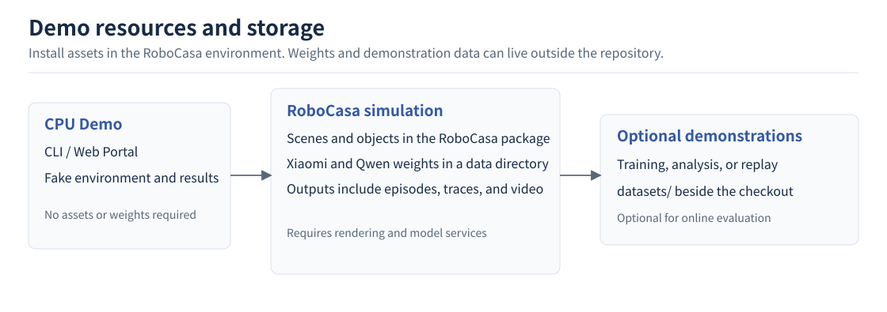

# Demo assets and model downloads

[**English**](download-data.md) · [简体中文](download-data.zh-CN.md)

The CLI and Portal CPU examples run on a fake environment with no assets or weights. The RoboCasa simulation requires scene assets and model weights. Demonstration trajectories are optional and are used for training, analysis, or replay.



## Required downloads

| Resource | Purpose | Required for the RoboCasa demo? |
| --- | --- | --- |
| RoboCasa scene and object assets | Create kitchen scenes, furniture, and objects | Yes |
| Xiaomi-Robotics-1-RoboCasa365 weights | Generate robot actions | Yes |
| Qwen3.5-9B weights | High-level task planning | Yes |
| RoboCasa demonstrations | Training, dataset analysis, or replay | No |

For a first CPU run, use the [CLI](cli-experiments.md) or [Portal](03-portal.md) tutorial. Review [First simulation](02-first-simulation.md) before switching environments.

## 1. Select a storage directory

Store weights and optional demonstrations on a volume with sufficient space outside the Git checkout. Run these commands from the repository root in the terminal you will use to download resources and launch services:

```bash
export ROBOTENON_DATA_ROOT="${ROBOTENON_DATA_ROOT:-$HOME/robotenon-data}"
export XIAOMI_MODEL_PATH="$ROBOTENON_DATA_ROOT/models/Xiaomi-Robotics-1-RoboCasa365"
export QWEN_MODEL_PATH="$ROBOTENON_DATA_ROOT/models/Qwen3.5-9B"

mkdir -p "$ROBOTENON_DATA_ROOT/models"
df -h "$ROBOTENON_DATA_ROOT"
```

`df` shows the free space on that volume. The Hugging Face CLI can preview files and download sizes. RoboCasa estimates about 10 GB for the full scene assets.

## 2. Install the download tool

Install the Hugging Face CLI in a separate Python environment under the data directory to keep simulator and model dependencies isolated:

```bash
python3 -m venv "$ROBOTENON_DATA_ROOT/hf-tools"
"$ROBOTENON_DATA_ROOT/hf-tools/bin/python" -m pip install --upgrade huggingface_hub
export HF_CLI="$ROBOTENON_DATA_ROOT/hf-tools/bin/hf"
"$HF_CLI" --help
```

## 3. Download model weights

Preview the files and download sizes, then download to the model directories used in the tutorial:

```bash
"$HF_CLI" download XiaomiRobotics/Xiaomi-Robotics-1-RoboCasa365 \
  --local-dir "$XIAOMI_MODEL_PATH" --dry-run

"$HF_CLI" download XiaomiRobotics/Xiaomi-Robotics-1-RoboCasa365 \
  --local-dir "$XIAOMI_MODEL_PATH"

"$HF_CLI" download Qwen/Qwen3.5-9B \
  --local-dir "$QWEN_MODEL_PATH" --dry-run

"$HF_CLI" download Qwen/Qwen3.5-9B \
  --local-dir "$QWEN_MODEL_PATH"
```

For downloads that require authentication, sign in with `"$HF_CLI" auth login`. Keep access tokens out of scripts and configurations.

Verify the files against the Hub checksums:

```bash
"$HF_CLI" cache verify XiaomiRobotics/Xiaomi-Robotics-1-RoboCasa365 \
  --local-dir "$XIAOMI_MODEL_PATH" \
  --fail-on-missing-files --fail-on-extra-files

"$HF_CLI" cache verify Qwen/Qwen3.5-9B \
  --local-dir "$QWEN_MODEL_PATH" \
  --fail-on-missing-files --fail-on-extra-files

du -sh "$XIAOMI_MODEL_PATH" "$QWEN_MODEL_PATH"
```

Both verification commands should exit successfully. Before launching the services, set Xiaomi's `XR_MODEL_PATH` and Qwen's `QWEN_MODEL_PATH` to the corresponding directories. For model versions and environments, see [Upstream dependencies](../vendor-guide.md) and [Xiaomi deployment](../../vendor/Xiaomi-Robotics-1/docs/DEPLOYMENT.md).

## 4. Download RoboCasa scene assets

Run these commands in the simulator environment containing RoboCasa365 and MuJoCo. Follow the [official RoboCasa installation guide](https://robocasa.ai/docs/build/html/introduction/installation.html). The download script installs assets under the RoboCasa package in that environment.

```bash
python -m robocasa.scripts.setup_macros
python -m robocasa.scripts.download_kitchen_assets
```

The script asks for confirmation. On the first run, choose `y`. It shows progress for approximately 10 GB of downloads. If `macros_private.py` already exists, enter `n` to retain local settings when asked. The script attempts each resource up to three times. After a network interruption, check the destination and free space before rerunning.

Check the object registry in the same Python environment:

```bash
python scripts/check_robocasa_assets.py
```

`missing` should be an empty array. This checks registered objects. Use [simulation preflight](02-first-simulation.md) to check renderer dependencies and model services before execution.

## 5. Optional demonstration trajectories

Download demonstrations for training, analysis, or replay. The upstream script defaults to `datasets/` alongside the RoboCasa project. To use another location, set `DATASET_BASE_PATH` in `robocasa/macros_private.py`.

This example downloads target human trajectories for `CloseBlenderLid`. Preview the plan with `--dryrun`, then remove that option to download:

```bash
python -m robocasa.scripts.download_datasets \
  --tasks CloseBlenderLid --split target --source human --dryrun

python -m robocasa.scripts.download_datasets \
  --tasks CloseBlenderLid --split target --source human
```

Confirm the download when prompted. The script saves and extracts data at the printed path. To select other tasks or data types, set `--tasks`, `--split`, and `--source` according to the [RoboCasa dataset guide](https://robocasa.ai/docs/build/html/datasets/using_datasets.html). Online simulation creates its own scenes and runs the policy.

## After downloading

Start the services using `XIAOMI_MODEL_PATH` and `QWEN_MODEL_PATH`, then run one task following [First simulation](02-first-simulation.md). To submit from the Portal, select `generated config.json` and use the same Xiaomi weight directory in the model override. See the [Portal tutorial](03-portal.md#5-switch-to-robocasa).

Official resources: [RoboCasa installation and assets](https://robocasa.ai/docs/build/html/introduction/installation.html), [demonstrations](https://robocasa.ai/docs/build/html/datasets/using_datasets.html), [Xiaomi model](https://huggingface.co/XiaomiRobotics/Xiaomi-Robotics-1-RoboCasa365), [Qwen model](https://huggingface.co/Qwen/Qwen3.5-9B), and [Hugging Face CLI](https://huggingface.co/docs/huggingface_hub/guides/cli).
