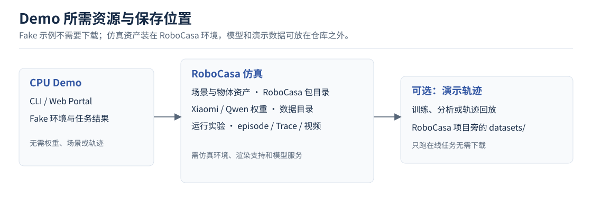

# Demo 数据与模型下载

[English](download-data.md) · [**简体中文**](download-data.zh-CN.md)

CLI 和 Portal 的 CPU 示例使用 Fake 环境，不需要下载模型、仿真资产或演示轨迹。要运行 RoboCasa 仿真，再按本页准备场景资产和模型权重；训练或回放示例轨迹时，才需要下载演示数据。



## 需要下载什么

| 内容 | 用途 | RoboCasa demo 是否需要 |
| --- | --- | --- |
| RoboCasa 场景与物体资产 | 创建厨房、家具和物体 | 需要 |
| Xiaomi-Robotics-1-RoboCasa365 权重 | 生成机器人动作 | 需要 |
| Qwen3.5-9B 权重 | 提供高层任务规划 | 需要 |
| RoboCasa 演示轨迹 | 模型训练、数据分析或轨迹回放 | 不需要 |

首次运行 Fake 示例时，请从[命令行教程](cli-experiments.zh-CN.md)或[Portal 教程](03-portal.zh-CN.md)开始。切换仿真前，确认已读[首次仿真](02-first-simulation.zh-CN.md)中的环境要求。

## 1. 选择保存目录

模型权重和可选演示数据较大。建议放到有足够空间的独立磁盘，不放在 Git 仓库内。以下命令在仓库根目录执行，并在后续下载和启动服务的同一个终端中运行：

```bash
export ROBOTENON_DATA_ROOT="${ROBOTENON_DATA_ROOT:-$HOME/robotenon-data}"
export XIAOMI_MODEL_PATH="$ROBOTENON_DATA_ROOT/models/Xiaomi-Robotics-1-RoboCasa365"
export QWEN_MODEL_PATH="$ROBOTENON_DATA_ROOT/models/Qwen3.5-9B"

mkdir -p "$ROBOTENON_DATA_ROOT/models"
df -h "$ROBOTENON_DATA_ROOT"
```

`df` 会显示该目录所在磁盘的剩余空间。Hugging Face 下载工具还可以先列出模型文件和预计下载量；RoboCasa 上游说明全量场景资产约需 10 GB。

## 2. 安装独立下载工具

将 Hugging Face 命令行工具装在数据目录下的独立 Python 环境中，避免改动仿真器、模型服务或 RoboTenon 的依赖：

```bash
python3 -m venv "$ROBOTENON_DATA_ROOT/hf-tools"
"$ROBOTENON_DATA_ROOT/hf-tools/bin/python" -m pip install --upgrade huggingface_hub
export HF_CLI="$ROBOTENON_DATA_ROOT/hf-tools/bin/hf"
"$HF_CLI" --help
```

## 3. 下载模型权重

先预览文件列表和下载大小，再下载到教程约定的模型目录：

```bash
"$HF_CLI" download XiaomiRobotics/Xiaomi-Robotics-1-RoboCasa365 \
  --local-dir "$XIAOMI_MODEL_PATH" --dry-run

"$HF_CLI" download XiaomiRobotics/Xiaomi-Robotics-1-RoboCasa365 \
  --local-dir "$XIAOMI_MODEL_PATH"

"$HF_CLI" download Qwen/Qwen3.5-9B \
  --local-dir "$QWEN_MODEL_PATH" --dry-run

"$HF_CLI" download Qwen/Qwen3.5-9B \
  --local-dir "$QWEN_MODEL_PATH"
```

下载服务受限时，先按 Hugging Face 的账号要求登录：`"$HF_CLI" auth login`。不要把访问令牌写进脚本或配置文件。

完成后核对本地文件与 Hub 校验值：

```bash
"$HF_CLI" cache verify XiaomiRobotics/Xiaomi-Robotics-1-RoboCasa365 \
  --local-dir "$XIAOMI_MODEL_PATH" \
  --fail-on-missing-files --fail-on-extra-files

"$HF_CLI" cache verify Qwen/Qwen3.5-9B \
  --local-dir "$QWEN_MODEL_PATH" \
  --fail-on-missing-files --fail-on-extra-files

du -sh "$XIAOMI_MODEL_PATH" "$QWEN_MODEL_PATH"
```

两条校验命令均应正常退出，并报告本地文件校验完成。启动服务前应使用这两个目录：Xiaomi 的 `XR_MODEL_PATH` 和 Qwen 的 `QWEN_MODEL_PATH`。模型版本和推理环境见[上游依赖说明](../vendor-guide.zh-CN.md)及[Xiaomi 部署说明](../../vendor/Xiaomi-Robotics-1/docs/DEPLOYMENT.zh-CN.md)。

## 4. 下载 RoboCasa 场景资产

以下命令应在已经安装 RoboCasa365 和 MuJoCo 的仿真 Python 环境中执行。安装步骤见[RoboCasa 官方安装指南](https://robocasa.ai/docs/build/html/introduction/installation.html)。脚本会将资产放入该环境所安装的 RoboCasa 包目录，不会下载到模型目录。

```bash
python -m robocasa.scripts.setup_macros
python -m robocasa.scripts.download_kitchen_assets
```

下载脚本会先询问是否继续。首次运行需要确认 `y`；官方脚本预计下载约 10 GB，并显示进度。已存在的 `macros_private.py` 会再次询问是否覆盖；已有本机设置时选择 `n` 保留它。脚本对每种资源最多尝试下载三次。网络中断后可以重新运行命令，并检查输出的资产目标路径和磁盘空间。

在同一个 RoboCasa Python 环境中检查物体资源注册表：

```bash
python scripts/check_robocasa_assets.py
```

输出的 `missing` 应为空数组。此检查只覆盖物体资源注册表；运行前仍要完成[仿真预检](02-first-simulation.zh-CN.md)，检查渲染依赖和模型服务。

## 5. 可选：下载演示轨迹

运行 RoboCasa 任务不需要示范轨迹。只有在做训练、数据分析或轨迹回放时再下载，以免占用大量空间。官方脚本默认把数据放在 RoboCasa 项目旁的 `datasets/` 目录；上游说明可通过 `robocasa/macros_private.py` 中的 `DATASET_BASE_PATH` 设置其他位置。

下面以 `CloseBlenderLid` 的 target human 轨迹为例。先用 `--dryrun` 查看计划，再去掉它开始下载：

```bash
python -m robocasa.scripts.download_datasets \
  --tasks CloseBlenderLid --split target --source human --dryrun

python -m robocasa.scripts.download_datasets \
  --tasks CloseBlenderLid --split target --source human
```

脚本会提示确认下载；确认后按显示的目标路径保存并解压。若只需要其他任务或数据类型，按[RoboCasa 数据集说明](https://robocasa.ai/docs/build/html/datasets/using_datasets.html)调整 `--tasks`、`--split` 和 `--source`。下载的数据用于学习和回放；本教程的在线仿真实验会自行创建场景并运行策略。

## 下载完成后

使用 `XIAOMI_MODEL_PATH` 和 `QWEN_MODEL_PATH` 启动服务，然后按[首次仿真](02-first-simulation.zh-CN.md)运行单个任务。若改用网页提交，在 Portal 的仿真步骤中选择 `generated config.json`，模型覆盖层填写同一个 Xiaomi 权重目录，详见[Portal 教程](03-portal.zh-CN.md#5-换成-robocasa-仿真)。

官方来源：[RoboCasa 安装与资产](https://robocasa.ai/docs/build/html/introduction/installation.html)、[RoboCasa 演示数据](https://robocasa.ai/docs/build/html/datasets/using_datasets.html)、[Xiaomi 模型](https://huggingface.co/XiaomiRobotics/Xiaomi-Robotics-1-RoboCasa365)、[Qwen 模型](https://huggingface.co/Qwen/Qwen3.5-9B)、[Hugging Face CLI](https://huggingface.co/docs/huggingface_hub/guides/cli)。
