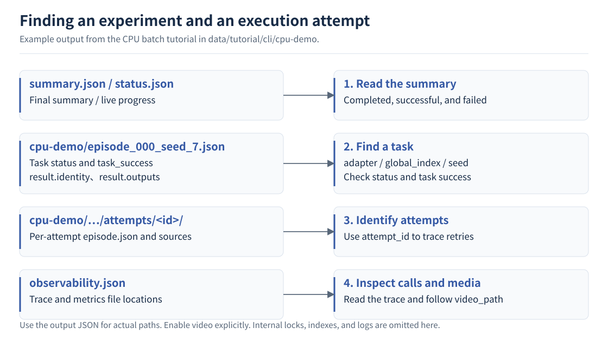
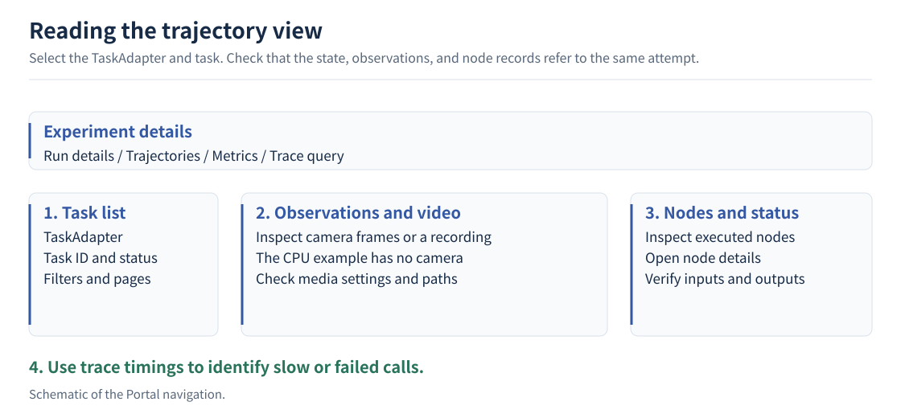
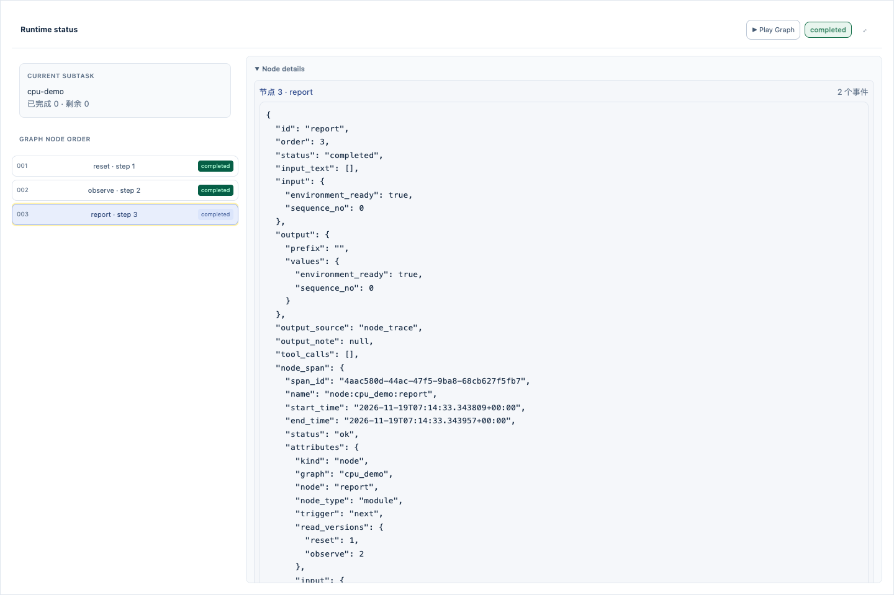
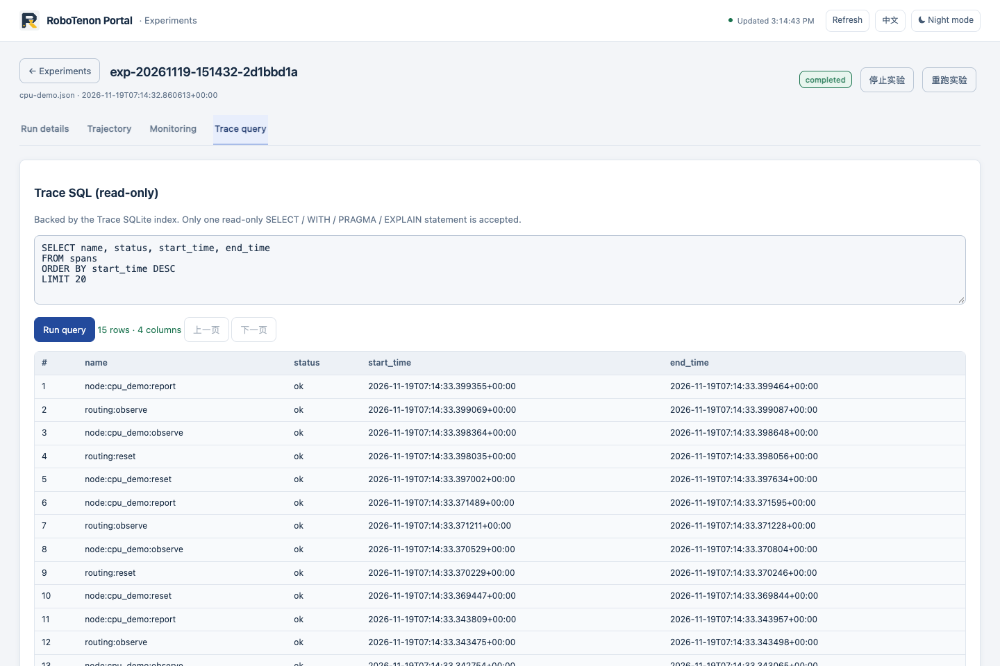

# Inspect experiment results

[**English**](view-results.md) · [简体中文](view-results.zh-CN.md)

Use data from the [CLI tutorial](cli-experiments.md) or the [Portal tutorial](03-portal.md) to determine whether execution finished, whether the task succeeded, and which operation failed or consumed time.

## 1. Locate the relevant data



| Question | CLI / file | Portal view |
| --- | --- | --- |
| Is it still running? | `status.json` and process logs | Experiment list and run details |
| How many tasks succeeded? | Final `summary.json` | Experiment progress and success count |
| Which task failed? | The task's `episode_*.json` | Trajectories → adapter → task |
| How far did the Graph get? | `result.graph_status`, node records, and traces | Node list in the trajectory view |
| How long did calls take? | Trace SQLite database identified in `observability.json` | Call timings and trace query |
| What did the camera observe? | Frame references and observation cache | Node observations |
| Where is the video? | `video_path` in the single-run result | Task video when media is available |
| What configuration ran? | `config.snapshot.json` in the batch directory | Effective parameters in run details |

Read `status.json` and completed task records during a run. Read the full `summary.json` once at the end instead of repeatedly parsing it for progress.

## 2. Check execution status and task success

The following excerpt shows the relevant fields from a batch task record:

```json
{
  "status": "completed",
  "task_success": true,
  "result": {
    "graph_status": "completed",
    "graph_success": true,
    "task_success": true,
    "outputs": {"success": true}
  }
}
```

| Field | Meaning |
| --- | --- |
| `status` | Execution status of the task record |
| `graph_status` / `graph_success` | Whether Graph scheduling finished normally |
| `outputs.success` | Public Graph success signal, a required boolean |
| `task_success` | Task success derived from the Graph output |
| `reason` / `error` | Business reason or execution error, if provided |
| `env_steps` | Reported environment steps, counted separately from Graph node executions |

`completed` and `task_success: false` can appear together when execution finishes but the goal remains unmet. In the CPU tutorial, the goal is only an environment readiness check.

## 3. Find the task in the Portal



1. On the experiment list, open **Details** and verify the configuration and experiment ID.
2. Open **Trajectories** and choose the TaskAdapter. The CPU tutorial uses `tutorial`.
3. Select the task row and verify its ID, episode, and status. Checkboxes select rows for batch operations. Clicking a row opens its details.
4. Inspect the nodes on the right. Select one and expand **Node details**. The fullscreen button enlarges the runtime pane. Use the call timings below to follow execution.
5. For simulations or hardware runs with media, inspect the observation frames, camera views, and task video.



The screenshot shows the fullscreen node pane from a CPU run. All three nodes completed. The example produces no robot motion or camera recording. Undecodable media entries such as `trace_db` and `trace_wal` are not sensor images. Use the task JSON and traces to inspect this example.

The task list is paginated. Check the time range, task status, current page, and selected adapter if a task is missing.

## 4. Query the trace

Open **Trace query**, enter the following SQL, and select **Run query**:

```sql
SELECT name, status, start_time, end_time
FROM spans
ORDER BY start_time DESC
LIMIT 20
```



The screenshot comes from a complete CPU experiment. Graph nodes and routes can both produce spans, so span, task, and action counts measure different things.

Find the identifiers in `identity` of the task result, then restrict the query. Replace the run and episode IDs below:

```sql
SELECT name, status, start_time, end_time, attributes_json
FROM spans
WHERE run_id = 'cpu-demo'
  AND episode_id = 'tutorial:0:0'
ORDER BY start_time
LIMIT 100
```

`attributes_json` holds the call attributes. Check `attempt_id` when comparing retries. The first CLI CPU task ID is `tutorial:0:0`. Portal run IDs usually look like `exp-...`, so use the ID for the actual run.

Find slow calls by duration:

```sql
SELECT name, status,
       ROUND((julianday(end_time) - julianday(start_time)) * 86400000, 1) AS elapsed_ms
FROM spans
WHERE end_time IS NOT NULL
ORDER BY elapsed_ms DESC
LIMIT 20
```

This query helps locate slower spans. SQLite time conversion and recording precision are insufficient for dedicated p95/p99 action-latency measurement. Parallel and nested span durations can overlap.

For empty results, verify the experiment, data source, and filters. In read-only mode, point `--source` at the relevant `observability.json`. In the full Portal the experiment selects the data source. Use a time window, `LIMIT`, and pagination for large results.

## 5. Inspect media and metrics

**Video** must be enabled before the run. Use `--video-path` for CLI single-episode runs, `--save-videos` for batches, or **Save video** in the Portal. The environment must supply images and video dependencies must be installed. The fake example provides no camera frames.

To locate artifacts for a single simulation run:

```bash
python - <<'PY'
import json
from pathlib import Path

record = json.loads(Path("data/tutorial/single/episode.json").read_text())
result = record.get("result", record)
for key in ("video_path", "trace_sqlite", "trace_jsonl", "metrics_wal"):
    print(key, result.get(key))
PY
```

This command reads the single-run output from [First simulation](02-first-simulation.md). For a batch, use the corresponding `episode_*.json`. After copying runs between hosts, check absolute paths in the source records and copy the media resources as well.

**Observation frames** resolve through the observation cache. A trace cannot restore an image whose persistent resource was never saved or has expired. See [Observation cache](../observation-cache.md).

Open **Metrics** to inspect the measurements recorded in the active data source. The CPU example may have no application metrics. Grafana is optional. This tutorial starts with `--no-auto-grafana` and skips dashboard provisioning.

## 6. Preserve failure evidence

Keep the experiment ID, effective configuration, failed task JSON, `identity`, relevant log excerpts, and traces. Include model service logs for inference failures and source and resource paths for media failures. Remove tokens and device credentials before sharing.

Check configuration, task selection, and output directory before inspecting the error and its span. See [Troubleshooting](../troubleshooting.md) for common checks. Use a new run ID or Portal fork when comparing parameters. An in-place rerun updates the selected task results.
