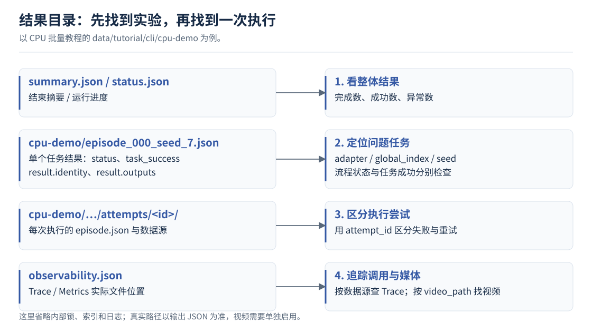
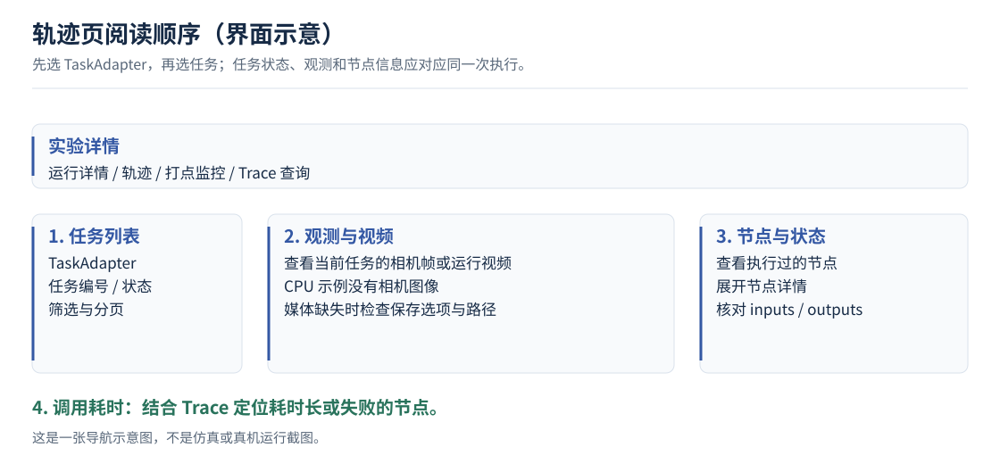
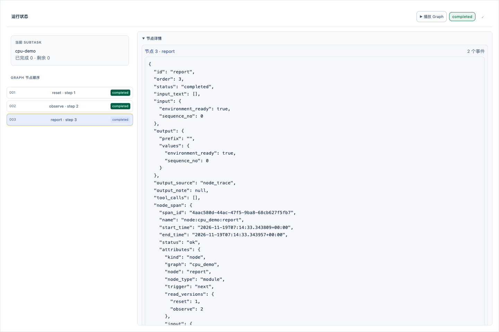
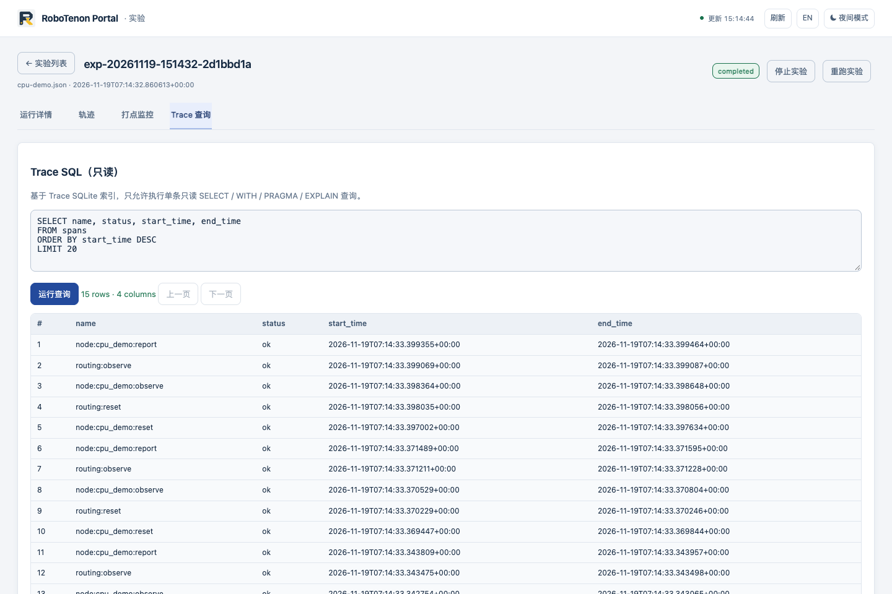

# 查看实验结果

[English](view-results.md) · [**简体中文**](view-results.zh-CN.md)

本页回答三个问题：实验是否正常结束，任务是否成功，失败或耗时发生在哪里。可以使用[命令行教程](cli-experiments.zh-CN.md)或 [Portal 教程](03-portal.zh-CN.md)生成的数据。

## 1. 先看哪一份文件



| 想知道什么 | CLI / 文件 | Portal 入口 |
| --- | --- | --- |
| 还在运行吗 | `status.json`；进程日志 | 实验列表、运行详情 |
| 整体成功了多少 | 结束后的 `summary.json` | 实验进度、已成功数量 |
| 哪个任务失败 | 任务的 `episode_*.json` | 轨迹 → Adapter → 任务 |
| Graph 跑到哪一步 | `result.graph_status`、节点记录、Trace | 轨迹右侧节点列表 |
| 模型或节点耗时 | `observability.json` 指向的 Trace SQLite | 调用耗时、Trace 查询 |
| 相机当时看到了什么 | 帧引用及观测缓存资源 | 节点观测 |
| 完整动作视频在哪里 | 单次结果的 `video_path` | 任务的运行视频入口（有媒体时） |
| 实际使用了什么配置 | 批量目录的 `config.snapshot.json` | 运行详情中的有效参数 |

不要在运行中反复解析整个 `summary.json` 来计算进度。运行中查看 `status.json` 和已完成的任务记录，结束后再读完整摘要。

## 2. 区分完成与成功

以下是批量任务记录的关键字段，省略了其他内容：

```json
{
  "status": "completed",
  "task_success": true,
  "result": {
    "graph_status": "completed",
    "graph_success": true,
    "task_success": true,
    "outputs": {"success": true}
  }
}
```

| 字段 | 含义 |
| --- | --- |
| `status` | 这条任务记录处于什么执行状态 |
| `graph_status` / `graph_success` | Graph 调度是否正常结束 |
| `outputs.success` | Graph 对外发布的业务成功信号，必须是布尔值 |
| `task_success` | 根据 Graph 输出得到的任务成功判断 |
| `reason` / `error` | 业务原因或执行错误，可能为空 |
| `env_steps` | 报告的环境步数，不等于 Graph 节点次数 |

`completed` 可能与 `task_success: false` 同时出现：程序正常跑完，但目标没有完成。CPU 教程的目标只是检查环境就绪，所以成功也不表示机械臂完成了一次操作。

## 3. 在 Portal 找到具体任务



1. 实验列表 → **查看详情**，核对配置和实验编号。
2. 打开 **轨迹**，选择 TaskAdapter；CPU 教程中是 `tutorial`。
3. 点击任务行，核对编号、episode 和状态。勾选框用于批量操作，点击任务行用于查看。
4. 在右侧查看执行节点，点击节点并展开 **节点详情**；点击运行状态面板右上角的全屏按钮可放大。结合下方调用耗时查看运行过程。
5. 仿真或真机配置有媒体时，再查看观测帧、相机视角和运行视频。



上图为 CPU 示例的真实全屏节点面板截图。三个节点完成，但没有物理动作或相机录像。当前页面若在无相机示例中显示 `trace_db`、`trace_wal` 等无法解码的媒体项，这些不是传感器图像；使用任务 JSON 和 Trace 检查本例结果。

任务列表采用分页，筛选和选择不能视作已加载全部历史任务。找不到任务时，先检查时间范围、任务状态和当前页，再检查 Adapter 是否正确。

## 4. 查询 Trace

在详情页打开 **Trace 查询**，输入以下 SQL 并点击 **运行查询**：

```sql
SELECT name, status, start_time, end_time
FROM spans
ORDER BY start_time DESC
LIMIT 20
```



这张截图来自 CPU 示例的一次完整实验。Graph 节点与路由都可能产生 span，span 数量不等于任务数或动作数。

按任务定位时，先从结果中的 `identity` 取得 ID，再限制查询范围。例如将下面的 run ID 和 episode ID 换成本次结果：

```sql
SELECT name, status, start_time, end_time, attributes_json
FROM spans
WHERE run_id = 'cpu-demo'
  AND episode_id = 'tutorial:0:0'
ORDER BY start_time
LIMIT 100
```

`attributes_json` 中保留调用属性；跨重试比较时再核对 `attempt_id`。批量 CPU 示例的第一条任务 ID 为 `tutorial:0:0`，Portal 的 run ID 则通常为 `exp-...`，不要直接照抄 CLI 的 run ID。

按耗时找较慢的调用：

```sql
SELECT name, status,
       ROUND((julianday(end_time) - julianday(start_time)) * 86400000, 1) AS elapsed_ms
FROM spans
WHERE end_time IS NOT NULL
ORDER BY elapsed_ms DESC
LIMIT 20
```

该查询用于排查较慢的 span。SQLite 时间换算和记录精度不足以替代专门的动作延迟 p95/p99 基准；并行、嵌套 span 的耗时也不能直接相加作为总运行时间。

若查询为空，先核对当前实验和数据源，再检查过滤条件。只读模式用 `--source` 指向对应的 `observability.json`；完整 Portal 从当前实验确定数据源。查询结果较多时使用时间窗口、`LIMIT` 和页面翻页。

## 5. 查视频、图像与指标

**视频**需要在运行前启用：CLI 单次运行用 `--video-path`，批量用 `--save-videos`，Portal 勾选“保存视频”。还需要可提供图像的环境及视频依赖。Fake 示例没有相机，启用保存也不会产生真实画面。

单次仿真运行可这样取得产物位置：

```bash
python - <<'PY'
import json
from pathlib import Path

record = json.loads(Path("data/tutorial/single/episode.json").read_text())
result = record.get("result", record)
for key in ("video_path", "trace_sqlite", "trace_jsonl", "metrics_wal"):
    print(key, result.get(key))
PY
```

这个命令用于[首次仿真](02-first-simulation.zh-CN.md)的单次输出；查看批量时将文件路径换成对应 `episode_*.json`。复制运行目录到另一台机器后，还需核对数据源中的绝对路径以及媒体资源是否一并复制。

**观测帧**通过帧引用解析到观测缓存。只有 Trace 而没有对应的持久化资源时，页面无法还原图像；帧被清理也会出现这种情况。详见[观测缓存](../observation-cache.zh-CN.md)。

**指标**在“打点监控”中查看。只会出现实际打点并写入当前数据源的指标，CPU 示例可能没有业务指标。Grafana 是可选的外部展示；本教程用 `--no-auto-grafana` 启动，不自动准备 Grafana 面板。

## 6. 失败时保留什么

保留实验编号、有效配置、失败任务 JSON、`identity`、相关日志片段和 Trace。模型故障同时保存模型服务日志，媒体故障同时保存数据源与资源路径。对外提供材料前移除令牌和设备凭据。

先确认配置、任务范围和输出目录，再看错误与对应 span。常见错误的检查顺序见[排障页](../troubleshooting.zh-CN.md)。修改参数做对照时用新的 run ID 或 Portal Fork，原地重跑会更新所选任务的结果。
