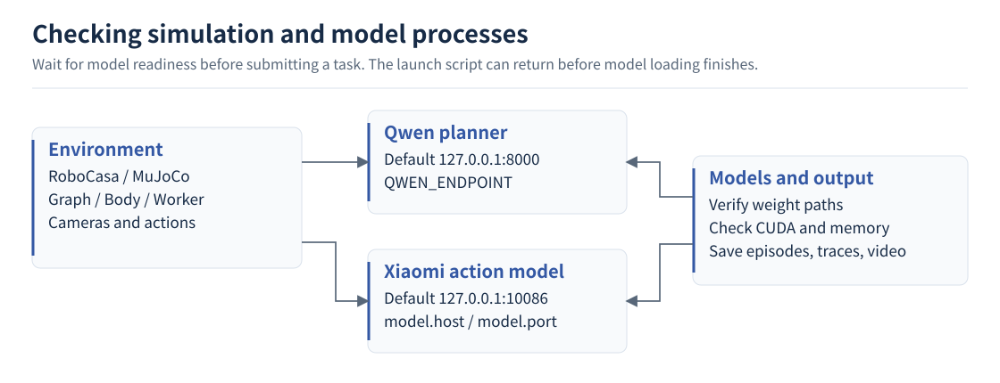

# Upstream dependencies

[**English**](vendor-guide.md) · [简体中文](vendor-guide.zh-CN.md)

Add a vendor through a separate plugin package and configuration for Environment, Body, or Tool. Manage framework dependencies separately from vendor SDKs. Execution, storage, and stream plugins cannot resolve incompatible Python, CUDA, or MuJoCo stacks in one process. Use explicit process and service boundaries for deployment across environments. See [infrastructure plugins](infrastructure-plugins.md).

`vendor/Xiaomi-Robotics-1` contains third-party code, documentation, and licenses. Upstream documentation, paper titles, commands, and license text retain their original wording. This guide explains their relationship to RoboTenon. Results reported upstream belong to their original experiments.

## 1. Integration boundaries

The [LIBERO integration review](changes/libero-integration-review.md) assessed installation compatibility, required plugin files, model adaptation, and the expected effort. The review itself did not implement or run a LIBERO plugin.

- RoboTenon manages configuration, Graphs, task execution, Body/Environment, observations, and results.
- Tools such as Qwen or GPT can provide high-level planning or verification through service endpoints.
- The Xiaomi VLA Tool uses the vendor's client/service. The Body receives and executes the resulting ActionChunk.
- Without a deployment declaration, a resident Worker reuses a client for an external service. A declared deployment can launch a dedicated model service and bind GPUs. Both modes require weights to be available separately. See [Worker model deployment](worker-model-deployment.md).

Related guides: [Quickstart](quickstart.md), [Execution and observability](execution-and-observability.md), and [Plugin development](plugin_development.md).

## 2. Upstream materials

| Resource | Contents |
| --- | --- |
| [Xiaomi-Robotics-1 overview](../vendor/Xiaomi-Robotics-1/README.md) | Introduction to the upstream project and model |
| [Upstream deployment guide](../vendor/Xiaomi-Robotics-1/docs/DEPLOYMENT.md) | Model serving and environment dependencies |
| [RoboCasa365 evaluation](../vendor/Xiaomi-Robotics-1/eval_robocasa365/README.md) | Upstream evaluator, tasks, and rendering configuration |
| [RoboCasa evaluation](../vendor/Xiaomi-Robotics-1/eval_robocasa/README.md) | Alternative upstream evaluation entry point |
| [VLABench evaluation](../vendor/Xiaomi-Robotics-1/eval_vlabench/README.md) | VLABench environment details |
| [XR1 training code](../vendor/Xiaomi-Robotics-1/xr1/README.md) | Training code and model implementation |
| [Training data format](../vendor/Xiaomi-Robotics-1/xr1/docs/data_format.md) | Upstream data organization |
| [Upstream license](../vendor/Xiaomi-Robotics-1/LICENSE) | Authoritative licensing and usage terms |

Vendor scripts implement their own parallelism, GPU allocation, and queues. RoboTenon experiments use `runtime.execution` and run through `scripts/run_experiment.py`.

## 3. Model startup scripts



```bash
XR_GPU=1 XR_MODEL_PATH=/path/to/xiaomi-model \
  bash scripts/start_xiaomi_robotics_1.sh

QWEN_GPU=0 QWEN_MODEL_PATH=/path/to/qwen-model \
  bash scripts/start_qwen35.sh
```

Replace `/path/to/...` with an existing model path. The top of each script documents its interpreter, port, and environment variables. Check running services before launch to avoid port or GPU memory conflicts.

Once the services are ready, verify model paths and endpoints in `runs/robocasa365/config.json` and the main configuration. Worker `gpu_ids` affect resource reservations and newly launched processes. Existing external inference services keep their placement.

## 4. Environment and rendering

Prepare RoboCasa dependencies, MuJoCo, graphics drivers, EGL/OSMesa, and video codecs in the deployment environment. `--dry-run` still initializes the environment. Use the Fake smoke test for local validation without a simulator.

CUDA-visible indices and EGL device indices can differ. Set `egl_device_ids` according to host enumeration; an empty list preserves existing renderer settings. Fake process tests verify neither actual GPU rendering nor peak VRAM use or long-run stability.
