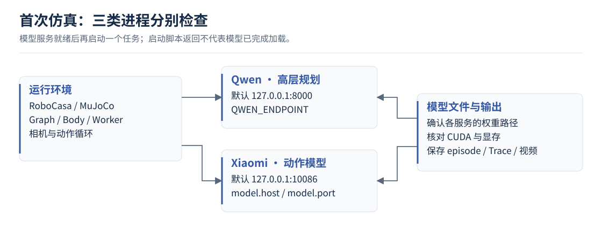

# 上游依赖中文导读

[English](vendor-guide.md) · [**简体中文**](vendor-guide.zh-CN.md)

接入新供应方时，通过独立插件包和配置扩展 Environment、Body、Tool；框架与具体 SDK 的依赖分开管理。执行/存储/流传输插件化并不自动解决同进程 Python、CUDA 或 MuJoCo 版本冲突，跨环境部署仍需明确进程与服务边界。见[基础设施插件](infrastructure-plugins.zh-CN.md)。

本仓库的 `vendor/Xiaomi-Robotics-1` 保存第三方代码、说明与许可证。上游说明、论文名称、命令和授权文字保留原文；本页说明它们与 RoboTenon 的关系，不将上游实验结果作为当前框架的验证结果。

## 1. 应用边界

LIBERO 的安装兼容性、插件文件清单、模型适配与工期已在[接入复审](changes/libero-integration-review.zh-CN.md)单独检查；当前是审计结论，尚未实现或运行 LIBERO 插件。

- RoboTenon 负责配置、Graph、任务执行、Body/Environment、观测和结果。
- Qwen/GPT 等 Tool 可通过服务端点提供高层规划或验证能力。
- Xiaomi VLA Tool 使用供应方客户端/服务；Body 接收其产生的 ActionChunk 并执行。
- 未声明 deployment 时，常驻 Worker 复用外部服务客户端；声明后可独立启动模型服务并绑定 GPU，见[Worker 模型部署](worker-model-deployment.zh-CN.md)。两种方式都不自动下载权重。

相关中文文档：[快速上手](quickstart.zh-CN.md)、[执行与统一观测](execution-and-observability.zh-CN.md)、[插件开发](plugin_development.zh-CN.md)。

## 2. 上游资料入口

| 资料 | 用途 |
| --- | --- |
| [Xiaomi-Robotics-1 总说明](../vendor/Xiaomi-Robotics-1/README.zh-CN.md) | 上游模型和项目介绍 |
| [上游部署说明](../vendor/Xiaomi-Robotics-1/docs/DEPLOYMENT.zh-CN.md) | 模型服务及环境依赖 |
| [RoboCasa365 评测说明](../vendor/Xiaomi-Robotics-1/eval_robocasa365/README.zh-CN.md) | 上游评测器、任务与渲染配置 |
| [RoboCasa 评测说明](../vendor/Xiaomi-Robotics-1/eval_robocasa/README.zh-CN.md) | 另一套上游评测入口 |
| [VLABench 评测说明](../vendor/Xiaomi-Robotics-1/eval_vlabench/README.zh-CN.md) | VLABench 环境相关内容 |
| [XR1 训练代码说明](../vendor/Xiaomi-Robotics-1/xr1/README.zh-CN.md) | 训练代码和模型实现 |
| [训练数据格式](../vendor/Xiaomi-Robotics-1/xr1/docs/data_format.zh-CN.md) | 上游数据组织 |
| [上游许可证](../vendor/Xiaomi-Robotics-1/LICENSE) | 授权与使用条件，以原文为准 |

供应方脚本自己的并行、GPU 和任务队列行为，不等于 RoboTenon 的 `runtime.execution` 行为。通过本框架跑实验时，统一使用 `scripts/run_experiment.py`。

## 3. 仓库提供的模型启动脚本



```bash
XR_GPU=1 XR_MODEL_PATH=/path/to/xiaomi-model \
  bash scripts/start_xiaomi_robotics_1.sh

QWEN_GPU=0 QWEN_MODEL_PATH=/path/to/qwen-model \
  bash scripts/start_qwen35.sh
```

`/path/to/...` 必须替换为已存在的模型路径。这两个脚本的解释器、服务端口及更多环境变量以脚本顶部配置为准。运行前核对当前服务，避免与现有实例重复占用端口或显存。

检查服务就绪后，再核对 `runs/robocasa365/config.json` 与主配置的模型路径/端点。Worker 的 `gpu_ids` 只影响所启动的进程和资源预约，不会重新安排已运行的外部推理服务。

## 4. 环境与渲染

RoboCasa 依赖、MuJoCo、图形驱动、EGL/OSMesa 和视频编码属于部署环境。`--dry-run` 不跳过环境初始化；无仿真依赖的本地验证应使用 Fake 冒烟。

CUDA 可见编号与 EGL 设备编号不要直接等同。`egl_device_ids` 需要按主机实际枚举结果配置；空列表沿用已有渲染设置。框架的 Fake 进程测试不能证明实际 GPU 渲染、多模型显存峰值或长时间运行稳定性。
