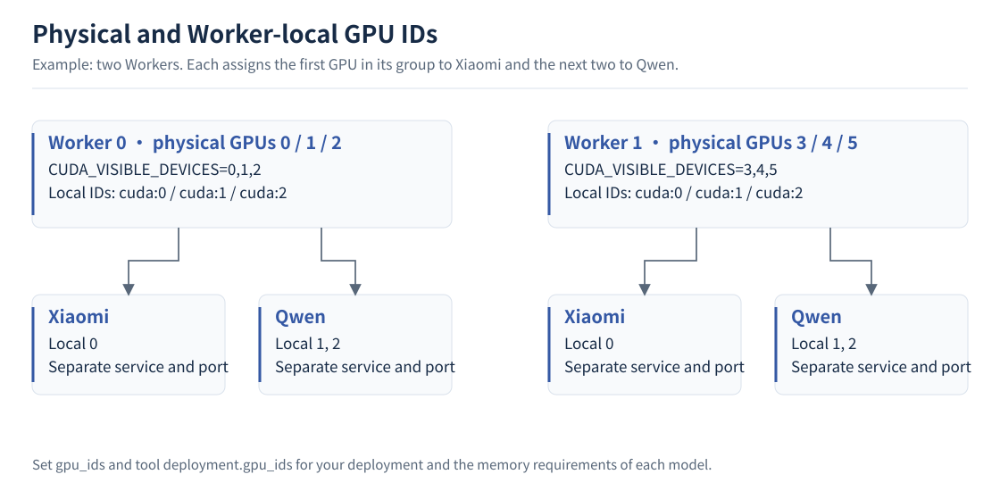

# Deploying a model per Worker

[**English**](worker-model-deployment.md) · [简体中文](worker-model-deployment.zh-CN.md)

This page describes dedicated model services owned by individual Workers. To share one replica across Workers and batch their requests, use `batch_services` as described in [dynamic Graph batching](graph-batching.md).

The behavior here applies to the built-in Worker and process backend. Custom execution backends declare local_worker, managed_workers, or shared_observability capabilities when registering. Startup uses those capabilities instead of branching on backend names. Worker and Tool lifecycles retain their contracts. See [infrastructure plugins](infrastructure-plugins.md).

Each Worker can own its own Xiaomi/Qwen services, ports, logs, and clients. Models load once at startup and are reused across tasks. Recycling or exiting a Worker closes its services. Tasks continue using the common Tool interface.

## 1. Physical and Worker-local GPU IDs



`parameters.runtime.execution.gpu_ids` lists physical GPUs reserved for the run. The runtime divides the ordered pool evenly among `max_workers` Workers. Entries must be nonempty and unique, and the length must be divisible by the Worker count. In contrast, a Tool's `deployment.gpu_ids` uses zero-based indices within that Worker.

For example, use physical pool `[0,1,2,3,4,5]`, `max_workers=2`, Xiaomi on `[0]`, and Qwen on `[1,2]` in each Worker.

| Instance | Physical GPUs visible to Worker | Xiaomi | Qwen |
| --- | --- | --- | --- |
| Worker 0 | 0, 1, 2 | Physical 0 | Physical 1, 2 |
| Worker 1 | 3, 4, 5 | Physical 3 | Physical 4, 5 |

Both Workers see local devices 0, 1, and 2. Each Qwen subprocess sees only its two assigned cards, renumbered again by CUDA as 0 and 1. Tool configuration uses the Worker-local indices.

The framework sets `CUDA_VISIBLE_DEVICES` without changing the global GPU numbering. Physical IDs may also be CUDA-supported GPU UUIDs. Use the host's actual device IDs, which can differ from indices visible in the shell. Configure EGL separately using `egl_device_ids`.

## 2. Enable managed model deployment in generated configuration

The benchmark extension uses `evaluate.py` or `robotenon_benchmark_support.configure`
to generate the full configuration. To use framework-managed `deployment`, add a deployment entry to the generated Tool
and declare the Worker GPU pool under `parameters.runtime.execution`.

The standard Xiaomi evaluator for RoboCasa365 uses a shared batch service with one
resident replica per model GPU. Simulation Workers send inference requests to its endpoint. It does not use the old XR365
two-Tool Xiaomi/Qwen configuration. Other application Graphs can use the generic Tool deployment
described below to start their own services.

## 3. Tool configuration

Example entry for a Tool manifest:

```json
{
  "id": "Qwen3.5-VL",
  "name": "Qwen3.5-VL",
  "params": {"max_completion_tokens": 1024, "temperature": 0.0},
  "deployment": {
    "backend": "robotenon.deployments.models:transformers",
    "gpu_ids": [1, 2],
    "health_path": "/health",
    "model_path": "/data/models/Qwen3.5-9B",
    "executable": "/opt/envs/qwen35/bin/transformers",
    "startup_timeout_s": 600,
    "shutdown_timeout_s": 10
  }
}
```

| Field | Meaning |
| --- | --- |
| `backend` | command or a module:callable plugin reference |
| `gpu_ids` | Required, nonempty list of unique nonnegative integers within the Worker's GPU range |
| `model_path` | Required by the built-in backends and used by both the service and client |
| `executable` | Python path for Xiaomi or the transformers/vllm executable. Defaults to the interpreter or PATH lookup |
| `startup_timeout_s` | Time to wait for readiness, default 600 seconds |
| `shutdown_timeout_s` | Time to wait for shutdown, default 10 seconds |
| `extra_args` | Additional arguments for built-in services. They cannot override owned settings such as model, host, port, device, and tensor-parallel-size |
| `env` | Additional child environment variables. The allocator controls CUDA_VISIBLE_DEVICES |
| `health_path` | HTTP readiness endpoint. Qwen explicitly uses /health. Without a path the runtime checks TCP readiness only |
| `command` | Argument vector for the command backend, executed without a shell |

Tools start sequentially. Set the Worker's `startup_timeout_s` above the sum of its Tool deployment timeouts. The example allows 1,500 seconds for two deployments of up to 600 seconds each, with margin for importing and starting clients.

## 4. Running Qwen across two GPUs

The default Transformers backend uses `--device cuda:0` for one GPU and `--device balanced` for multiple GPUs. The server passes this value to `device_map` to distribute layers and weights across visible devices. This method does not implement tensor parallelism or guarantee linear speedup. Placement and possible CPU offloading depend on the model and available VRAM. See the [Accelerate device map guide](https://huggingface.co/docs/accelerate/v0.30.0/en/concept_guides/big_model_inference#designing-a-device-map).

For tensor parallelism, select `backend: "robotenon.deployments.models:vllm"` and point to a vLLM executable that supports the model. The framework sets `--tensor-parallel-size` to the Tool's GPU count and selects local multiprocessing. Verify support in the installed server version. See the [vLLM serve documentation](https://docs.vllm.ai/en/latest/cli/serve/).

The current upstream Xiaomi service loads using single-GPU `.cuda()`. Accordingly, the built-in xiaomi backend requires exactly one GPU. Listing two devices does not add model parallelism.

## 5. Ports, lifecycle, and logs

- Each model receives a distinct loopback port reserved across launchers for the same user. Workers do not contend for fixed ports such as 8000 or 10086.
- After the service is ready, the runtime calls `bind_deployment(host, port, model_path)` on the Tool. The managed endpoint and model path take precedence over legacy environment variables or external endpoints. `--model-path` does not replace the path in Tool deployment.
- Consecutive tasks on one Worker reuse its service. `end_session` releases only task state. Worker recycling unloads the model, so weigh recycling frequency against reload cost.
- Startup failures and timeouts release resources already started. The process backend gives each Worker a process group and cleans up its model children on normal shutdown or Worker failure. Custom commands must stay in the foreground and in that group.
- During execution the Worker checks whether a managed service exited. Service exit fails the Worker and the normal max_retries policy applies. This check neither probes continuous HTTP inference health nor recovers from a Coordinator crash.
- A Tool with explicit dry_run skips launching the real model. Its GPU configuration still has to validate.

Batch service logs are stored at `<run-directory>/workers/<worker_id>/<tool_id-hash>/server.log`. Adjacent `deployment.json` records Tool ID, PID, port, and the mapping from Worker-local to physical GPUs. For a single task, look under workers beside its output file. Logs survive cleanup. The manifest records startup state; its ready field is not a live health check.

## 6. Extending the deployer

Other models can use the command backend. Its arguments accept `{host}`, `{port}`, `{model_path}`, and `{tensor_parallel_size}`. Escape literal braces by doubling them, following Python format rules. Implement synchronous `bind_deployment(host, port, model_path)` on custom Tools alongside their normal async start/close/call methods.

Deployment belongs to the Tool resource layer. Modules, Bodies, and Environments do not need model launch code. A Tool without a deployment declaration uses its explicit external endpoint.

## 7. Validation scope

Tests use lightweight services to verify physical GPU environment mapping, distinct ports for two Workers, reuse of two model groups across four tasks, cleanup after startup timeout/cancellation, port release after Worker failure, Qwen/Xiaomi endpoint binding, and EGL configuration propagation.

```bash
python -m pytest -o addopts= -q tests/test_model_deployments.py
```

These tests did not launch two sets of large models on six physical GPUs or measure VRAM, inference throughput, or contention with RoboCasa rendering. Real sharding, performance, and GPU inference require separate validation from CUDA visibility in a lightweight service.

## 8. Deployer interface and parameter bindings

Set `deployment.backend` to `command` or an explicit `module:callable` reference. Built-in launch providers include
`robotenon_robocasa365.deployment:xiaomi`、`robotenon.deployments.models:transformers`、
`robotenon.deployments.models:vllm`. Migrate old short names. A plugin implements
`provider(config, host, port) -> list[str]` and returns an argument vector. The common runtime handles GPU assignment, process management, ports, and cleanup.
Configured plugins are trusted Python code, like Tools. Set `health_path: /health` explicitly for HTTP readiness checks. Without it the runtime probes TCP.

A Tool can declare a `role` such as `vla` or `hlp`; the default is `tool`. Trace uses the declared role without guessing from the name.
Use `parameter_bindings` to pass merged runtime parameters into constructor arguments:

```json
{
  "name": "Xiaomi-Robotics-1",
  "role": "vla",
  "parameter_bindings": {
    "dry_run": "runtime.dry_run",
    "model_path": "model.path",
    "host": "model.host",
    "port": "model.port"
  }
}
```

A non-null binding overrides `params`. Missing or null bindings retain explicit `params` or plugin defaults. False and zero remain valid values.
Python callers using bindings must pass `runtime_params` to `build_tool_runtime` or `initialize_tool_runtime`.
Workers no longer write XR_MODEL_* or XR365_DRY_RUN environment variables. Upstream plugins own their legacy environment-variable compatibility.
GPT/Qwen no longer read XR365_DRY_RUN. Existing combined configurations pass dry_run through bindings.

Specify `runtime.graph_id` for a multi-Graph configuration. With one Graph, selection can be automatic. Runner and Portal no longer select an XR365 Graph based on the Monitor switch.
The default configuration is `configs/config.json`, a component/Fake example. For a full episode, supply an explicit complete configuration and Graph outputs.
Existing XR365 and physical robot templates explicitly select their policy and Graph. The common runtime has no XR-specific default.
Historical snapshots and Forks are not rewritten automatically. Migrate snapshots that use old backend names or omit required parameter bindings.
