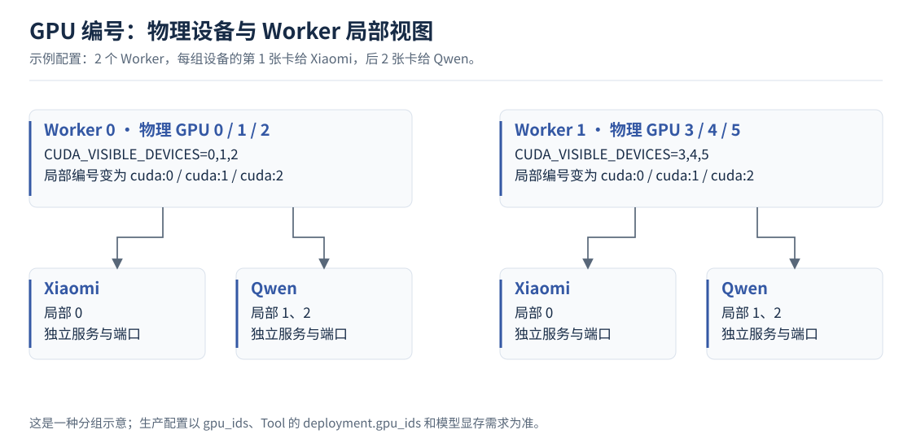

# 每个 Worker 独立部署模型

[English](worker-model-deployment.md) · [**简体中文**](worker-model-deployment.zh-CN.md)

如果多个 Worker 应共享同一模型副本并动态合批，请使用[普通 Graph 动态 batching](graph-batching.zh-CN.md)中的 `batch_services`。本页的每 Worker 独立部署与运行级共享服务是两种部署方式。

本页描述内置 Worker 与 process 后端的模型部署行为。自定义执行后端通过注册能力声明 local_worker、managed_workers 或 shared_observability，启动器不再按后端名称分支。Worker 和模型 Tool 的既有生命周期保持不变；扩展契约见[基础设施插件](infrastructure-plugins.zh-CN.md)。

本功能让每个 Worker 拥有独立的 Xiaomi/Qwen 服务、端口、日志与客户端。模型在 Worker 启动时加载一次，连续任务复用；Worker 回收或退出时关闭服务。任务仍使用统一的 Tool 调用接口。

## 1. GPU 编号分两层



执行层的 `parameters.runtime.execution.gpu_ids` 是本次运行预约的物理 GPU 池，按顺序均分给 `max_workers` 个 Worker。列表不能为空项、不能重复，长度必须能被 Worker 数整除。Tool 的 `deployment.gpu_ids` 则是 Worker 内从 0 开始的编号。

例如，物理池 `[0,1,2,3,4,5]`，`max_workers=2`；每个 Worker 配置 Xiaomi `[0]`、Qwen `[1,2]`：

| 执行实例 | Worker 可见的物理卡 | Xiaomi | Qwen |
| --- | --- | --- | --- |
| Worker 0 | 0、1、2 | 物理 0 | 物理 1、2 |
| Worker 1 | 3、4、5 | 物理 3 | 物理 4、5 |

两个 Worker 内部看到的设备编号均为 0、1、2。Qwen 服务子进程只看到自己的两张卡，因此它内部的 CUDA 编号再次变为 0、1；这与 Tool 配置使用的 Worker 编号不是同一层。

框架通过 `CUDA_VISIBLE_DEVICES` 映射，不修改全局 GPU 编号。物理标识也可使用 CUDA 支持的 GPU UUID；必须按宿主机设备编号配置，不把启动 shell 的可见编号误当物理编号。EGL 使用独立的 `egl_device_ids`，不从 CUDA 编号自动推导。

## 2. 在生成配置中启用模型部署

Benchmark extension 先由 `evaluate.py` 或 `robotenon_benchmark_support.configure`
生成完整配置。若模型使用框架的 `deployment` 机制，在生成配置的 Tool 项中
加入 deployment，并在 `parameters.runtime.execution` 中声明 Worker GPU 池。

RoboCasa365 Xiaomi 的正式 evaluator 使用共享 batch service：每张模型卡一个
常驻副本，仿真 Worker 通过 endpoint 请求推理。它不使用旧 XR365 的 Xiaomi
与 Qwen 双 Tool 配置。其他产品 Graph 仍可使用本页后续的通用 Tool deployment
结构来启动自己的服务。

## 3. Tool 配置结构

以下是可放入 Tool 清单的一项：

```json
{
  "id": "Qwen3.5-VL",
  "name": "Qwen3.5-VL",
  "params": {"max_completion_tokens": 1024, "temperature": 0.0},
  "deployment": {
    "backend": "robotenon.deployments.models:transformers",
    "gpu_ids": [1, 2],
    "health_path": "/health",
    "model_path": "/data/models/Qwen3.5-9B",
    "executable": "/opt/envs/qwen35/bin/transformers",
    "startup_timeout_s": 600,
    "shutdown_timeout_s": 10
  }
}
```

| 字段 | 说明 |
| --- | --- |
| `backend` | command 或 module:callable 插件路径 |
| `gpu_ids` | 必填，非空、不重复的非负整数；必须落在 Worker GPU 范围内 |
| `model_path` | 内置后端必填；实际服务与客户端均使用它 |
| `executable` | Xiaomi 的 Python 路径，或 transformers/vllm 的可执行文件；省略时使用默认解释器或 PATH |
| `startup_timeout_s` | 等待模型服务就绪，默认 600 秒 |
| `shutdown_timeout_s` | 等待服务关闭，默认 10 秒 |
| `extra_args` | 内置服务附加参数；不能覆盖模型、host、port、device、tensor-parallel-size 等归属配置 |
| `env` | 子进程附加环境变量；CUDA_VISIBLE_DEVICES 仍由分配器控制 |
| `health_path` | HTTP 健康检查路径；Qwen 配置显式指定 /health，未配置则 TCP 就绪探测 |
| `command` | command 后端的 argv 数组；不经 shell 执行 |

Tool 顺序启动，因此 Worker 的 `startup_timeout_s` 必须大于所有部署 Tool 启动超时之和。示例使用 1500 秒覆盖两项各 600 秒的部署。客户端导入和启动也需要留有余量。

## 4. Qwen 双卡的执行方式

默认 Transformers：单卡使用 `--device cuda:0`，多卡使用 `--device balanced`。服务器现有 serving 实现会把该值传入 `device_map`，在可见卡之间分配模型层/权重；它不等于张量并行，也不保证两卡带来线性加速。具体放置及可能的 CPU/offload 行为取决于模型和可用显存，见 [Accelerate 的设备映射说明](https://huggingface.co/docs/accelerate/v0.30.0/en/concept_guides/big_model_inference#designing-a-device-map)。

需要张量并行时，改成 `backend: "robotenon.deployments.models:vllm"` 并指向支持该模型的 vLLM 程序；框架会设置 `--tensor-parallel-size` 为此 Tool 分配的卡数，并使用本机 multiprocessing 执行后端。参数依据见 [vLLM 服务文档](https://docs.vllm.ai/en/latest/cli/serve/)。使用前确认所安装的服务端版本支持目标模型。

Xiaomi 当前上游服务使用单卡 `.cuda()` 加载，因此内置 xiaomi 后端要求一个 GPU。不能仅把列表写成两张卡，就声称该服务已支持多卡模型并行。

## 5. 端口、生命周期与日志

- 每个模型分配独立回环端口，并在本用户的启动器之间预约；没有固定 8000/10086 的跨 Worker 冲突。
- 服务就绪后，通过 Tool 的 `bind_deployment(host, port, model_path)` 回填地址。托管地址与模型路径优先于旧的环境变量/外部端点；`--model-path` 不替代 Tool deployment 中的模型路径。
- Worker 内连续任务复用模型服务，`end_session` 只清任务状态。Worker 回收才卸载模型；需要衡量回收频率与重载成本。
- 启动失败或超时会关闭已启动资源。进程后端给 Worker 建立独立进程组，正常清理后及 Worker 崩溃时清理组内模型子进程；自定义命令不得后台化或自行脱离进程组。
- Worker 运行期间会检查托管服务是否退出；服务退出使 Worker 失败，之后遵循已有 max_retries 策略。当前检查不是持续的 HTTP 推理探活，也不是 Coordinator 崩溃自动恢复。
- 明确启用 dry_run 的 Tool 不启动实际模型；完整 GPU 配置仍需通过校验。

批量运行的日志在 `<run目录>/workers/<worker_id>/<tool_id哈希>/server.log`，同目录的 `deployment.json` 包含 Tool ID、PID、端口、Worker 局部 GPU 和物理 GPU 映射。单任务位于输出文件父目录下的 workers 目录。清理后的日志保留；manifest 是启动时记录，不能用其中的 ready 字段判断进程当前仍存活。

## 6. 扩展部署器

其他模型可以使用 command 后端，命令参数支持 `{host}`、`{port}`、`{model_path}`、`{tensor_parallel_size}` 占位符。字面量花括号按 Python format 规则写成双括号。自定义 Tool 实现同步 `bind_deployment(host, port, model_path)`，并继续提供原有异步 start/close/call 接口。

部署器属于工具资源层，不向 Module、Body 或 Environment 注入模型启动逻辑。未声明 deployment 的 Tool 继续使用其显式外部端点。

## 7. 验证边界

测试使用轻量服务验证物理 GPU 环境映射、两个 Worker 的独立端口、四个任务复用两组模型、启动超时/取消清理、Worker 异常退出后的模型端口释放、Qwen/Xiaomi 客户端地址回填及 EGL 配置传递。

```bash
python -m pytest -o addopts= -q tests/test_model_deployments.py
```

没有在真实六卡环境启动两组大模型，也没有测量显存、推理吞吐或 RoboCasa 渲染竞争。服务端 CUDA 可见性与真实模型分片/性能属于不同验证层次，不能把假服务测试当作 GPU 推理验收。

## 8. 部署器接口与参数绑定

`deployment.backend` 使用 `command` 或显式的 `module:callable`。内置启动配方位于
`robotenon_robocasa365.deployment:xiaomi`、`robotenon.deployments.models:transformers`、
`robotenon.deployments.models:vllm`；旧的短名称必须迁移。插件签名为
`provider(config, host, port) -> list[str]`，只生成 argv；GPU 分配、进程管理、端口和清理由通用运行层负责。
配置插件与 Python Tool 一样属于可信代码。HTTP 就绪探测必须显式配置 `health_path: /health`，未配置时只探测 TCP。

Tool 可声明 `role`（如 `vla`、`hlp`；默认 `tool`），Trace 不再根据名称推断角色。
`parameter_bindings` 将合并后的运行参数注入构造参数，例如：

```json
{
  "name": "Xiaomi-Robotics-1",
  "role": "vla",
  "parameter_bindings": {
    "dry_run": "runtime.dry_run",
    "model_path": "model.path",
    "host": "model.host",
    "port": "model.port"
  }
}
```

绑定值非 null 时覆盖 `params`；缺失/null 保留显式 `params` 或插件默认值；false/0 不会被忽略。
使用绑定的 Python 调用者需向 `build_tool_runtime` / `initialize_tool_runtime` 传 `runtime_params`。
Worker 不再写入 XR_MODEL_* / XR365_DRY_RUN 环境变量；上游插件的独立环境变量兼容仍由插件自己负责。
GPT/Qwen 不再读取 XR365_DRY_RUN，现有组合配置通过绑定向它们传入 dry_run。

多图配置必须显式指定 `runtime.graph_id`，单图可自动选择。Runner 和 Portal 不再按 Monitor 开关选择 XR365 图。
默认配置路径改为通用 `configs/config.json`；该文件仍是组件/Fake 示例，正式 episode 实验应显式提供完整配置和图 outputs。
现有 XR365 和真机组合模板仍显式选择其策略和图，不代表通用运行层默认选择 XR。
历史实验快照/Fork 不自动改写；使用旧 backend 短名或缺少参数绑定的快照需要按上述规则迁移。
