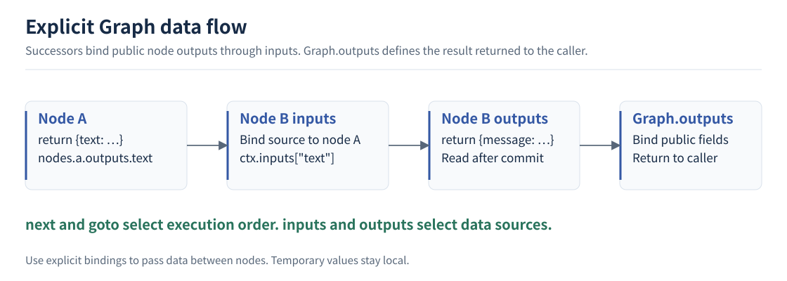

# Workflow and JSON Graph reference

[**English**](workflow.md) · [简体中文](workflow.zh-CN.md)

Environment and Body RPC services support replaceable stream transports. Configure external checkpoint storage with `parameters.runtime.context_store`; the application closes it. Pluggable runtime.execution.backend settings do not change the WaveScheduler algorithm or next/goto/loop/transition semantics inside a Graph. See [infrastructure plugins](infrastructure-plugins.md).

`GraphRuntime`, `EnvironmentService`, `MonitorRuntime/MonitorService`, and `BodyService` respectively orchestrate the workflow, environment, monitoring, and action execution. GraphRuntime connects them with JSON nodes. All nodes in an episode share one `GraphContext`. The current environment service is bound to the process-local `robotenon.envs.environment` handle. In-process objects and UDS clients expose matching methods, allowing the same Graph to use a simulator, physical robot, or remote Body. Calls across services carry a minimal JSON `ServiceContext` snapshot. Workflow alone writes the full `ctx`.

Only the resident `BodyService` executes actions. EnvironmentService provides reset/observe/command/health/close. Simulation, physical robots, and remote deployments use the same control path.

## 1. JSON Graph



### 1.1 Four routing operations

Use distinct `next`, `goto`, `loop`, and `transition` fields. Routing objects no longer accept `kind`. A next field cannot contain goto/loop/transition statements.

| Field | Semantics | Form |
| --- | --- | --- |
| `next` | Run after acquiring an arrival token from each predecessor group; any member can satisfy its group | `{"node": "B", "when": "..."}` or an array of objects |
| `goto` | Invoke the target directly, even for its first invocation, without waiting for its original predecessors or adding the caller as a predecessor | `{"node": "A", "when": "..."}` or an array of objects |
| `loop` | Repeat this node, independently of slow branches | `true` or `{"every": "20ms", "when": "..."}`. Omitted, null, or false disables the loop |
| `transition` | End the current Graph and start at another Graph's entry without pushing a subgraph call frame | `{"graph": "other", "when": "...", "inputs": {...}}` or an array of objects |
| `default` | Choose one normal successor only if all four operations fail to match | Node ID or `END` |

Use `node` and `when` for a conditional edge and an array of objects for multiple edges. Omit when for unconditional routing. Target strings, embedded next/goto statements, and to/target or condition aliases remain for compatibility.

A `loop` has no target and does not accept a list. `{"loop": {"node": "B"}}` is rejected even if B is the current node. Use `{"loop": {"when": "..."}}`. For normal next/default edges, declare the source in the target's predecessors. The target waits for actual arrivals from completed predecessors that selected it. A goto skips this wait.

### 1.1.1 AND/OR predecessor groups

`predecessors` uses an outer AND list with optional inner OR lists. Existing flat lists remain supported.

```json
{"predecessors": ["a", "b"]}
```

means `a AND b`.

```json
{"predecessors": ["a", ["b", "c"]]}
```

means `a AND (b OR c)`.

```json
{"predecessors": [["a", "b"], ["c", "d"]]}
```

means `(a OR b) AND (c OR d)`. Each outer element represents a required group. A string is a single-member group. A nested list is an OR group. Empty OR groups, third-level nesting, and duplicate members within or across groups fail validation. Every member must be a declared node whose `next` or `default` can select the target.

The first arrival satisfies an OR group. Its remaining members no longer appear as missing. Multiple simultaneous arrivals for the same group still release one target invocation. Checkpoints record actual arriving members and retain group semantics on recovery. `goto` bypasses all predecessor groups.

`transition` is a Graph-level tail call. It invalidates successors that have not started, queued invocations, and loops in the current Graph, then starts the target at its entry. A subgraph node instead returns to its parent after completion. A transition reuses the current `GraphContext`, environment, Body, Monitor, and Tools without increasing nesting depth. A may transition to B and B back to A without triggering recursion checks. `inputs` resolves visible data and merges it into the context's Graph input values. The target's old cursor resets, while node results and audit history remain. Checkpoints include the active Graph and pending target, so crash recovery does not return to the old Graph.

```json
{
  "id": "evaluate",
  "module": "task_evaluator",
  "transition": [{
    "graph": "plan_graph",
    "when": "ctx.results['evaluate']['continue'] == true",
    "inputs": {"reason": "nodes.evaluate.outputs.reason"}
  }]
}
```

On node completion, a matching transition takes precedence over next/goto/loop/default and prevents further routes from the departing Graph. Already-started parallel siblings finish and commit before the switch. Multiple matching transitions in one completion batch are ambiguous and fail.

```json
{
  "graphs": [{
    "id": "main",
    "entry": "A",
    "max_steps": 1000,
    "nodes": [
      {"id": "A", "module": "observe", "next": {"node": "B"}},
      {"id": "B", "module": "plan", "predecessors": ["A"], "next": {"node": "C"}},
      {
        "id": "C", "module": "execute", "predecessors": ["B"],
        "goto": [{"node": "A", "when": "ctx.trigger == 'next' and ctx.results['C']['refresh'] == true"}],
        "loop": {"every": "20ms", "when": "ctx.results['C']['continue'] == true"}
      }
    ]
  }]
}
```

When C completes, it can call A again and schedule a self-loop. The loop continues while A→B runs. When B triggers C via next, the old C loop becomes invalid and C runs against a new snapshot. After that invocation, C evaluates its own when again. Invalidation does not permanently disable the loop.

Every self-loop iteration evaluates all routes on the node. Use `ctx.trigger == 'next'` alongside an application condition to restrict a goto to predecessor activations and avoid recalling A after every loop. A node has at most one invocation in flight. Pending duplicates coalesce. A next/goto received during execution retains at most one follow-up invocation, which takes a fresh snapshot after exit. A complete next takes priority over goto, and goto over loop. An incomplete next never blocks goto. If a complete next and goto target the same node before launch, the merged call uses ctx.trigger=next. Otherwise goto uses ctx.trigger=goto. This also holds when A's token is already present and B sends both next C and goto C. Only a completed next interrupts an active old loop; goto waits for it to finish.

`ctx.trigger` is a read-only property local to the invocation. The module and post-completion when conditions see `entry`, `next` (including default), `goto`, or `loop`. Parallel calls keep distinct values and recovery preserves the original trigger. It is null outside a Graph. A subgraph uses its own trigger and restores the parent's trigger on return.

For `loop: {"every": "20ms", "when": "ctx.trigger == 'next'"}`, a predecessor's next call schedules one loop after completion. At 20 ms, the scheduler rechecks the condition using the original next trigger. The actual call then uses loop, so its post-completion condition fails and no further loop is scheduled. For a sustained loop, use an application condition such as `ctx.results['C']['active']`.

`loop.every` requires a positive duration with units, such as `20ms` or `0.5s`. Each period is anchored to invocation start using a monotonic clock. Missed periods are skipped; invocations of a node never overlap. Omitting every repeats immediately after completion. Waiting allocates no node workspace. At dispatch, a fresh snapshot is used to recheck loop.when. A false condition discards the loop without executing, incrementing the count, or triggering default. The recheck uses the original scheduling trigger, and execution uses loop. next/goto can replace a pending timed invocation. A recovered waiting loop waits one new period, skipping ticks during downtime. An already active invocation resumes with its checkpointed snapshot. The period is a scheduling target.

`default` applies only when none of the four operations matches. An unconditional route, including loop or transition, makes default unreachable. Configuration loading warns without changing routing behavior.

Ordinary fan-out example:

```json
{"id": "start", "module": "prepare",
 "next": [{"node": "a", "when": "ctx.inputs['x']"},
          {"node": "b", "when": "ctx.inputs['y']"}],
 "default": "fallback"}
```

Without a matched transition, all matching next/goto branches take effect and targets are deduplicated per operation. A missing when denotes an unconditional edge. For predecessors [A, B], both A and B must finish and select next C. For [[A, B]], either arrival suffices. Tokens wait until all outer groups are satisfied, yielding one call. `END` closes only its current route; other branches and valid self-loops continue.

Normal next/predecessors form a DAG. An entry node cannot have predecessors. A goto may call a target that has never run and skips the target's original prerequisites. A new goto invalidates old arrivals and queued next requests for that target and its normal successors, preventing cross-generation joins. An old ordinary call may complete and commit without deriving invalidated successor routes. Partial predecessor arrivals do not interrupt a self-loop; a fully satisfied join does. Repeated arrivals during execution coalesce by source. Once a complete next is queued, only one follow-up call is retained.

`GraphResult.routing_diagnostics` and the episode summary's field of the same name list unreleased joins. Checkpoints preserve `waiting_diagnostics` for inspection after recovery. Only targets with partial arrivals are reported. An unselected branch is not an error, and diagnostics do not change success or failure.

For example, A selected C, but B finished without selecting C:

```json
[{"graph": "main", "scope": ["main"], "node": "C",
  "arrived": ["A"], "missing": {"B": "not_selected"}}]
```

`not_completed` means the source has not finished this generation and may not have started. `not_selected` means routes were evaluated without selecting this target. `awaiting_batch` means the result committed, but routing waits for normal siblings to finish. Subgraph diagnostics are saved in the parent node's subgraph outputs.

Scheduling rules:

- Ordinary nodes released together read one immutable snapshot. Evaluate routes after the batch commits.
- Schedule each loop activation independently of the completion barrier for slow ordinary siblings.
- Allow one in-flight invocation per node. A completed predecessor next has priority over goto and loop. A goto precedes an unstarted loop.
- To replace a running self-loop with next, persist invalidation first, then cancel, await exit, and create the new workspace. An old loop that swallows cancellation still cannot publish a late result or route successors.
- If predecessor and loop finish simultaneously, process the predecessor first. Retain previously committed loop results as history, suppressing stale routing.
- max_steps applies to goto and loop. Cancellation requires node cooperation and cannot stop a blocking vendor thread or undo a physical effect. Low-level stopping belongs to Body and its driver.

To stop the entire current Graph, call an explicit system node:

```json
{"id": "stop", "type": "system", "operation": "graph.stop"}
```

Use `next: "stop"` or a conditional route to invoke it. graph.stop atomically commits its result and the termination marker without waiting for sibling completion. It cancels and waits for in-flight branches and subgraphs, clears pending calls and timed loops, then returns success. Late publications are rejected, and recovery does not revive abandoned branches. Prior committed results remain. External threads and physical devices still require driver-level stop handling. graph.stop cannot have successors. In a subgraph it stops only that subgraph and the parent can continue. In the root it stops the workflow. END always closes just the current route.

Ordinary `edges` accept from/to/when or source/target/condition and compile to next. Do not mix edges with node-level routing. The old `edges[].kind` is removed. Move back-edges to the source node's goto field.

Other node fields retain their contracts. Set `type` to module, graph, or system and supply module, graph, or operation respectively. `emergency_graphs`, `recovery`, and compatible backend names remain available.

### 1.2 Conditions

The condition parser does not use Python `eval`. It accepts:

- `ctx` attribute and dictionary lookups, including `ctx.step`, `ctx.results['evaluate']['score']`, and `ctx.outputs['grasp']['ok']`.
- String, number, boolean, and null literals using JSON-style `true/false/null`.
- `== != > >= < <= in not in`；
- `and or not` and parentheses.

Calls, imports, comprehensions, and arbitrary code are disallowed. Invalid conditions produce explicit errors during loading or execution.

### Condition validation and diagnostics

Loading validates static node IDs in `ctx.results['node_id']`, `ctx.results.node_id`, and `ctx.result_versions['node_id']` against the current Graph. Errors identify the Graph, source node, and routing operation. Application result fields are not statically inferred. Dynamic keys such as `ctx.results[ctx.inputs['chosen']]` resolve at runtime. Subgraph fields nested inside a parent result are also exempt from current-Graph node-ID validation.

`GraphResult.routing_events` and episode summaries include recent routing decisions.

- `phase=after_completion` evaluates next/goto/loop/transition on completion. `phase=before_loop` rechecks a pending loop before dispatch.
- `expression`, `matched`, `operation`, and `target` identify the rule and decision. A matched next may still wait on predecessor groups. Inspect routing_diagnostics for the reason.
- `trigger` is the invocation source used for evaluation. before_loop reports the scheduling trigger; execution itself uses loop.
- `snapshot_versions` identifies available node-result versions, without copying their values or claiming every one was read.
- `activation` identifies the completed activation. It is null before_loop because the new activation has not yet been allocated. `rule_index` distinguishes rules on the same node.

Each Graph invocation retains the latest 200 routing/timing records in its checkpoint. `routing_events_dropped` counts evictions. With Trace enabled, decisions produce `kind=routing` spans and node spans include `trigger` and `read_versions`. The configured buffering and persistence rules apply. Diagnostic records have no exactly-once guarantee.

`GraphResult.loop_metrics` and episode summaries aggregate by Graph scope and node. They include `target_interval_ms`, `last_interval_ms`, `last_duration_ms`, and cumulative `skipped_ticks`. Compute means from `interval_total_ms / interval_samples` and `duration_total_ms / invocations`.

MetricsClient receives the `workflow.loop.duration_ms` and `workflow.loop.interval_ms` histograms, `workflow.loop.skipped_ticks` counter, and `workflow.loop.target_interval_ms` gauge, labeled by graph/node. Metrics cover nodes configured with a loop, including initial, next, and goto invocations. Intervals compare consecutive starts on the same loop chain. Duration includes node execution and safety checks but excludes final result commit. Completed indicates a return from execution; persistence may still be pending. Cancelled or exceptional calls count as interrupted. Recovery retains historical aggregates and establishes a fresh monotonic clock without counting downtime or catching up missed periods. Metrics do not guarantee hard real-time behavior.

Configurations use the current syntax without a syntax_version field or multiple interpreters. Graph fingerprints enforce compatibility.

### 1.3 GraphContext for one task

This low-level integration assumes an async application that supplies session_id, env, body, and monitor and owns their startup and shutdown. For a runnable entry point, use the [quickstart](quickstart.md).

```python
from robotenon.runtime.config import load_application_config
from robotenon.runtime.factory import (
    build_module_runtime,
    build_tool_runtime,
    initialize_body_service,
)
from robotenon.workflow import GraphRuntime, GraphContext, load_graphs_config

loaded = load_application_config("configs/config.json")
tools = build_tool_runtime(loaded.tools)
modules = build_module_runtime(loaded.modules, tools=tools, params=loaded.params)
graphs = loaded.graphs
ctx = GraphContext(
    session_id=session_id,
    task_id="pick",
    values={"object": "mug"},
)
# env = EnvironmentServiceClient("/tmp/robotenon-env.sock")
# body = BodyServiceClient("/tmp/robotenon-body.sock")
# monitor = MonitorServiceClient("/tmp/robotenon-monitor.sock")
from robotenon.envs import bind_environment
bind_environment(env)
result = await GraphRuntime(graphs.graph_map(), modules, tools=tools, params=loaded.params).run(
    "main", ctx=ctx, body=body, monitor=monitor,
)
```

Every node receives the same `ctx` object:

- `feedback/action/action_chunk/body_result/monitor_report/decision/task_item/safety` hold the most recent embodied state.
- `inputs` exposes read-only Graph input or declared node bindings. `values` is the current invocation's private writable workspace.
- `results[node_id]` is a read-only published-state snapshot. `previous` holds this node's last successful values.
- `outputs[node_id]` is read-only diagnostic output. A plain dictionary return merges into the node workspace; explicit `NodeResult.output` stays separate.
- `history/step` record the audit trail and step counter.
- `current_graph/current_node/status/error` give the execution position and error status.
- `params` is the read-only configuration view from Parameter. Call
  `ctx.params.get("name", [type, default])` to read a value. It is absent from checkpoints and is reinjected
  by application bootstrap on recovery.

GraphRuntime injects a process-local `ToolRuntime` into `ctx.tools`, outside the checkpoint. A Module can call `await ctx.call_tool("model_main", {"prompt": ...})` and use `ToolResult.output` for a Memory, Skill, or model result. Tools are constructed once at assembly and reused by nested Graphs, goto, and multiple runs in the process. Avoid reloading models or opening database connections inside a Module.

New modules implement `async def run(self, ctx)`:

```python
@register_module("safety-check", kind="evaluator")
class SafetyCheck:
    async def run(self, ctx):
        ctx.values["need_recovery"] = ctx.safety.level != "P0"
        return {"ok": not ctx.values["need_recovery"]}
```

GraphRuntime invokes `run(ctx)` for Graph nodes. `ModuleRuntime.call()` still supports string-based, non-Graph calls using `invoke(arguments, ModuleContext)`. A policy module produces `ctx.action_chunk`; `body.execute` sends and executes it. `env.observe` reads the environment and `monitor.check` reads compliance findings. Read parameters using `ctx.params.get(name, [type, default])`. Environment methods are available on the `robotenon.envs.environment` singleton so each ordinary Graph Module receives just `ctx`.

### 1.4 EnvironmentAdapter and Session

Environment is separate from ModuleRuntime. The Runner constructs an Adapter, Session, and Body per task. A lower-level integration may use a separate resident service. This example assumes the caller supplies its server, driver, and context.

```python
from robotenon.envs import environment_registry, register_environment

@register_environment("my-env")
class MyAdapter:
    descriptor = ...
    async def open(self, spec): ...

adapter = environment_registry.get("my-env", endpoint="127.0.0.1:9000")
session = await adapter.open(session_spec)
env = EnvironmentServiceClient("/tmp/robotenon-env.sock")
bind_environment(env)  # Bind for this run; modules access it through robotenon.envs.environment.
body = await initialize_body_service(
    loaded.bodies,
    runtime={"executor": body_driver.send_action, "stop_executor": body_driver.stop_now},
    safety_state=safety_state,
)
monitor = SafetyMonitorService(env, safety_state=safety_state)
ctx = GraphContext(task_id="pick")
result = await graph_runtime.run("embodied_loop", ctx=ctx, body=body, monitor=monitor)
await body.close(); await monitor.close(); await env.close_connection()
```

`EnvironmentService` provides `start()`, `reset(ctx)`, `observe()`, `command()`, `health()`, and `close()`. Workflow uses `EnvironmentServiceClient` for a resident envs process. Actions go only through `body.execute`. `env.reset`, `env.observe`, and `env.close` handle sessions and feedback. A Workflow client should call `close_connection()` on exit and leave the session owned by the envs process open. Nested Graphs, goto, and emergency/recovery Graphs reuse the same `ctx` and environment connection.

### 1.5 Scheduling and recovery

JSON edges compile to next. `backend` selects a compatible scheduling configuration. Both supported names use `WaveScheduler`.

An iteration emits tokens only to successors it selected. Checkpoints preserve arrivals, follow-up requests, and routing generations, preventing stale tokens from surviving a back-edge. Parallel subgraphs share application context but each has its own ExecutionFrame. Conditions are validated and cached during assembly.

With ContextStore enabled, checkpoints save the schema version, Graph/module fingerprint, pending/wave/done state, loop iterations, and application state. An empty GraphContext with the same session_id can resume unfinished nodes. Committed nodes do not replay. In-flight nodes may retry, so side effects must be idempotent or reconcilable. A legacy in-flight checkpoint with no cursor fails explicitly and requires a restart. See the [migration guide](changes/migration-2026-09.md).

## 2. Integrate embodied components

1. Register policy, VLA, Evaluator, or safety-check Modules with `@register_module`. Register reusable models, Memory, Skill, or other Tools with `@register_tool`. Use `@register_body` for action execution, `@register_environment` for an environment Adapter/Session, and `@register_monitor` for a compliance Monitor.
2. Reference `modules_configs.json`, `graphs.json`, `tools_configs.json`, `monitor_configs.json`, `body_configs.json`, and `envs_configs.json` from `configs/config.json`. Parameter merges them at startup. Run `initialize_tool_runtime`, `initialize_module_runtime(..., tools=tools, params=loaded.params)`, `initialize_body_service` if needed, and `initialize_monitor_runtime(loaded.monitors, environment_service=env, params=loaded.params)`. The envs service creates its Adapter with `initialize_environment_adapter`, then creates Sessions per Run.
3. Set `nodes[].module` in `graphs.json` to the configured Module instance ID. Modules call Tools through `ctx.call_tool(...)`. Use `body.execute` for actions, `env.observe` for observations, `monitor.check` for compliance, and `monitor.request` or `monitor.request.<monitor_id>` for on-demand checks.
4. Read inputs from ctx and preferably return NodeResult. Direct ctx writes and dictionary returns are supported, but concurrent writes must avoid conflicts. Read parameters with `ctx.params.get(name, [type, default])`. Access the environment through `from robotenon.envs import environment`. Do not create model, Memory, Skill, environment, or Body connections inside Modules. GraphRuntime reuses `ctx`, the environment singleton, `body`, `monitor`, and `tools` across the Run.
5. Send telemetry through `MetricsClient` and `TraceClient`; storing live metrics in ctx is not a substitute for persistence.

### 2.1 Service interfaces

```python
class EnvironmentService(Protocol):
    async def start(self) -> None: ...
    async def reset(self, ctx) -> EnvironmentFeedback: ...
    async def observe(self) -> EnvironmentFeedback: ...
    async def command(self, command) -> EnvironmentFeedback: ...
    async def health(self) -> EnvironmentHealth: ...
    async def close(self) -> None: ...

class BodyService(Protocol):
    async def start(self) -> None: ...
    async def execute(self, chunk: ActionChunk) -> BodyExecutionResult: ...
    async def interrupt(self, reason: str, *, safe_action=None) -> BodyExecutionResult: ...
    async def health(self) -> EnvironmentHealth: ...
    async def close(self) -> None: ...

class MonitorService(Protocol):
    async def start(self) -> None: ...
    async def check(self, feedback=None, *, context=None) -> MonitorReport: ...
    async def request(self, name=None, request=None, *, feedback=None, context=None) -> MonitorReport: ...
    async def latest(self) -> MonitorReport | None: ...
    async def health(self) -> EnvironmentHealth: ...
    async def close(self) -> None: ...
```

`services.ipc` provides JSON-lines UDS clients and servers for these protocols. `ServiceSupervisor` calls `start()`, polls `health()` with a default two-second timeout, and renews the service heartbeat. A failed readiness probe, nonready service, timeout, or process exit produces fail-safe P3/P4 signals in shared safety state. The envs process owns the Session; Workflow and Monitor have separate Environment clients. The Body process owns its driver and watchdog. Send JSON model data across processes, not SDK objects.

## 3. Concurrency, persistence, and safety

- A Workflow instance owns one active session. Schedule multiple sessions in separate processes or create a Workflow per session.
- TaskQueue provides SQLite WAL, leases, and `queue_events`. The default Graph, Runner, and batch backend do not consume it, and the Graph does not automatically apply EvaluationDecision.queue_operation. Leases do not imply experiment crash recovery. See the [runnable example](evaluation-monitoring-and-task-queue.md).
- Metrics/Trace clients use bounded nonblocking queues consumed by a configured writer in the run process or an external daemon. The Portal reads their data.
- P0 is normal, P1 monitoring, P2 restricted, P3 protective pause, and P4 emergency stop. P3/P4 latch. Workflow fails safe before another action, while the Body watchdog interrupts the active chunk and executes a configured safe action. The Body driver and hardware controller implement physical stopping.
- Use `SafetyStateStore` in one process or shared `SQLiteSafetyStateStore("runs/safety.sqlite3")` across processes. Set `ROBOTENON_SAFETY_DB` for the default instance to use a shared file. Persist the Workflow's `GraphContext` using `SQLiteContextStore("runs/context.sqlite3")`. Each write uses `context_revision` CAS to prevent stale snapshots overwriting newer state after restart or concurrent access.

- Body returns an `ActionExecution` acknowledgement per Action and deduplicates by session plus `idempotency_key` (default `action_id`). Expiry of `deadline_ns`, Action timeout, or Chunk `max_duration_ms` sends a low-level stop, returns `deadline_exceeded`, and suppresses subsequent actions. The stop callback defaults to a 0.5-second timeout. A timeout or failure raises latched P4. Configure `ROBOTENON_ACTION_DB` or `idempotency_db` to reuse durable successful acknowledgements across Body restarts.

### 3.1 Emergency handling and recovery

Workflow polls safety state before and after each Graph node. A Graph may configure:

```json
{
  "emergency_graphs": {"P3": "emergency_pause", "P4": "emergency_stop"},
  "recovery": {
    "P1": {"mode": "auto", "recovery_graph": "recover_monitor", "resume_graph": "embodied_loop"},
    "P3": {"mode": "manual", "recovery_graph": "recover_pause", "resume_graph": "embodied_loop", "clear_latched": true},
    "P4": {"mode": "manual", "recovery_graph": "recover_estop", "resume_graph": "embodied_loop", "clear_latched": true}
  }
}
```

`emergency_graphs` stop or protect. `recovery_graph` can reset, self-test, or calibrate. `resume_graph` continues the task once the level returns to P0–P2. Manual levels require prior acknowledgment from on-site staff or the hardware controller.

```python
if result.status == "safety_stop":
    result = await graph_runtime.recover(
        "embodied_loop", ctx, body=body, monitor=monitor, approved=True,
    )
```

Recovery reuses the original `ctx`, environment singleton, `body`, and `monitor`. `GraphContext.history` traces emergency/recovery/resume. For resident handling, use `RecoveryController`. It invokes recovery Graphs for auto levels. Manual levels enter `waiting_manual` until a caller confirms with `approve(incident_id)`. The number of attempts is bounded per `incident_id`. Set `recovery_timeout_s` to limit each attempt and prevent endless retries or indefinite blocking.

## 4. Batch process execution

Graph wave concurrency applies inside one task. Parallel RoboCasa Sessions require isolated Workers from `runtime.execution.backend=process`. Each Worker executes one task Graph at a time, reuses Tools across tasks, and clears session state at task end.

Recovery operates at three levels. An explicitly configured Graph checkpoint resumes unfinished nodes. A live parent can replace a lost Worker and retry in a new attempt. Coordinator crashes do not automatically resume. For actions with physical effects, reconcile device state or provide idempotency before retrying.

See [execution and observability](execution-and-observability.md) for the full configuration and recovery matrix.

## Node-private values and result publication

All nodes receive the same ctx object. `ctx.values` selects the current invocation's private workspace using its ContextVar identity.
The workspace starts empty. `ctx.inputs` is a read-only input view and `ctx.previous` contains this node's last successful values.
`ctx.results["node"]` contains the published read-only result in the current Graph scope. Nodes in one wave read the same committed view.

```python
async def run(self, ctx):
    instruction = ctx.inputs["instruction"]
    vision = ctx.results["vision"]  # Declare vision as a predecessor of this node.
    ctx.values["count"] = ctx.previous.get("count", 0) + 1
    ctx.values["decision"] = await self.compute(instruction, vision)
    # The runtime commits a normal return; no explicit publish is required.
```

A plain dictionary return merges into the node's workspace. `NodeResult.state_patch` updates that node only. `NodeResult.output` is recorded separately.
Different nodes may use the same keys. After success, the runtime freezes the result and writes it with typed field changes and the done record to one checkpoint.
Only after successful persistence does it publish to memory, emit exit, and release successors. Failed or cancelled drafts leave the previous result intact.

Published results are recursively read-only. Workspace dictionary and list references close at the end of the call; later writes by background subtasks raise an error.
Subtasks of one node share its workspace. Use `ctx.atomic_update` for atomic read-modify-write inside it, not for a cross-node shared counter.
`asyncio.to_thread` inherits the workspace context. A thread without propagated context fails explicitly when accessing the workspace.

Typed fields such as `ctx.action` and `ctx.feedback` support snapshot reads and staged explicit assignment committed on success. Two branches in one wave writing the same field conflict.
Reads return copies. Reassign the modified object to stage changes. SafetyStateStore independently manages safety state; mutating a private copy cannot clear an incident.
Service connections, resident Module/Tool instance state, and the live observation_updates channel are outside values isolation.
Physical actions and network requests do not roll back when a draft is discarded.

After running a Graph, reading `ctx.values` outside a node raises an error. Read `ctx.results` or `ctx.inputs` instead.
Existing robot modules explicitly select sources with `ctx.read_values("plan", "verify", ...)` to obtain a mutable copy. There is no implicit global-values fallback.
Explicitly restart legacy in-progress checkpoints. New checkpoints save each wave's read view, so a resumed node cannot see a sibling's later publication prematurely.
See [node-private context](node-private-context.md) for interface and migration examples.
