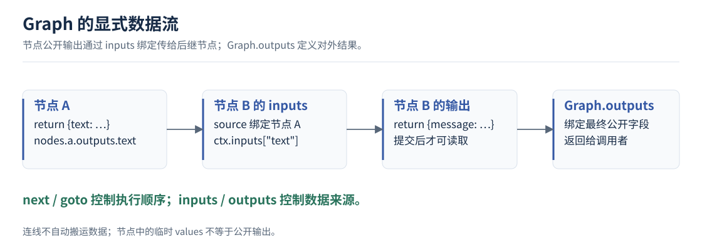

# Workflow 与 JSON Graph 使用说明

[English](workflow.md) · [**简体中文**](workflow.zh-CN.md)

Graph 使用的环境与 Body 服务可以更换 RPC 流传输；checkpoint 可通过 `parameters.runtime.context_store` 装配外部存储，并由应用关闭。此处 runtime.execution.backend 的插件化不改变 Graph 内部 WaveScheduler 算法或 next/goto/loop/transition 语义。详见[基础设施插件](infrastructure-plugins.zh-CN.md)。

`GraphRuntime`、`EnvironmentService`、`MonitorRuntime/MonitorService` 和 `BodyService` 分别负责流程、环境、监控和动作执行。GraphRuntime 通过 JSON 节点编排它们，同一 episode 的所有节点共享同一个 `GraphContext`；当前环境服务在进程内绑定到 `robotenon.envs.environment` 单例句柄。进程内对象与 UDS Client 的方法签名相同，因此仿真、真机和远程本体不需要改 Graph。跨服务调用只传递必要的 `ServiceContext` JSON 快照，不传整个 `ctx`，Workflow 仍是它的唯一写入者。

动作只通过常驻 `BodyService` 执行；EnvironmentService 只提供 reset/observe/command/health/close。这样仿真、真机和远程部署都使用同一条控制路径。

## 1. JSON Graph



### 1.1 四个独立路由操作

节点使用 `next`、`goto`、`loop`、`transition` 四个不同字段。路由对象不再接受 `kind`；不能在 next 字段中写 goto/loop/transition 语句。

| 字段 | 语义 | 写法 |
| --- | --- | --- |
| `next` | 每个 predecessor 组都收到凭据后执行；组内任一成员即可 | `{"node": "B", "when": "..."}` 或对象列表 |
| `goto` | 直接调用目标节点（包括首次调用），不等待目标原前驱，也无需给目标增加当前节点作为前驱 | `{"node": "A", "when": "..."}` 或对象列表 |
| `loop` | 只重复当前节点，独立于慢分支调度 | `true` 或 `{"every": "20ms", "when": "..."}`；省略、null、false 表示关闭 |
| `transition` | 结束当前 graph，并从目标 graph 的 entry 开始执行；不建立子图调用栈 | `{"graph": "other", "when": "...", "inputs": {...}}` 或对象列表 |
| `default` | 仅当 next、goto、loop、transition 都不匹配时选择一个普通后继 | 节点 ID 或 `END` |

推荐条件边统一使用 `node`、`when` 对象字段；多条边使用对象列表。无条件边可省略 when。目标字符串、内嵌 next/goto 语句，以及 to/target、condition 别名仅保留兼容，不作为新配置的推荐格式。

`loop` 不带目标节点，也不接收列表。`{"loop": {"node": "B"}}`（即使 B 就是自己）会被拒绝，使用 `{"loop": {"when": "..."}}`。每条 next/default 普通边需与目标 predecessors 对应；目标必须按下述组语义收齐前驱完成后实际选中它的到达凭据。goto 跳过该等待。

### 1.1.1 predecessor 的 AND/OR 组

`predecessors` 使用“外层 AND、内层 OR”的两层语法，并兼容原来的一维列表：

```json
{"predecessors": ["a", "b"]}
```

表示 `a AND b`；

```json
{"predecessors": ["a", ["b", "c"]]}
```

表示 `a AND (b OR c)`；

```json
{"predecessors": [["a", "b"], ["c", "d"]]}
```

表示 `(a OR b) AND (c OR d)`。每个外层元素都是一个必须满足的组：字符串是单成员组，内层列表是多成员 OR 组。只支持这两层；空 OR 组、三层嵌套，以及同一节点在一个或多个组中重复出现都会在加载时拒绝。所有成员仍须是已声明节点，且成员的 `next`/`default` 必须指向目标。

一个 OR 组收到首个成员凭据后即满足；其他未到达成员不会显示为缺失依赖。若同一批次多个成员同时到达，同一组只形成一次目标调用。checkpoint 保存实际到达的成员，恢复后继续按相同组语义消费。`goto` 仍直接调用目标并绕过全部 predecessor 组。

`transition` 是 graph 级尾调用：当前 graph 中尚未开始的后继、排队调用和循环全部失效，目标 graph 从 entry 重新开始；它与 graph node 的“调用子图后返回父图”不同。切换前后复用同一个 `GraphContext`、环境、Body、Monitor 和 Tools，不增加嵌套调用栈，因此 A 可以 transition 到 B，B 也可以 transition 回 A，不会触发递归 graph 检查。`inputs` 显式解析当前节点可见的数据并合并到全局 ctx values；目标 graph 的旧游标会重置，但节点结果和审计历史保留。checkpoint 会保存当前活动 graph 和待切换目标，崩溃恢复不会回到旧 graph。

```json
{
  "id": "evaluate",
  "module": "task_evaluator",
  "transition": [{
    "graph": "plan_graph",
    "when": "ctx.results['evaluate']['continue'] == true",
    "inputs": {"reason": "nodes.evaluate.outputs.reason"}
  }]
}
```

节点完成时如果 transition 匹配，它优先于同一节点的 next/goto/loop/default，当前 graph 不再派生新路由。同一个完成批次中已经启动的并行兄弟节点仍先完成并提交，随后统一切换；一次批次匹配多个 transition 会作为配置歧义报错。

```json
{
  "graphs": [{
    "id": "main",
    "entry": "A",
    "max_steps": 1000,
    "nodes": [
      {"id": "A", "module": "observe", "next": {"node": "B"}},
      {"id": "B", "module": "plan", "predecessors": ["A"], "next": {"node": "C"}},
      {
        "id": "C", "module": "execute", "predecessors": ["B"],
        "goto": [{"node": "A", "when": "ctx.trigger == 'next' and ctx.results['C']['refresh'] == true"}],
        "loop": {"every": "20ms", "when": "ctx.results['C']['continue'] == true"}
      }
    ]
  }]
}
```

C 完成后，可同时重新调用 A 和自循环。A→B 运行期间，C 的自循环继续运行；B 通过 next 再次触发 C 时，旧 C 自循环失效，随后用新的读取快照执行 C。新 C 完成后仍按自己的 when 判断是否建立下一轮自循环，失效不是永久关闭 loop 配置。

自循环每轮仍会检查本节点所有路由。可通过 `ctx.trigger == 'next'` 将 goto 限定为前驱触发的调用，避免每次自循环都重新调用 A；业务条件可继续与调用来源组合。同一节点最多一个在途调用。等待中的重复请求合并；执行期间收到 next/goto，会保留至多一次后续调用，旧调用结束后用新快照执行。next 仍需所有前驱完成并选中目标；只有完整的 next 请求才能优先于 goto，goto 优先于 loop。未收齐前驱的 next 不会阻塞 goto。同一目标的完整 next 与 goto 在启动前合并为一次调用，ctx.trigger 固定为 next；若 next 未收齐，则以 goto 调用，ctx.trigger 为 goto。包括“先收到 A 的凭据，随后 B 同时发出 next C 和 goto C”的情况，也保留完整 next 的语义。只有 next 会取消正在执行的旧自循环，goto 等待该次调用结束。

`ctx.trigger` 是只读、调用局部的框架属性，在模块执行及该调用完成后的 when 判断中均可使用：入口为 `entry`，普通后继（含 default）为 `next`，直接调用为 `goto`，自循环为 `loop`。并行调用互不覆盖，恢复后保留原调用来源；图外访问为 null。子图内使用子图自己的调用来源，返回父节点后恢复父调用来源。

例如 `loop: {"every": "20ms", "when": "ctx.trigger == 'next'"}`：前驱通过 next 调用 C，完成后安排一次循环；20ms 到期，仍用来源 next 重查条件；真正开始执行时来源变为 loop；这次完成后条件不成立，不再重复。因此它表示“next 调用之后额外执行一次”。持续循环应使用业务条件，例如 `ctx.results['C']['active']`。

`loop.every` 必须是正数加单位的字符串，例如 `20ms`、`0.5s`；不接受无单位数值。周期以当前一轮普通调用的开始时刻为基准，使用单调时钟，超时跳过错过的周期、不积压补跑。同一节点不重叠执行。省略 every 保持完成后立即重复。等待周期期间不占用节点工作区，真正启动时才建立读取快照，并用这份快照重查 loop.when。条件已变为 false 时丢弃本次循环，不执行节点、不增加执行次数，也不额外触发 default。重查使用最初安排该循环时的 ctx.trigger，实际节点执行时 ctx.trigger 为 loop；next/goto 可以替换尚未开始的定时调用。恢复时，为等待中的循环重新等待一个周期，不重放停机期间的 tick。正在执行的调用仍按原 checkpoint 的读取快照恢复。周期是调度目标，不是硬实时保证。

`default` 仍只在四个操作都不匹配时生效。存在无条件路由（包括 loop 或 transition）时，加载配置会提示 default 不可达；这是诊断警告，不改变原路由行为。

普通 fan-out 示例：

```json
{"id": "start", "module": "prepare",
 "next": [{"node": "a", "when": "ctx.inputs['x']"},
          {"node": "b", "when": "ctx.inputs['y']"}],
 "default": "fallback"}
```

没有 transition 匹配时，所有匹配的 next/goto 分支同时生效，目标按操作去重；无 when 表示无条件，不是 default。例如 C 声明 predecessors: [A, B]，必须 A、B 都完成并各自选中 next C，C 才执行；若声明 [[A, B]]，则 A 或 B 任一个选中 C 即可。已到达的凭据等待其他尚未满足的外层组；所有组完整后形成一次调用。`END` 只结束当前路由，不取消其他分支或仍有效的自循环。

普通 next/predecessors 构成 DAG，entry 不能有前驱。goto 不要求目标执行过，也不等待其原前驱完成。新 goto 请求会清除目标及其普通后继旧轮次的到达凭据和排队 next 请求，防止跨轮次汇合；旧在途普通调用可以完成提交，但不再派生已经失效的后继路由。部分前驱选中目标时不会打断其自循环；收齐全部前驱的凭据时才替换。执行期间的重复到达按来源合并；已有完整 next 请求排队时，不再积压更多凭据，最多保留一次后续调用。

未释放的汇合通过 `GraphResult.routing_diagnostics` 和 episode summary 的同名字段返回；checkpoint 中保存 `waiting_diagnostics`，恢复后仍可查看。只报告已经收到部分凭据的目标，不将所有未选择的分支视为错误。诊断不改变成功/失败状态。

例如 A 已选中 C、B 完成但未选中 C：

```json
[{"graph": "main", "scope": ["main"], "node": "C",
  "arrived": ["A"], "missing": {"B": "not_selected"}}]
```

原因码：`not_completed` 表示这一轮尚未完成（也可能尚未启动）；`not_selected` 表示这一轮路由已判断但没选中目标；`awaiting_batch` 表示已经提交结果，仍在等待普通同批节点完成后判断路由。子图诊断也随父节点的子图输出保存。

调度规则：

- 普通同时释放的节点共享同一个不可变读取快照；这一批提交完后再求值路由。
- loop 的每个激活单独调度，不与慢速普通批次共用完成屏障。
- 同一节点最多一个在途调用。前驱 next 触发优先于 goto 和 loop；goto 优先于尚未启动的 loop。
- next 替换正在执行的自循环时，先持久化失效标记，再取消并等待旧调用退出，最后创建新工作区。旧 loop 即使吞掉取消异常，也不能提交迟到结果或派生后继。
- 同刻完成的前驱和自循环先处理前驱；已经提交的旧结果保留为历史，但旧循环的后续路由不再执行。
- goto 和 loop 都受 max_steps 约束。取消依赖节点协作退出，不能终止阻塞的厂商线程或撤销物理副作用；底层停止仍由 Body/驱动处理。

结束整个当前图时，使用显式系统节点，而不是 END：

```json
{"id": "stop", "type": "system", "operation": "graph.stop"}
```

通过 `next: "stop"` 或条件路由调用它。graph.stop 的结果与图终止标记原子提交，不等待同批次其他节点完成；随后取消并等待所有在途分支/子图退出，清除排队调用和定时循环，返回成功。停止后不能提交迟到结果，也不会在恢复时复活剩余分支。已经提交的结果保留；外部线程和硬件动作仍需驱动层停止。graph.stop 不能配置后续路由。在子图内只结束子图，父图可继续；在根图内结束整个工作流。END 始终只结束当前分支。

普通 `edges` 仍可使用（from/to/when 或 source/target/condition），编译成 next；不能与节点路由格式混用。旧 `edges[].kind` 已移除，回跳迁移至源节点的 goto 字段。

其它节点字段保持不变：`type` 为 module/graph/system，分别设置 module、graph、operation；`emergency_graphs`、`recovery` 和 backend 的兼容名称保持不变。

### 1.2 条件语法

条件解析器不使用 Python `eval`，只接受：

- `ctx` 属性和字典下标：`ctx.step`、`ctx.results['evaluate']['score']`、`ctx.outputs['grasp']['ok']`；
- 字符串/数字/布尔/null 字面量（使用 JSON 风格 `true/false/null`）；
- `== != > >= < <= in not in`；
- `and or not` 和括号。

禁止函数调用、导入、列表推导和任意代码。非法条件在加载/执行时返回明确错误。

### 条件检查与运行观测

配置加载时检查 `ctx.results['node_id']`、`ctx.results.node_id` 和 `ctx.result_versions['node_id']` 中的静态节点名，节点必须属于当前图；错误信息包含图、源节点及路由操作。节点结果里的业务字段不做静态推断。动态索引（如 `ctx.results[ctx.inputs['chosen']]`）仍在运行时求值；外层节点结果内的子图字段也不当作当前图节点检查。

`GraphResult.routing_events` 和 episode summary 返回最近的路由判断记录：

- `phase=after_completion`：节点完成后的 next/goto/loop/transition 条件判断；`phase=before_loop`：循环真正启动前重查。
- `expression`、`matched`、`operation`、`target`：判断了什么、是否匹配。匹配 next 不表示立刻执行，仍需收齐全部前驱凭据；结合 routing_diagnostics 查看等待原因。
- `trigger`：此次判断使用的调用来源；before_loop 保留安排循环时的来源，实际执行的来源仍为 loop。
- `snapshot_versions`：该次判断可读取的节点结果版本，不代表表达式实际访问了所有这些节点，也不复制业务值。
- `activation`：完成判断所属激活；before_loop 尚未分配新激活，因此为 null。`rule_index` 用于区分同节点的多条规则。

每个图调用在 checkpoint 保留最近 200 条判断/循环耗时记录；`routing_events_dropped` 表示被覆盖的条数。启用 Trace 时，记录也发送为 `kind=routing` 的 span，节点 span 附带 `trigger` 和 `read_versions`。Trace 的缓冲与落盘仍遵守现有 Trace 配置，不承诺诊断事件恰好写入一次。

`GraphResult.loop_metrics` 和 episode summary 按图作用域、节点汇总：目标周期 `target_interval_ms`、最近实际启动间隔 `last_interval_ms`、最近耗时 `last_duration_ms`、累计跳过周期 `skipped_ticks`。同时保存次数与总和，分别用 `interval_total_ms / interval_samples` 和 `duration_total_ms / invocations` 计算平均值。

现有 MetricsClient 会收到 `workflow.loop.duration_ms`、`workflow.loop.interval_ms` 两个 histogram，`workflow.loop.skipped_ticks` counter，以及 `workflow.loop.target_interval_ms` gauge；labels 为 graph/node。统计仅针对配置 loop 的节点，包含它的首次及 next/goto 调用；实际间隔仅比较同一自循环链路的连续启动。耗时包含节点执行与安全检查，不含最终结果提交；completed 表示节点执行返回，不代表已经持久化。被取消或异常中断的执行标为 interrupted。恢复时重新建立单调时钟基准，不把停机时间算成周期或补跑；历史汇总保留。指标是观测数据，不提供硬实时保证。

项目配置统一采用当前语法，不增加 syntax_version 或多版本解释机制；配置一致性仍由现有图指纹检查。

### 1.3 单任务 GraphContext

以下为低层集成片段，需由异步应用提供 session_id、env、body、monitor，并负责启动与关闭；直接运行请使用[快速上手](quickstart.zh-CN.md)。

```python
from robotenon.runtime.config import load_application_config
from robotenon.runtime.factory import (
    build_module_runtime,
    build_tool_runtime,
    initialize_body_service,
)
from robotenon.workflow import GraphRuntime, GraphContext, load_graphs_config

loaded = load_application_config("configs/config.json")
tools = build_tool_runtime(loaded.tools)
modules = build_module_runtime(loaded.modules, tools=tools, params=loaded.params)
graphs = loaded.graphs
ctx = GraphContext(
    session_id=session_id,
    task_id="pick",
    values={"object": "mug"},
)
# env = EnvironmentServiceClient("/tmp/robotenon-env.sock")
# body = BodyServiceClient("/tmp/robotenon-body.sock")
# monitor = MonitorServiceClient("/tmp/robotenon-monitor.sock")
from robotenon.envs import bind_environment
bind_environment(env)
result = await GraphRuntime(graphs.graph_map(), modules, tools=tools, params=loaded.params).run(
    "main", ctx=ctx, body=body, monitor=monitor,
)
```

所有节点拿到同一个 `ctx` 对象：

- `feedback/action/action_chunk/body_result/monitor_report/decision/task_item/safety`：最近一次具身状态；
- `inputs`：图初始输入，只读；`values`：当前调用的私有可写工作区；
- `results[node_id]`：节点已发布业务结果的只读快照；`previous`：当前节点上次成功发布的 values；
- `outputs[node_id]`：诊断返回值，只读；普通 dict 返回值合并到本节点工作区，显式 `NodeResult.output` 不自动合并；
- `history/step`：审计轨迹和循环计数；
- `current_graph/current_node/status/error`：执行位置和错误。
- `params`：由 Parameter 模块生成的只读配置视图，使用
  `ctx.params.get("name", [type, default])` 读取；它不写入 checkpoint，恢复时由
  应用 bootstrap 重新注入。

`ctx.tools` 是由 GraphRuntime 注入的进程内 `ToolRuntime`，不会写入 checkpoint。Module 可直接调用 `await ctx.call_tool("model_main", {"prompt": ...})`，或从 `ToolResult.output` 读取 Memory/Skill/模型结果。Tool 实例在装配阶段构造一次，嵌套 graph、goto 和同一进程中的多个 Run 复用同一个实例；不要在 Module 内部重新加载模型或创建数据库连接。

新模块使用 `async def run(self, ctx)`：

```python
@register_module("safety-check", kind="evaluator")
class SafetyCheck:
    async def run(self, ctx):
        ctx.values["need_recovery"] = ctx.safety.level != "P0"
        return {"ok": not ctx.values["need_recovery"]}
```

GraphRuntime 的图节点统一调用 `run(ctx)`；`ModuleRuntime.call()` 仍保留 `invoke(arguments, ModuleContext)` 作为非图的字符串调用边界。策略模块只生成 `ctx.action_chunk`，`body.execute` 负责发送和执行；`env.observe` 负责读取环境，`monitor.check` 负责读取合规判断。模块参数使用 `ctx.params.get(name, [type, default])`。环境不作为 Module 输入，而是由 `robotenon.envs.environment` 单例提供同一组环境方法；这样图内所有普通 Module 都只接收同一个 `ctx`。

### 1.4 EnvironmentAdapter 与 Session

环境不属于 ModuleRuntime。统一 Runner 按任务构造 Adapter、Session 和 Body；低层集成也可以使用独立常驻服务。下面演示后者，省略的服务端、驱动和上下文由调用方提供：

```python
from robotenon.envs import environment_registry, register_environment

@register_environment("my-env")
class MyAdapter:
    descriptor = ...
    async def open(self, spec): ...

adapter = environment_registry.get("my-env", endpoint="127.0.0.1:9000")
session = await adapter.open(session_spec)
env = EnvironmentServiceClient("/tmp/robotenon-env.sock")
bind_environment(env)  # 在本次运行范围绑定，Module 通过 robotenon.envs.environment 访问
body = await initialize_body_service(
    loaded.bodies,
    runtime={"executor": body_driver.send_action, "stop_executor": body_driver.stop_now},
    safety_state=safety_state,
)
monitor = SafetyMonitorService(env, safety_state=safety_state)
ctx = GraphContext(task_id="pick")
result = await graph_runtime.run("embodied_loop", ctx=ctx, body=body, monitor=monitor)
await body.close(); await monitor.close(); await env.close_connection()
```

`EnvironmentService` 提供 `start()`、`reset(ctx)`、`observe()`、`command()`、`health()` 和 `close()`；Workflow 通过 `EnvironmentServiceClient` 访问常驻 envs 进程。动作只通过 `body.execute` 发送给 Body，`env.reset`、`env.observe`、`env.close` 只负责环境会话和反馈。Workflow 客户端退出时使用 `close_connection()`，不要关闭由 envs 进程持有的环境会话。嵌套 Graph、goto、emergency/recovery graph 沿用同一个 `ctx` 和环境服务连接，不会重新连接环境。

### 1.5 统一调度与恢复

JSON edges 在编译时转换为 next；`backend` 字段仅用于选择兼容的调度配置，当前两种名称共用 `WaveScheduler`。

每轮只向实际选中的后继发出到达凭据；前驱凭据、后续调用请求及路由代次随 checkpoint 保存，回跳后不能复用旧凭据。并行子图保持同一个业务 ctx，但拥有各自的 ExecutionFrame。条件表达式在装配时验证并缓存。

启用 ContextStore 后，checkpoint 保存 schema 版本、图/模块配置指纹、pending/wave/done、循环轮次与业务状态。新建同 session_id 的空 GraphContext 可继续未完成节点；已提交节点不会再次执行。执行中的节点可能重试，具有副作用的模块必须提供幂等或对账能力。旧的在途 checkpoint 没有游标，运行时会明确拒绝并要求显式重启；不会猜测执行位置。详见 [迁移说明](changes/migration-2026-09.zh-CN.md)。

## 2. 接入具身模块

1. 将策略、VLA、Evaluator 或安全检查实现为 Module，并用 `@register_module` 注册；将模型、Memory、Skill 或其他可复用能力实现为 Tool，并用 `@register_tool` 注册；将本体动作服务实现为 Body，并用 `@register_body` 注册；环境实现为 Adapter/Session，并用 `@register_environment` 注册；合规检查实现为 Monitor，并用 `@register_monitor` 注册。
2. 在主 `configs/config.json` 中引用 `modules_configs.json`、`graphs.json`、`tools_configs.json`、`monitor_configs.json`、`body_configs.json` 和 `envs_configs.json`；启动时由 Parameter 模块一次性合并，再先 `initialize_tool_runtime`，后 `initialize_module_runtime(..., tools=tools, params=loaded.params)`，按需 `initialize_body_service`，最后 `initialize_monitor_runtime(loaded.monitors, environment_service=env, params=loaded.params)`。EnvironmentAdapter 由 envs 服务使用 `initialize_environment_adapter` 构造，Session 再按 Run 创建。
3. 将模块实例 ID 放入 `graphs.json` 的 `nodes[].module`；Module 通过 `ctx.call_tool(...)` 使用 Tool；动作链路使用 `body.execute`，环境读取使用 `env.observe`，合规判断使用 `monitor.check`，按需检查使用 `monitor.request` 或 `monitor.request.<monitor_id>`。
4. Module 从 ctx 读取输入，推荐返回 NodeResult；兼容直接写 ctx 或返回 dict，但并行写入必须避免冲突。使用 `ctx.params.get(name, [type, default])` 读取参数；环境通过 `from robotenon.envs import environment` 调用。不要在 Module 内部创建模型、Memory、Skill、环境或 Body 连接。一次 Run 的 `ctx`、环境单例、`body`、`monitor` 和 `tools` 由 GraphRuntime 统一复用。
5. 通过 `MetricsClient`/`TraceClient` 写观测旁路，不把实时指标写入 ctx 作为持久化替代。

### 2.1 服务接口

```python
class EnvironmentService(Protocol):
    async def start(self) -> None: ...
    async def reset(self, ctx) -> EnvironmentFeedback: ...
    async def observe(self) -> EnvironmentFeedback: ...
    async def command(self, command) -> EnvironmentFeedback: ...
    async def health(self) -> EnvironmentHealth: ...
    async def close(self) -> None: ...

class BodyService(Protocol):
    async def start(self) -> None: ...
    async def execute(self, chunk: ActionChunk) -> BodyExecutionResult: ...
    async def interrupt(self, reason: str, *, safe_action=None) -> BodyExecutionResult: ...
    async def health(self) -> EnvironmentHealth: ...
    async def close(self) -> None: ...

class MonitorService(Protocol):
    async def start(self) -> None: ...
    async def check(self, feedback=None, *, context=None) -> MonitorReport: ...
    async def request(self, name=None, request=None, *, feedback=None, context=None) -> MonitorReport: ...
    async def latest(self) -> MonitorReport | None: ...
    async def health(self) -> EnvironmentHealth: ...
    async def close(self) -> None: ...
```

`services.ipc` 提供这些协议的 JSON-lines UDS Client/Server。`ServiceSupervisor` 在启动时调用 `start()`，随后周期性调用 `health()`（默认超时 2 秒）并续租服务 heartbeat；启动探活失败、未 ready、超时或进程退出会在共享安全状态中产生 fail-safe P3/P4 信号。envs 服务进程内持有真实 Session；Workflow 和 Monitor 各自创建 Environment client，Body 服务进程内持有驱动和 watchdog。所有跨进程数据必须是模型 JSON，不能传 SDK 对象。

## 3. 并发、持久化和安全

- 一个 Workflow 实例负责一个 active session；多个 session 在进程外调度，或各自创建 Workflow。
- TaskQueue 提供 SQLite WAL、lease 和 `queue_events`；默认 Graph/Runner/批量后端均未接入它，Graph 不自动执行 EvaluationDecision.queue_operation。租约能力不能据此推导出实验自动恢复。详见[可运行例子](evaluation-monitoring-and-task-queue.zh-CN.md)。
- Metrics/Trace 客户端是有界非阻塞队列，配置的写入端消费（可在运行进程内，也可为外部 daemon）；Portal 只读这些数据。
- P0 正常，P1 监控，P2 受限，P3 保护暂停，P4 急停。P3/P4 锁存；Workflow 在下一次 Action 前 fail-safe，Body watchdog 先中断当前 chunk 并执行 safe action，物理停止由 Body 驱动和硬件控制器完成。
- 安全状态单进程使用 `SafetyStateStore`，分进程使用所有服务共享的 `SQLiteSafetyStateStore("runs/safety.sqlite3")`；设置 `ROBOTENON_SAFETY_DB` 可让默认全局实例直接使用共享文件。Workflow 的 `GraphContext` 可用 `SQLiteContextStore("runs/context.sqlite3")` 持久化；每次写入带 `context_revision` CAS，避免重启或并发进程用旧快照覆盖新状态。

- Body 对每个 Action 返回 `ActionExecution` ack，按 session + `idempotency_key`（缺省使用 `action_id`）去重；`deadline_ns`、Action timeout 和 Chunk `max_duration_ms` 任一到期都会发送低层 stop，并返回 `deadline_exceeded`，不再继续发送后续动作。stop 回调默认有 0.5 秒超时，超时/失败会升为锁存 P4。设置 `ROBOTENON_ACTION_DB` 或传入 `idempotency_db` 后，成功 ack 可跨 Body 重启复用。

### 3.1 Emergency 与恢复

Workflow 在每个 graph 节点前后轮询安全状态。Graph 可以配置：

```json
{
  "emergency_graphs": {"P3": "emergency_pause", "P4": "emergency_stop"},
  "recovery": {
    "P1": {"mode": "auto", "recovery_graph": "recover_monitor", "resume_graph": "embodied_loop"},
    "P3": {"mode": "manual", "recovery_graph": "recover_pause", "resume_graph": "embodied_loop", "clear_latched": true},
    "P4": {"mode": "manual", "recovery_graph": "recover_estop", "resume_graph": "embodied_loop", "clear_latched": true}
  }
}
```

`emergency_graphs` 只做停止/保护动作；`recovery_graph` 做复位、自检、标定；`resume_graph` 在安全等级恢复到 P0-P2 后继续任务。手动等级必须先由现场人员或硬件控制器确认：

```python
if result.status == "safety_stop":
    result = await graph_runtime.recover(
        "embodied_loop", ctx, body=body, monitor=monitor, approved=True,
    )
```

恢复调用仍共享故障前的 `ctx`、环境单例、`body` 和 `monitor`；`GraphContext.history` 会记录 emergency/recovery/resume 的全过程。需要常驻处理时使用 `RecoveryController`：auto 等级自动调用恢复图，manual 等级进入 `waiting_manual`，现场确认后调用 `approve(incident_id)`；每个 `incident_id` 的恢复次数有上限，单次恢复还可用 `recovery_timeout_s` 限时，避免故障时无限重试或永久阻塞。

## 4. 与批量进程执行的关系

Graph 的 wave 并发仅发生在同一任务内部，不能直接拿来并发多个 RoboCasa Session。批量并行由 `runtime.execution.backend=process` 启动隔离 Worker；每个 Worker 内串行运行 Graph，Tool 跨任务复用，结束任务时清理会话状态。

恢复分三层：Graph checkpoint 在显式配置后恢复未完成节点；Worker 丢失可由仍存活的父进程重建并重试新的 attempt；Coordinator 自身崩溃后目前不自动恢复。上述机制均不能自动消除物理动作的副作用，实际重试需要幂等与设备状态对账。

完整配置和恢复矩阵见[执行与统一观测](execution-and-observability.zh-CN.md)。

## 节点私有 values 与结果发布

所有节点仍接收同一个 ctx 对象，但 `ctx.values` 根据 ContextVar 中的执行身份返回本次调用的私有工作区。
工作区初始为空；`ctx.inputs` 是初始输入的只读视图，`ctx.previous` 是本节点上次成功发布的只读 values。
`ctx.results["node"]` 是当前图作用域内已发布的只读结果；同一 wave 的所有节点读取同一份已提交版本视图。

```python
async def run(self, ctx):
    instruction = ctx.inputs["instruction"]
    vision = ctx.results["vision"]  # 在图中声明 vision 为本节点前驱
    ctx.values["count"] = ctx.previous.get("count", 0) + 1
    ctx.values["decision"] = await self.compute(instruction, vision)
    # 正常返回后由运行时提交；无需自行 publish。
```

普通 dict 返回值合并到本节点私有工作区；`NodeResult.state_patch` 也只更新本节点，`NodeResult.output` 单独记录。
不同节点可以安全使用相同键名。节点成功后运行时冻结结果，将结果、typed 业务字段变更和 done 记录写入同一 checkpoint，
持久化成功后才发布到内存、发送 exit 事件和释放后继。失败/取消的草稿丢弃，不覆盖上一版结果。

发布结果递归只读，工作区的字典和列表引用在调用结束后关闭，后台子任务继续写会报错。
同一节点内部的子任务共享自己的工作区；需要原子读改写时可用 `ctx.atomic_update`，它不再是跨节点共享计数器。
`asyncio.to_thread` 可继承工作区上下文，未传播上下文的普通线程访问工作区会明确报错。

`ctx.action`、`ctx.feedback` 等 typed 业务字段采用快照读取、显式赋值暂存，成功后提交；同一 wave 的不同分支写同一字段会报冲突。
读取到的模型对象是副本，修改后需显式赋值。SafetyStateStore 仍独立管理安全状态，不能通过修改私有副本清除安全事件。
服务连接、常驻 Module/Tool 实例内部状态，以及 observation_updates 实时缓存通道不属于 values 隔离范围。
外部机器人动作和网络请求也不会因为草稿被丢弃而回滚。

图运行后，节点范围外访问 `ctx.values` 会报错，应读取 `ctx.results` 或 `ctx.inputs`。
已有机器人模块通过 `ctx.read_values("plan", "verify", ...)` 显式选择输入来源并取得可修改副本，未保留全局 values 的隐式回退。
旧的进行中 checkpoint 必须显式重新开始；新的 checkpoint 会保存每个 wave 的读取视图，恢复时不会读到提前完成兄弟节点的新结果。
详细接口和迁移例子见 [节点私有上下文](node-private-context.zh-CN.md)。
