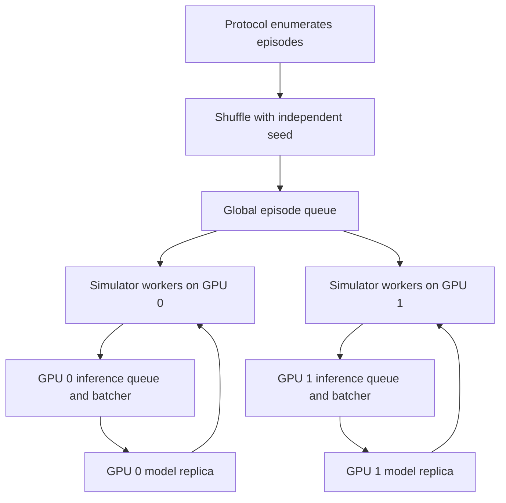

# Benchmark evaluation reference

[**English**](EVALUATION.md) · [简体中文](EVALUATION.zh-CN.md)

Each run selects a benchmark, model backend, and evaluation protocol. All native benchmarks share the same entry point. Each extension defines its environment, assets, tasks, and action space.

- [Installation and asset catalog](README.md#installation-and-assets)
- [Shared setup and result verification](SETUP.md)
- [Model interface](models/README.md)
- [CLI implementation](benchmark-support/src/robotenon_benchmark_support/evaluate.py)

## Contents

For a first evaluation, follow the [quickstart](QUICKSTART.md). Use this reference to look up individual settings and runtime behavior.

- [Configuration and environments](#2-configuration)
- [Parallel execution and scheduling](#4-parallel-execution)
- [Run template](#5-run-template)
- [History, chunks, and termination](#6-history-chunks-and-termination)
- [Real-time mode](#7-kinetix-real-time-evaluation)
- [CLI options](#8-cli-options)
- [Failure, retry, recycling, and interruption](#9-failure-retry-recycling-and-interruption)
- [Outputs and progress](#10-outputs-and-progress)
- [Tuning and validation](#11-tuning-and-validation)

## 1. Directory layout

```text
extensions/benchmarks/
  benchmark-support/      Entry point, model loading, history, chunks, graphs, and scheduling
  models/
    fake/                 Fake actions for interface checks
    xiaomi/               Xiaomi inference and preprocessing
  <benchmark>/
    README.md             Protocols and usage
    SETUP.md              Environment, assets, paths, and smoke commands
    requirements.txt      Simulator dependencies
    configs/*.json        Evaluation protocols
    src/robotenon_*/         Simulator adapters, tasks, and metrics
```

Place a new model in `models/<name>/vla.py` or an external directory. The existing evaluation command, graph, tool, and registry can load it without modification. Legacy per-extension `evaluate.py` files remain for compatibility. The older `robocasa-hlp` and `robodojo-office` integrations use the commands in their own documentation.

## 2. Configuration

| Type | Contents | Input |
| --- | --- | --- |
| Protocol | Tasks, episodes, seed, split, observations, horizon, success, and metric dimensions | `--profile` |
| Model | Checkpoint, precision, preprocessing, and model RNG | `--backend-config` |
| Execution | GPUs, workers, batches, wait window, scheduling, and timeouts | CLI options |

Pass a built-in profile such as `smoke` or an external JSON file to `--profile`. An external profile's `benchmark_id` must equal `<benchmark>_benchmark`. Use absolute asset paths in copied profiles. JSON does not expand `$VARIABLE` or `~`. A model configuration must be a JSON object. Its contents are passed unchanged to `create(**params)`.

The runtime enumerates the actual tasks. A run need not include 2,500 episodes. Xiaomi supports smoke runs, and other models that accept RoboCasa365 observations and actions can use `xiaomi_official`. Report the profile, task subset, overrides, and model RNG.

## 3. Installation and minimal run

Install packages and download assets on the evaluation host. Use separate Python environments for each simulator stack and for the model. Keep each environment's site-packages off the others' PYTHONPATH.

```bash
export ROBOTENON=/opt/RoboTenon
export MODEL_PY=/opt/envs/model/bin/python
export SIM_PY=/opt/envs/robocasa365/bin/python
cd "$ROBOTENON"
"$MODEL_PY" -m pip install -e . -e extensions/benchmarks/benchmark-support
"$SIM_PY" -m pip install -e . -e extensions/benchmarks/benchmark-support -e extensions/benchmarks/robocasa365
```

These commands install the framework. Follow the [RoboCasa365 setup guide](robocasa365/SETUP.md) for simulator dependencies and assets. Keep model weights and dependencies in the model environment. These examples assume two environments on the same host with access to the same filesystem. The local Unix socket transport requires model inference to run on that host.

### 3.1 Single worker with fake actions

```bash
"$MODEL_PY" -m robotenon_benchmark_support.evaluate \
  --benchmark robocasa365 --profile smoke \
  --backend ./extensions/benchmarks/models/fake/vla.py \
  --backend-config ./extensions/benchmarks/models/fake/configs/robocasa365.json \
  --model-python "$MODEL_PY" --sim-python "$SIM_PY" \
  --model-devices 0 --workers-per-gpu 1 --batch-size 1 --wait-ms 0 \
  --max-tasks 1 --episodes-per-task 1 \
  --output runs/robocasa365-fake-single
```

Zero success is common for fake actions. Verify that the actions advance the environment, state and termination signals are available, frames contain meaningful images, and infrastructure errors are absent. Use a fake configuration with the correct action space for each benchmark.

### 3.2 External model

```bash
"$MODEL_PY" -m robotenon_benchmark_support.evaluate \
  --benchmark robocasa365 --profile smoke \
  --backend /data/my-model/vla.py --backend-config /data/my-model/config.json \
  --model-python "$MODEL_PY" --sim-python "$SIM_PY" \
  --model-devices 0 --workers-per-gpu 1 --batch-size 1 --wait-ms 0 \
  --output runs/my-model-smoke
```

Supply a file path with a default `create()` factory or an import path such as `my_model.vla:create`. File backends have separate module namespaces and support relative imports. The coordinator reads the declaration in the model environment. The model service loads weights there, and simulator processes receive the declaration and service address. Keep top-level imports lightweight and load weights in `create()`.

## 4. Parallel execution

| Feature | Behavior | Setting |
| --- | --- | --- |
| Multi-GPU model replicas | Each selected GPU has a separate model service that loads its weights once at startup. | `--model-devices` |
| Parallel simulation | Each GPU serves multiple persistent workers. Each worker runs one episode at a time. | `--workers-per-gpu` |
| Dynamic batching | A service batches compatible pending requests and returns results by request ID. | `--batch-size`, `--wait-ms` |
| Global episode assignment | Idle workers take the next episode, reducing idle time when episode lengths differ. | `--scheduling-strategy global_queue` |
| Static assignment | The original case index modulo the worker count determines a fixed slot. | `--scheduling-strategy static` |
| Independent shuffle | A separate RNG shuffles the episode list without consuming environment or model RNG. | `--scheduler-seed`, `--no-shuffle` |
| Startup and reset concurrency | Bound the number of simultaneous worker launches and native resets. | `--startup-parallelism` |
| Worker recycling | Close workers after the configured number of tasks and rebuild them on demand. | `--recycle-after-tasks` |
| Worker loss | Retry the same episode identity on a fresh worker and retain each attempt. | `--max-retries` |
| Asynchronous real-time policy | The Kinetix live graph advances with the most recently returned action. | Real-time profile |

### 4.1 Episode queues and GPU assignment



**Workers share the episode queue. Each GPU maintains its own inference queue.** A worker stays connected to one model service throughout an episode. After completion, it may receive an episode from any task. Requests are never randomly routed across GPUs.

GPU assignment is interleaved. For `--model-devices 0,1 --workers-per-gpu 2`, slots 0 and 2 use GPU 0 and slots 1 and 3 use GPU 1. This lets smaller task subsets use multiple GPUs. Worker CUDA and EGL settings use numeric device IDs. A process may see its assigned device as local CUDA device 0 even when it is on another physical GPU. Use `--egl-device-ids` to specify one EGL index per worker. For nonnumeric device IDs, set EGL indices explicitly and verify rendered images.

Without `--model-devices`, a single model service uses the devices visible to its process, and `workers-per-gpu` sets the total worker count. This does not force CPU operation or automatically use every GPU. Check process-level visibility when containers or an outer CUDA setting restrict devices.

### 4.2 Dynamic batching

- `batch-size` limits a single inference call **per replica**. Episode count and other replicas are independent.
- `wait-ms` sets the batching window from pending request arrival. A full compatible batch can run early. A partial batch runs when the window expires.
- A 50 ms window does not cap end-to-end latency. Previous batches, queuing, transport, and inference add time.
- Each model service serializes its model calls. Replicas on separate GPUs can run concurrently.
- The runtime checks that each request ID appears exactly once in the responses. Response order is immaterial.
- A backend declaring `supports_batch=False` rejects batch sizes above 1. Calling the model once per sample in a loop still runs individual inference calls.
- Single samples use `act_batch` with B=1. For immediate dispatch, use `--batch-size 1 --wait-ms 0`. The unified CLI has no `--inference-mode` option.

Services group requests by batch key. A backend with varying shapes or robot inputs must group compatible inputs or handle them itself. Batch occupancy depends on arrival times and compatibility. With 16 simulators, batches may still contain fewer than eight requests because executing a cached action needs no inference. Resets and differing episode lengths also affect the request rate.

### 4.3 Scheduling and reproducibility

The scheduling unit is `(task, episode_idx)`. Filtering and scheduling preserve original task indices, episode numbers, and protocol seeds. A separate `random.Random(scheduler_seed)` sets the initial queue order. The same seed reproduces this order, while assignment and completion order depend on runtime.

`--no-shuffle` preserves the initial list order. Idle workers still claim episodes dynamically. Static scheduling binds the original case index to a worker even if the list is shuffled. The last few long episodes can extend run time.

- `official_stream` uses the model service's global RNG. Scheduling, request order, and batch changes can change which request consumes a random draw.
- `session_deterministic` isolates model RNG by stable episode identity for scheduling and performance comparisons. Derive seeds from episode identity instead of worker index or assignment order.
- Environment, model, and scheduler RNGs are independent. An identical environment seed does not guarantee bitwise-identical actions across batch sizes.
- Numerical differences between batches can change trajectories. For accuracy comparisons, repeat the full protocol and report uncertainty. A single action difference cannot establish equivalent success rates.

## 5. Run template

Complete the benchmark's setup guide and single-worker checks first. Set `BENCHMARK`, `PROFILE`, and `BACKEND` for your environment. The backend must support the selected benchmark.

```bash
export BENCHMARK=libero_plus
export PROFILE=spatial
export BACKEND=/data/models/my-model/vla.py
export BACKEND_CONFIG=/data/models/my-model/config.json
"$MODEL_PY" -m robotenon_benchmark_support.evaluate \
  --benchmark "$BENCHMARK" --profile "$PROFILE" \
  --backend "$BACKEND" --backend-config "$BACKEND_CONFIG" \
  --model-python "$MODEL_PY" --sim-python "$SIM_PY" \
  --model-devices 0,1 --workers-per-gpu 4 --batch-size 4 --wait-ms 50 \
  --scheduling-strategy global_queue --scheduler-seed 7 \
  --output "runs/$BENCHMARK-batch"
```

| Scenario | devices | workers-per-gpu | batch-size | wait-ms |
| --- | --- | ---: | ---: | ---: |
| Single-worker check | `0` | 1 | 1 | 0 |
| Dynamic batching on one GPU | `0` | 4 | 4 | 50 |
| Single-sample baseline on eight GPUs | `0,1,2,3,4,5,6,7` | 1 | 1 | 0 |
| 128 simulators on eight GPUs | `0,1,2,3,4,5,6,7` | 16 | 8 | 50 |

These examples depend on memory capacity, renderer support, and model compatibility. Start with a few workers. See the [RoboCasa365/Xiaomi command](robocasa365/README.md#xiaomi-robotics-1) and [LIBERO-Plus protocols](libero_plus/README.md#selecting-an-evaluation-protocol).

### Task subsets and static scheduling

For a small validation, add `--max-tasks 2 --episodes-per-task 2`. To select tasks by name, use `--tasks TASK_A TASK_B` with real names from the environment. Remove these validation overrides for a full run and inspect `episode-plan.json`.

Compare a fixed assignment with `--scheduling-strategy static --no-shuffle` and use a separate output directory. Scheduling may change random draws under `official_stream`, so trajectory differences can have causes beyond batch numerics.

## 6. History, chunks, and termination

The model declares its history length and sampling interval in `SPEC.history.length/interval`. `replan_steps` caps the actions executed from each returned chunk. The synchronous runtime captures an observation at each environment step, pads missing history with the first frame, and passes frames to the model from oldest to newest.

The synchronous graph runs `reset → policy → execute → observe → terminal → policy`. The policy consumes cached actions one at a time and requests inference when the cache is empty. Longer chunks are truncated at replan_steps. Shorter chunks trigger a new request after their last action.

When the benchmark reports termination, the episode ends and remaining actions and session history are cleared. RoboCasa365 checks `info.success` after each step and stops immediately on success. Other benchmarks retain their own success and termination semantics. Isolate caches by session and release model-side caches when a session closes.

## 7. Kinetix real-time evaluation

Select the `realtime` profile with the same entry point, model interface, and batch service. Copy the profile, set the local `params.rtc_worlds_dir`, and set the top-level `render: "cpu"` for CPU rendering.

```bash
"$MODEL_PY" -m robotenon_benchmark_support.evaluate \
  --benchmark kinetix --profile /data/configs/kinetix-realtime.json \
  --backend ./extensions/benchmarks/models/fake/vla.py \
  --backend-config ./extensions/benchmarks/models/fake/configs/kinetix.json \
  --model-python "$MODEL_PY" --sim-python /opt/envs/kinetix/bin/python \
  --workers-per-gpu 2 --batch-size 2 --wait-ms 5 \
  --max-tasks 2 --episodes-per-task 1 --output runs/kinetix-live
```

The live graph adds `live_tick` after observation. The environment advances with the latest available action while inference proceeds asynchronously. It uses a zero action before the first result and a hold action on stale ticks. Observations enter the model message queue in FIFO order. History is collected continuously and actions are consumed by this real-time loop. Set `hz`, `pace`, and `wait_first_action` in the profile.

Each episode's `outputs.rt_metrics` includes update counts, stale counts and fractions, measured control Hz, step times, and elapsed time. A longer batching window can increase stale ticks. JAX compilation and slow physics steps can lower the achieved rate. This uses upstream's default non-continuous inference mode. CI/LAAS are not enabled automatically. See the [Kinetix README](kinetix/README.md).

## 8. CLI options

| Option | Default | Meaning | Guidance |
| --- | --- | --- | --- |
| `--benchmark` | Required | Native benchmark ID | Select an environment whose observations and actions the backend supports. |
| `--profile` | Required | Built-in name or external JSON file | Start with a smoke or small-task profile. For a published score, use the official profile with its full horizon. |
| `--backend` | Required, possibly supplied in execution-config | `vla.py` path or `module:factory` | Select a backend for the environment. Verify new models with one worker. |
| `--system-config` | None | Application configuration for a system graph. A VLA backend is still required. | Use when evaluating a custom system graph. A single VLA needs no system configuration. |
| `--execution-config` | None | JSON execution settings. Explicit CLI arguments take precedence. | Store reusable resource settings here and override individual values on the CLI. |
| `--backend-config` | `{}` | JSON model parameters | Set the model's checkpoint, precision, and RNG here. Set task protocols in the profile. |
| `--model-python` | Current Python | Interpreter for the coordinator and model service | Use an absolute path to the interpreter with the model's dependencies. |
| `--sim-python` | Current Python | Interpreter for simulation and rollouts | Explicitly select the simulator interpreter or an executable wrapper. |
| `--model-devices` | Empty | Comma-separated GPU IDs. Duplicate and empty entries are invalid. | Start with one GPU. Add devices after checking capacity and assignment. |
| `--workers-per-device` | 1 | Workers per physical or virtual device, or total workers if no device is specified | Start at one per GPU. Increase gradually while measuring episodes/min, CPU load, and memory. |
| `--workers-per-gpu` | Same as above | Compatibility alias. If both aliases are set, their values must match. | Use `workers-per-device` in new configurations. |
| `--virtual-gpu-map` | `{}` | JSON mapping from logical to physical GPUs. See [virtual GPUs](VIRTUAL_GPUS.md). | Start with one replica per GPU. Add slots if memory permits and measured throughput improves. |
| `--egl-device-ids` | Inferred for numeric IDs | Comma-separated physical EGL indices, one per worker | Use automatic mapping for ordinary numeric IDs. For custom enumeration or UUIDs, set indices explicitly and verify rendered frames. |
| `--batch-size` | 1 | Maximum batch per replica, a positive integer | Start at 1. For a backend with real batched inference, try 2, 4, and 8 and monitor batch occupancy and VRAM. |
| `--wait-ms` | 50 | Nonnegative batching window in milliseconds | Use 0 for single samples. For dynamic batching, start at 50 and compare throughput and latency across windows. |
| `--trace-mode` | summary | Diagnostic trace detail, `summary` or `full` | Use summary for routine runs and full for node failures or complete timelines. |
| `--history-cache` | auto | History transfer cache, `auto`, `on`, or `off`. Sampling stays the same. | Use auto by default. Compare on and off for your workload. |
| `--output` | Required | Run output root | Use a fresh directory to isolate configuration and results. |
| `--run-id` | evaluation | Run ID under runs | A different run ID in the same output directory still shares root-level artifacts. |
| `--scheduling-strategy` | global_queue | `global_queue` or `static` | Use global_queue to reduce idle time and static for fixed-assignment comparisons. |
| `--scheduler-seed` | 7 | Independent scheduler RNG seed | Record the integer and keep it fixed for performance comparisons. Model and environment seeds are separate. |
| `--no-shuffle` | Disabled | Preserve the initial episode order | Leave unset to mix tasks. Enable to investigate ordering. |
| `--tasks` | No override | One or more task names | Supply exact environment task names for a subset. Omit for a full protocol. |
| `--max-tasks` | No override | Cap the number of enumerated tasks | Use 1–2 for smoke tests. Select exact tasks by name and omit the cap for the full protocol. |
| `--episodes-per-task` | No override | Override the protocol's episode count | Use 1 for a smoke test. For full evaluation, preserve the profile value or report the override. |
| `--startup-parallelism` | 8 | Maximum concurrent worker starts/native resets, capped at the worker count | Start at 8 or lower. Adjust for peak reset demand independently of the total worker count. |
| `--max-retries` | 1 | Additional attempts allowed after WorkerLost | Use 0 to preserve initial failures for diagnosis. Retries apply to infrastructure failures. |
| `--task-timeout` | 14400 | Response timeout in seconds for one worker episode attempt. The step horizon is independent. | Keep the default or allow more than the longest healthy episode's wall time. |
| `--inference-timeout` | 600 | Model service timeout in seconds | Allow for queue and inference tail latency. Investigate stalled services after a timeout. |
| `--model-startup-timeout` | 1800 | Seconds allowed for the model service to become ready | Adjust for measured weight-loading times on the target storage. |
| `--worker-startup-timeout` | 1800 | Seconds allowed for worker initialization | Check for missing assets before increasing the timeout for slow loads or compilation. |
| `--context-history-limit` | 64 | Recent diagnostic events retained per episode checkpoint | Increase only if diagnosis requires a longer window and monitor checkpoint overhead. |
| `--context-outputs-limit` | 64 | Recent path-addressed node outputs retained per episode checkpoint | Increase for diagnosis. Model input history is independent. |
| `--recycle-after-tasks` | 1000 | Executions per worker before recycling | For persistent memory growth, try a smaller value such as 5 and measure the cost of rebuilding. |

Worker counts, batch size, startup concurrency, recycling interval, and timeouts in seconds must be positive. Retry counts may be zero. Check `Tenon evaluate --help` for supported arguments. The unified CLI currently has no `--resume`, `--inference-mode`, `--max-steps`, random cross-GPU routing, or remote service discovery option.


## 9. Failure, retry, recycling, and interruption

- Loss of a worker process, a communication failure, or a timeout classified as `WorkerLost` triggers a rebuild and a bounded retry. Each attempt has its own ID and retains the episode identity.
- A completed episode with `success=False` is a task failure. The runtime does not retry it to increase the score. Ordinary provider exceptions and graph errors do not automatically qualify as WorkerLost.
- Attempts remain available for diagnostics. Only the final result counts for each episode. A retry may consume the global model RNG in a different state and produce another trajectory.
- After `recycle-after-tasks` episode executions, the runtime recycles the simulator worker. The count is per episode execution, independent of task type. Model replicas stay resident. More frequent recycling may contain simulator leaks at the cost of extra startups and resets.
- On normal exit, a finally block closes the simulator processes and model services. After SIGKILL or host failure, check for retained processes and GPU allocations, taking care to identify only this run's resources.
- The runner refuses to overwrite an existing `output/runs/run-id`. Use a fresh output root. Changing only the run ID still overwrites root-level protocol, configuration, and log files.
- Automatic resume is unavailable. Preserve previous results, enumerate missing episodes, and define deduplication rules before combining separate runs.

For remote evaluation, run the full command in a server-side `tmux` session and record the session name and output path. Evaluation can continue after SSH disconnects. Download assets directly on the server.

## 10. Outputs and progress

```text
<output>/
  protocol.json            Original and effective protocols, model declarations, RNG, arguments, and overall status
  episode-plan.json        Stable episode identities and scheduled order
  model-service.json       Model service configuration
  config.json              Generated application configuration
  config_graphs.json       Generated graph definitions
  config_modules.json      Generated module configuration
  simulation.log           Simulator coordinator log
  batch-metrics/*.json     Per-replica batch statistics, refreshed every 5 seconds and saved at shutdown
  runs/<run-id>/
    status.json            Live progress, active episodes, and current summary
    summary.json           Final aggregate, which may retain initial values during execution
    episodes.sqlite3       Episode index
    .../attempts/...       Attempt records, worker/GPU assignments, and diagnostics
```

**During a run, read `status.json.summary` for live progress.** The following commands only read files:

```bash
export EVAL_OUTPUT=/data/runs/xiaomi-target50x50
export EVAL_RUN_ID=evaluation
"$MODEL_PY" - <<'PY'
import json, os
from pathlib import Path
p = Path(os.environ['EVAL_OUTPUT']) / 'runs' / os.environ['EVAL_RUN_ID'] / 'status.json'
s = json.loads(p.read_text())
r = s.get('summary', {})
print(json.dumps({
    'status': s.get('status'), 'total': s.get('total_episodes'),
    'completed': s.get('completed_episodes'), 'active': len(s.get('active', [])),
    'successes': r.get('successes'), 'success_rate': r.get('episode_success_rate'),
    'errors': r.get('num_errors'), 'cancelled': r.get('num_cancelled'),
}, ensure_ascii=False, indent=2))
PY
nvidia-smi --query-gpu=index,utilization.gpu,memory.used,memory.total --format=csv
```

Inspect repeated status and live-observation timestamps when diagnosing a stall. A single 0% GPU sample may simply fall between inference and rendering. Scene, texture, and reset allocations can change VRAM usage even while model weights remain resident.

### 10.1 Batch statistics

Read `batch-metrics/*.json` during a run or after normal shutdown. Use `status` (running/closed) and `updated_at` to determine snapshot freshness.

- `requests / batches` gives the actual mean batch size.
- `batch_sizes` gives the observed distribution of batch sizes.
- `queue_wait_sec / requests` gives mean request wait time, including time spent waiting for a busy service.
- `inference_sec / batches` gives the mean duration of a batched model call.

These timings include service-call overhead. `pending` gives the current queue length, `pending_peak` its maximum, and `sessions` the current session count. Aggregate snapshots update atomically every five seconds. After abnormal termination the most recent snapshot may be incomplete.

### 10.2 Success rates and completion

Report the effective protocol and overrides, episode count, successes, failures, errors/cancellations, overall success rate, per-task and benchmark-defined metrics, execution settings, model/environment versions, RNG settings, and scheduler seed.

Count final episode outcomes for overall success. When task sizes differ, this episode-weighted rate differs from the unweighted mean of per-task rates. Preserve benchmark-specific dimensions, including CALVIN chain-completion metrics. Count each episode once and report infrastructure errors.

The CLI marks a run completed only when the final episode count equals the actual plan size and there are zero errors or cancellations. Successful episodes that terminate early may be overrepresented in interim results.

## 11. Tuning and validation

For read-only SQLite queries of recent throughput, see the [framework guide](../../docs/benchmarks.md#5-inspect-progress-speed-and-results). Parse ISO `updated_at` strings as datetimes before converting them to Unix timestamps.

For large worker pools, consider setting `OMP_NUM_THREADS=1`, `MKL_NUM_THREADS=1`, `OPENBLAS_NUM_THREADS=1`, `NUMEXPR_NUM_THREADS=1`, and `TOKENIZERS_PARALLELISM=false` before startup. These limit common library thread pools. They do not cap all process threads. Measure steady-state throughput, CPU load, and memory after cold startup.

1. With one worker and fake actions, verify assets, actions, images, and termination.
2. With a real model on one worker, verify preprocessing, history, state, and action semantics.
3. On one GPU with several workers, verify batching, session isolation, and VRAM usage.
4. On two GPUs, check each worker's CUDA/EGL assignment and the shared episode queue.
5. Scale to eight GPUs. Retain a single-sample accuracy baseline and the complete protocol record.

When batches are small, inspect inference request frequency, history/chunk lengths, and actual simulator progress before increasing workers or wait times. Additional workers can lower throughput when CPU, reset, or image transport is saturated. Reducing reset concurrency can lower peak memory. Preserve the official horizon and observation resolution in full evaluations.

See the [unified entry point verification](../../docs/changes/unified-benchmark-entry-2026-09-29.md), [Kinetix real-time checks](../../docs/changes/kinetix-live-unified-2026-09-29.md), and [setup guide verification](../../docs/changes/benchmark-setup-docs-2026-09-29.md). Selected tasks in 18 non-Isaac environments have been probed on real simulators. Other tasks and parallel configurations require separate verification. BEHAVIOR-1K and RoboDojo still need rendering checks on RTX hardware with licensed assets.


## 12. Live monitoring overhead


Live status retains the most recent 256 node records and 256 events. Ordinary snapshots are written at most once per second. Errors and termination are written immediately. `timeline_window` records the cumulative node count and indicates truncation. This window is independent of model image history, action chunks, and final statistics. Use separate tracing for a complete timeline. Restart active workers to load the change.


## 13. Shared performance features

The shared batch service sends MessagePack and raw array bytes over Unix sockets, preserving dtype and shape and enforcing message size limits. The protocol avoids Base64, pickle, and lossy compression. Both model and simulator environments require the framework dependency `msgpack>=1.0.8,<2`. New readers accept old JSON messages. Older readers cannot decode the new binary format, so update and restart model services and workers together.

The shared synchronous and real-time runtimes borrow read-only observation snapshots while assembling history. The packing layer still copies simulator outputs so later steps cannot overwrite stored frames. The public `unpack_observation` returns a writable copy by default. The shared policy layer reuses normalized actions.

These optimizations apply to all native benchmarks through the common entry point. Worker counts, GPU routing, batch windows, and task order are unchanged. See [local measurements](../../docs/changes/common-benchmark-performance-2026-09-29.md).

## Multi-model system evaluation

Use `--system-config` to supply native modules, tools, and a graph. Configure independent batch services for each model in `--execution-config`. Conditional branches can proceed independently for each task. Each actual model request goes to the relevant service queue. See [system integration](SYSTEMS.md) for configuration, environment isolation, and an eight-GPU example.

### 13.1 Trace summaries and incremental history transfer

The unified CLI defaults to `--trace-mode summary --history-cache auto` for synchronous and real-time graphs. Set `"trace_mode": "summary"` and `"history_cache": "auto"` in `--execution-config` as an alternative. The `execution` and `optimizations` fields in `protocol.json` record requested and effective settings.

- `--trace-mode summary` omits individual traces for successful nodes, tools, and routes. Each completed episode emits a bounded `trace:summary` with call counts, errors, and cumulative durations. Errors retain separate traces. Final results, live status, and batch metrics remain available. Nested durations overlap. A forcibly terminated process may have no final summary.
- `--trace-mode full` records individual nodes for troubleshooting and complete timelines. Direct use of the core framework defaults to full. The unified benchmark CLI defaults to summary.
- `--history-cache auto` enables caching when adjacent inference windows may overlap, using `length > 1` and `replan_steps <= (length-1)*interval`. Actual speedup depends on the workload. Xiaomi's `4/2/16` setting leaves this disabled.
- `--history-cache on/off` enables or disables caching explicitly. With caching, RPC uses content addressing to send missing history frames. The service reconstructs the complete history for `vla.py`, preserving images, state, order, dtype, and sampling. Model-side mutations cannot alter the cache.
- `--context-history-limit` and `--context-outputs-limit` bound diagnostics in graph checkpoints. The defaults retain 64 entries each, reducing repeated serialization on long horizons. Observation and model histories, action chunks, and final metrics are independent. Use Recorder or Trace for full event persistence.
- The simulator action's Body deadline is `task_timeout + 60s`, allowing the process-level episode watchdog to handle a stalled worker first. The benchmark's step horizon and success criteria remain unchanged.

Each connection/session retains up to 32 frames or 64 MiB of serialized content on each end. Requests without history or beyond these limits clear the cache and use normal transport. Normal closure, disconnection, and timeout clear it. Reconnection creates a new model session and fully synchronizes its first request. Failed inference is not replayed automatically. The scheduler continues to own episode retries. Update services and workers together for `infer_delta`. Other `SharedBatchModel` tools may set `params.history_cache=true` explicitly. It defaults to off outside the managed VLA tool.

For detailed tracing with caching disabled, append the following to the evaluation command:

```bash
--trace-mode full --history-cache off
```

An RPC speedup with short replanning intervals measures only that part of simulation. See the [trace and history verification](../../docs/changes/trace-history-implementation-2026-09-29.md).


### 13.2 Batch JSONL metrics

The metrics service appends each received batch to JSONL in one operation, reducing per-record file opens. Existing JSONL data, Portal, Prometheus aggregation, and replay remain compatible. Clients keep their existing flush intervals and add no wait to fill batches. Single-record inputs see little benefit.

In a local IPC test with 65,536 records, batch writes produced roughly three times the logging throughput. This measures logging only. See [implementation and verification](../../docs/changes/batch-jsonl-implementation-2026-09-29.md).

## Multiple model replicas on one GPU

See [virtual GPU configuration and verification](VIRTUAL_GPUS.md) for regular benchmarks and system graphs.

### File descriptor limits for parallel evaluation

The parallel runtime and managed model services automatically raise the process
soft `RLIMIT_NOFILE` limit to 65536 before spawning children. This applies to all
benchmarks; no shell `ulimit` command is normally needed. Higher existing limits
are preserved, and the system hard limit is never changed. If the hard limit is
lower, the runtime raises the soft limit as far as allowed and logs a warning.
Unsupported platforms skip this POSIX-specific adjustment. This provides capacity
for Worker pipes, trace sockets and files; it does not repair descriptor leaks.
