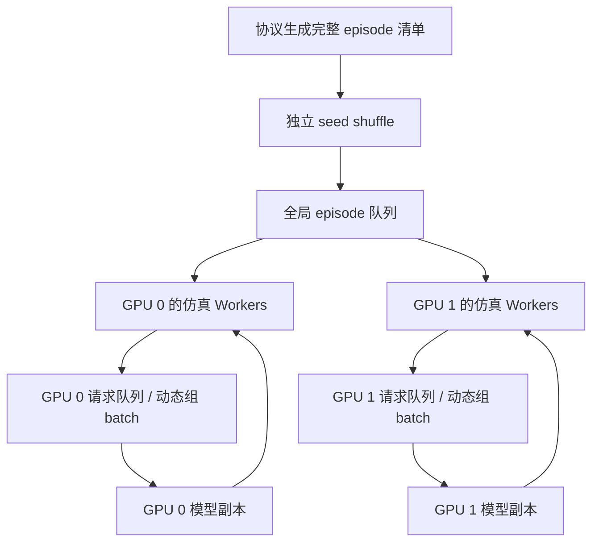

# Benchmark 评测完整使用手册

[English](EVALUATION.md) · [**简体中文**](EVALUATION.zh-CN.md)

本文描述当前统一入口 **实际实现** 的能力。一次运行对应一个 benchmark、一个模型后端和一份评测协议。所有原生 benchmark 共用入口；具体环境、资产、任务和 action 空间由各 extension 提供。

- [安装与资产索引](README.zh-CN.md#installation-and-assets)
- [共享安装与结果检查](SETUP.zh-CN.md)
- [模型接口](models/README.zh-CN.md)
- [参数实现](benchmark-support/src/robotenon_benchmark_support/evaluate.py)

## 阅读导航

首次运行先看 [快速开始](QUICKSTART.zh-CN.md)。本页用作参数和行为参考，不要求从头读完。

- [配置与环境](#2-三类配置分开管理)
- [并行能力与调度](#4-并行能力总览)
- [通用运行模板](#5-通用运行模板)
- [History、chunk 与终止](#6-historychunk-与终止)
- [实时模式](#7-kinetix-realtime-并行)
- [全部 CLI 参数](#8-完整-cli-参数表)
- [故障与恢复边界](#9-故障重试回收与中断)
- [输出与进度](#10-输出与进度查询)
- [调优与验证范围](#11-调优顺序与验收边界)

## 1. 目录与职责

```text
extensions/benchmarks/
  benchmark-support/      统一入口、模型加载、历史/chunk、Graph、调度
  models/
    fake/                 环境接口验证用假动作
    xiaomi/               Xiaomi 推理与预处理
  <benchmark>/
    README.md             可用协议与使用说明
    SETUP.md              环境、资产下载、路径与 smoke 命令
    requirements.txt      仿真依赖
    configs/*.json        评测协议
    src/robotenon_*/         仿真适配与任务/指标定义
```

新模型放在 `models/<name>/vla.py` 或仓库外任意目录。无需修改 evaluate、Graph、Tool 或中央注册表。旧 extension `evaluate.py` 是兼容入口，新增使用统一命令。`robocasa-hlp`、`robodojo-office` 是特殊旧集成，继续使用各自文档的命令，不属于原生入口的自动兼容范围。

## 2. 三类配置分开管理

| 类型 | 内容 | 输入位置 |
| --- | --- | --- |
| 评测协议 | 任务、episode 数、seed、split、观测、horizon、success、指标维度 | `--profile` |
| 模型配置 | checkpoint、精度、预处理、模型 RNG | `--backend-config` |
| 执行配置 | GPU、Worker、batch、等待窗口、调度、超时 | 命令行参数 |

`--profile` 可为 benchmark 内置名称（例如 `smoke`），或外部 JSON 路径。外部文件的 `benchmark_id` 必须等于 `<benchmark>_benchmark`。复制配置后设置绝对资产路径；JSON 不展开 `$VARIABLE` 或 `~`。模型 JSON 必须为对象，原样传给 `create(**params)`。

任务总数来自实际枚举，不固定为 2500。Xiaomi 可以跑 smoke，其他支持 RoboCasa365 action/observation 的模型也可跑 `xiaomi_official` 协议。正式报告必须说明所用 profile、任务子集、覆盖参数和模型 RNG。

## 3. 环境准备与最小运行

在实际计算服务器上安装、下载资产。每个仿真栈使用独立 Python 环境，模型使用自己的环境。不要把另一个环境的 site-packages 注入 PYTHONPATH。

```bash
export ROBOTENON=/opt/RoboTenon
export MODEL_PY=/opt/envs/model/bin/python
export SIM_PY=/opt/envs/robocasa365/bin/python
cd "$ROBOTENON"
"$MODEL_PY" -m pip install -e . -e extensions/benchmarks/benchmark-support
"$SIM_PY" -m pip install -e . -e extensions/benchmarks/benchmark-support -e extensions/benchmarks/robocasa365
```

上述只安装框架。先按 [RoboCasa365 安装指南](robocasa365/SETUP.zh-CN.md) 安装仿真依赖和资产。模型权重、模型依赖仅放模型环境。以下示例默认同一台服务器、两个环境共享可见的文件系统；当前本地 Unix socket 服务不提供跨机器推理。

### 3.1 单 Worker、fake action

```bash
"$MODEL_PY" -m robotenon_benchmark_support.evaluate \
  --benchmark robocasa365 --profile smoke \
  --backend ./extensions/benchmarks/models/fake/vla.py \
  --backend-config ./extensions/benchmarks/models/fake/configs/robocasa365.json \
  --model-python "$MODEL_PY" --sim-python "$SIM_PY" \
  --model-devices 0 --workers-per-gpu 1 --batch-size 1 --wait-ms 0 \
  --max-tasks 1 --episodes-per-task 1 \
  --output runs/robocasa365-fake-single
```

fake 的零成功率很常见。验收应检查动作推进、状态、非黑图像、终止信号和无基础设施错误。不同 benchmark 使用对应 fake config，不能复用不兼容的动作向量。

### 3.2 外部模型

```bash
"$MODEL_PY" -m robotenon_benchmark_support.evaluate \
  --benchmark robocasa365 --profile smoke \
  --backend /data/my-model/vla.py --backend-config /data/my-model/config.json \
  --model-python "$MODEL_PY" --sim-python "$SIM_PY" \
  --model-devices 0 --workers-per-gpu 1 --batch-size 1 --wait-ms 0 \
  --output runs/my-model-smoke
```

支持文件路径（默认工厂 `create()`）或 `my_model.vla:create`。独立文件后端使用独立模块命名空间，支持包内相对导入。协调器在模型环境读取声明，模型服务在模型环境加载权重；仿真进程只接收声明和地址。后端顶层尽量保持轻量，把权重加载放进 `create()`。

## 4. 并行能力总览

| 能力 | 行为 | 配置 |
| --- | --- | --- |
| 多 GPU 模型副本 | 每个指定 GPU 一个独立模型服务，每份权重只在该服务初始化时加载 | `--model-devices` |
| 并行仿真 | 每张 GPU 对应多个持久 Worker，每个 Worker 同时执行一个 episode | `--workers-per-gpu` |
| 动态 batching | 同一模型服务将兼容的待处理请求合批，结果按 request ID 返回 | `--batch-size`、`--wait-ms` |
| 全局 episode 分配 | 任意空闲 Worker 领取下一个 episode，减少任务长度差异导致的空闲 | `--scheduling-strategy global_queue` |
| 固定分配 | 原始 case index 按 Worker 数取模，绑定固定槽位 | `--scheduling-strategy static` |
| 独立打乱 | 单独 RNG 打乱 episode 清单，不消耗环境/模型 RNG | `--scheduler-seed`、`--no-shuffle` |
| 启动/重置并发限制 | 控制 Worker 启动和 native reset 的同时进行数量 | `--startup-parallelism` |
| Worker 重建 | 达到复用次数后关闭，在后续需要时重建 | `--recycle-after-tasks` |
| Worker 丢失重试 | 保留 attempt 记录，用新 Worker 重试同一 episode 身份 | `--max-retries` |
| 实时异步策略 | Kinetix live Graph 持续推进，采用最新已返回动作 | realtime profile |

### 4.1 两层队列与固定 GPU 绑定



**全局共享的是 episode 队列，不是跨 GPU 的推理请求队列。** 当前没有把所有请求汇总后随机选择 GPU 的机制。Worker 固定连接一个模型服务，episode 执行中不迁移；完成后领取的新 episode 可以属于任何任务。

GPU 绑定交错排列。例如 `--model-devices 0,1 --workers-per-gpu 2` 对应 Worker 槽位 `0→GPU0, 1→GPU1, 2→GPU0, 3→GPU1`。这使小任务子集也有机会使用多张卡。数字设备 ID 用于 Worker 的 CUDA 和 EGL 配置；进程内 CUDA 的局部编号可能为 0，不等于物理 GPU0。可用 `--egl-device-ids` 显式提供每个 Worker 的 EGL 索引（数量须等于 Worker 数）；非数字设备标识不会自动推导数字 EGL ordinal，需显式配置并验证渲染映射。

不指定 `--model-devices` 时只启动一个未显式绑定设备的模型服务，Worker 数为 `workers-per-gpu`；这不代表强制 CPU，也不会自动发现并使用所有 GPU。容器或外层 CUDA 限制存在时，以进程实际设备可见性验证绑定。

### 4.2 动态 batch 的准确含义

- `batch-size` 是**每个模型副本**一次推理的上限，不是全局 batch，也不是 episode 数。
- `wait-ms` 从待处理请求的到达时间计算组 batch 窗口。兼容请求达到上限时可提前提交，不足时提交小 batch。
- 50ms 不是端到端 SLA：上一批推理、排队、传输和模型计算都可使请求总延迟超过 50ms。
- 每个模型服务串行执行自己的模型调用；不同 GPU 副本可以并行计算。
- 框架验证返回 request ID 集合恰好匹配请求，每个 ID 出现一次，不依赖返回列表顺序。
- `supports_batch=False` 的后端配置 batch >1 会报错。逐个样本循环不等于真正的模型 batch。
- 单样本也使用 `act_batch`，B=1；统一 CLI 没有 `--inference-mode` 参数。需要尽快处理单请求时用 `--batch-size 1 --wait-ms 0`。

服务按 batch key 合并请求；后端有不同形状/机器人输入时，应提供兼容性分组或自行处理，框架不会自动保证任意输入可堆叠。组 batch 受兼容性及到达节奏影响。16 个仿真不意味着每批都能达到 8：执行缓存 action 时不会请求新推理，reset 和长短任务也改变请求密度。

### 4.3 全局调度与 reproducibility

调度单位为单个 `(task, episode_idx)`。原始任务索引、episode 编号和协议 seed 在筛选/调度过程中保留。独立 `random.Random(scheduler_seed)` 决定初始队列；相同 seed 的初始次序相同，实际领取/完成次序取决于运行耗时。

`--no-shuffle` 只关闭打乱，空闲 Worker 仍动态领取。static 模式按原始 case index 绑定 Worker；打乱不能解除该绑定。最后一批正在执行的长 episode 仍可能造成长尾。

- `official_stream`：模型服务全局 RNG，调度、请求顺序或 batch 变化可改变随机数分配。
- `session_deterministic`：模型后端基于稳定 episode 身份隔离 RNG，适合调度/性能对照；不能以 Worker 编号或领取顺序作为 seed。
- 环境 seed、模型 RNG、调度 seed 是三件事。相同环境 seed 不保证不同 batch 的动作逐浮点相同。
- batch 数值差异可能改变最终轨迹。准确率比较应重复完整协议并报告不确定性，不能用单个 action 误差证明成功率一致。

## 5. 通用运行模板

在完成对应 benchmark 的 SETUP 和单 Worker 验证后，设置实际参数。这里的 `BENCHMARK`、`PROFILE` 和 `BACKEND` 可替换；模型必须支持所选环境。

```bash
export BENCHMARK=libero_plus
export PROFILE=spatial
export BACKEND=/data/models/my-model/vla.py
export BACKEND_CONFIG=/data/models/my-model/config.json
"$MODEL_PY" -m robotenon_benchmark_support.evaluate \
  --benchmark "$BENCHMARK" --profile "$PROFILE" \
  --backend "$BACKEND" --backend-config "$BACKEND_CONFIG" \
  --model-python "$MODEL_PY" --sim-python "$SIM_PY" \
  --model-devices 0,1 --workers-per-gpu 4 --batch-size 4 --wait-ms 50 \
  --scheduling-strategy global_queue --scheduler-seed 7 \
  --output "runs/$BENCHMARK-batch"
```

| 场景 | devices | workers-per-gpu | batch-size | wait-ms |
| --- | --- | ---: | ---: | ---: |
| 单 Worker 检查 | `0` | 1 | 1 | 0 |
| 单卡动态 batch | `0` | 4 | 4 | 50 |
| 8卡单样本基线 | `0,1,2,3,4,5,6,7` | 1 | 1 | 0 |
| 8卡、128个仿真 | `0,1,2,3,4,5,6,7` | 16 | 8 | 50 |

这是执行参数示例，是否适合取决于环境内存、渲染和模型兼容性。先从较少 Worker 开始。具体的 [RoboCasa365 / Xiaomi 命令](robocasa365/README.zh-CN.md#xiaomi-robotics-1) 与 [LIBERO-Plus 协议选择](libero_plus/README.zh-CN.md#选择评测协议) 放在各自 README。

### 任务子集和固定调度

小规模验证可加 `--max-tasks 2 --episodes-per-task 2`；指定任务则用 `--tasks TASK_A TASK_B`（替换为所选环境的真实名称）。正式运行移除这些验证覆盖项，并检查 `episode-plan.json`。

用 `--scheduling-strategy static --no-shuffle` 对照固定分配，输出到另一个目录。调度改变可能改变 official_stream 随机数分配，不能把所有轨迹差异都归因于 batch 数值误差。

## 6. History、chunk 与终止

模型 `SPEC.history.length/interval` 声明历史长度和采样间隔，`replan_steps` 声明每次最多执行多少个返回 action。同步 runtime 每个环境 step 收集 observation；不足历史用首帧补齐，按由旧到新的顺序传给模型。

同步 Graph：`reset → policy → execute → observe → terminal → policy`。`policy` 有缓存 action 时只取下一项，没有缓存才请求模型。返回 chunk 长于 replan_steps 时截断；短 chunk 用完后重新推理。

benchmark 报告 terminal 后停止 episode，清除剩余 chunk 和 session 历史。RoboCasa365 在每一步检查 `info.success` 并立即终止。其他 benchmark 保留自身 success/termination 语义，不能把某个模型的终止规则强加给所有环境。Session 缓存必须隔离；模型关闭 session 时也应释放自己的缓存。

## 7. Kinetix realtime 并行

使用相同统一入口、模型接口和 batch 服务，profile 切换到 `realtime`。先复制该 profile 并设置本机 `params.rtc_worlds_dir`；CPU 设置顶层 `render: "cpu"`。

```bash
"$MODEL_PY" -m robotenon_benchmark_support.evaluate \
  --benchmark kinetix --profile /data/configs/kinetix-realtime.json \
  --backend ./extensions/benchmarks/models/fake/vla.py \
  --backend-config ./extensions/benchmarks/models/fake/configs/kinetix.json \
  --model-python "$MODEL_PY" --sim-python /opt/envs/kinetix/bin/python \
  --workers-per-gpu 2 --batch-size 2 --wait-ms 5 \
  --max-tasks 2 --episodes-per-task 1 --output runs/kinetix-live
```

live Graph 在 observe 后增加 `live_tick`。环境不等待每次推理，按最新返回动作推进；第一条结果前使用零动作，过期 tick 使用 hold action。Observation 按 FIFO 进入模型侧消息流程；history 持续采集，chunk 按该实时流程消费。`hz`、`pace`、`wait_first_action` 来自 profile，不是 evaluate CLI 参数。

每个 episode 的 `outputs.rt_metrics` 包括更新次数、stale 次数/比例、实际控制 Hz、step 时间和总时长。组 batch 等待变长可能增加 stale；目标 Hz 不是性能保证。JAX 首次编译及慢物理步会影响实时表现。当前是 upstream 默认非持续推理模式，不自动启用 CI/LAAS。详见 [Kinetix README](kinetix/README.zh-CN.md)。

## 8. 完整 CLI 参数表

| 参数 | 默认值 | 含义 | 如何选取 |
| --- | --- | --- | --- |
| `--benchmark` | 必填 | 原生 benchmark ID | 按待评环境选择；模型必须支持其观测和动作空间。 |
| `--profile` | 必填 | 内置名或外部 JSON | 首次选 smoke/小任务协议；正式成绩选官方 profile，不缩短 horizon。 |
| `--backend` | 必填，也可从 execution-config 读取 | vla.py 路径或 module:factory | 选择已适配该环境的 vla.py；新模型先单 Worker 验证。 |
| `--system-config` | 无 | 系统 Graph 应用配置；仍需 VLA backend | 仅评测自定义系统 Graph 时设置；单 VLA 可省略。 |
| `--execution-config` | 无 | 执行参数 JSON；显式 CLI 参数覆盖对应默认值 | 多次复用资源配置时保存为 JSON；临时调整用 CLI 覆盖。 |
| `--backend-config` | 无，使用 `{}` | 模型参数 JSON | 按模型要求填写 checkpoint、精度、RNG；不放任务协议。 |
| `--model-python` | 当前 Python | 协调器和模型服务 Python | 选择装有模型依赖的解释器，建议绝对路径。 |
| `--sim-python` | 当前 Python | 仿真/rollout Python；建议显式指定 | 选择装有所选仿真器依赖的解释器或可执行包装脚本。 |
| `--model-devices` | 空 | 逗号分隔 GPU ID；不重复，不留空项 | smoke 先用一张卡；确认容量和绑定后再列出多卡。 |
| `--workers-per-device` | 1 | 每个实体/虚拟设备对应 Worker 数；未指定设备时为总数 | 从每卡 1 个开始逐步增加；按 episodes/min、CPU/内存压力判断，不只看 GPU 利用率。 |
| `--workers-per-gpu` | 同上 | 兼容别名；同时设置两个选项时必须相同 | 新配置优先使用 workers-per-device，避免同时填写两个别名。 |
| `--virtual-gpu-map` | `{}` | 逻辑设备到实体 GPU 的 JSON 映射，见 [虚拟 GPU](VIRTUAL_GPUS.zh-CN.md) | 默认每卡一份模型；仅在容量允许且对照吞吐有收益时增加逻辑槽位。 |
| `--egl-device-ids` | 自动推导数字 ID | 逗号分隔的物理 EGL 索引，每个 Worker 一项 | 普通数字设备先用自动映射；特殊设备枚举或 UUID 场景显式填写并验图。 |
| `--batch-size` | 1 | 每副本 batch 上限，必须为正整数 | 单样本基线用 1；后端支持真实 batch 后试 2/4/8，并检查实际分布和显存。 |
| `--wait-ms` | 50 | 组 batch 等待窗口，非负毫秒 | 单样本用 0；动态 batch 可从 50 开始，对照短/长窗口的吞吐与延迟。 |
| `--trace-mode` | summary | summary 或 full；控制诊断 trace 详细程度 | 常规评测用 summary；定位节点错误、需要完整时间线时用 full。 |
| `--history-cache` | auto | auto/on/off；历史传输缓存，不改变采样语义 | 通常保留 auto；on/off 用于测量对照，强制开启不保证提速。 |
| `--output` | 必填 | 本次输出根目录 | 每次实验新建目录，避免覆盖配置与结果。 |
| `--run-id` | evaluation | runs 下的运行 ID | 通常保留 evaluation；同 output 换 ID 不能完整隔离根目录产物。 |
| `--scheduling-strategy` | global_queue | global_queue 或 static | 通常用 global_queue 减少空闲；static 用于固定分配对照。 |
| `--scheduler-seed` | 7 | 独立调度 RNG seed | 固定并记录任意整数；性能对照保持一致，与模型/环境 seed 分开。 |
| `--no-shuffle` | 关闭 | 指定后不打乱初始清单 | 通常省略以混合任务；排查固定任务次序时开启。 |
| `--tasks` | 无覆盖 | 一个或多个任务名 | 只测指定任务时填写环境中的真实名称；正式完整协议省略。 |
| `--max-tasks` | 无覆盖 | 限制枚举任务数 | smoke 用 1–2；正式完整协议省略，不用它代替精确任务筛选。 |
| `--episodes-per-task` | 无覆盖 | 覆盖协议 episode 数 | smoke 用 1；正式运行保留 profile 值，变更需标注协议覆盖。 |
| `--startup-parallelism` | 8 | Worker 启动/native reset 并发上限，实际不超过 Worker 数 | 先用默认 8 或更低；按 reset 峰值资源调整，不必等于 Worker 总数。 |
| `--max-retries` | 1 | WorkerLost 重试次数；最多初次加该次数 | 默认 1；诊断需保留首次故障时用 0，不为提高模型成功率增加重试。 |
| `--task-timeout` | 14400 | Worker 一次 episode 尝试响应超时，秒；不改变任务步数 horizon | 保留默认或设为高于最长正常 episode 墙钟时间的值；不要用于缩短任务。 |
| `--inference-timeout` | 600 | 模型服务调用超时，秒 | 高于正常排队加推理的尾部延迟；超时先查服务是否卡住。 |
| `--model-startup-timeout` | 1800 | 模型服务就绪超时，秒 | 默认 1800s；大权重或慢存储按实测加载时间留余量。 |
| `--worker-startup-timeout` | 1800 | Worker 启动就绪超时，秒 | 默认 1800s；有慢资产加载/编译时适度增大，先排除缺资产。 |
| `--context-history-limit` | 64 | 每个 episode 检查点保留的最近诊断事件数 | 通常保留 64；需要更长诊断窗口时增大，同时观察检查点开销。 |
| `--context-outputs-limit` | 64 | 每个 episode 检查点保留的最近路径化节点输出数 | 通常保留 64；只为诊断需要增大，不改变模型输入历史。 |
| `--recycle-after-tasks` | 1000 | 每 Worker 完成多少次执行后关闭重建 | 稳定环境可保留默认；发现内存持续增长时试 5 等较小值，权衡重建成本。 |

正数要求适用于 Worker/batch/startup/recycle 数与各秒级 timeout；重试数非负。以 `Tenon evaluate --help` 为参数可用性的最终依据。统一入口当前没有 `--resume`、`--inference-mode`、`--max-steps`、跨 GPU 随机路由或远程服务发现选项。


## 9. 故障、重试、回收与中断

- Worker 进程丢失、通信异常/超时等 `WorkerLost` 会触发重建及配置次数内重试。每次尝试有不同 attempt ID，保留相同 episode 身份。
- 正常完成但 `success=False` 是模型任务失败，不会为了提高分数而重试。普通 provider 异常、Graph 错误也不等同于可自动重试的 WorkerLost。
- attempts 保留诊断记录，最终只按 episode 最终结果计数。模型 global RNG 在重试后可能处于不同状态，不能保证重复轨迹。
- 每 Worker 完成指定次数的执行后，达到 `recycle-after-tasks` 就回收仿真 Worker；这里的 task 是一次 episode 执行，不是一个任务类型的全部 episodes。模型副本独立常驻。降低该值可能改善仿真资源泄漏，但增加启动/reset 成本。
- 正常退出通过 finally 关闭仿真进程和模型服务。强制 SIGKILL/机器故障不能保证清理，应检查残留进程/GPU 显存，不要批量终止其他用户任务。
- 若同一 `output/runs/run-id` 已存在，入口拒绝覆盖。换 output 最清晰；仅换 run-id 虽可运行，但根目录的 protocol/config/log 文件仍会覆盖，无法完整隔离实验。
- 当前无自动断点续跑命令。进程死亡后不要把新运行称作原运行的无缝恢复。保留原结果、明确补跑清单和去重规则后再汇总。

远程运行建议在服务器 `tmux` 会话中启动完整命令，记录会话名和 output；断开 SSH 不等于停止评测。下载也在服务器执行，不走本机流量转发。

## 10. 输出与进度查询

```text
<output>/
  protocol.json            原始/实际协议、模型声明、RNG、参数和总状态
  episode-plan.json        稳定 episode 清单及调度顺序
  model-service.json       模型服务配置
  config.json              生成的应用配置
  config_graphs.json       生成的 Graph
  config_modules.json      生成的 modules
  simulation.log           仿真协调进程日志
  batch-metrics/*.json     各模型副本 batch 统计（运行中每5秒刷新，关闭时最终保存）
  runs/<run-id>/
    status.json            运行中进度、active 与当前 summary
    summary.json           最终汇总；运行中可能仍是初始值
    episodes.sqlite3       episode 索引
    .../attempts/...       各次尝试、Worker/GPU 信息和诊断记录
```

**运行中看 `status.json.summary`，不要把尚未更新的 `summary.json` 当成当前进度。** 以下命令只读文件，不会干扰运行：

```bash
export EVAL_OUTPUT=/data/runs/xiaomi-target50x50
export EVAL_RUN_ID=evaluation
"$MODEL_PY" - <<'PY'
import json, os
from pathlib import Path
p = Path(os.environ['EVAL_OUTPUT']) / 'runs' / os.environ['EVAL_RUN_ID'] / 'status.json'
s = json.loads(p.read_text())
r = s.get('summary', {})
print(json.dumps({
    'status': s.get('status'), 'total': s.get('total_episodes'),
    'completed': s.get('completed_episodes'), 'active': len(s.get('active', [])),
    'successes': r.get('successes'), 'success_rate': r.get('episode_success_rate'),
    'errors': r.get('num_errors'), 'cancelled': r.get('num_cancelled'),
}, ensure_ascii=False, indent=2))
PY
nvidia-smi --query-gpu=index,utilization.gpu,memory.used,memory.total --format=csv
```

状态文件、live observation 更新时间持续变化比单次 GPU 利用率更能判断是否卡住。推理和渲染有间隙，不能凭一次0%断定故障。仿真场景/纹理/reset 临时资源会引起显存波动；模型权重常驻不代表总显存恒定。

### 10.1 Batch 统计

运行中或正常服务关闭后读取 `batch-metrics/*.json`，通过 `status`（running/closed）和 `updated_at` 判断快照状态：

- `requests / batches`：实际平均 batch 大小。
- `batch_sizes`：各 batch 大小的次数分布，不能只看配置上限。
- `queue_wait_sec / requests`：平均请求排队时间，包含服务繁忙导致的排队。
- `inference_sec / batches`：平均模型 batch 调用时间。

统计是框架服务调用时间，不是纯 GPU kernel 时间。`pending` 是当前排队数，`pending_peak` 是累计队列峰值，`sessions` 是当前会话数。聚合快照每5秒原子更新；进程异常终止时，最后一个快照可能不是最终统计。

### 10.2 成功率与完成判定

最终报告至少包含实际协议/覆盖项、总 episode 数、成功数、失败数、errors/cancelled、总体成功率、逐任务与 benchmark 定义的维度统计、执行参数、模型/环境版本、RNG 和调度 seed。

总体 episode 成功率按最终 episode 计数；不均衡 episode 数时，它不等于各任务成功率的简单平均。各 benchmark 的维度不同，CALVIN 链式完成指标也不能替换为普通单步 success。不要对所有 attempts 重复计数，不要静默剔除基础设施错误。

统一入口在结束时检查最终 episode 数与实际计划总数一致，并要求 errors/cancelled 为0，才标记 completed。运行中成功提前终止可能让已完成部分的成功率偏高；不能当作最终全量成绩。

## 11. 调优顺序与验收边界

近期吞吐的 SQLite 只读查询示例见[框架使用指南](../../docs/benchmarks.zh-CN.md#5-查看进度速度和结果)。`updated_at` 是 ISO 时间字符串，需解析为 datetime，不能直接转换为 Unix 浮点时间。

大量 Worker 的运行可在启动前设置 `OMP_NUM_THREADS=1`、`MKL_NUM_THREADS=1`、`OPENBLAS_NUM_THREADS=1`、`NUMEXPR_NUM_THREADS=1` 和 `TOKENIZERS_PARALLELISM=false`，限制常用数值库线程池；这不是进程总线程数的硬上限。测量冷启动后的吞吐、CPU/内存压力，再调整并发。

1. 单 Worker fake 验证资产、动作、图像与终止。
2. 单 Worker 真模型验证预处理、history、state 和 action 语义。
3. 单卡多个 Worker 验证真实合批、session 隔离和显存。
4. 两卡检查每个 Worker 的 GPU/EGL 绑定和全局领取。
5. 再扩展到8卡；保留单样本准确率基线和完整协议记录。

平均 batch 偏小先看模型请求频率、history/chunk 长度与 Worker 实际推进速度，再增加 Worker 或等待窗口。CPU/reset/图像传输成为瓶颈时继续增加 Worker 可能更慢。降低 reset 并发可减轻峰值内存压力；不要为追求吞吐修改正式协议 horizon 或观测分辨率。

当前能力的测试证据见 [统一入口验证](../../docs/changes/unified-benchmark-entry-2026-09-29.zh-CN.md)、[Kinetix realtime 验证](../../docs/changes/kinetix-live-unified-2026-09-29.zh-CN.md) 和 [安装文档核验](../../docs/changes/benchmark-setup-docs-2026-09-29.zh-CN.md)。18个非Isaac环境有选定任务的真实探针证据，不等于每个任务或每种并行配置均已验证。BEHAVIOR-1K、RoboDojo 仍需 RTX/授权资产的实际渲染验证。


## 12. 实时监控开销控制


实时状态保留最近256条节点记录和256条事件，普通运行快照最多每秒写一次；错误和结束立即写入。`timeline_window` 标明累计节点数和是否裁剪。该限制不裁剪模型图像历史、action chunk 或最终统计。完整过程需使用独立 tracing；实时文件只提供最近窗口。已经启动的 Worker 需重启才能加载该修复，不能通过覆盖源码热更新。


## 13. 所有 benchmark 共用的性能路径

统一 batch 服务通过 Unix socket 使用 MessagePack + 原始数组字节传输，避免图像 Base64 编解码。该协议支持 dtype/shape 保留和消息大小限制，不使用 pickle 或有损图像压缩。新增依赖 `msgpack>=1.0.8,<2` 随框架安装，模型和仿真环境均需更新。新读端能读取旧 JSON 消息；旧读端不认识新二进制消息，部署时必须一起重启模型服务和 Worker。

公共同步/实时 runtime 在采集历史时借用只读观测快照，减少重复复制；仿真器输出仍由打包层复制，防止后续 step 覆盖历史。公开 `unpack_observation` 默认仍返回可写副本。action 标准化结果在公共 policy 层复用。

这些优化没有 benchmark/model 专用分支，适用于通过统一入口运行的全部原生 benchmark。Worker 数、GPU 路由、batch 等待策略和任务顺序不因本次优化变化。局部性能测量见 [本地验证报告](../../docs/changes/common-benchmark-performance-2026-09-29.zh-CN.md)。

## 多模型系统评测

通过 `--system-config` 使用框架原生 Module / Tool / Graph，通过 `--execution-config` 配置各模型独立的 batch 服务。条件分支不需要 task 同步；每个实际模型请求进入对应服务队列。详细配置、环境隔离和 8 GPU 示例见 [系统接入手册](SYSTEMS.zh-CN.md)。

### 13.1 通用 trace 摘要与历史增量传输

统一入口默认使用 `--trace-mode summary --history-cache auto`，同步和实时 Graph 均支持。也可以在 `--execution-config` JSON 中设置 `"trace_mode": "summary"`、`"history_cache": "auto"`。实际选项与生效状态记录在 `protocol.json` 的 `execution` / `optimizations` 中。

- `--trace-mode summary`：成功的节点、Tool 和 routing 不再逐条写 trace；每个 episode 结束输出有界的 `trace:summary`，包含调用次数、错误次数和累计耗时。错误仍保留独立 trace，最终 episode 结果、实时状态窗口和 batch metrics 保留。嵌套调用耗时有重叠，不能相加当作 episode 墙钟时间。进程被强制杀死时可能没有最终摘要。
- `--trace-mode full`：保留原有详细逐节点 trace，适用于排查过程和需要完整时间线的运行。直接使用核心框架仍默认 full；统一 benchmark 入口才默认 summary。
- `--history-cache auto`：当后端声明的历史窗口可能覆盖相邻推理请求时启用。判断为 `length > 1` 且 `replan_steps <= (length-1)*interval`。这是候选判断，不保证具体负载有加速。Xiaomi 的 `4/2/16` 配置默认关闭。
- `--history-cache on/off`：强制启用或关闭。开启后公共 RPC 使用内容寻址，仅传缺失的历史帧；服务端给 `vla.py` 还原原有完整 history，图像、状态、顺序、dtype 和采样语义不变。模型可修改收到的数组，不会污染缓存。
- `--context-history-limit` / `--context-outputs-limit`：只限制 Graph 检查点中的诊断窗口，不改变环境观测历史、模型输入、action chunk 或最终指标。统一入口默认各保留 64 条，避免长 horizon 在每个节点反复序列化不断增长的上下文；完整运行事件仍由 Recorder/Trace 等专用持久化层负责。
- 仿真 action 的 Body deadline 自动设置到 `task_timeout + 60s`，保证进程级 episode watchdog 先处理真正卡死的 Worker。它不会延长 benchmark 的任务 horizon，也不会改变 success 终止语义。

缓存属于单个连接/session，最多保留 32 帧、64 MiB 序列化内容（客户端和服务端各一份）；不满足限制或没有 history 的请求回退到普通传输并清缓存。正常结束、断连、超时都会清理缓存。重新打开连接创建新模型 session 并完整同步第一条请求，不自动重放失败的推理；episode 重试仍由原调度器负责。新 `infer_delta` 操作要求模型服务与 Worker 同时升级。除统一入口管理的 VLA Tool 外，其他 `SharedBatchModel` Tool 可显式设置 `params.history_cache=true`，默认关闭。

开启详细排查且关闭缓存，在原评测命令后添加：

```bash
--trace-mode full --history-cache off
```

短 replan 的 RPC 局部收益不能当作整个仿真的加速倍数。实现与验证见 [公共 trace / history 验证](../../docs/changes/trace-history-implementation-2026-09-29.zh-CN.md)。


### 13.2 公共 metrics 批量 JSONL

所有 benchmark 的公共 metrics 服务按收到的批次一次追加 JSONL，减少逐条打开文件的开销；无需新增配置。原有 JSONL、Portal、Prometheus 聚合和日志重放接口保持兼容。客户端 flush 周期不变，不额外等待凑批；单条输入的收益有限。

本地65536条日志的真实IPC基准中，批量写入约3倍日志吞吐；这不是仿真整体加速倍数。详见 [实现和验证](../../docs/changes/batch-jsonl-implementation-2026-09-29.zh-CN.md)。

## 同卡多个模型副本

参见 [虚拟 GPU 配置与验证](VIRTUAL_GPUS.zh-CN.md)，支持通用 benchmark 和系统 Graph。

### 并行评测的文件描述符上限

并行运行时和托管模型服务会在启动子进程前，将当前进程的
`RLIMIT_NOFILE` 软上限提高到 65536。此设置适用于所有
benchmark，通常无需在 shell 中运行 `ulimit`。如果已有上限更高，
框架会保留原值。系统硬上限始终保持不变。如果硬上限低于目标值，
运行时会把软上限提高到允许的最大值并记录警告。
不支持 POSIX 的平台会跳过这项调整。该设置为 Worker 管道、
Trace 套接字和文件预留容量。文件描述符泄漏仍需单独修复。
